## 第 1 章：全局概览

乍看之下，Linux 这样的现代操作系统非常复杂：数量繁多的组成部分同时运行、彼此通信。例如，Web 服务器可以与数据库服务器通信，而数据库服务器又可能使用许多其他程序共用的共享库。这一切究竟是如何协调运作的？我们又该怎样理解它？

理解操作系统工作原理最有效的方法是使用*抽象*。这个听起来很专业的词，其实意味着：暂时忽略某个事物的大部分细节，把注意力集中在它的基本用途和运行方式上。例如，乘车时，你通常不必考虑固定发动机的螺栓，也不必考虑修建和维护道路的人。你只需要知道汽车能做什么（把你送到别处），以及怎样使用它的一些基本功能（例如开门和系安全带）。

如果你只是乘客，这种程度的抽象就够了。但如果你还要开车，就得进一步深入，把原来的抽象拆成几个部分。此时，你需要了解三个方面：汽车本身（例如尺寸和性能）、操纵装置的使用方法（方向盘、油门踏板等），以及道路的特性。

抽象对于定位和解决问题也很有帮助。假设你开车时感觉颠簸，就可以迅速检查刚才提到的三个基本方面，判断问题出在哪里。如果汽车本身和驾驶方式都没有问题，就可以把范围缩小到道路。你很可能发现路面凹凸不平。接下来，如果愿意，还可以进一步分析道路：它为什么会损坏？如果是新路，施工人员为什么没有把它修好？

软件开发者在构建操作系统及应用程序时，也把抽象作为一种工具。在计算机软件中，抽象出来的组成部分有许多名称，例如*子系统*、*模块*和*软件包*。本章统一使用较简单的*组件*一词。开发者编写某个组件时，通常不需要过多考虑其他组件的内部结构，但会考虑有哪些现成组件可以复用（避免编写不必要的软件），以及该如何使用它们。

本章将从宏观层面介绍 Linux 系统的组成部分。尽管每个组件内部都有大量技术细节，我们暂时忽略这些细节，重点理解它们在整个系统中的作用。后续章节再逐步深入。

### 1.1 Linux 系统中的抽象层级

利用抽象将计算机系统拆分成组件，有助于理解系统，但这些组件还需要有条理地组织起来。我们将组件划分为不同的*层*或*级别*，依据是它们位于用户与硬件之间的什么位置。Web 浏览器、游戏等处于上层；最底层则是计算机硬件中的内存，即由 0 和 1 组成的数据。操作系统横跨其中的多个层级。

Linux 系统主要分为三个层级。[图 1-1](#figure1-1) 展示了这些层级及其包含的部分组件。最底层是*硬件*，包括内存、一个或多个用于计算以及读写内存的中央处理器（CPU），还包括磁盘、网络接口等设备。

往上一层是*内核*，即操作系统的核心。内核是驻留在内存中的软件，负责告诉 CPU 接下来应执行什么任务。它充当协调者，管理硬件（尤其是主内存），也是硬件与运行中程序之间的主要接口。

由内核管理的运行中程序称为*进程*。所有进程共同构成系统的最上层，即*用户空间*。（更准确地说，这些进程称为*用户进程*，不论用户是否直接与它们交互。例如，所有 Web 服务器都以用户进程的形式运行。）

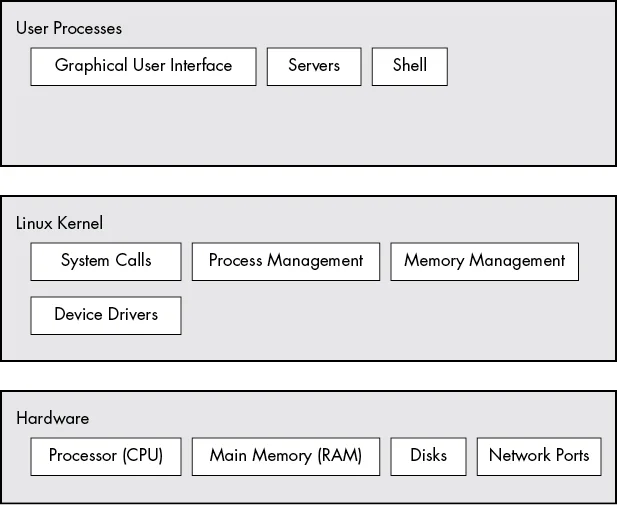

*图 1-1：Linux 系统的总体结构*

内核和用户进程的运行方式有一个关键区别：内核运行在*内核模式*，用户进程运行在*用户模式*。在内核模式下运行的代码可以不受限制地访问处理器和主内存。这是一项强大但危险的特权，因为内核也可能因此轻易破坏数据，甚至使整个系统崩溃。只有内核才能访问的内存区域称为*内核空间*。

相比之下，用户模式只能访问内存中（通常很小的）一部分区域，并且只能执行安全的 CPU 操作。*用户空间*指用户进程能够访问的主内存区域。如果某个进程出错并崩溃，影响通常是局部的，内核可以清理后续问题。因此，即使 Web 浏览器崩溃，也很可能不会影响后台已经运行数天的科学计算任务。

理论上，失控的用户进程无法对系统其他部分造成严重损害。但实际上，这取决于你如何定义“严重损害”，以及该进程拥有哪些权限，因为有些进程被允许执行更多操作。例如，用户进程能否彻底毁坏磁盘上的数据？只要权限足够，答案是能，而你大概会认为这相当危险。不过，系统有相应的防护措施，大多数进程并没有这样肆意破坏的权限。

> Linux 内核还可以运行*内核线程*。它们看起来很像进程，但能够访问内核空间，例如 `kthreadd` 和 `kblockd`。

### 1.2 硬件：理解主内存

在计算机系统的所有硬件中，*主内存*或许是最重要的。从最基本的层面看，主内存就是一个存放大量 0 和 1 的巨大存储区域。每个存放 0 或 1 的位置称为一个*位*（bit）。运行中的内核和进程都驻留在这里；它们本质上也是由大量位组成的。外围设备的所有输入和输出也以位的形式经过主内存。CPU 则负责操作内存：从内存读取指令和数据，再把数据写回内存。

谈到内存、进程、内核及计算机系统的其他部分时，你经常会听到*状态*（state）这个词。严格来说，状态就是位的一种特定排列。例如，假设内存中有四个位，那么 `0110`、`0001` 和 `1011` 就表示三种不同的状态。

一个进程在内存中很容易包含数百万个位，因此描述状态时通常使用抽象的说法更方便。我们不会逐位描述，而是说明某个对象已经做了什么或正在做什么。例如：“该进程正在等待输入”，或者“该进程正在执行启动过程的第二阶段”。

> 因为我们通常用抽象概念而非具体位来描述状态，所以*映像*（image）一词用来指位的一种特定物理排列。

### 1.3 内核

为什么要讨论主内存和状态？因为内核几乎所有工作都围绕主内存展开。内核的一项任务是将内存划分成许多区域，并持续维护这些区域的状态信息。每个进程都获得自己的内存份额，而内核必须确保进程只使用属于自己的部分。

内核负责管理系统的四个主要方面：

1. **进程：** 决定哪些进程可以使用 CPU。
2. **内存：** 跟踪全部内存，包括哪些已经分配给特定进程、哪些可能由多个进程共享，以及哪些仍然空闲。
3. **设备驱动程序：** 在磁盘等硬件与进程之间提供接口。操作硬件通常是内核的职责。
4. **系统调用与支持功能：** 进程通常通过系统调用与内核通信。

下面简要了解这些方面。

> 如果你希望深入了解内核的工作原理，可以参考两本优秀教材：Abraham Silberschatz、Peter B. Galvin 和 Greg Gagne 所著的 *Operating System Concepts* 第 10 版（Wiley，2018），以及 Andrew S. Tanenbaum 和 Herbert Bos 所著的 *Modern Operating Systems* 第 4 版（Prentice Hall，2014）。

#### 1.3.1 进程管理

*进程管理*包括进程的启动、暂停、恢复、调度和终止。启动和终止进程比较容易理解，但解释进程在正常运行时如何使用 CPU，就稍微复杂一些。

在任何现代操作系统中，许多进程看起来都在“同时”运行。例如，你可能在桌面计算机上同时打开浏览器和电子表格。但表面现象并不完全等于实际情况：这些应用背后的进程通常并不是在*完全相同的时刻*运行。

以单核 CPU 的系统为例。许多进程可能都*有资格*使用 CPU，但任意时刻实际上只有一个进程能够使用它。实际运行时，每个进程先占用 CPU 一小段时间，然后暂停；另一个进程再占用一小段时间，随后轮到下一个进程，如此循环。一个进程让出 CPU 控制权、由另一个进程接手的过程称为*上下文切换*（context switch）。

每一小段执行时间称为*时间片*（time slice）。时间片足以让进程完成相当数量的计算（实际上，进程经常在一个时间片内完成当前任务）。但由于时间片极短，人类无法察觉这种交替，于是系统看起来像是在同时运行多个进程。这种能力称为*多任务处理*（multitasking）。

上下文切换由内核负责。为了理解其工作方式，假设某个进程正在用户模式下运行，但它的时间片已经用完，接下来会发生以下步骤：

1. CPU（实际的硬件）根据内部计时器中断当前进程，切换到内核模式，并将控制权交还内核。
2. 内核记录 CPU 和内存的当前状态，以便之后恢复刚刚被中断的进程。
3. 内核处理上一个时间片期间出现的其他任务，例如收集输入和输出（I/O）操作的数据。
4. 内核准备运行另一个进程，检查就绪进程列表并选出一个进程。
5. 内核为新进程准备内存，然后配置 CPU。
6. 内核告知 CPU 新进程的时间片将持续多久。
7. 内核将 CPU 切换回用户模式，并把 CPU 控制权交给该进程。

上下文切换回答了一个重要问题：内核*什么时候*运行？答案是，内核会在上下文切换时，也就是不同进程的时间片之间运行。

对于如今常见的多 CPU 系统，情况稍微复杂一些：内核不必放弃当前 CPU 的控制权，就能让某个进程在另一个 CPU 上运行，而且多个进程确实可能同时执行。不过，为了充分利用所有 CPU，内核通常仍会执行上述步骤（有时还会使用一些技巧，为自己争取更多 CPU 时间）。

#### 1.3.2 内存管理

内核必须在上下文切换期间管理内存，这项工作可能非常复杂。系统需要满足以下条件：

- 内核必须拥有用户进程无法访问的专用内存区域。
- 每个用户进程都需要自己的内存区域。
- 一个用户进程不能访问其他进程的私有内存。
- 用户进程之间可以共享内存。
- 用户进程的部分内存可以设置为只读。
- 系统可以将磁盘空间用作辅助存储，从而使用超过实际物理内存容量的内存。

幸运的是，内核有硬件可以帮忙。现代 CPU 包含*内存管理单元*（memory management unit，MMU），支持一种称为*虚拟内存*的内存访问机制。使用虚拟内存时，进程不会直接按照硬件中的物理地址访问内存。相反，内核为每个进程建立一种环境，使它仿佛独占整台计算机。当进程访问内存时，MMU 会拦截该访问，并利用内存地址映射表，将进程视角中的地址转换为计算机中实际的物理内存地址。内核仍需负责初始化、持续维护和修改这个地址映射表。例如，在上下文切换时，内核必须把即将退出运行的进程的映射切换为即将运行的进程的映射。

> 内存地址映射的一种实现称为*页表*（page table）。

第 8 章将进一步介绍如何查看内存性能。

#### 1.3.3 设备驱动程序与设备管理

内核在设备管理方面的职责相对简单。设备通常只能在内核模式下访问，因为不当的访问（例如用户进程要求关闭电源）可能使计算机崩溃。一个显著的难点是：即使两个设备完成相同任务（例如两块不同的网卡），它们的编程接口也很少完全相同。因此，设备驱动程序传统上属于内核的一部分，并努力为用户进程提供统一的接口，以简化软件开发者的工作。

#### 1.3.4 系统调用与支持功能

内核还为用户进程提供其他类型的功能。例如，*系统调用*（system call，或 syscall）负责执行用户进程自身无法完成或难以完成的特定任务。打开、读取和写入文件都需要系统调用。

要理解进程如何启动，两个系统调用尤其重要：`fork()` 和 `exec()`。

1. **`fork()`：** 进程调用 `fork()` 时，内核会创建一个与原进程几乎完全相同的副本。
2. **`exec()`：** 进程调用 `exec(program)` 时，内核加载并启动 `program`，用它替换当前进程。

在 Linux 系统中，除了 init（见第 6 章）之外，*所有*新用户进程都由 `fork()` 产生。而在大多数情况下，系统还会调用 `exec()` 来启动一个新程序，而不只是继续运行现有进程的副本。一个简单例子是在命令行运行 `ls` 来列出目录内容。当你在终端输入 `ls` 时，终端内运行的 shell 会调用 `fork()` 创建自身的副本；新的 shell 副本再调用 `exec(ls)` 来运行 `ls`。[图 1-2](#figure1-2) 展示了启动 `ls` 这类程序时，进程与系统调用的执行流程。

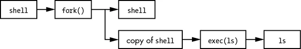

*图 1-2：启动新进程*

> 系统调用的名称通常带有括号。在[图 1-2](#figure1-2) 的示例中，请求内核创建新进程的进程必须执行 `fork()` 系统调用。这种写法来自 C 语言中的函数调用形式。理解本书不需要掌握 C 语言，只需记住系统调用是进程与内核之间的一种交互即可。此外，本书会对某些系统调用家族使用简化名称。例如，`exec()` 实际上代表一整组功能类似、编程接口略有不同的系统调用。进程还有一种称为*线程*的变体，第 8 章会进一步介绍。

除了传统的系统调用，内核还通过其他功能支持用户进程，其中最常见的是*伪设备*（pseudodevice）。从用户进程的角度看，伪设备像普通设备，但它完全由软件实现。严格来说，伪设备不一定必须由内核实现，不过出于实际需要，通常仍由内核提供。例如，如果把内核随机数生成器设备（*/dev/random*）放在用户进程中实现，就很难确保其安全性。

> 从技术上说，用户进程访问伪设备时仍然需要通过系统调用打开设备，因此进程并不能完全绕开系统调用。

### 1.4 用户空间

如前所述，内核分配给用户进程的主内存称为*用户空间*。由于进程本质上只是内存中的一种状态（或映像），用户空间也可以指所有运行中进程共同占用的内存。（你也可能听到比较口语化的 *userland* 一词；有时它还指运行在用户空间中的程序。）

Linux 系统中的大多数实际工作都发生在用户空间。从内核的角度看，所有进程基本上是平等的，但它们为用户执行的任务各不相同。用户进程所代表的系统组件可以粗略划分为几个服务层级。[图 1-3](#figure1-3) 展示了一组示例组件在 Linux 系统中的组合与交互方式。基础服务位于底层（最接近内核），工具性服务位于中间层，用户直接使用的应用程序位于顶层。图中只展示六个组件，因此是高度简化的示意图，但仍能看出：最上层组件（用户界面和 Web 浏览器）最接近用户；中间层包括供 Web 浏览器使用的域名缓存服务器；底层则包含几个更小的组件。

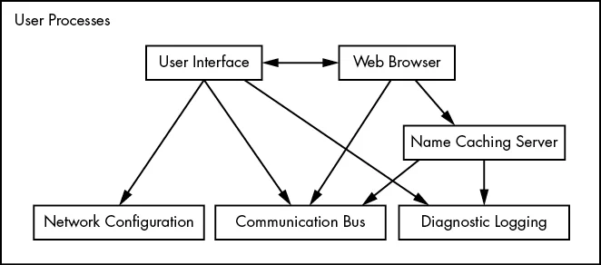

*图 1-3：进程类型及其交互*

底层通常由执行单一、简单任务的小组件构成。中间层包含邮件、打印和数据库服务等较大型组件。顶层组件则执行复杂任务，通常由用户直接控制。组件也会使用其他组件。一般而言，如果一个组件需要使用另一个组件，后者通常位于同一服务层级或更低的层级。

不过，[图 1-3](#figure1-3) 只是对用户空间结构的近似描述。实际上，用户空间并没有严格的层级规则。例如，大多数应用程序和服务都会写入称为*日志*（log）的诊断消息。许多程序使用标准 syslog 服务记录日志，但有些程序更愿意自己处理全部日志记录工作。

此外，一些用户空间组件也很难归类。例如，Web 服务器和数据库服务器这类服务端组件往往执行复杂任务，因此可以被视为高级应用程序，放在[图 1-3](#figure1-3) 的顶层。但用户应用程序也可能依赖这些服务器来完成自己不愿处理的任务，因此把它们放在中间层同样有道理。

### 1.5 用户

Linux 内核支持传统的 Unix 用户概念。*用户*是一种能够运行进程并拥有文件的实体。用户通常与*用户名*关联，例如系统中可能有一个名为 *billyjoe* 的用户。不过，内核并不管理用户名，而是通过简单的数字标识符——*用户 ID*（user ID）——来识别用户。（第 7 章将进一步说明用户名与用户 ID 的对应关系。）

用户存在的主要目的是支持权限管理和隔离。用户空间中的每个进程都有一个作为其*所有者*的用户，我们也说该进程*以该用户的身份运行*。用户可以在一定限制内终止或改变自己进程的行为，但不能干扰其他用户的进程。此外，用户可以拥有文件，并决定是否与其他用户共享这些文件。

Linux 系统通常不仅有对应真实使用者的用户，还包含许多其他用户。第 3 章将更详细地介绍这些用户，但最重要的是 *root*。root 用户是前述规则的例外：它可以终止或修改其他用户的进程，也可以访问本地系统上的任何文件。因此，root 被称为*超级用户*（superuser）。能够以 root 身份操作的人——也就是拥有 *root 权限*（root access）的人——在传统 Unix 系统中就是管理员。

> 以 root 身份操作可能很危险。系统会允许你做任何事情，即使这些操作会损害系统，因此错误往往难以发现和修复。为此，系统设计者一直努力减少必须使用 root 权限的场景。例如，在笔记本电脑上切换无线网络通常不再需要 root 权限。另外，尽管 root 用户权限极高，它仍运行在操作系统的*用户模式*，而不是内核模式。

*组*（group）是用户的集合。组的主要用途是让用户能够与同组的其他成员共享文件访问权限。

### 1.6 展望后续内容

到目前为止，你已经了解了一个*正在运行*的 Linux 系统由哪些部分组成。用户进程构成了你直接交互的环境；内核负责管理进程和硬件。内核和进程都驻留在内存中。

这些是很好的背景知识，但仅靠阅读还不足以掌握 Linux 系统的细节；你需要亲自动手实践。下一章将从用户空间的基础知识开始，引领你进一步探索。在此过程中，你还会接触本章没有讨论的 Linux 系统重要组成部分：长期存储（磁盘、文件等）。毕竟，程序和数据总得存放在某个地方。

---


## 第 2 章：基本命令与目录层次结构

本章介绍贯穿全书的 Unix 命令和实用工具。这些属于预备知识，你可能已经熟悉其中的大部分内容。即使你觉得自己已经掌握，也建议花一点时间浏览本章，确认没有遗漏，尤其是第 2.19 节有关目录层次结构的内容。

为什么要讲 Unix 命令？这不是一本介绍 Linux 工作原理的书吗？当然是，但 Linux 从根本上说属于 Unix 风格的操作系统。本章出现 *Unix* 一词的次数会多于 *Linux*，因为这里学到的知识可以直接应用于 BSD 和其他 Unix 风格的系统。我尽量避免介绍太多 Linux 特有的用户界面扩展：一方面，这有助于你打好使用其他操作系统的基础；另一方面，这些扩展往往不够稳定。掌握核心命令后，你就能更快地适应新版 Linux。此外，了解这些命令也能加深你对内核的理解，因为其中许多命令都与系统调用直接对应。

> 如果希望了解更多适合初学者的 Unix 知识，可以阅读《The Linux Command Line》第 2 版（No Starch Press，2019）、《UNIX for the Impatient》第 2 版（Addison-Wesley Professional，1995）和《Learning the UNIX Operating System》第 5 版（O’Reilly，2001）。

### 2.1 Bourne Shell：/bin/sh

Shell（命令解释器）是 Unix 系统最重要的组成部分之一。*Shell* 是一个执行命令的程序，例如用户在终端窗口中输入的命令。这些命令既可以是其他程序，也可以是 Shell 的内置功能。Shell 还是一个小型编程环境。Unix 程序员经常把常见任务拆分成较小的组件，再利用 Shell 管理任务并将它们组合起来。

系统中许多重要部分实际上都是 *Shell 脚本*，也就是包含一系列 Shell 命令的文本文件。如果你以前使用过 MS-DOS，可以把 Shell 脚本理解为功能强大得多的 *.BAT* 文件。由于 Shell 脚本十分重要，第 11 章将专门介绍它们。

随着阅读本书和不断练习，你会逐渐掌握更多通过 Shell 操作命令的技巧。Shell 的一大优点是：如果操作出错，你可以轻松查看自己输入了什么，找出问题所在，然后重新尝试。

Unix 有许多不同的 Shell，但它们都继承了 Bourne Shell（*/bin/sh*）的某些特性。Bourne Shell 是贝尔实验室为早期 Unix 开发的一种标准 Shell。正如你将在本书中看到的，每个 Unix 系统都需要某个版本的 Bourne Shell 才能正常运行。

Linux 使用一种增强版的 Bourne Shell，称为 `bash`，也叫“Bourne-again shell”。在大多数 Linux 发行版中，`bash` 是默认 Shell，而 Linux 系统中的 */bin/sh* 通常是指向 `bash` 的链接。运行本书示例时，应使用 `bash`。

> 如果你是在某个机构提供的 Unix 账户上学习本章，而你又不是系统管理员，那么默认 Shell 可能不是 `bash`。你可以使用 `chsh` 更改 Shell，或向系统管理员寻求帮助。

### 2.2 使用 Shell

安装 Linux 时，你应该至少创建一个普通用户作为自己的个人账户。学习本章时，请以这个普通用户身份登录。

#### 2.2.1 Shell 窗口

登录后，打开一个 Shell 窗口（通常称为*终端*）。如果使用 GNOME 或 KDE 等图形用户界面，最简单的方法就是打开终端应用程序，它会在新窗口中启动一个 Shell。打开后，窗口顶部通常会显示一个以美元符号（`$`）结尾的提示符。在 Ubuntu 中，提示符大致为 `name@host:path$`；在 Fedora 中，大致为 `[name@host path]$`。其中，`name` 是用户名，`host` 是计算机名，`path` 是当前工作目录（见第 2.4.1 节）。如果你熟悉 Windows，Shell 窗口看起来有些像 DOS 命令提示符；macOS 中的“终端”应用程序与 Linux 的 Shell 窗口基本相同。

本书包含许多需要在 Shell 提示符下输入的命令。示例中的命令都以一个 `$` 开头，用来表示 Shell 提示符。例如，输入下面的命令（只输入命令本身，不包括 `$`），然后按 Enter 键：

```bash
$ echo Hello there.
```

> 本书中的许多 Shell 命令以 `#` 开头。这表示应该以超级用户（root）身份执行，因此必须格外小心。最佳做法是通过 `sudo` 执行，以获得一定的保护，并留下可供日后排查错误的日志。第 2.20 节将介绍具体方法。

现在输入以下命令：

```bash
$ cat /etc/passwd
```

这个命令会显示系统信息文件 */etc/passwd* 的内容，然后重新出现 Shell 提示符。暂时不必关心这个文件的用途；第 7 章会详细介绍。

命令通常以要运行的程序名开头，后面可以跟随一些*参数*，用于告诉程序操作什么对象以及如何操作。这里的程序是 `cat`，唯一的参数是 `/etc/passwd`。许多参数属于*选项*，用于改变程序的默认行为，通常以连字符（`-`）开头。稍后介绍 `ls` 时你就会看到例子。不过，也有一些情况不遵循这种常见的命令结构，例如 Shell 内置命令以及临时设置环境变量的用法。

#### 2.2.2 cat

`cat` 是 Unix 中最容易理解的程序之一：它只是输出一个或多个文件或其他输入源的内容。`cat` 命令的一般语法如下：

```bash
$ cat file1 file2 ...
```

执行后，`cat` 会依次打印 `file1`、`file2` 以及你通过参数指定的其他文件（上例中的 `...` 表示还可以有更多文件），然后退出。它之所以叫 `cat`，是因为在输出多个文件时执行了拼接（concatenation）操作。`cat` 有许多用法；下面我们用它来探索 Unix 的输入与输出。

#### 2.2.3 标准输入与标准输出

Unix 进程通过 I/O *流*读取和写入数据。进程从输入流读取数据，向输出流写入数据。流非常灵活。例如，输入流的数据源可以是文件、设备、终端窗口，甚至另一个进程的输出流。

要观察输入流如何工作，可以输入不带任何参数的 `cat`，然后按 Enter。此时不会立即出现输出，也不会重新显示 Shell 提示符，因为 `cat` 仍在运行。接下来随意输入一些内容，每行末尾按 Enter。这样使用时，`cat` 会把你输入的每一行重复显示出来。玩够之后，在空白行上按 Ctrl-D，终止 `cat` 并返回 Shell 提示符。

这里 `cat` 会表现出交互行为，原因就在于流。当你没有指定输入文件名时，`cat` 读取的是 Linux 内核提供的*标准输入*流，而不是与文件相连的流。在这个例子中，标准输入连接到运行 `cat` 的终端。

> 在空白行按 Ctrl-D，会向终端当前的标准输入发送 EOF（文件结束）信号，通常也会使程序终止。不要把它与 Ctrl-C 混淆：Ctrl-C 通常会中断程序，而不管程序正在进行什么输入或输出。

*标准输出*与之类似。内核为每个进程提供一个标准输出流，进程可以向其中写入输出内容。`cat` 始终把输出写到标准输出。当你在终端中运行 `cat` 时，标准输出连接着该终端，因此输出就显示在那里。

标准输入和标准输出通常分别缩写为 *stdin* 和 *stdout*。许多命令的行为与 `cat` 相似：如果不指定输入文件，命令就从 stdin 读取数据。输出则略有不同。有些程序（如 `cat`）只向 stdout 发送输出，另一些程序则可以选择直接把输出写入文件。

还有第三种标准 I/O 流，称为*标准错误*，第 2.14.1 节会介绍它。

标准流最实用的特性之一，是可以轻松地改变数据的读取和写入位置，而不局限于终端。第 2.14 节将介绍如何操作标准流，特别是如何把流连接到文件和其他进程。

### 2.3 基本命令

现在来看更多 Unix 命令。下面的大多数程序都接受多个参数，有些程序的选项和使用形式多到没有必要在这里完整列出。因此，下面只是基本命令的简要介绍；目前你还不需要了解所有细节。

#### 2.3.1 ls

`ls` 命令用于列出目录内容。默认列出当前目录，但也可以把任意目录或文件作为参数，并且有许多实用选项。例如，`ls -l` 会显示详细的长格式列表，`ls -F` 则会显示文件类型信息。下面是一个长格式列表的示例，其中包括文件所有者（第 3 列）、所属组（第 4 列）、文件大小（第 5 列）以及修改日期和时间（位于第 5 列与文件名之间）：

```bash
$ ls -l
total 3616
-rw-r--r-- 1 juser users 3804    May 28 10:40  abusive.c
-rw-r--r-- 1 juser users 4165    Aug 13 10:01  battery.zip
-rw-r--r-- 1 juser users 131219  Aug 13 10:33  beav_1.40-13.tar.gz
-rw-r--r-- 1 juser users 6255    May 20 14:34  country.c
drwxr-xr-x 2 juser users 4096    Jul 17 20:00  cs335
-rwxr-xr-x 1 juser users 7108    Jun 16 13:05  dhry
-rw-r--r-- 1 juser users 11309   Aug 13 10:26  dhry.c
-rw-r--r-- 1 juser users 56      Jul  9 15:30  doit
drwxr-xr-x 6 juser users 4096    Feb 20 13:51  dw
drwxr-xr-x 3 juser users 4096    Jul  1 16:05  hough-stuff
```

第 2.17 节会进一步介绍输出中的第 1 列。第 2 列暂时可以忽略，它表示文件的硬链接数，第 4.6 节会解释。

#### 2.3.2 cp

`cp` 最基本的用途是复制文件。例如，要把 `file1` 复制为 `file2`，输入：

```bash
$ cp file1 file2
```

你也可以把文件复制到另一个目录，并在目标目录中保留原文件名：

```bash
$ cp file dir
```

如果要把多个文件复制到名为 `dir` 的目录中，可以像下面这样一次复制三个文件：

```bash
$ cp file1 file2 file3 dir
```

#### 2.3.3 mv

`mv`（移动）命令的用法与 `cp` 很相似。最简单的用途是重命名文件。例如，要把 `file1` 重命名为 `file2`，输入：

```bash
$ mv file1 file2
```

你也可以像使用 `cp` 一样，使用 `mv` 把文件移动到其他目录。

#### 2.3.4 touch

`touch` 命令可以创建文件。如果目标文件已经存在，`touch` 不会更改文件内容，但会更新文件的修改时间戳。例如，要创建一个空文件，输入：

```bash
$ touch file
```

接着对这个文件运行 `ls -l`。你应该会看到类似下面的输出，其中的日期和时间表示执行 `touch` 的时刻：

```bash
$ ls -l file
-rw-r--r-- 1 juser users 0  May 21 18:32  file
```

要观察时间戳更新，可以至少等待一分钟，再次执行同一条 `touch` 命令。随后 `ls -l` 显示的时间戳就会更新。

#### 2.3.5 rm

`rm` 命令用于删除文件。文件被删除后，通常就从系统中消失了；除非从备份恢复，否则一般无法撤销删除操作。

```bash
$ rm file
```

#### 2.3.6 echo

`echo` 命令把参数打印到标准输出：

```bash
$ echo Hello again.
Hello again.
```

`echo` 非常适合用来查看 Shell 的 glob 模式（例如 `*` 这样的“通配符”）以及变量（例如 `$HOME`）展开后的结果。本章稍后会介绍这些内容。

### 2.4 在目录之间导航

Unix 的目录层次结构从 */* 开始，它也称为*根目录*。目录分隔符是正斜杠（*/*），**不是**反斜杠（\）。根目录下有多个标准子目录，例如 */usr*；第 2.19 节会进一步介绍。

引用文件或目录时，需要指定一个*路径*（path 或 pathname）。如果路径以 */* 开头（例如 */usr/lib*），就称为*完整路径*或*绝对路径*。

由两个点（*..*）组成的路径部分表示父目录。例如，如果当前位于 */usr/lib*，那么 *..* 表示 */usr*；同样，*../bin* 表示 */usr/bin*。

一个点（*.*）表示当前目录。例如，如果你位于 */usr/lib*，那么 *.* 仍然表示 */usr/lib*，而 *./X11* 表示 */usr/lib/X11*。你不必经常使用 *.*，因为对于不以 */* 开头的路径，大多数命令默认从当前目录开始查找。因此，在前面的例子中，可以直接使用 *X11*，不必写成 *./X11*。

不以 */* 开头的路径称为*相对路径*。大多数时候你会使用相对路径，因为你通常已经位于目标目录或其附近。

了解目录的基本机制之后，下面介绍几个必备的目录命令。

#### 2.4.1 cd

*当前工作目录*是某个进程（例如 Shell）目前所在的目录。除了大多数 Linux 发行版的默认 Shell 提示符之外，你还可以使用第 2.5.3 节介绍的 `pwd` 命令查看当前目录。

每个进程都可以独立设置自己的当前工作目录。`cd` 命令用于更改 Shell 的当前工作目录：

```bash
$ cd dir
```

如果省略 `dir`，Shell 就会返回你的*主目录*（home directory），也就是最初登录时所在的目录。有些程序使用 `~` 符号（波浪号）作为主目录的缩写。

> `cd` 是 Shell 内置命令。它不能作为独立程序实现同样的功能，因为如果它作为子进程运行，通常无法更改父进程的当前工作目录。这个区别现在可能看起来并不重要，但有时了解这一点可以帮助你消除困惑。

#### 2.4.2 mkdir

`mkdir` 命令用于创建名为 `dir` 的新目录：

```bash
$ mkdir dir
```

#### 2.4.3 rmdir

`rmdir` 命令用于删除目录 `dir`：

```bash
$ rmdir dir
```

如果 `dir` 不是空目录，这个命令就会失败。不过，如果你不想费力地逐个删除 `dir` 中的文件和子目录，可以使用 `rm -r dir` 删除目录及其全部内容。但一定要小心！这是少数几种可能造成严重破坏的命令之一，尤其是在超级用户身份下执行时。`-r` 选项表示*递归删除*，即反复删除 `dir` 内的所有内容。不要将 `-r` 与星号（`*`）这样的 glob 模式搭配使用。最重要的是，执行命令前务必仔细检查。

#### 2.4.4 Shell glob 模式（“通配符”）

Shell 可以使用简单模式匹配文件名和目录名，这个过程称为 *globbing*，与其他系统中的通配符概念相似。最简单的 glob 字符是 `*`，表示匹配任意数量的任意字符。例如，下面的命令会打印当前目录中的文件列表：

```bash
$ echo *
```

Shell 会将包含 glob 模式的参数与文件名进行匹配，用匹配到的文件名替换原参数，然后执行修改后的命令行。这个替换过程称为*展开*（expansion），因为 Shell 会用所有匹配的文件名替换一个简短的表达式。下面是使用 `*` 展开文件名的几种方式：

- `at*` 展开为所有以 `at` 开头的文件名。
- `*at` 展开为所有以 `at` 结尾的文件名。
- `*at*` 展开为所有包含 `at` 的文件名。

如果没有文件与 glob 模式匹配，`bash` 就不会进行展开，而是把 `*` 等字符原样传给命令。例如，可以尝试 `echo *dfkdsafh`。

> 如果你习惯了 Windows 命令提示符，可能会下意识地输入 `*.*` 来匹配所有文件。现在就应该改掉这个习惯。在 Linux 和其他 Unix 系统中，应使用 `*` 匹配所有文件。在 Unix Shell 中，`*.*` 只匹配名称中包含点号（`.`）的文件和目录。Unix 文件名不要求具有扩展名，而且很多文件名确实没有扩展名。

另一个 Shell glob 字符是问号（`?`），它表示恰好匹配一个任意字符。例如，`b?at` 可以匹配 `boat` 和 `brat`。

如果不希望 Shell 展开命令中的 glob 模式，可以用单引号（`''`）将其括起来。例如，`echo '*'` 会输出一个星号。在下一节介绍的某些命令（如 `grep` 和 `find`）中，这种做法很有用。（第 11.2 节会更详细地介绍引号。）

> 请务必记住：Shell 只会在执行命令之前进行展开。如果 `*` 没有被展开，而是原样传到了命令中，Shell 就不会再对它做任何处理；接下来如何解释它，完全由该命令自行决定。


### 2.5 中级命令

本节介绍一些最重要的 Unix 中级命令。

#### 2.5.1 grep

`grep` 命令会输出文件或输入流中与指定表达式匹配的行。例如，要输出 */etc/passwd* 文件中包含 `root` 文本的行，可以输入：

```bash
$ grep root /etc/passwd
```

在同时处理多个文件时，`grep` 尤其方便，因为它除了输出匹配的行，还会输出文件名。例如，要检查 */etc* 目录下哪些文件包含 `root` 一词，可以使用：

```bash
$ grep root /etc/*
```

`grep` 最重要的两个选项是 `-i`（匹配时忽略大小写）和 `-v`（反转搜索结果，即输出所有*不*匹配的行）。此外还有功能更强的变体 `egrep`（它只是 `grep -E` 的另一种写法）。

`grep` 能识别*正则表达式*。正则表达式是一种具有计算机科学理论基础的模式，在 Unix 工具中十分常见。它比通配符式的模式更强大，而且语法也不同。关于正则表达式，需要记住三个要点：

- `.*` 匹配任意数量的字符，包括零个字符（类似于 glob 和通配符中的 `*`）。
- `.+` 匹配一个或多个任意字符。
- `.` 恰好匹配一个任意字符。

> `grep(1)` 手册页详细介绍了正则表达式，不过读起来可能有些困难。想进一步学习，可以阅读 Jeffrey E. F. Friedl 的《Mastering Regular Expressions》第 3 版（O’Reilly，2006），或 Tom Christensen 等人所著《Programming Perl》第 4 版（O’Reilly，2012）中的正则表达式章节。如果你喜欢数学，并且对正则表达式的起源感兴趣，可以查阅 Jeffrey Ullman 和 John Hopcroft 的《Introduction to Automata Theory, Languages, and Computation》第 3 版（Prentice Hall，2006）。

#### 2.5.2 less

当文件非常大，或者命令输出太长、内容已经滚动到屏幕上方看不到时，`less` 命令就很有用。

要分页查看 */usr/share/dict/words* 这样的大文件，可以运行 `less /usr/share/dict/words`。运行 `less` 后，文件内容会一次显示一屏。按空格键向前翻一屏，按小写的 `b` 向后翻一屏；按 `q` 退出。

> `less` 是较早的 `more` 程序的增强版本。Linux 桌面系统和服务器通常都有 `less`，但很多嵌入式系统及其他 Unix 系统并不把它作为标准工具。如果遇到无法使用 `less` 的情况，可以试试 `more`。

你还可以在 `less` 中搜索文本。例如，输入 `/word` 向前搜索某个词，输入 `?word` 向后搜索。找到匹配项后，按 `n` 继续搜索。

你将在 2.14 节学到，几乎所有程序的标准输出都可以直接发送到另一个程序的标准输入。当某条命令产生大量输出，而你想用 `less` 之类的工具查看时，这种方式尤其有用。下面的例子将 `grep` 的输出发送给 `less`：

```bash
$ grep ie /usr/share/dict/words | less
```

亲自试试这条命令。你很可能会发现 `less` 还有许多类似的用途。

#### 2.5.3 pwd

`pwd`（print working directory，打印工作目录）程序只做一件事：输出当前工作目录的名称。你可能会疑惑，既然大多数 Linux 发行版都把当前工作目录显示在命令提示符中，为什么还需要它？有两个原因。

首先，并不是所有命令提示符都会包含当前工作目录。尤其是你可能觉得它占用了太多空间，想把它从自己的提示符中去掉。这时就需要 `pwd`。

其次，你将在 2.17.2 节学到的符号链接，有时会掩盖当前工作目录的真实完整路径。使用 `pwd -P` 可以消除这种混淆。

#### 2.5.4 diff

要查看两个文本文件之间的差异，可以使用 `diff`：

```bash
$ diff file1 file2
```

可以通过多个选项控制输出格式。默认输出格式通常最便于人类理解。不过，当程序员需要把差异结果发送给其他人时，大多更喜欢 `diff -u` 的输出，因为自动化工具更容易处理这种格式。

#### 2.5.5 file

如果看到一个文件，却不确定它是什么格式，可以试试 `file` 命令，看看系统能否识别：

```bash
$ file file
```

这个看起来不起眼的命令所能做到的事情，可能会让你惊讶。

#### 2.5.6 find 和 locate

你明明知道某个文件就在某棵目录树里，却不知道具体位置，这种情况很令人沮丧。可以按以下方式运行 `find`，在 `dir` 中查找名为 `file` 的文件：

```bash
$ find dir -name file -print
```

与本节的大多数程序一样，`find` 也能完成一些相当复杂的操作。不过，在你熟记上面的形式，并理解为什么需要 `-name` 和 `-print` 选项之前，不要急着尝试 `-exec` 等选项。`find` 接受 `*` 之类的特殊模式匹配字符，但必须用单引号（`'*'`）把它们括起来，以免被 Shell 自身的 glob 展开功能处理。（回想 2.4.4 节：Shell 会在执行命令*之前*展开 glob 模式。）

大多数系统还提供 `locate` 命令来查找文件。`locate` 不会实时搜索文件，而是查询系统定期建立的索引。因此，`locate` 的搜索速度远快于 `find`；但如果要找的文件比索引更新，`locate` 就找不到它。

#### 2.5.7 head 和 tail

`head` 和 `tail` 命令可以让你快速查看文件或数据流的一部分。例如，`head /etc/passwd` 显示密码文件的前 10 行，`tail /etc/passwd` 显示最后 10 行。

要改变显示的行数，可以使用 `-n` 选项，其中 `n` 是想查看的行数（例如 `head -5 /etc/passwd`）。要从第 `n` 行开始输出，可以使用 `tail +n`。

#### 2.5.8 sort

`sort` 命令可以快速按照字母和数字顺序排列文本文件中的各行。如果每行以数字开头，而你希望按数值大小排序，可以使用 `-n` 选项。`-r` 选项则会反转排序顺序。

### 2.6 修改密码和 Shell

使用 `passwd` 命令修改密码。系统会要求你输入旧密码，然后提示你输入两次新密码。

好的密码通常是容易记住、但没有实际意义的长句子。密码越长（按字符数计算）通常越好；尽量使用 16 个或更多字符。（在很久以前，密码允许使用的字符数受到限制，因此人们常被建议加入各种奇怪的字符。）

你可以通过 `chsh` 命令更换 Shell（例如换成 `zsh`、`ksh` 或 `tcsh`）。但要记住，本书假设你使用的是 `bash`，所以如果更换了 Shell，书中的某些示例可能无法正常工作。

### 2.7 点文件

如果你还不在主目录中，先切换到主目录，输入 `ls` 看看里面有什么，再运行 `ls -a`。注意到输出有什么不同了吗？不加 `-a` 运行 `ls` 时，你看不到那些称为*点文件*（dot files）的配置文件。它们是名称以点号（`.`）开头的文件和目录。常见的点文件包括 *.bashrc* 和 *.login*，也有像 *.ssh* 这样的点目录。

点文件和点目录本身并没有什么特殊之处。有些程序默认不显示它们，只是为了避免列出主目录内容时显得杂乱。例如，`ls` 只有加上 `-a` 选项才会列出点文件。此外，Shell 的 glob 模式也不会匹配点文件，除非你明确使用 `.*` 这样的模式。

> 使用 glob 模式时可能遇到一个问题：`.*` 也会匹配 `.` 和 `..`（分别表示当前目录和父目录）。如果想匹配除当前目录和父目录以外的所有点文件，可以考虑使用 `.[^.]*` 或 `.??*` 这样的模式。

### 2.8 环境变量与 Shell 变量

Shell 可以保存临时变量，称为 *Shell 变量*，其中存放文本字符串的值。Shell 变量非常适合在脚本中记录各种值，有些变量还会控制 Shell 的行为。（例如，`bash` 在显示命令提示符之前会读取 `PS1` 变量。）

要给 Shell 变量赋值，可以使用等号（`=`）。下面是一个简单的例子：

```bash
$ STUFF=blah
```

这个例子把名为 `STUFF` 的变量设置为 `blah`。要访问该变量，可以使用 `$STUFF`（例如，试着运行 `echo $STUFF`）。你将在第 11 章进一步了解 Shell 变量的各种用途。

> 给变量赋值时，`=` 两边不要加空格。

*环境变量*与 Shell 变量类似，但它并不局限于 Shell。Unix 系统上的所有进程都有存储环境变量的空间。两者最主要的区别是：操作系统会把 Shell 的所有环境变量传递给它所启动的程序，而普通 Shell 变量无法被这些程序访问。

可以使用 Shell 的 `export` 命令设置环境变量。例如，如果想把 Shell 变量 `$STUFF` 变成环境变量，可以这样做：

```bash
$ STUFF=blah
$ export STUFF
```

由于子进程会继承父进程的环境变量，许多程序会读取它们来获取配置和选项。例如，你可以把自己喜欢的 `less` 命令行选项放入 `LESS` 环境变量，之后运行 `less` 时它就会使用这些选项。（许多手册页都有一个名为 ENVIRONMENT 的章节，用来介绍相关环境变量。）

### 2.9 命令搜索路径

`PATH` 是一个特殊的环境变量，其中包含*命令搜索路径*（command path，简称 path），也就是 Shell 在查找命令时要搜索的一组系统目录。例如，运行 `ls` 时，Shell 会在 `PATH` 列出的目录中寻找 `ls` 程序。如果路径中的多个目录都存在同名程序，Shell 会运行第一个找到的程序。

运行 `echo $PATH`，你会看到各个路径组成部分之间用冒号（`:`）分隔。例如：

```bash
$ echo $PATH
/usr/local/bin:/usr/bin:/bin
```

如果想让 Shell 在更多位置寻找程序，可以修改 `PATH` 环境变量。例如，下面这条命令会把目录 `dir` 加到搜索路径的开头，让 Shell 先搜索 `dir`，再搜索 `PATH` 中的其他目录：

```bash
$ PATH=dir:$PATH
```

也可以把目录名追加到 `PATH` 变量的末尾，让 Shell 最后才搜索 `dir`：

```bash
$ PATH=$PATH:dir
```

> 修改搜索路径时，如果不小心把 `$PATH` 输错了，就可能意外清空整个路径。不过不必惊慌！这种影响不是永久性的；重新启动一个 Shell 即可恢复。（只有在编辑某个配置文件时也写错，才可能产生持续影响；即便如此，修复起来也不困难。）恢复正常状态最简单的方法，就是关闭当前终端窗口，再打开一个新的。


### 2.10 特殊字符

与他人讨论 Linux 时，你应该知道一些常见特殊字符的名称。如果你对这类事情感兴趣，可以看看“黑客术语文件”（Jargon File，*http://www.catb.org/jargon/html/*），或者它的纸质配套读物——Eric S. Raymond 所著的 *The New Hacker’s Dictionary* 第 3 版（MIT Press，1996 年）。

[表 2-1](#table2-1) 列出了一些特殊字符，其中许多你在本章前面已经见过。某些工具（例如 Perl 编程语言）几乎会用到这里列出的所有特殊字符！（请注意，表中的名称是这些字符在美国的叫法。）

**表 2-1：特殊字符**

| 字符 | 名称 | 用途 |
| --- | --- | --- |
| `*` | star、asterisk（星号） | 正则表达式、通配符匹配字符 |
| `.` | dot（点号） | 当前目录、文件名或主机名中的分隔符 |
| `!` | bang（感叹号） | 取反、命令历史 |
| `|` | pipe（管道符） | 命令管道 |
| `/` | (forward) slash（正斜杠） | 目录分隔符、搜索命令 |
| `\` | backslash（反斜杠） | 字面字符、宏（*绝不*用于分隔目录） |
| `$` | dollar（美元符号） | 变量、行尾 |
| `'` | tick、(single) quote（单引号） | 字面字符串 |
| `` ` `` | backtick、backquote（反引号） | 命令替换 |
| `"` | double quote（双引号） | 部分按字面解释的字符串 |
| `^` | caret（脱字符） | 取反、行首 |
| `~` | tilde、squiggle（波浪号） | 取反、目录快捷表示 |
| `#` | hash、sharp、pound（井号） | 注释、预处理器、替换 |
| `[ ]` | (square) brackets（方括号） | 范围 |
| `{ }` | braces、(curly) brackets（花括号） | 语句块、范围 |
| `_` | underscore、under（下划线） | 在不希望或不允许使用空格时，或者自动补全算法会因空格而混淆时，作为空格的简便替代符号 |

> 你经常会看到用脱字符表示控制字符的写法，例如用 ^C 表示 ctrl-C。

### 2.11 命令行编辑

在使用 Shell 的过程中，你会发现可以用左右方向键编辑命令行，也可以用上下方向键浏览之前输入的命令。大多数 Linux 系统都支持这些标准操作。

不过，最好还是忘掉方向键，改用 Ctrl 组合键。如果掌握了[表 2-2](#table2-2) 中列出的按键，你就能更熟练地在许多采用这些标准按键的 Unix 程序中输入文本。

**表 2-2：命令行快捷键**

| 按键 | 操作 |
| --- | --- |
| ctrl-B | 将光标向左移动 |
| ctrl-F | 将光标向右移动 |
| ctrl-P | 查看上一条命令（或将光标上移） |
| ctrl-N | 查看下一条命令（或将光标下移） |
| ctrl-A | 将光标移到行首 |
| ctrl-E | 将光标移到行尾 |
| ctrl-W | 删除光标前的一个单词 |
| ctrl-U | 删除从光标位置到行首的内容 |
| ctrl-K | 删除从光标位置到行尾的内容 |
| ctrl-Y | 粘贴刚刚删除的文本（例如通过 ctrl-U 删除的文本） |

### 2.12 文本编辑器

说到编辑，现在该学习一种编辑器了。要认真使用 Unix，就必须能够编辑文本文件而不损坏它们。系统的大部分组件都使用纯文本配置文件（例如 */etc* 目录中的文件）。编辑文件本身并不困难，但你会频繁地进行这项工作，因此需要一个功能强大的工具。

你应该尝试学习两种事实上的 Unix 标准文本编辑器之一：vi 或 Emacs。大多数 Unix 高手对自己选用的编辑器都有近乎宗教般的热情，但不必听他们的。自己选择就好。如果选中的编辑器符合你的工作方式，学起来就会更容易。基本上，可以这样选择：

- 如果你想要一款几乎无所不能、提供丰富在线帮助的编辑器，而且不介意为了使用这些功能多敲一些键，就试试 Emacs。
- 如果速度高于一切，就试试 vi；它用起来有点像在玩电子游戏。

Arnold Robbins、Elbert Hannah 和 Linda Lamb 合著的 *Learning the vi and Vim Editors: Unix Text Processing* 第 7 版（O’Reilly，2008 年）涵盖了你需要了解的所有 vi 知识。对于 Emacs，可以使用它的在线教程：启动 Emacs，按 ctrl-H，然后输入 T。你也可以阅读 Richard M. Stallman 所著的 *GNU Emacs Manual* 第 18 版（Free Software Foundation，2018 年）。

刚开始时，你可能想试试更容易上手的编辑器，例如 nano、Pico，或者众多图形界面编辑器中的某一款。但如果你习惯于一直使用最先接触的工具，那么最好不要走这条路。

> 编辑文本是你第一次明显感受到终端与图形用户界面（GUI）差异的地方。vi 等编辑器运行在终端窗口内部，使用标准终端输入输出接口。GUI 编辑器则会打开自己的窗口，提供独立于终端的界面。Emacs 默认以 GUI 方式运行，但也可以在终端窗口中运行。

### 2.13 获取在线帮助

Linux 系统附带了大量文档。对于基本命令，手册页（manual pages，简称 *man pages*）通常就能提供你需要的信息。例如，要查看 `ls` 命令的手册页，可以这样运行 `man`：

```bash
$ man ls
```

大多数手册页主要提供参考信息，可能还会附带一些示例和交叉引用，但通常也就到此为止。不要指望它是一篇教程，更不要期待它的文风引人入胜。

如果某个程序有许多选项，手册页通常会按某种系统化的方式列出这些选项（例如按字母顺序），却不会告诉你哪些选项最重要。如果你有耐心，通常能从手册页中找到所需信息。如果你没耐心，那就问朋友——或者花钱请个人当你的朋友，好让你向他提问。

要通过关键字搜索手册页，可以使用 `-k` 选项：

```bash
$ man -k keyword
```

当你不太确定自己需要的命令叫什么时，这个功能很有用。例如，如果你在寻找一个用于排序的命令，可以运行：

```bash
$ man -k sort
--snip--
comm (1) - compare two sorted files line by line
qsort (3) - sorts an array
sort (1) - sort lines of text files
sortm (1) - sort messages
tsort (1) - perform topological sort
--snip--
```

输出中包含手册页名称、手册所属的章节编号（见下文），以及对手册内容的简短说明。

> 如果你对前面几节介绍的命令有疑问，使用 `man` 命令可能就能找到答案。

手册页按数字划分章节。人们引用某个手册页时，通常会在名称后面的括号中注明章节编号，例如 ping(8)。[表 2-3](#table2-3) 列出了这些章节及其编号。

**表 2-3：在线手册章节**

| 章节 | 说明 |
| --- | --- |
| 1 | 用户命令 |
| 2 | 内核系统调用 |
| 3 | 较高层次的 Unix 编程库文档 |
| 4 | 设备接口和驱动程序信息 |
| 5 | 文件说明（系统配置文件） |
| 6 | 游戏 |
| 7 | 文件格式、约定和编码（ASCII、文件后缀等） |
| 8 | 系统命令和服务器 |

第 1、5、7 和 8 节的手册可以很好地补充本书的内容。第 4 节可能只有有限的帮助；如果第 6 节的内容再多一些，那就太好了。如果你不是程序员，大概用不上第 3 节；但读完本书后面关于系统调用的内容后，你也许就能理解第 2 节中的一些资料。

某些常见名称会在多个手册章节中对应不同的页面。默认情况下，`man` 会显示找到的第一个页面。你也可以指定章节。例如，要阅读 */etc/passwd* 文件的说明（而不是 `passwd` 命令的说明），可以在页面名称前加上章节编号：

```bash
$ man 5 passwd
```

手册页涵盖了基本内容，但获取在线帮助的方法还有很多（这里暂且不算互联网搜索）。如果你只想查找某个命令的特定选项，可以尝试在命令名后面加上 `--help` 或 `-h`（具体使用哪个选项因命令而异）。你可能会看到铺天盖地的输出（例如 `ls --help`），也可能恰好找到想要的信息。

前些年，GNU 项目认为手册页不太合它的心意，于是转而采用另一种称为 *info*（或 *texinfo*）的格式。这类文档通常比一般的手册页更深入，但也可能更复杂。要查看 info 手册，可以在 `info` 后面加上命令名称：

```bash
$ info command
```

如果你不喜欢 `info` 阅读器，也可以将输出传给 `less`（只需在后面加上 `| less`）。

有些软件包完全不理会 `man` 或 `info` 之类的在线手册系统，而是直接把提供的文档放到 */usr/share/doc* 中。如果你正在寻找文档，不妨查看系统上的这个目录——当然，也别忘了搜索互联网。


### 2.14 Shell 输入与输出

现在你已经熟悉了基本的 Unix 命令、文件和目录，可以开始学习如何重定向标准输入和标准输出了。我们先从标准输出说起。

要将 `command` 的输出发送到文件而不是终端，可以使用重定向字符 `>`：

```bash
$ command > file
```

如果 `file` 不存在，Shell 就会创建它。如果 `file` 已经存在，Shell 会先清除（*clobber*，即覆盖）原文件的内容。（某些 Shell 提供了防止覆盖的设置。例如，在 `bash` 中输入 `set -C`，就可以避免覆盖已有文件。）

如果不想覆盖文件，而是希望将输出追加到文件末尾，可以使用 `>>` 重定向语法：

```bash
$ command >> file
```

当你连续执行一组相关命令，希望将它们的输出收集到同一个地方时，这种方式非常方便。

要把一个命令的标准输出发送给另一个命令作为标准输入，可以使用管道字符（`|`）。试试下面两个命令，看看它是如何工作的：

```bash
$ head /proc/cpuinfo
$ head /proc/cpuinfo | tr a-z A-Z
```

你可以让输出依次经过任意多个通过管道连接的命令；每增加一个命令，只需在它前面再加一个管道符即可。

#### 2.14.1 标准错误

有时，你已经重定向了标准输出，却发现程序仍然会在终端上打印一些内容。这些内容来自*标准错误*（standard error，stderr），它是一个额外的输出流，用于诊断和调试。例如，下面的命令会产生错误：

```bash
$ ls /fffffffff > f
```

命令执行完后，文件 *f* 应该是空的，但终端上仍会显示下面这条通过标准错误输出的消息：

```
ls: cannot access /fffffffff: No such file or directory
```

如果需要，也可以重定向标准错误。例如，要把标准输出发送到 *f*，把标准错误发送到 *e*，可以使用 `2>` 语法：

```bash
$ ls /fffffffff > f 2> e
```

数字 2 指定了 Shell 要修改的*流 ID*（stream ID）。流 ID 1 代表标准输出（默认值），流 ID 2 代表标准错误。

你也可以使用 `>&` 记法，将标准错误发送到与标准输出相同的位置。例如，要把标准输出和标准错误都发送到名为 *f* 的文件，可以试试：

```bash
$ ls /fffffffff > f 2>&1
```

#### 2.14.2 标准输入重定向

要把文件内容送入程序的标准输入，可以使用 `<` 运算符：

```bash
$ head < /proc/cpuinfo
```

偶尔你会遇到必须使用这种重定向方式的程序。不过，大多数 Unix 命令都接受文件名作为参数，因此这种用法并不十分常见。例如，上面的命令也可以写成 `head /proc/cpuinfo`。

### 2.15 理解错误消息

在 Linux 这样的类 Unix 系统上遇到问题时，你*必须*阅读错误消息。与其他操作系统的消息不同，Unix 的错误消息通常会准确告诉你哪里出了问题。

#### 2.15.1 Unix 错误消息的组成

大多数 Unix 程序生成和报告的基本错误消息都相同，不过不同程序的输出可能存在细微差异。下面是一个你几乎肯定会以某种形式遇到的例子：

```bash
$ ls /dsafsda
ls: cannot access /dsafsda: No such file or directory
```

这条消息包含三个部分：

- 程序名称 `ls`。有些程序会省略这项标识信息。编写 Shell 脚本时，这可能有点烦人，但通常不是什么大问题。
- 文件名 `/dsafsda`。这是更具体的信息，说明这个路径存在问题。
- 错误内容 `No such file or directory`，指出文件名对应的问题是什么。

把这些信息合起来，意思就是：“`ls` 试图打开 `/dsafsda`，但因为它不存在，所以无法打开。”这看起来很直观；不过，如果你运行的 Shell 脚本中包含一条以其他名称执行的错误命令，这类消息就可能让人有些困惑。

排查错误时，始终先处理出现的第一条错误。有些程序在报告自己无法继续工作之后，还会接连报告大量其他问题。例如，假设你运行了一个虚构的程序 `scumd`，看到了这条错误消息：

```
scumd: cannot access /etc/scumd/config: No such file or directory
```

紧接着又出现一大串其他错误消息，看上去简直像发生了灾难。不要被后面的错误分散注意力。你很可能只需要创建 */etc/scumd/config* 即可。

> 不要把错误消息和警告消息混为一谈。警告通常看起来像错误，但其中会包含 `warning` 一词。警告通常意味着某个地方出了问题，不过程序仍会尝试继续运行。要解决警告指出的问题，有时你必须先找到某个进程并将其终止，才能进行其他操作。（第 2.16 节将介绍如何列出和终止进程。）

#### 2.15.2 常见错误

你在 Unix 程序中遇到的许多错误，都与文件和进程可能出现的问题有关。其中不少错误直接来自内核系统调用遇到的状况。因此，通过观察这些错误，你可以了解内核是如何将问题反馈给进程的。

##### No such file or directory（没有那个文件或目录）

这是最常见的错误，表示你试图访问一个不存在的文件。由于 Unix 的文件 I/O 系统并不严格区分文件和目录，因此这条错误消息适用于两种情况。无论是尝试读取不存在的文件、切换到不存在的目录，还是向一个不存在的目录中的文件写入内容，都可能遇到它。这个错误也称为 ENOENT，是 “Error NO ENTity” 的缩写。

> 如果你对系统调用感兴趣，这通常是 `open()` 返回 ENOENT 的结果。有关该系统调用可能遇到的错误，请参阅 open(2) 手册页。

##### File exists（文件已存在）

这种情况下，你很可能试图创建一个已经存在的文件。例如，尝试创建一个与现有文件同名的目录时，就经常会遇到这个错误。

##### Not a directory、Is a directory（不是目录、是一个目录）

当你试图把文件当作目录使用，或者把目录当作文件使用时，就会出现这些消息。例如：

```bash
$ touch a
$ touch a/b
touch: a/b: Not a directory
```

注意，这条错误消息实际上只针对 `a/b` 路径中的 `a` 部分。遇到这个问题时，你可能需要稍加排查，找出路径中哪个组成部分被当成了目录。

##### No space left on device（设备上没有剩余空间）

磁盘空间已经用完了。

##### Permission denied（权限被拒绝）

当你尝试读取或写入一个自己无权访问的文件或目录时（即权限不足），就会出现这个错误。即使你能够读取某个文件，只要它没有设置可执行权限位，在尝试执行它时也会出现这条错误消息。第 2.17 节将进一步介绍权限。

##### Operation not permitted（不允许的操作）

这种错误通常出现在你尝试终止一个不属于自己的进程时。

##### Segmentation fault、Bus error（段错误、总线错误）

*段错误*（segmentation fault）基本上意味着你刚运行的程序在编写时出了某种差错。程序试图访问一块不允许它访问的内存，因此操作系统终止了它。类似地，*总线错误*（bus error）表示程序以不应当采用的方式访问了某块内存。遇到这些错误时，也有可能是你向程序提供了它未曾预料到的输入。在极少数情况下，原因也可能是内存硬件故障。


### 2.16 列出和操作进程

回想第 1 章，进程就是正在运行的程序。系统中的每个进程都有一个数字形式的*进程 ID*（*PID*）。如果想快速列出正在运行的进程，只需在命令行执行 `ps`。你应该会看到类似下面的列表：

```bash
$ ps
  PID TTY STAT TIME COMMAND
  520 p0  S    0:00 -bash
  545  ?  S    3:59 /usr/X11R6/bin/ctwm -W
  548  ?  S    0:10 xclock -geometry -0-0
 2159 pd  SW   0:00 /usr/bin/vi lib/addresses
31956 p3  R    0:00 ps
```

各字段的含义如下：

1. `PID`：进程 ID。
2. `TTY`：进程运行所在的终端设备。后面会详细介绍。
3. `STAT`：进程状态，即进程正在做什么，以及它的内存位于何处。例如，`S` 表示休眠，`R` 表示运行。（所有状态符号的说明请参阅 ps(1) 手册页。）
4. `TIME`：进程到目前为止使用的 CPU 时间，以分和秒表示。换句话说，这是进程在处理器上执行指令所花费的总时间。请记住，进程并不是持续运行的，因此这个数值不同于进程启动以来经过的时间（即“墙上时钟时间”，wall-clock time）。
5. `COMMAND`：看起来显而易见，它表示用于启动程序的命令。但要注意，进程可以修改这个字段，使它不再是最初的值。此外，Shell 可能执行通配符展开，因此这里显示的可能是展开后的命令，而不是你在提示符下输入的原始内容。

> 系统中同时运行的每个进程都有唯一的 PID。不过，进程结束之后，内核最终可以把它的 PID 重新分配给新进程。

#### 2.16.1 ps 命令选项

`ps` 命令有很多选项。更令人困惑的是，指定选项还有三种不同风格：Unix、BSD 和 GNU。许多人觉得 BSD 风格用起来最顺手（也许是因为输入的字符更少），所以本书采用这种风格。下面是一些最有用的选项组合：

1. `ps x`：显示属于你的所有正在运行的进程。
2. `ps ax`：显示系统中的所有进程，而不只是你拥有的进程。
3. `ps u`：显示更详细的进程信息。
4. `ps w`：显示完整的命令名称，而不局限于一行能够容纳的长度。

和其他程序一样，这些选项可以组合使用，例如 `ps aux` 和 `ps auxw`。

要查看某个特定进程，可以把它的 PID 添加到 `ps` 命令的参数列表中。例如，要检查当前 Shell 进程，可以使用 `ps u $$`（`$$` 是一个 Shell 变量，其值为当前 Shell 的 PID）。第 8 章会介绍管理命令 `top` 和 `lsof`。即使你并不是在进行系统维护，它们也能帮助你查找进程。

#### 2.16.2 终止进程

要终止进程，可以使用 `kill` 命令向它发送一个*信号*——由内核传递给进程的消息。大多数情况下，只需要执行：

```bash
$ kill pid
```

信号有很多种。默认信号（即上面命令使用的信号）是 `TERM`，表示终止。你可以为 `kill` 添加额外选项，以发送其他信号。例如，如果想冻结进程而不是终止它，可以使用 `STOP` 信号：

```bash
$ kill -STOP pid
```

被停止的进程仍然保留在内存中，随时可以从中断处继续执行。使用 `CONT` 信号可以让进程恢复运行：

```bash
$ kill -CONT pid
```

> 在当前终端中按 ctrl-C 终止正在运行的进程，相当于使用 `kill` 向该进程发送 `INT`（中断）信号。

对于大多数信号，内核会通过*信号处理程序*（signal handler）机制，让进程有机会执行必要的清理工作。然而，有些进程收到信号后可能选择不终止，也可能在处理信号时陷入僵局，或者干脆忽略信号。因此，即使你尝试终止某个进程，它也可能仍在运行。如果发生这种情况，而且你确实必须结束该进程，那么最强硬的方式就是发送 `KILL` 信号。与其他信号不同，`KILL` 不能被忽略；事实上，操作系统甚至不会给进程任何处理机会。内核会直接终止进程，并强制将其从内存中移除。只有在万不得已时才应使用这种方法。

不要不加区别地终止进程，尤其是在你不知道它们正在做什么的时候。这样做可能反过来给自己造成麻烦。

你可能看到其他用户在 `kill` 命令中使用数字而不是信号名称，例如使用 `kill -9` 而不是 `kill -KILL`。这是因为内核用数字来标识不同的信号。如果知道要发送的信号编号，也可以采用这种写法。运行 `kill -l` 可以查看信号编号与名称之间的对应关系。

#### 2.16.3 作业控制

Shell 支持*作业控制*（job control）：通过不同的按键组合和命令，向程序发送 `TSTP`（类似于 `STOP`）和 `CONT` 信号。这使你能够暂停正在使用的程序，并在程序之间切换。例如，按 ctrl-Z 可以发送 `TSTP` 信号，之后输入 `fg`（将作业带回前台）或 `bg`（将作业移到后台；参见下一节）就可以让进程重新运行。

尽管作业控制很实用，而且许多有经验的用户习惯使用它，但它并非必需，对初学者来说还可能造成困惑。用户经常误按 ctrl-Z 而不是 ctrl-C，随后忘记自己之前运行了什么，最终留下大量处于暂停状态的进程。

> 要检查是否意外暂停了当前终端中的某些进程，可以运行 `jobs` 命令。

如果想同时运行多个程序，可以让每个程序在单独的终端窗口中运行，将非交互式进程放到后台（下一节会介绍），并学习使用 `screen` 和 `tmux` 工具。

#### 2.16.4 后台进程

通常，从 Shell 运行 Unix 命令时，在程序执行完毕之前，你不会重新看到 Shell 提示符。不过，可以使用与号（`&`）让进程脱离 Shell 的前台执行状态，将其放到“后台”，这样提示符就会立即返回。例如，如果有一个很大的文件需要使用 `gunzip` 解压（第 2.18 节会介绍），同时又想做其他事情，可以运行：

```bash
$ gunzip file.gz &
```

Shell 应该会打印新后台进程的 PID，然后立即返回提示符，让你继续工作。如果进程需要运行很长时间，它甚至可能在你退出登录之后继续运行。对于需要大量数值计算的程序，这一点尤其方便。如果进程在你退出登录或关闭终端窗口之前结束，Shell 通常会根据当前配置向你发出通知。

> 如果你正在远程访问一台计算机，并希望退出登录后程序仍继续运行，可能需要使用 `nohup` 命令；详情请参阅它的手册页。

在后台运行进程也有不利的一面：进程可能希望使用标准输入（更糟的是，可能直接从终端读取内容）。如果后台程序尝试从标准输入读取数据，它可能会停住（可尝试使用 `fg` 将它带回前台），也可能直接终止。此外，如果程序向标准输出或标准错误输出写入内容，这些输出可能不顾终端中正在进行的其他操作，直接出现在终端窗口里。也就是说，你在处理其他事情时，可能突然看到意料之外的输出。

确保后台进程不打扰你的最佳方法，是按照第 2.14 节介绍的方式重定向它的输出（必要时也重定向输入）。

如果后台进程产生的意外输出妨碍了操作，可以学习如何重新绘制终端窗口的内容。`bash` Shell 和大多数全屏交互式程序都支持通过 ctrl-L 重绘整个屏幕。如果程序正在读取标准输入，ctrl-R 通常可以重绘当前行；但在不恰当的时候按下错误的组合键，可能让情况变得更糟。例如，在 `bash` 提示符下按 ctrl-R 会进入反向增量搜索模式（reverse isearch）；按 esc 可以退出。


### 2.17 文件模式与权限

每个 Unix 文件都有一组*权限*，用于决定你能否读取、写入或运行该文件。运行 `ls -l` 就可以查看权限。下面是一个输出示例：

```
-rw-r--r--1 1 juser somegroup 7041  Mar 26 19:34  endnotes.html
```

文件的*模式*（mode）1 表示文件权限以及一些额外信息。模式由四个部分组成，如[图 2-1](#figure2-1) 所示。

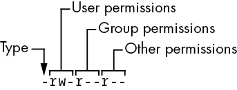

*图 2-1：文件模式的各个部分*

模式的第一个字符表示*文件类型*。像示例中那样，这个位置上的短横线（`-`）表示*普通文件*，也就是说，这个文件没有什么特殊之处，只包含二进制数据或文本数据。这是最常见的文件类型。目录也很常见，其文件类型位置用 `d` 表示。（其他文件类型见 3.1 节。）

文件模式的其余部分表示权限，按顺序分为三组：*用户*（user）、*组*（group）和*其他用户*（other）。例如，示例中的 `rw-` 是用户权限，接下来的 `r--` 是组权限，最后的 `r--` 是其他用户权限。

每组权限都可能出现以下四种基本符号：

- `r` 表示文件可读。
- `w` 表示文件可写。
- `x` 表示文件可执行（可以作为程序运行）。
- `-` 表示“无”（更准确地说，该组中对应位置的权限未被授予）。

用户权限（第一组）适用于文件的所有者。在前面的示例中，所有者是 `juser`。第二组是组权限，适用于文件所属的组（示例中为 `somegroup`）。该组中的任何用户都可以使用这些权限。（使用 `groups` 命令可以查看自己所属的组；更多信息见 7.3.5 节。）

系统上的其他所有用户则按照第三组权限访问文件。这组权限有时也称为 *world* 权限。

> 
>
> 每个读、写、执行权限位置有时也称为一个*权限位*（permission bit），因为操作系统在底层用一串二进制位表示这些权限。因此，你可能会听到有人把权限的一部分称为“读取位”。

有些可执行文件在用户权限的位置上显示 `s`，而不是 `x`。这表示该可执行文件设置了 *setuid*：执行这个程序时，它会以文件所有者的身份运行，而不是以执行者的身份运行。许多程序利用 setuid 位以 root 身份运行，从而获得修改系统文件所需的权限。`passwd` 程序就是一个例子，因为它需要修改 */etc/passwd* 文件。

#### 2.17.1 修改权限

要修改文件或目录的权限，可以使用 `chmod` 命令。首先选择要修改哪一组权限，然后选择要修改哪个权限位。例如，要为 `file` 增加组（`g`）和其他用户（`o`，即 other）的读取（`r`）权限，可以执行以下两个命令：

```bash
$ chmod g+r file
$ chmod o+r file
```

也可以一次完成：

```bash
$ chmod go+r file
```

要移除这些权限，将 `go+r` 换成 `go-r` 即可。

> 
>
> 显然，你不应该把文件设置成所有用户都可写，因为这会允许系统上的任何人修改它们。但这是否也意味着互联网上的任何人都能修改这些文件？通常不会，除非你的系统存在网络安全漏洞。如果真是这样，文件权限也帮不了你。

有时你会看到人们用数字修改权限，例如：

```bash
$ chmod 644 file
```

这称为*绝对式*修改，因为它会一次设置*所有*权限位。要理解其原理，你需要知道如何用八进制表示权限位（每个数字都是一个 0 到 7 的八进制数，对应一组权限）。更多信息请参阅 chmod(1) 手册页或 info 手册。

如果你喜欢使用绝对式权限，其实不一定需要掌握如何推导每一种模式；只要记住最常用的模式即可。[表 2-4](#table2-4) 列出了其中最常见的几种。

**表 2-4：绝对式权限模式**

| 模式 | 含义 | 适用对象 |
| --- | --- | --- |
| `644` | 用户：读/写；组、其他用户：读 | 文件 |
| `600` | 用户：读/写；组、其他用户：无权限 | 文件 |
| `755` | 用户：读/写/执行；组、其他用户：读/执行 | 目录、程序 |
| `700` | 用户：读/写/执行；组、其他用户：无权限 | 目录、程序 |
| `711` | 用户：读/写/执行；组、其他用户：执行 | 目录 |

目录也有权限。如果目录可读，你就可以列出它的内容；但只有目录具有执行权限时，你才能访问其中的文件。在大多数情况下，这两种权限都需要具备。设置目录权限时，人们常犯的一个错误是使用绝对式模式时不小心去掉了执行权限。

最后，可以通过 Shell 命令 `umask` 指定一组默认权限，让你创建的每个新文件都应用预先定义的权限设置。一般来说，如果希望其他人能够查看你创建的所有文件和目录，就使用 `umask 022`；如果不希望如此，就使用 `umask 077`。如果希望所选的权限掩码在新打开的窗口和以后的会话中继续生效，就需要把带有所需模式的 `umask` 命令写入某个启动文件，具体见第 13 章。

#### 2.17.2 使用符号链接

*符号链接*（symbolic link）是一种指向另一个文件或目录的文件，相当于为目标创建了一个别名（类似 Windows 中的快捷方式）。符号链接可以让你快速访问不容易记住的目录路径。

在长格式目录列表中，符号链接看起来像这样（注意文件模式的文件类型位置是 `l`）：

```
lrwxrwxrwx 1 ruser users  11 Feb 27 13:52  somedir -> /home/origdir
```

如果你尝试访问这个目录中的 *somedir*，系统实际上会让你访问 */home/origdir*。符号链接只是一个指向其他名称的文件名。链接自身的名称和它指向的路径不必具有任何特殊含义。在上面的例子中，*/home/origdir* 甚至不一定存在。

事实上，如果 */home/origdir* 不存在，任何访问 *somedir* 的程序都会返回错误，报告 *somedir* 不存在（`ls somedir` 除外，这个命令会傻乎乎地告诉你 *somedir* 就是 *somedir*）。这可能让人困惑，因为你明明能看到眼前有一个叫 *somedir* 的东西。

符号链接让人困惑的地方不止于此。另一个问题是，仅凭链接的名称无法判断目标的性质；必须沿着链接查看，才能知道它指向文件还是目录。系统中还可能存在指向其他链接的链接，称为*链式符号链接*（chained symbolic links）；在追踪链接目标时，这类链接可能非常麻烦。

要创建一个从 *linkname* 指向 *target* 的符号链接，使用 `ln -s`：

```bash
$ ln -s target linkname
```

参数 `linkname` 是符号链接的名称；`target` 是链接*指向*的文件或目录的路径；`-s` 选项表示创建符号链接（请参阅后面的警告）。

创建符号链接时，执行命令前最好检查两遍，因为可能出错的地方有好几处。例如，如果你不小心颠倒了参数顺序（写成 `ln -s` `linkname target`），而 *linkname* 又是一个已经存在的目录，那就有麻烦了。如果确实如此（这种情况相当常见），`ln` 会在 *linkname* 目录内创建一个名为 *target* 的链接；除非 *linkname* 是完整路径，否则这个链接会指向它自己。如果创建指向目录的符号链接时出了问题，请检查该目录中是否出现了误建的符号链接，并将其删除。

当你不知道符号链接存在时，它们也可能带来麻烦。例如，你可能以为自己正在编辑某个文件的副本，实际上编辑的却是一个指向原始文件的符号链接。

> **警告：**
>
> 创建符号链接时不要忘记 `-s` 选项。如果没有这个选项，`ln` 创建的是*硬链接*（hard link），也就是为同一个文件增加一个真正的文件名。新文件名与旧文件名具有同等地位；它直接指向（链接到）文件数据，而不是像符号链接那样指向另一个文件名。硬链接甚至可能比符号链接更让人困惑。在理解 4.6 节的内容之前，最好避免使用硬链接。

看到这么多关于符号链接的警告，你可能会想：为什么还会有人使用它们？实际上，符号链接在组织文件和轻松修补小问题方面非常有用，这些优点远远超过了它们的缺点。一个常见场景是，某个程序要求在特定位置找到某个文件或目录，但该文件或目录实际上已经存在于系统的其他位置。你不想再复制一份，又无法修改程序，那么只需创建一个符号链接，让程序期望的位置指向文件或目录的真实位置即可。


### 2.18 文件归档与压缩

现在你已经了解了文件、权限以及可能出现的错误，接下来需要掌握 `gzip` 和 `tar`：这两个常用工具分别用于压缩文件，以及将文件和目录打包在一起。

#### 2.18.1 gzip

`gzip`（GNU Zip）是目前 Unix 系统中标准的压缩程序之一。以 *.gz* 结尾的文件是 GNU Zip 压缩文件。使用 `gunzip file.gz` 可以解压 *file.gz* 并去掉其后缀；若要重新压缩该文件，则使用 `gzip file`。

#### 2.18.2 tar

与其他操作系统中的 ZIP 程序不同，`gzip` 不负责创建文件归档；也就是说，它不会将多个文件和目录打包成一个文件。要创建归档，应使用 `tar`：

```bash
$ tar cvf archive.tar file1 file2 ...
```

`tar` 创建的归档通常以 *.tar* 为后缀（这只是约定，并非强制要求）。例如，在上面的命令中，`file1`、`file2` 等是你想要放进 *archive.tar* 的文件或目录名称。选项 `c` 启用*创建模式*。选项 `v` 和 `f` 则有各自更具体的作用。

选项 `v` 启用详细输出，让 `tar` 在处理归档中的文件和目录时打印它们的名称。再增加一个 `v`，`tar` 就会输出文件大小、权限等详细信息。如果不想让 `tar` 报告自己的操作过程，可以省略 `v`。

选项 `f` 表示文件选项。命令行中紧随 `f` 选项之后的参数必须是 `tar` 要创建的归档文件（在前面的示例中就是 *archive.tar*）。除了使用磁带驱动器的情况之外，你*始终必须*使用该选项并指定文件名。如果要使用标准输入或标准输出，应将文件名指定为连字符（`-`）。

##### 解包 .tar 文件

要使用 `tar` 解包 *.tar* 文件，请使用选项 `x`：

```bash
$ tar xvf archive.tar
```

在这条命令中，`x` 使 `tar` 进入*提取（解包）模式*。你可以在命令行末尾添加归档中某些部分的名称，只提取这些内容，但必须知道它们的准确名称。（要确认名称，可以使用下面介绍的目录列表模式。）

> 
>
> 请记住：在提取模式下，`tar` 不会在解包完成后删除原来的 .tar 归档文件。

##### 使用目录列表模式

在解包之前，通常最好先用*目录列表模式*检查 *.tar* 文件的内容：只需将 `x` 选项换成 `t`。该模式会检查归档的基本完整性，并打印其中所有文件的名称。如果不先检查就直接解包，你可能会把大量杂乱文件释放到当前目录，之后清理起来会非常麻烦。

使用 `t` 模式检查归档时，应确认其中的文件具有合理的目录结构；也就是说，归档内所有文件的路径名都应该以同一个目录开头。如果不确定，可以先创建一个临时目录，切换进去再解包。（如果解包后没有造成混乱，你随时可以使用 `mv * ..` 将文件移到上一级目录。）

解包时，可以考虑使用 `p` 选项来保留权限。在提取模式下，该选项会覆盖 `umask` 的影响，使文件获得归档中指定的确切权限。以超级用户身份操作时，`p` 是默认行为。如果你以超级用户身份解包时遇到权限或所有权方面的问题，请确认自己已等待命令执行结束、Shell 提示符重新出现。即使你只想提取归档中的一小部分，`tar` 仍必须遍历整个归档；不要中断这一过程，因为它只有在检查完整个归档后才会设置权限。

请把本节介绍的 `tar` 选项和模式全部记牢。如果记不住，可以制作一些记忆卡片。听起来也许像小学生的学习方法，但避免在这条命令上犯粗心错误非常重要。

#### 2.18.3 压缩归档（.tar.gz）

许多初学者会困惑：为什么归档文件通常还经过压缩，文件名以 *.tar.gz* 结尾？要解开这种压缩归档，可以从文件名的右边向左处理：先去掉 *.gz*，再处理 *.tar*。例如，下面两条命令会对 *file.tar.gz* 进行解压缩和解包：

```bash
$ gunzip file.tar.gz
$ tar xvf file.tar
```

刚开始学习时，分两步操作完全没有问题：先运行 `gunzip` 解压缩，再用 `tar` 检查并解包。创建压缩归档时则反过来：先运行 `tar`，再运行 `gzip`。只要经常这样操作，很快就能记住归档和压缩的工作流程。不过，即使不常用，你也会发现反复输入这些命令相当繁琐，进而开始寻找快捷方法。下面就来看看这些方法。

#### 2.18.4 zcat

刚才介绍的方法并不是对压缩归档运行 `tar` 的最快或最高效的方式，而且会浪费磁盘空间和内核 I/O 时间。更好的办法是使用管道，将归档和解压缩操作连接起来。例如，下面的命令管道可以解包 *file.tar.gz*：

```bash
$ zcat file.tar.gz | tar xvf -
```

`zcat` 命令等同于 `gunzip -dc`。其中 `-d` 选项用于解压缩，`-c` 选项则将结果发送到标准输出（在这里，输出会传给 `tar` 命令）。

由于 `zcat` 的使用非常普遍，Linux 自带的 `tar` 提供了一种快捷方式：可以使用 `z` 选项，让 `tar` 自动对归档调用 `gzip`。这一选项既适用于提取归档（`tar` 的 `x` 或 `t` 模式），也适用于创建归档（`c` 模式）。例如，可以使用下面的命令检查压缩归档：

```bash
$ tar ztvf file.tar.gz
```

不过，即使使用了快捷选项，也请记住：实际上仍然执行了两个步骤。

> 
>
> `.tgz` 文件与 `.tar.gz` 文件相同。之所以采用这种后缀，是为了适应 FAT（基于 MS-DOS 的）文件系统。

#### 2.18.5 其他压缩工具

另外两种压缩程序是 `xz` 和 `bzip2`，它们生成的压缩文件分别以 *.xz* 和 *.bz2* 结尾。虽然它们通常比 `gzip` 稍慢一些，但往往能把文本文件压缩得更小。对应的解压缩程序是 `unxz` 和 `bunzip2`；它们的选项与 `gzip` 对应工具足够相似，因此不需要再学习一套全新的用法。

大多数 Linux 发行版都带有 `zip` 和 `unzip` 程序，能够兼容 Windows 系统使用的 ZIP 归档。它们既能处理常见的 *.zip* 文件，也能处理以 *.exe* 结尾的自解压归档。不过，如果遇到以 *.Z* 结尾的文件，你看到的就是过去由 `compress` 程序创建的遗留文件格式；`compress` 曾经是 Unix 的标准压缩程序。`gunzip` 可以解开这些文件，但 `gzip` 不会创建这种格式。


### 2.19 Linux 目录层次结构基础

现在，你已经知道如何查看文件、切换目录以及阅读手册页，可以开始探索系统中的文件和目录了。Linux 目录结构的详细规范见文件系统层次结构标准（Filesystem Hierarchy Standard，简称 FHS，*https://refspecs.linuxfoundation.org/fhs.shtml*），不过现阶段只需做一个简要了解。

[图 2-2](#figure2-2) 简化展示了目录层次结构，包括 */*、*/usr* 和 */var* 下的一些目录。注意，*/usr* 下的目录结构中，有些目录名称与根目录 */* 下的相同。

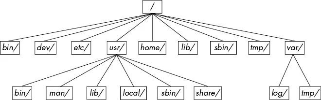

*图 2-2：Linux 目录层次结构*

下面列出根目录下最重要的子目录：

1. ***/bin***　包含可直接运行的程序（也称为*可执行文件*），其中包括 `ls`、`cp` 等大多数基本 Unix 命令。*/bin* 中的大部分程序是由 C 编译器生成的二进制文件，但在现代系统中，也有一些是 Shell 脚本。
2. ***/dev***　包含设备文件。第 3 章将进一步介绍它们。
3. ***/etc***　这是核心系统配置目录（读作 *EHT-see*），其中包含用户密码、启动、设备、网络以及其他配置文件。
4. ***/home***　存放普通用户的主目录（个人目录）。大多数 Unix 系统都遵循这一标准。
5. ***/lib***　名称是 *library*（库）的缩写，存放包含可供可执行程序使用的代码的库文件。库分为静态库和共享库两种。*/lib* 目录应当只包含共享库，但其他库目录（如 */usr/lib*）既包含这两种库，也包含其他辅助文件。（第 15 章将更详细地讨论共享库。）
6. ***/proc***　通过可浏览的目录和文件接口提供系统统计信息。Linux 上 */proc* 的大部分子目录结构是其特有的，不过许多其他 Unix 变体也有类似功能。*/proc* 目录包含当前运行进程的信息以及一些内核参数。
7. ***/run***　包含系统特定的运行时数据，包括某些进程 ID、套接字文件、状态记录，以及在许多情况下的系统日志。这是根目录中相对较新的一个目录；在较旧的系统中，这些内容位于 */var/run*。在较新的系统中，*/var/run* 是指向 */run* 的符号链接。
8. ***/sys***　与 */proc* 类似，该目录提供设备和系统接口。第 3 章将进一步介绍 */sys*。
9. ***/sbin***　存放系统可执行程序。位于 /*sbin* 目录中的程序与系统管理有关，因此普通用户的命令搜索路径通常不包含这些目录。这里的许多工具如果不以 root 身份运行，就无法正常工作。
10. ***/tmp***　用于存放不太重要的小型临时文件。任何用户都可以在 */tmp* 中读写文件，但不一定有权限访问其他用户放在这里的文件。许多程序将其作为工作目录。如果某个文件非常重要，就不要放在 */tmp*，因为大多数发行版会在启动时清理它，有些还会定期删除其中的旧文件。另外，也不要让垃圾文件塞满 */tmp*，因为它使用的空间通常与某些关键部分共享（例如根文件系统 */* 的其余部分）。
11. ***/usr***　虽然读作“user”，这个子目录却不存放用户文件。相反，它包含一个庞大的目录层次结构，Linux 系统的大部分内容都位于其中。*/usr* 下许多目录的名称与根目录下的相同（例如 */usr/bin* 和 */usr/lib*），所存放的文件类型也相同。（根目录没有容纳整个系统，主要是历史原因：过去需要尽量减少根文件系统占用的空间。）
12. ***/var***　这是存放可变数据的目录，程序在其中记录随时间变化的信息。系统日志、用户活动记录、缓存，以及系统程序创建和管理的其他文件都位于这里。（你会看到其中还有 */var/tmp* 目录，但系统启动时不会清空它。）

#### 2.19.1 根目录下的其他子目录

根目录下还有几个值得注意的子目录：

1. ***/boot***　包含内核引导加载程序所需的文件。这些文件只与 Linux 启动过程的最初阶段有关，因此你不会在这个目录中找到 Linux 如何启动各项服务的信息。更多内容见第 5 章。
2. ***/media***　许多发行版使用它作为闪存盘等可移动介质的基本挂载位置。
3. ***/opt***　可能包含额外安装的第三方软件。许多系统并不使用 */opt*。

#### 2.19.2 /usr 目录

乍看之下，*/usr* 目录可能显得相当整洁，但只要快速浏览一下 */usr/bin* 和 */usr/lib*，就会发现其中内容十分丰富；大多数用户空间程序和数据都位于 */usr*。除 */usr/bin*、*/usr/sbin* 和 */usr/lib* 之外，*/usr* 还包含以下目录：

1. ***/include***　存放 C 编译器使用的头文件。
2. ***/local***　供管理员安装自己的软件。它的目录结构应与 */* 和 */usr* 类似。
3. ***/man***　包含手册页。
4. ***/share***　存放无需损失功能就能在其他类型的 Unix 计算机上使用的文件。它们通常是程序和库按需读取的辅助数据文件。过去，计算机网络中的多台机器会通过文件服务器共享这个目录；但如今的系统在存放这类文件时几乎不受空间限制，因此这种共享方式已经很少见了。相反，在 Linux 发行版中，你会在这里看到 /*man*、/*info* 等许多子目录，因为这是一种容易理解的约定。

#### 2.19.3 内核的位置

在 Linux 系统上，内核通常是 */vmlinuz* 或 */boot/vmlinuz* 这个二进制文件。系统启动时，*引导加载程序*（boot loader）会将该文件加载到内存中并启动内核。（第 5 章将详细介绍引导加载程序。）

引导加载程序启动内核后，正在运行的系统就不再使用这个主内核文件。不过，在正常运行期间，内核还会根据需要加载和卸载许多模块。这些模块称为*可加载内核模块*（loadable kernel modules），位于 */lib/modules* 下。

### 2.20 以超级用户身份运行命令

继续学习之前，你应该了解如何以超级用户身份运行命令。你可能想直接启动一个 root Shell，但这样做有许多缺点：

- 无法留下修改系统的命令记录。
- 无法留下执行这些系统修改命令的用户记录。
- 无法使用你平常的 Shell 环境。
- 必须输入 root 密码（如果设置了的话）。

#### 2.20.1 sudo

大多数发行版使用名为 `sudo` 的软件包，让管理员以自己的用户身份登录后，仍能以 root 身份运行命令。例如，第 7 章会介绍如何使用 `vipw` 编辑 */etc/passwd* 文件。你可以这样操作：

```bash
$ sudo vipw
```

运行这条命令时，`sudo` 会通过 syslog 服务，在 local2 设施（facility）下记录此次操作。第 7 章还会进一步介绍系统日志。

#### 2.20.2 /etc/sudoers

当然，系统不会允许*任何*用户都以超级用户身份运行命令；你必须在 */etc/sudoers* 文件中配置具有特权的用户。`sudo` 软件包提供了许多选项（其中大部分你可能永远用不到），因此 */etc/sudoers* 的语法有些复杂。例如，下面的配置允许 `user1` 和 `user2` 无需输入密码，就以 root 身份执行任何命令：

```
User_Alias ADMINS = user1, user2

ADMINS ALL = NOPASSWD: ALL

root ALL=(ALL) ALL
```

第一行定义了名为 `ADMINS` 的用户别名，其中包含两个用户；第二行则授予他们相应权限。`ALL = NOPASSWD: ALL` 表示 `ADMINS` 别名中的用户可以通过 `sudo` 以 root 身份执行命令。第二个 `ALL` 表示“任何命令”，第一个 `ALL` 表示“任何主机”。（如果你有多台计算机，可以为每台计算机或每组计算机设置不同的访问权限，但这里不讨论这一功能。）

`root ALL=(ALL) ALL` 的意思是，超级用户也可以通过 `sudo` 在任何主机上运行任何命令。额外的 `(ALL)` 表示超级用户还可以以任何其他用户的身份运行命令。你可以在 */etc/sudoers* 的第二行添加 `(ALL)`，把这项权限也授予 `ADMINS` 用户，如下所示：

```
ADMINS ALL = (ALL) NOPASSWD: ALL
```

> 请使用 `visudo` 命令编辑 /etc/sudoers。保存文件后，该命令会检查文件是否存在语法错误。

#### 2.20.3 sudo 日志

虽然本书后面会更详细地讨论日志，但在大多数系统中，你可以使用下面的命令查看 `sudo` 日志：

```bash
$ journalctl SYSLOG_IDENTIFIER=sudo
```

在较旧的系统中，你需要到 */var/log* 中查找日志文件，例如 */var/log/auth.log*。

关于 `sudo`，目前就介绍到这里。如果需要使用它的高级功能，请参阅 sudoers(5) 和 sudo(8) 手册页。（用户身份切换的实际工作机制将在第 7 章介绍。）

### 2.21 展望

现在，你应该已经知道如何在命令行中完成以下操作：运行程序、重定向输出、操作文件和目录、查看进程列表、阅读手册页，以及在 Linux 系统的用户空间中进行基本操作。你也应该能够以超级用户身份运行命令。对于用户空间组件的内部细节，或者内核中究竟发生了什么，你可能还了解不多；但掌握了文件和进程的基础知识后，你已经走上了正确的道路。接下来的几章中，你将使用刚学会的命令行工具，操作内核和用户空间中的系统组件。

---


## 第 3 章：设备

本章将对正常运行的 Linux 系统中由内核提供的设备基础设施进行一次基础性的介绍。纵观 Linux 的发展历史，内核向用户呈现设备的方式经历了许多变化。我们将首先了解传统的设备文件机制，再看看内核如何通过 sysfs 提供设备配置信息。我们的目标是学会提取系统中设备的相关信息，以便理解一些基本操作。后续章节会更详细地介绍如何与特定类型的设备交互。

理解内核在发现新设备时如何与用户空间交互也很重要。udev 系统使用户空间程序能够自动配置和使用新设备。你将看到内核如何通过 udev 向用户空间进程发送消息，以及进程收到消息后会做什么。

### 3.1 设备文件

在 Unix 系统中，大多数设备都比较容易操作，因为内核会将许多设备的输入／输出（I/O）接口以文件的形式提供给用户进程。这些*设备文件*有时也称为*设备节点*。程序员可以使用常规的文件操作来访问设备；此外，某些设备也可以通过 `cat` 等标准程序访问，因此你不必是程序员也能使用它们。不过，文件接口所能完成的操作是有限的，所以并非所有设备及其功能都能通过标准文件 I/O 访问。

Linux 的设备文件设计与其他 Unix 系统一样。设备文件位于 */dev* 目录下，运行 `ls /dev` 就会发现其中有相当多的文件。那么，应该怎样使用这些设备呢？

先看下面这条命令：

```bash
$ echo blah blah > /dev/null
```

和其他使用输出重定向的命令一样，它会把标准输出中的一些内容发送到文件。不过，这里的文件 */dev/null* 实际上是一个设备，因此内核不会采用通常的文件操作方式，而是使用设备驱动程序处理写入该设备的数据。对于 */dev/null*，内核只是接收输入的数据，然后将其丢弃。

要识别设备并查看其权限，可以使用 `ls -l`。下面是一些示例：

```bash
$ ls -l
brw-rw----   1 root disk 8, 1 Sep  6 08:37 sda1
crw-rw-rw-   1 root root 1, 3 Sep  6 08:37 null
prw-r--r--   1 root root    0 Mar  3 19:17 fdata
srw-rw-rw-   1 root root    0 Dec 18 07:43 log
```

请注意每行的第一个字符（也就是文件模式的第一个字符）。如果这个字符是 `b`、`c`、`p` 或 `s`，说明它是一个设备文件。这几个字母分别表示*块设备*（block）、*字符设备*（character）、*管道*（pipe）和*套接字*（socket）：

**块设备（Block device）**

1. 程序以固定大小的数据块为单位访问块设备。上例中的 *sda1* 是一种*磁盘设备*，属于块设备。磁盘上的数据很容易划分为一个个块。由于块设备的总容量固定，而且便于按位置索引，因此在内核的帮助下，进程可以快速随机访问设备中的任意数据块。

**字符设备（Character device）**

1. 字符设备处理的是数据流。你只能从字符设备读取字符，或向字符设备写入字符，就像前面操作 */dev/null* 时那样。字符设备没有固定的大小；当你从中读取或向其写入时，内核通常会对设备执行相应的读写操作。直接连接到计算机的打印机就以字符设备表示。需要注意的是，在与字符设备交互时，一旦内核把数据交给设备或进程，就无法再倒回去重新检查已经传递的数据流。

**管道设备（Pipe device）**

1. *命名管道*与字符设备类似，不过 I/O 数据流另一端连接的是另一个进程，而不是内核驱动程序。

**套接字设备（Socket device）**

1. *套接字*是一种特殊用途的接口，经常用于进程间通信。套接字文件通常也会出现在 */dev* 目录之外。它们表示 Unix 域套接字；你将在第 10 章进一步了解这类套接字。

对于块设备和字符设备，在 `ls -l` 的输出中，日期前面的数字是设备的*主设备号*（major device number）和*次设备号*（minor device number），内核用它们来标识设备。相似的设备通常具有相同的主设备号，例如 *sda3* 和 *sdb1*（两者都是硬盘分区）。

> 并不是所有设备都有对应的设备文件，因为块设备和字符设备的 I/O 接口并非适用于所有情况。例如，网络接口就没有设备文件。从理论上说，可以使用单个字符设备与网络接口交互，但那样做很困难，因此内核提供了其他 I/O 接口。

### 3.2 sysfs 设备路径

传统 Unix 系统中的 */dev* 目录为用户进程引用和访问内核支持的设备提供了一种方便的方式，但这个机制也相当简单。*/dev* 中的设备名称能告诉你一点设备信息，却通常不足以提供多少实际帮助。另一个问题是，内核按照发现设备的顺序为其分配名称，因此同一个设备在两次重启之间可能具有不同的名称。

为了根据设备的实际硬件属性，为已连接设备提供统一的视图，Linux 内核通过一套文件和目录提供了 *sysfs* 接口。设备的基础路径是 */sys/devices*。例如，位于 */dev/sda* 的 SATA 硬盘在 sysfs 中可能对应以下路径：

```
/sys/devices/pci0000:00/0000:00:17.0/ata3/host0/target0:0:0/0:0:0:0/block/sda
```

可以看到，与 */dev/sda* 这个文件名相比，这条路径相当长，而且它本身是一个目录。不过，两者其实不能直接比较，因为它们的用途不同。*/dev* 中的文件供用户进程使用设备，而 */sys/devices* 中的路径则用于查看设备信息和管理设备。如果列出上述设备路径中的内容，可能会看到类似下面的结果：

```
alignment_offset  discard_alignment  holders   removable  size       uevent
bdi               events             inflight  ro         slaves
capability        events_async       power     sda1       stat
dev               events_poll_msecs  queue     sda2       subsystem
device            ext_range          range     sda5       trace
```

这些文件和子目录主要是供程序读取的，而不是供人直接阅读。不过，查看其中的示例文件（比如 *dev* 文件）仍然可以帮助你理解它们所包含和表示的信息。在这个目录中运行 `cat dev`，会显示 `8:0`；这恰好就是 */dev/sda* 的主设备号和次设备号。

*/sys* 目录下还提供了一些便捷入口。例如，*/sys/block* 应该包含系统中所有可用的块设备。不过，这些入口只是符号链接；运行 `ls -l /sys/block` 就能看到它们在 sysfs 中的真实路径。

有时很难找到 */dev* 中某个设备在 sysfs 中对应的位置。可以像下面这样使用 `udevadm` 命令，查看设备路径及其他一些有用的属性：

```bash
$ udevadm info --query=all --name=/dev/sda
```

第 3.5 节将进一步介绍 `udevadm` 和整个 udev 系统。

### 3.3 dd 与设备

在处理块设备和字符设备时，`dd` 程序非常有用。它的功能就是从输入文件或输入流读取数据，再写入输出文件或输出流，并且可以在此过程中进行某些编码转换。对于块设备而言，`dd` 一个特别实用的特性是：它可以只处理文件中间的一段数据，而忽略这段数据之前或之后的内容。

> **警告：**
>
> `dd` 的功能非常强大，因此运行之前一定要清楚自己在做什么。一个不小心的错误就可能损坏文件或设备上的数据。如果不确定命令会产生什么结果，先把输出写入一个新文件通常会更安全。

`dd` 以固定大小的数据块为单位复制数据。下面展示如何使用 `dd` 操作字符设备，并用到几个常见选项：

```bash
$ dd if=/dev/zero of=new_file bs=1024 count=1
```

可以看到，`dd` 的选项格式与大多数其他 Unix 命令不同：它沿用了旧式 IBM 作业控制语言（Job Control Language，JCL）的风格。它不使用连字符（`-`）标识选项，而是写出选项名称，再用等号（`=`）设置选项值。上面的例子从 */dev/zero*（一个持续产生零字节的数据流）复制一个 1,024 字节的数据块到 *new_file*。

以下是 `dd` 的重要选项：

1. **`if=file`**：输入文件。默认使用标准输入。
2. **`of=file`**：输出文件。默认使用标准输出。
3. **`bs=size`**：数据块大小。`dd` 每次按指定的字节数读取和写入数据。为了简写较大的数据量，可以用 `b` 和 `k` 分别表示 512 字节和 1,024 字节。因此，前面的例子可以将 `bs=1024` 写成 `bs=1k`。
4. **`ibs=size`、`obs=size`**：分别指定输入块和输出块的大小。如果输入和输出可以使用相同的块大小，就使用 `bs`；否则分别使用 `ibs` 和 `obs`。
5. **`count=num`**：要复制的数据块总数。处理超大文件，或者处理 */dev/zero* 这种会源源不断提供数据的设备时，应当让 `dd` 在固定位置停止，否则可能浪费大量磁盘空间、CPU 时间，或者两者兼有。可以将 `count` 与 `skip` 参数配合使用，从大型文件或设备中复制一小段数据。
6. **`skip=num`**：跳过输入文件或输入流开头的 `num` 个数据块，不将它们复制到输出中。


### 3.4 设备名称概览

有时，确定设备的名称并不容易（例如在对磁盘分区时）。以下是几种查找设备名称的方法：

- 使用 `udevadm` 查询 udevd（参见 3.5 节）。
- 在 */sys* 目录中查找设备。
- 根据 `journalctl -k` 命令的输出（该命令打印内核消息）或内核系统日志（参见 7.1 节）推测设备名称。这些输出可能包含系统中设备的描述。
- 对于系统已经识别的磁盘设备，可以查看 `mount` 命令的输出。
- 运行 `cat /proc/devices`，查看系统当前已有驱动程序支持的块设备和字符设备。每一行都包含一个数字和一个名称。数字是 3.1 节介绍的设备主设备号。如果能根据名称推断出设备，就可以到 */dev* 中寻找具有相应主设备号的字符设备或块设备，从而找到设备文件。

这些方法中，只有第一种是可靠的，但它要求系统提供 udev。如果遇到 udev 不可用的情况，可以尝试其他方法，不过要记住：内核可能并没有为你的硬件提供设备文件。

下面几节列出了最常见的 Linux 设备及其命名约定。

#### 3.4.1 硬盘：/dev/sd\*

当前 Linux 系统连接的大多数硬盘都使用带有 *sd* 前缀的设备名称，例如 */dev/sda*、*/dev/sdb* 等。这些设备表示整块磁盘；内核会为磁盘上的分区分别创建设备文件，例如 */dev/sda1* 和 */dev/sda2*。

这种命名约定需要稍作解释。名称中的 *sd* 代表 *SCSI disk*（SCSI 磁盘）。*小型计算机系统接口（Small Computer System Interface，SCSI）* 最初是一套硬件与协议标准，用于磁盘等外围设备之间的通信。虽然大多数现代计算机已不再使用传统的 SCSI 硬件，但由于适应性很强，SCSI 协议仍然无处不在。例如，USB 存储设备就使用该协议进行通信。SATA（Serial ATA，PC 上常见的存储总线）磁盘的情况稍微复杂一些，但 Linux 内核与它们通信时，在某个环节仍然会使用 SCSI 命令。

要列出系统中的 SCSI 设备，可以使用遍历 sysfs 所提供设备路径的工具。其中一个输出十分简洁的工具是 `lsscsi`。运行后可能看到如下结果：

```bash
$ lsscsi
[0:0:0:0]1  disk2  ATA     WDC WD3200AAJS-2  01.0  /dev/sda3
[2:0:0:0]    disk    FLASH   Drive UT_USB20    0.00  /dev/sdb
```

第一列（标注 1）表示设备在系统中的地址；第二列（标注 2）描述设备类型；最后一列（标注 3）指出设备文件的位置。其余内容是厂商信息。

Linux 按驱动程序发现设备的顺序，将设备分配给相应的设备文件。因此，在上面的示例中，内核先发现硬盘，再发现闪存盘。

遗憾的是，这种设备分配机制长期以来一直会在重新配置硬件时引发问题。例如，假设系统有三块磁盘：*/dev/sda*、*/dev/sdb* 和 */dev/sdc*。如果 */dev/sdb* 损坏，不得不将其移除以恢复机器运行，那么原来的 */dev/sdc* 就会变成 */dev/sdb*，而 */dev/sdc* 则不复存在。如果你在 *fstab* 文件中直接引用了这些设备名称（参见 4.2.8 节），就必须修改该文件，才能让系统（大体上）恢复正常。为了解决这个问题，许多 Linux 系统使用通用唯一标识符（Universally Unique Identifier，UUID；参见 4.2.4 节）和／或逻辑卷管理器（Logical Volume Manager，LVM）提供稳定的磁盘设备映射。

以上讨论只是浅浅涉及了 Linux 系统如何使用磁盘和其他存储设备。关于磁盘的使用，请参见第 4 章。本章稍后还会介绍 Linux 内核中的 SCSI 支持机制。

#### 3.4.2 虚拟磁盘：/dev/xvd\*、/dev/vd\*

有些磁盘设备专门针对 AWS 实例、VirtualBox 等虚拟机进行了优化。Xen 虚拟化系统使用 */dev/xvd* 前缀，而 */dev/vd* 表示另一种类似的设备类型。

#### 3.4.3 非易失性存储设备：/dev/nvme\*

现在，有些系统使用非易失性内存高速接口（Non-Volatile Memory Express，NVMe）与某些类型的固态存储设备通信。在 Linux 中，这些设备显示为 */dev/nvme\**。可以使用 `nvme list` 命令列出系统中的此类设备。

#### 3.4.4 设备映射器：/dev/dm-\*、/dev/mapper/\*

在某些系统中，位于磁盘和其他直接块存储设备之上的一层是 LVM，它使用内核中的设备映射器（device mapper）机制。如果看到以 */dev/dm-* 开头的块设备，以及 */dev/mapper* 中的符号链接，那么系统很可能正在使用这一机制。第 4 章将详细介绍它。

#### 3.4.5 CD 和 DVD 驱动器：/dev/sr\*

Linux 将大多数光学存储驱动器识别为 SCSI 设备 */dev/sr0*、*/dev/sr1* 等。不过，如果驱动器使用较旧的接口，也可能显示为下一节介绍的 PATA 设备。*/dev/sr\** 设备是只读的，仅用于从光盘读取数据。要使用光驱的写入或重写功能，则需要使用 */dev/sg0* 等“通用”SCSI 设备。

#### 3.4.6 PATA 硬盘：/dev/hd\*

PATA（Parallel ATA，并行 ATA）是一种较老的存储总线。Linux 块设备 */dev/hda*、*/dev/hdb*、*/dev/hdc* 和 */dev/hdd* 常见于较旧版本的 Linux 内核及旧硬件。这些设备的分配是固定的，取决于接口 0 和接口 1 上的设备组合。有时，你可能会发现 SATA 磁盘被识别为其中一种设备。这意味着 SATA 磁盘正运行在兼容模式下，而这种模式会限制性能。检查 BIOS 设置，看看能否将 SATA 控制器切换到原生模式。

#### 3.4.7 终端：/dev/tty\*、/dev/pts/\* 和 /dev/tty

*终端（terminal）* 是在用户进程和 I/O 设备之间传送字符的设备，通常用于向终端屏幕输出文本。终端设备接口的历史非常悠久，可以追溯到终端还是打字机式设备、而一台计算机连接着许多终端的时代。

如今，大多数终端都是*伪终端（pseudoterminal）*，也就是能够模拟真实终端 I/O 功能的终端。内核并不是与实际硬件通信，而是向软件提供 I/O 接口，例如你很可能用来输入大多数命令的 Shell 终端窗口。

两个常见的终端设备是 */dev/tty1*（第一个虚拟控制台）和 */dev/pts/0*（第一个伪终端设备）。*/dev/pts* 目录本身是一个专用文件系统。

*/dev/tty* 设备表示当前进程的控制终端。如果某个程序正在从终端读取数据并向终端写入数据，这个设备就相当于该终端的别名。进程不一定需要连接到终端。

##### 显示模式与虚拟控制台

Linux 主要有两种显示模式：*文本模式*和图形模式（第 14 章将介绍使用图形模式的窗口系统）。虽然 Linux 系统过去通常以文本模式启动，但现在大多数发行版都会使用内核参数和启动过程中的临时图形显示机制（例如 plymouth 这样的启动画面），在系统启动时完全隐藏文本模式。在这种情况下，系统会在启动过程接近结束时切换到完整的图形模式。

Linux 支持通过*虚拟控制台*复用显示设备。每个虚拟控制台都可以运行在图形模式或文本模式下。处于文本模式时，可以通过 Alt 与功能键的组合在控制台之间切换。例如，Alt-F1 切换到 */dev/tty1*，Alt-F2 切换到 */dev/tty2*，以此类推。其中许多虚拟控制台可能运行着 `getty` 进程，显示登录提示符，详见 7.4 节。

图形模式下的虚拟控制台略有不同。图形环境并非从 init 配置中取得虚拟控制台分配，而是接管一个空闲的虚拟控制台，除非明确指定使用某个控制台。例如，如果 *tty1* 和 *tty2* 上都有 `getty` 进程，新启动的图形环境就会接管 *tty3*。此外，一旦进入图形模式，通常必须使用 Ctrl-Alt 与功能键的组合才能切换到另一个虚拟控制台，而不能只使用较简单的 Alt 与功能键组合。

总之，如果系统启动后想查看文本控制台，可以按 Ctrl-Alt-F1。要返回图形环境，则可以依次尝试 Alt-F2、Alt-F3 等组合，直到找到图形环境所在的控制台。

>
>
> 有些发行版会在图形模式下使用 *tty1*。这种情况下，需要尝试其他控制台。

如果由于输入机制故障或其他原因而无法正常切换控制台，可以尝试使用 `chvt` 命令强制系统切换。例如，要切换到 *tty1*，可以以 root 身份运行：

```bash
# chvt 1
```

#### 3.4.8 串行端口：/dev/ttyS\*、/dev/ttyUSB\*、/dev/ttyACM\*

较旧的 RS-232 类型及类似串行端口被表示为真正的终端设备。由于需要考虑波特率、流量控制等大量设置，单靠命令行很难直接操作串行端口设备。不过，可以将设备路径作为参数传给 `screen` 命令，以连接到该终端。你可能需要具备该设备的读写权限；有时只需将自己加入 `dialout` 等特定用户组即可。

Windows 中称为 COM1 的端口，在 Linux 中是 */dev/ttyS0*；COM2 对应 */dev/ttyS1*，依此类推。插入式 USB 串口适配器的设备名称包含 *USB* 或 *ACM*，例如 */dev/ttyUSB0*、*/dev/ttyACM0*、*/dev/ttyUSB1*、*/dev/ttyACM1* 等。

串行端口一个非常有趣的应用，是连接基于微控制器的开发板，以便在 Linux 系统上进行开发和测试。例如，可以通过 USB 串行接口访问 CircuitPython 开发板的控制台和读取—求值—输出循环（REPL）。你只需插入开发板，找到相应设备（通常是 */dev/ttyACM0*），然后使用 `screen` 连接即可。

#### 3.4.9 并行端口：/dev/lp0 和 /dev/lp1

单向并行端口设备 */dev/lp0* 和 */dev/lp1* 对应 Windows 中的 LPT1: 和 LPT2:。这种接口如今已在很大程度上被 USB 和网络取代。你可以使用 `cat` 命令直接向并行端口发送文件（例如待打印文件），但之后可能还需要向打印机发送额外的换页符，或重置打印机。像 CUPS 这样的打印服务器更适合处理与打印机的交互。

双向并行端口则是 */dev/parport0* 和 */dev/parport1*。

#### 3.4.10 音频设备：/dev/snd/\*、/dev/dsp、/dev/audio 等

Linux 有两套音频设备。一套用于高级 Linux 声音架构（Advanced Linux Sound Architecture，ALSA）的系统接口，另一套用于较旧的开放声音系统（Open Sound System，OSS）。ALSA 设备位于 */dev/snd* 目录中，但很难直接操作。如果当前加载了 OSS 内核支持，使用 ALSA 的 Linux 系统也可以支持向后兼容 OSS 的设备。

通过 OSS 的 *dsp* 和 *audio* 设备，可以执行一些基本操作。例如，将 WAV 文件发送到 */dev/dsp*，计算机就会播放它。不过，由于采样频率不匹配，硬件的实际表现可能不符合预期。此外，在大多数系统中，你一登录，该设备往往就已经处于忙碌状态。

>
>
> 由于涉及许多不同层次，Linux 音频是一个相当复杂的话题。我们刚才只讨论了内核层面的设备，但通常还有 pulseaudio 之类的用户空间服务器，它们负责管理来自不同来源的音频，并充当音频设备与其他用户空间进程之间的中介。

#### 3.4.11 创建设备文件

在任何较新的 Linux 系统上，你通常都不需要自行创建设备文件；这些文件由 devtmpfs 和 udev 创建（参见 3.5 节）。不过，了解创建方法仍然有益，而且在极少数情况下，你可能需要创建命名管道或套接字文件。

`mknod` 命令可以创建一个设备。你必须知道设备名称，以及它的主设备号和次设备号。例如，要创建 */dev/sda1*，可以使用以下命令：

```bash
# mknod /dev/sda1 b 8 1
```

其中 `b 8 1` 指定一个主设备号为 8、次设备号为 1 的块设备。对于字符设备或命名管道，应分别使用 `c` 或 `p` 代替 `b`（命名管道不需要指定主设备号和次设备号）。

在较早的 Unix 和 Linux 版本中，维护 */dev* 目录是一项挑战。每当内核进行重大升级或增加驱动程序时，内核就可能支持更多类型的设备，这意味着需要为新的设备文件名分配一组新的主设备号和次设备号。为应对这种维护难题，每个系统都会在 */dev* 中提供一个 `MAKEDEV` 程序，用来批量创建设备。升级系统时，你需要寻找 `MAKEDEV` 的更新版本，再运行它来创建新设备。

这种静态机制逐渐变得难以管理，因此需要替代方案。最初的改进尝试是 devfs：它是在内核空间实现的 */dev*，其中包含当前内核支持的所有设备。然而，devfs 存在多种局限，最终促成了 udev 和 devtmpfs 的开发。


### 3.5 udev

前面已经讨论过，内核中不必要的复杂性是危险的，因为它很容易导致系统不稳定。设备文件管理就是一个例子：既然可以在用户空间创建设备文件，为什么还要在内核中完成这项工作呢？当 Linux 内核检测到系统中出现新设备时（例如有人插入 USB 闪存盘），可以向名为 udevd 的用户空间进程发送通知。udevd 可以检查新设备的特征、创建设备文件，然后执行必要的设备初始化操作。

> 
>
> 你几乎肯定会在系统中看到以 systemd-udevd 名称运行的 udevd，因为它是第 6 章将介绍的系统启动机制的一部分。

以上是理论上的方案。遗憾的是，这种方法存在一个问题：系统在启动过程的早期就需要设备文件，因此 udevd 也必须尽早启动。但是，为了创建设备文件，udevd 不能依赖那些需要由它自己创建的设备；而且，它必须非常迅速地完成初始启动，不能让系统的其他部分一直等待它启动。

#### 3.5.1 devtmpfs

为解决启动期间设备可用性的问题，人们开发了 devtmpfs 文件系统（关于文件系统的更多细节，请参见 4.2 节）。它与较早的 devfs 支持类似，但更加简化。内核会按需创建设备文件，同时通知 udevd 有新设备可用。收到通知后，udevd 不负责创建设备文件，而是执行设备初始化、设置权限，并通知其他进程有新设备可用。此外，它还会在 */dev* 中创建一些符号链接，以便进一步标识设备。在 */dev/disk/by-id* 目录中可以看到这些链接的例子，每块连接的磁盘在那里都有一个或多个条目。

例如，看看 */dev/disk/by-id* 中一块典型磁盘（设备为 */dev/sda*）及其分区的链接：

```bash
$ ls -l /dev/disk/by-id
lrwxrwxrwx 1 root root  9 Jul 26 10:23 scsi-SATA_WDC_WD3200AAJS-_WD-WMAV2FU80671 -> ../../sda
lrwxrwxrwx 1 root root 10 Jul 26 10:23 scsi-SATA_WDC_WD3200AAJS-_WD-WMAV2FU80671-part1 ->
../../sda1
lrwxrwxrwx 1 root root 10 Jul 26 10:23 scsi-SATA_WDC_WD3200AAJS-_WD-WMAV2FU80671-part2 ->
../../sda2
lrwxrwxrwx 1 root root 10 Jul 26 10:23 scsi-SATA_WDC_WD3200AAJS-_WD-WMAV2FU80671-part5 ->
../../sda5
```

udevd 为这些链接命名时，先使用接口类型，再使用制造商、型号、序列号以及分区信息（如果适用）。

> 
>
> devtmpfs 名称中的“tmp”表示该文件系统驻留在主内存中，并允许用户空间进程读写；正是这一特性使 udevd 能够创建这些符号链接。4.2.12 节还会介绍一些相关细节。

不过，udevd 怎么知道应该创建哪些符号链接，又是怎样创建它们的呢？下一节将介绍 udevd 的工作方式。但要继续阅读本书，你并不需要掌握这些内容，也不必掌握本章剩余部分的其他知识。实际上，如果这是你第一次接触 Linux 设备，强烈建议你直接跳到下一章，开始学习如何使用磁盘。

#### 3.5.2 udevd 的运行与配置

udevd 守护进程按以下步骤工作：

1. 内核通过内部网络连接向 udevd 发送通知事件，称为 *uevent*。
2. udevd 加载 uevent 中的所有属性。
3. udevd 解析规则，根据这些规则筛选和更新 uevent，并执行相应操作或设置更多属性。

udevd 从内核收到的 uevent 可能如下所示（3.5.4 节会介绍如何使用 `udevadm monitor --property` 命令获得这类输出）：

```
ACTION=change
DEVNAME=sde
DEVPATH=/devices/pci0000:00/0000:00:1a.0/usb1/1-1/1-1.2/1-1.2:1.0/host4/
target4:0:0/4:0:0:3/block/sde
DEVTYPE=disk
DISK_MEDIA_CHANGE=1
MAJOR=8
MINOR=64
SEQNUM=2752
SUBSYSTEM=block
UDEV_LOG=3
```

这个事件表示某个设备发生了变化。收到 uevent 后，udevd 已经知道设备名称、sysfs 设备路径，以及与设备属性有关的其他一些信息，因此可以开始处理规则。

规则文件位于 */lib/udev/rules.d* 和 */etc/udev/rules.d* 目录。*/lib* 中的是默认规则，*/etc* 中的是覆盖规则。完整解释这些规则会相当繁琐；你可以通过 udev(7) 手册页了解更多。这里先介绍 udevd 读取规则的基本方式：

1. udevd 从规则文件的开头读到结尾。
2. 读取一条规则并可能执行其操作后，udevd 会继续读取当前规则文件，寻找其他适用的规则。
3. 某些指令（例如 `GOTO`）可以在必要时跳过规则文件的部分内容。这类指令通常放在规则文件开头，以便在整个文件与 udevd 正在配置的设备无关时直接跳过它。

回到 3.5.1 节的 */dev/sda* 示例。那些符号链接由 */lib/udev/rules.d/60-persistent-storage.rules* 中的规则定义。在该文件中可以看到以下内容：

```bash
# ATA
KERNEL=="sd*[!0-9]|sr*", ENV{ID_SERIAL}!="?*", SUBSYSTEMS=="scsi", ATTRS{vendor}=="ATA", IMPORT{program}="ata_id --export $devnode"

# ATAPI devices (SPC-3 or later)
KERNEL=="sd*[!0-9]|sr*", ENV{ID_SERIAL}!="?*", SUBSYSTEMS=="scsi", ATTRS{type}=="5",ATTRS{scsi_level}=="[6-9]*", IMPORT{program}="ata_id --export $devnode"
```

这些规则匹配通过内核 SCSI 子系统呈现的 ATA 磁盘和光学介质（参见 3.6 节）。可以看到，为了处理设备可能采用的不同表示方式，这里有几条规则，但基本思路相同：udevd 首先尝试匹配名称以 *sd* 或 *sr* 开头且末尾不是数字的设备（使用表达式 `KERNEL=="sd*[!0-9]|sr*"`），还要匹配子系统（`SUBSYSTEMS=="scsi"`），最后根据设备类型匹配其他属性。如果其中任意一条规则的所有条件表达式都为真，udevd 就会执行该规则最后的表达式：

```
IMPORT{program}="ata_id --export $tempnode"
```

这不是条件，而是一条指令：从 */lib/udev/ata\_id* 命令导入变量。如果你有这样的磁盘，可以在命令行亲自试试。输出大致如下：

```bash
# /lib/udev/ata_id --export /dev/sda
ID_ATA=1
ID_TYPE=disk
ID_BUS=ata
ID_MODEL=WDC_WD3200AAJS-22L7A0
ID_MODEL_ENC=WDC\x20WD3200AAJS22L7A0\x20\x20\x20\x20\x20\x20\x20\x20\x20\x20
\x20\x20\x20\x20\x20\x20\x20\x20\x20
ID_REVISION=01.03E10
ID_SERIAL=WDC_WD3200AAJS-22L7A0_WD-WMAV2FU80671
--snip--
```

导入操作会设置环境，使输出中的所有变量名都具有所显示的值。例如，后续规则现在会将 `ENV{ID_TYPE}` 识别为 `disk`。

在刚才看到的两条规则中，`ID_SERIAL` 尤其值得注意。每条规则的第二个条件都是：

```
ENV{ID_SERIAL}!="?*"
```

如果 `ID_SERIAL` 尚未设置，这个表达式就为真。因此，如果 `ID_SERIAL` **已经**设置，该条件就为假，当前整条规则便不适用，udevd 会继续处理下一条规则。

为什么要这样做？这两条规则的目的，是运行 `ata_id` 来查找磁盘设备的序列号，再把这些属性添加到当前正在处理的 uevent 副本中。你会在许多 udev 规则中看到这种通用模式。

设置好 `ENV{ID_SERIAL}` 后，udevd 就能继续判断规则文件后面的这条规则，它用于匹配所有已连接的 SCSI 磁盘：

```
KERNEL=="sd*|sr*|cciss*", ENV{DEVTYPE}=="disk", ENV{ID_SERIAL}=="?*",SYMLINK+="disk/by-id/$env{ID_BUS}-$env{ID_SERIAL}"
```

可以看到，这条规则要求 `ENV{ID_SERIAL}` 已经设置，并包含一条指令：

```
SYMLINK+="disk/by-id/$env{ID_BUS}-$env{ID_SERIAL}"
```

这条指令让 udevd 为传入事件对应的设备添加一个符号链接。现在你就知道设备符号链接从何而来了！

你可能想知道如何区分条件表达式和指令。条件表达式使用两个等号（`==`）或不等号（`!=`），而指令使用单个等号（`=`）、加等号（`+=`）或冒号等号（`:=`）。

#### 3.5.3 udevadm

`udevadm` 是 udevd 的管理工具。你可以用它重新加载 udevd 规则并触发事件，不过，它最强大的功能或许是搜索、查看系统设备，以及监视 udevd 从内核收到的 uevent。它的命令语法有些复杂，大多数选项都有长短两种形式；这里使用长选项。

先从检查一个系统设备开始。回到 3.5.2 节的示例，如果要查看与 */dev/sda* 这样的设备有关、在规则中使用和生成的全部 udev 属性，可以运行：

```bash
$ udevadm info --query=all --name=/dev/sda
```

输出如下：

```
P: /devices/pci0000:00/0000:00:1f.2/host0/target0:0:0/0:0:0:0/block/sda
N: sda
S: disk/by-id/ata-WDC_WD3200AAJS-22L7A0_WD-WMAV2FU80671
S: disk/by-id/scsi-SATA_WDC_WD3200AAJS-_WD-WMAV2FU80671
S: disk/by-id/wwn-0x50014ee057faef84
S: disk/by-path/pci-0000:00:1f.2-scsi-0:0:0:0
E: DEVLINKS=/dev/disk/by-id/ata-WDC_WD3200AAJS-22L7A0_WD-WMAV2FU80671 /dev/disk/by-id/scsi
-SATA_WDC_WD3200AAJS-_WD-WMAV2FU80671 /dev/disk/by-id/wwn-0x50014ee057faef84 /dev/disk/by
-path/pci-0000:00:1f.2-scsi-0:0:0:0
E: DEVNAME=/dev/sda
E: DEVPATH=/devices/pci0000:00/0000:00:1f.2/host0/target0:0:0/0:0:0:0/block/sda
E: DEVTYPE=disk
E: ID_ATA=1
E: ID_ATA_DOWNLOAD_MICROCODE=1
E: ID_ATA_FEATURE_SET_AAM=1
--snip--
```

每一行的前缀都表示设备的一项属性或其他特征。在这个例子中，开头的 `P:` 是 sysfs 设备路径；`N:` 是设备节点（即 */dev* 中对应文件的名称）；`S:` 表示 udevd 根据规则放入 */dev* 的、指向设备节点的符号链接；`E:` 则是从 udevd 规则中提取出的其他设备信息。（这个示例的实际输出比这里展示的多得多；不妨亲自运行一下命令，了解它的作用。）

#### 3.5.4 设备监视

要使用 `udevadm` 监视 uevent，可以运行 `monitor` 命令：

```bash
$ udevadm monitor
```

例如，当插入闪存设备时，输出可能类似下面这个经过缩减的示例：

```
KERNEL[658299.569485] add /devices/pci0000:00/0000:00:1d.0/usb2/2-1/2-1.2 (usb)
KERNEL[658299.569667] add /devices/pci0000:00/0000:00:1d.0/usb2/2-1/2-1.2/2-1.2:1.0 (usb)
KERNEL[658299.570614] add /devices/pci0000:00/0000:00:1d.0/usb2/2-1/2-1.2/2-1.2:1.0/host15
(scsi)
KERNEL[658299.570645] add /devices/pci0000:00/0000:00:1d.0/usb2/2-1/2-1.2/2-1.2:1.0/
host15/scsi_host/host15 (scsi_host)
UDEV [658299.622579] add /devices/pci0000:00/0000:00:1d.0/usb2/2-1/2-1.2 (usb)
UDEV [658299.623014] add /devices/pci0000:00/0000:00:1d.0/usb2/2-1/2-1.2/2-1.2:1.0 (usb)
UDEV [658299.623673] add /devices/pci0000:00/0000:00:1d.0/usb2/2-1/2-1.2/2-1.2:1.0/host15
(scsi)
UDEV [658299.623690] add /devices/pci0000:00/0000:00:1d.0/usb2/2-1/2-1.2/2-1.2:1.0/
host15/scsi_host/host15 (scsi_host)
--snip--
```

输出中的每条消息都有两份，因为默认行为是同时打印来自内核的原始消息（标记为 `KERNEL`）和 udevd 处理时产生的消息。如果只想查看内核事件，可以添加 `--kernel` 选项；如果只想查看 udevd 处理的事件，则使用 `--udev`。要查看完整的传入 uevent，包括 3.5.2 节展示的属性，可使用 `--property` 选项。将 `--udev` 与 `--property` 一起使用，则可以查看经过处理后的 uevent。

还可以按子系统筛选事件。例如，只查看与 SCSI 子系统变化有关的内核消息，可以运行：

```bash
$ udevadm monitor --kernel --subsystem-match=scsi
```

有关 `udevadm` 的更多信息，请参见 udevadm(8) 手册页。

udev 还有很多其他内容。例如，有一个名为 udisksd 的守护进程会监听事件，以便自动挂接磁盘，并通知其他进程有新磁盘可用。


### 3.6 深入了解：SCSI 与 Linux 内核

本节将通过考察 Linux 内核对 SCSI 的支持，来了解 Linux 内核架构的一部分。使用磁盘并不需要掌握这些知识，因此，如果你急着开始使用磁盘，可以直接跳到第 4 章。此外，这里的内容比前面介绍的知识更偏向高级概念和理论。如果你更喜欢动手实践，完全可以先跳过这一节，继续阅读下一章。

先介绍一点背景知识。传统的 SCSI 硬件配置由一个主机适配器和通过 SCSI 总线串联起来的一组设备构成，如[图 3-1](#figure3-1) 所示。主机适配器连接到计算机。主机适配器和每个设备都有自己的 SCSI ID。根据 SCSI 版本的不同，每条总线可以有 8 个或 16 个 ID。有些管理员会用 *SCSI 目标（SCSI target）* 来指代设备及其 SCSI ID，因为在 SCSI 协议中，一次会话的一端称为“目标”。

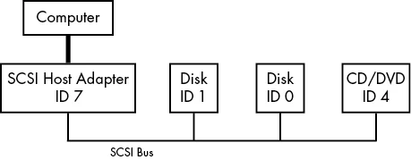

*图 3-1：连接主机适配器和设备的 SCSI 总线*

任何设备都可以通过 SCSI 命令集，以对等方式与另一台设备通信。计算机并不直接连接到设备链，因此必须经过主机适配器才能与磁盘及其他设备通信。通常，计算机将 SCSI 命令发送给主机适配器，再由适配器转发给设备；设备的响应也通过主机适配器返回。

较新的 SCSI 版本（例如串行连接 SCSI，即 SAS）具有出色的性能，但在大多数计算机中，你可能找不到真正的 SCSI 设备。更常见的是使用 SCSI 命令的 USB 存储设备。此外，支持 ATAPI 的设备（例如 CD/DVD-ROM 驱动器）也使用一种形式的 SCSI 命令集。

SATA 磁盘在系统中同样表现为 SCSI 设备，但它们稍有不同，因为其中大多数通过 libata 库中的转换层进行通信（见 3.6.2 节）。有些 SATA 控制器，特别是高性能 RAID 控制器，会在硬件中完成这种转换。

这些组件究竟是怎样协同工作的？看看下面这个系统中的设备：

```bash
$ lsscsi
[0:0:0:0]   disk    ATA       WDC WD3200AAJS-2  01.0  /dev/sda
[1:0:0:0]   cd/dvd  Slimtype  DVD A DS8A5SH     XA15  /dev/sr0
[2:0:0:0]   disk    USB2.0    CardReader CF     0100  /dev/sdb
[2:0:0:1]   disk    USB2.0    CardReader SM XD  0100  /dev/sdc
[2:0:0:2]   disk    USB2.0    CardReader MS     0100  /dev/sdd
[2:0:0:3]   disk    USB2.0    CardReader SD     0100  /dev/sde
[3:0:0:0]   disk    FLASH     Drive UT_USB20    0.00  /dev/sdf
```

方括号中的数字从左到右分别表示 SCSI 主机适配器编号、SCSI 总线编号、设备的 SCSI ID，以及 LUN（逻辑单元号，表示设备内部进一步划分出的逻辑单元）。在这个例子中，系统连接了四个适配器（scsi0、scsi1、scsi2 和 scsi3），每个适配器都只有一条总线（总线编号均为 0），每条总线上也只有一个设备（目标编号均为 0）。不过，位于 2:0:0 的 USB 读卡器有四个逻辑单元，分别对应可以插入的四种闪存卡。内核为每个逻辑单元分配了不同的设备文件。

尽管 NVMe 设备并不是 SCSI 设备，但它们有时也会出现在 `lsscsi` 的输出中，并以 `N` 作为适配器编号。

> 如果你想亲自试用 `lsscsi`，可能需要另外安装这个软件包。

[图 3-2](#figure3-2) 展示了这一特定系统配置中，内核内部从各个设备驱动程序到块设备驱动程序的驱动与接口层次结构。图中没有包含 SCSI 通用（*sg*）驱动程序。

这个结构虽然庞大，乍看之下可能令人望而生畏，但图中的数据流实际上非常线性。我们先从 SCSI 子系统的三层驱动程序入手，逐步分析它：

- **上层**负责某一类设备的操作。例如，*sd*（SCSI 磁盘）驱动程序就位于这一层；它知道如何将来自内核块设备接口的请求转换为 SCSI 协议中的磁盘专用命令，也知道如何进行反向转换。
- **中间层**负责协调和路由上层与下层之间的 SCSI 消息，并跟踪系统连接的所有 SCSI 总线和设备。
- **下层**负责与具体硬件有关的操作。这一层的驱动程序将发出的 SCSI 协议消息传送给特定的主机适配器或硬件，并从硬件接收传入的消息。之所以将它与上层分开，是因为尽管同一设备类别（例如磁盘）的 SCSI 消息是统一的，不同类型的主机适配器发送这些消息的方式却各不相同。

  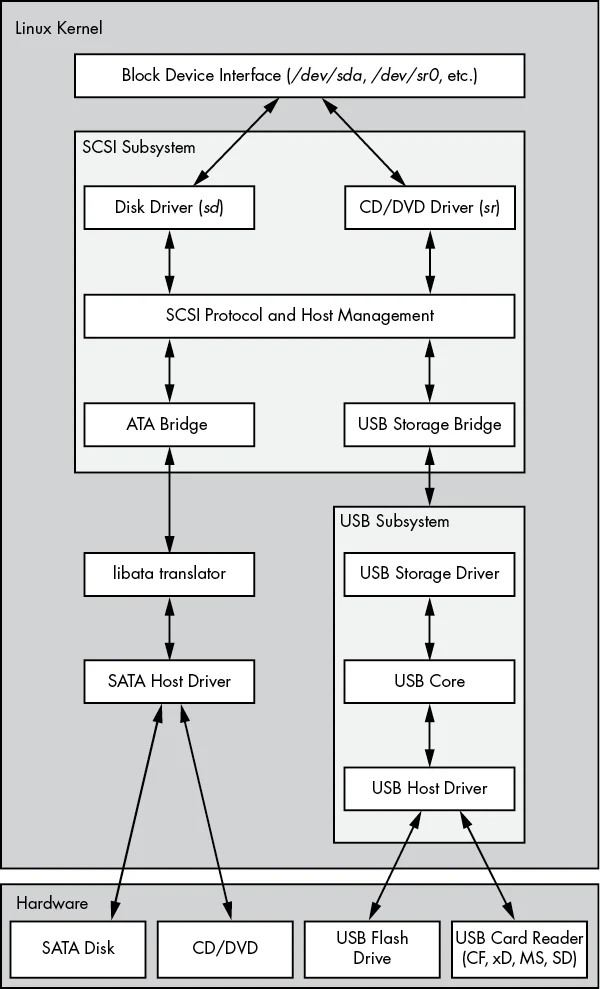

  *图 3-2：Linux SCSI 子系统示意图*

上层和下层都包含许多不同的驱动程序，但要记住：对于系统中的任意一个设备文件，内核（几乎总是）只使用一个上层驱动程序和一个下层驱动程序。在我们的例子中，对于 */dev/sda* 磁盘，内核使用 *sd* 上层驱动程序和 ATA 桥接下层驱动程序。

有时，同一个硬件设备也可能使用不止一个上层驱动程序（见 3.6.3 节）。对于真正的 SCSI 硬件设备，例如连接到 SCSI 主机适配器或硬件 RAID 控制器的磁盘，下层驱动程序会直接与底层硬件通信。不过，对于大多数接入 SCSI 子系统的硬件，情况就有所不同了。

#### 3.6.1 USB 存储设备与 SCSI

为了让 SCSI 子系统能够与常见的 USB 存储硬件通信（如[图 3-2](#figure3-2) 所示），内核需要的不仅仅是一个 SCSI 下层驱动程序。以 */dev/sdf* 表示的 USB 闪存盘能够理解 SCSI 命令，但要真正与它通信，内核还必须知道如何通过 USB 系统传输信息。

从抽象层面来看，USB 与 SCSI 十分相似：两者都有设备类别、总线和主机控制器。因此，Linux 内核也有一个与 SCSI 子系统非常相似的三层 USB 子系统，这并不令人意外。它的上层是设备类别驱动程序，中间是总线管理核心，下层是主机控制器驱动程序。正如 SCSI 子系统在各组件之间传递 SCSI 命令一样，USB 子系统在各组件之间传递 USB 消息。甚至还有一个与 `lsscsi` 类似的命令：`lsusb`。

这里我们真正关心的是上层的 USB 存储驱动程序。它充当翻译器：一端使用 SCSI，另一端使用 USB。由于存储硬件把 SCSI 命令封装在 USB 消息中，这个驱动程序的工作相对简单，主要是重新封装数据。

有了 SCSI 和 USB 两个子系统，与闪存盘通信所需的组件就几乎齐全了。最后缺少的环节是 SCSI 子系统中的下层驱动程序，因为 USB 存储驱动程序属于 USB 子系统，而不是 SCSI 子系统。（出于组织结构方面的考虑，这两个子系统不应共享一个驱动程序。）为了让它们相互通信，一个简单的 SCSI 下层桥接驱动程序会连接到 USB 子系统的存储驱动程序。

#### 3.6.2 SCSI 与 ATA

[图 3-2](#figure3-2) 中的 SATA 硬盘和光驱都使用相同的 SATA 接口。为了将内核中针对 SATA 的驱动程序连接到 SCSI 子系统，内核也像处理 USB 驱动器一样使用桥接驱动程序，但其机制不同，而且还存在额外的复杂性。光驱使用 ATAPI，它是编码在 ATA 协议中的一种 SCSI 命令形式。然而，硬盘并不使用 ATAPI，也根本不会对任何 SCSI 命令进行编码！

Linux 内核使用名为 libata 的库中的部分功能，来协调 SATA（以及 ATA）驱动器与 SCSI 子系统。对于使用 ATAPI 的光驱，这项工作相对简单：只需将 SCSI 命令封装到 ATA 协议中，并从中提取出来。但对于硬盘，任务就复杂得多，因为这个库必须进行完整的命令转换。

处理光驱的工作，就像把一本英文书输入计算机。你不必理解书的内容，甚至不必懂英语，也能完成这项工作。但处理硬盘的任务更像是阅读一本德文书，再把它翻译成英文输入计算机。这时，你既要理解两种语言，也要理解书的内容。

尽管存在这样的困难，libata 仍然完成了这项任务，使 ATA/SATA 接口及设备能够接入 SCSI 子系统。（实际参与工作的驱动程序通常不止[图 3-2](#figure3-2) 中所示的那个 SATA 主机驱动程序；为了简化示意图，其他驱动程序没有画出来。）

#### 3.6.3 通用 SCSI 设备

当用户空间进程与 SCSI 子系统通信时，通常会经过块设备层，或者通过位于 SCSI 设备类别驱动程序（例如 *sd* 或 *sr*）之上的其他内核服务。换句话说，大多数用户进程根本不需要了解 SCSI 设备及其命令。

不过，用户进程也可以绕过设备类别驱动程序，通过设备对应的*通用设备（generic device）*直接向其发送 SCSI 协议命令。还是以 3.6 节介绍的系统为例，这次给 `lsscsi` 加上 `-g` 选项，看看显示通用设备后会发生什么：

```bash
$ lsscsi -g
[0:0:0:0]   disk    ATA       WDC WD3200AAJS-2  01.0  /dev/sda 1/dev/sg0
[1:0:0:0]   cd/dvd  Slimtype  DVD A DS8A5SH     XA15  /dev/sr0   /dev/sg1
[2:0:0:0]   disk    USB2.0    CardReader CF     0100  /dev/sdb   /dev/sg2
[2:0:0:1]   disk    USB2.0    CardReader SM XD  0100  /dev/sdc   /dev/sg3
[2:0:0:2]   disk    USB2.0    CardReader MS     0100  /dev/sdd   /dev/sg4
[2:0:0:3]   disk    USB2.0    CardReader SD     0100  /dev/sde   /dev/sg5
[3:0:0:0]   disk    FLASH     Drive UT_USB20    0.00  /dev/sdf   /dev/sg6
```

除了通常的块设备文件之外，每一行的最后一列还列出了一个 SCSI 通用设备文件。例如，位于 */dev/sr0* 的光驱，其通用设备文件是 */dev/sg1*。

为什么需要使用通用设备？答案与内核代码的复杂程度有关。任务越复杂，就越适合将其放在内核之外完成。以 CD/DVD 的读取和写入为例：读取光盘是比较简单的操作，因此内核中有专门的驱动程序负责这项工作。

然而，写入光盘比读取复杂得多，而且没有任何关键系统服务依赖光盘写入操作。因此，没有理由让这项活动给内核空间带来风险。所以，在 Linux 中要向光盘*写入*数据，可以运行一个用户空间程序，让它与 */dev/sg1* 这样的 SCSI 通用设备通信。这个程序的效率可能略低于内核驱动程序，但构建和维护起来容易得多。

#### 3.6.4 访问同一设备的多种方式

[图 3-3](#figure3-3) 展示了 Linux SCSI 子系统中，从用户空间访问光驱的两种入口（*sr* 和 *sg*；图中省略了 SCSI 下层以下的所有驱动程序）。进程 A 通过 *sr* 驱动程序读取光驱，进程 B 通过 *sg* 驱动程序向光驱写入数据。不过，通常不会让这类进程同时访问同一个设备。

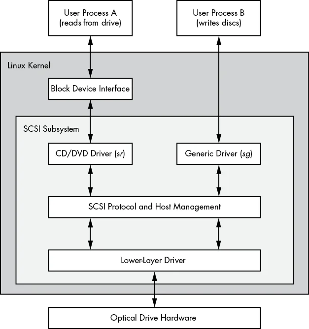

*图 3-3：光学设备驱动程序示意图*

在[图 3-3](#figure3-3) 中，进程 A 从块设备读取数据。但用户进程真的会以这种方式读取数据吗？通常答案是否定的，至少不会直接这样做。块设备之上还有更多层次，而硬盘也有更多访问入口。下一章将介绍这些内容。

---


## 第 4 章：磁盘与文件系统

在第 3 章中，我们概览了内核提供的一些顶层磁盘设备。本章将详细讨论如何在 Linux 系统上使用磁盘。你将学习如何对磁盘进行分区、创建和维护磁盘分区中的文件系统，以及如何使用交换空间。

回想一下，磁盘设备的名称可能是 */dev/sda*，它表示 SCSI 子系统中的第一块磁盘。这种块设备代表整块磁盘，但磁盘内部还有许多不同的组成部分和层次。

[图 4-1](#figure4-1) 展示了一块简单 Linux 磁盘的示意图（注意，该图并非按比例绘制）。随着本章的深入，你将了解各个部分所处的位置。

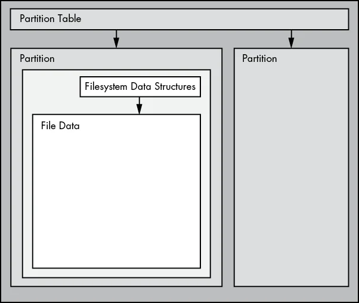

*图 4-1：典型 Linux 磁盘示意图*

*分区（partition）* 是对整块磁盘的划分。在 Linux 中，分区名称是在完整块设备名称后加上一个数字，例如 */dev/sda1* 和 */dev/sdb3*。内核会将每个分区呈现为一个块设备，就像呈现整块磁盘一样。分区信息定义在磁盘的一小块区域中，这块区域称为 *分区表（partition table）*，也叫 *磁盘标签（disk label）*。

> 过去，在配有大容量磁盘的系统上创建多个数据分区很常见，因为早期 PC 只能从磁盘的特定区域启动。另外，管理员会通过分区为操作系统的不同区域预留一定空间。例如，他们不希望用户耗尽整个系统的磁盘空间，导致关键服务无法运行。这种做法并非 Unix 独有；如今仍有许多新的 Windows 系统在一块磁盘上设置多个分区。此外，大多数系统还有单独的交换分区。

Linux 内核允许你同时访问整块磁盘及其某个分区，不过除非你要复制整块磁盘，否则通常不会这样操作。

Linux *逻辑卷管理器（Logical Volume Manager，LVM）* 为传统磁盘设备和分区增加了更多灵活性，目前已广泛应用于许多系统。我们将在 4.4 节介绍 LVM。

分区之上的下一层是 *文件系统（filesystem）*，它是由文件和目录构成的数据库，也是你在用户空间中经常与之交互的部分。我们将在 4.2 节探讨文件系统。

从[图 4-1](#figure4-1) 可以看出，如果想访问某个文件的数据，你需要先依据分区表找到正确的分区位置，然后在该分区的文件系统数据库中查找目标文件的数据。

为了访问磁盘上的数据，Linux 内核使用[图 4-2](#figure4-2) 所示的分层体系。SCSI 子系统以及 3.6 节介绍的其他所有组件，在图中被合并为一个方框。注意，你既可以通过文件系统操作磁盘，也可以直接通过磁盘设备操作磁盘。本章将介绍这两种方法。为简化图示，[图 4-2](#figure4-2) 没有画出 LVM；不过，LVM 在块设备接口中有相应组件，在用户空间也有一些管理组件。

为了理解这些部分如何协同工作，我们先从最底层的分区讲起。

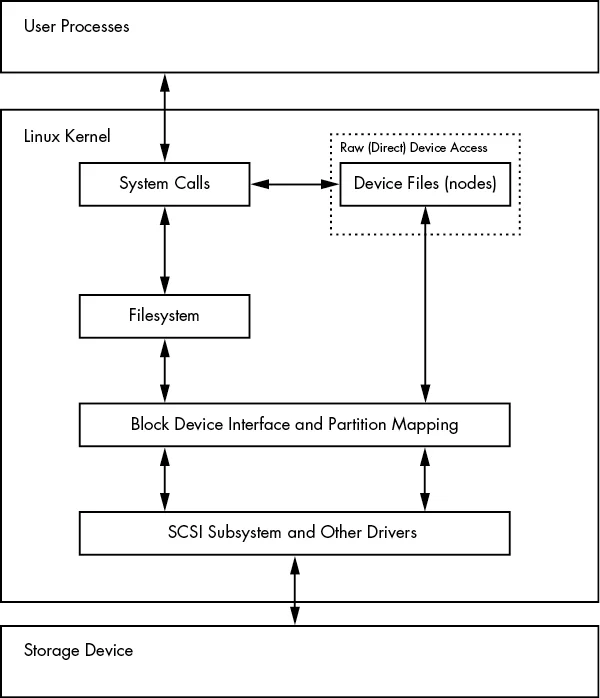

*图 4-2：内核访问磁盘的示意图*

### 4.1 对磁盘设备进行分区

分区表有许多类型。分区表本身并没有什么神秘之处：它只是一组数据，用于说明磁盘上的数据块如何划分。

传统分区表可以追溯到早期 PC，它位于 *主引导记录（Master Boot Record，MBR）* 中，存在许多限制。大多数较新的系统采用 *全局唯一标识符分区表（Globally Unique Identifier Partition Table，GPT）*。

下面列出几种 Linux 分区工具：

1. `parted` **（“分区编辑器”）**：基于文本的工具，同时支持 MBR 和 GPT。
2. `gparted`：`parted` 的图形界面版本。
3. `fdisk`：传统的 Linux 文本式磁盘分区工具。较新版本的 `fdisk` 支持 MBR、GPT 以及其他许多分区表类型，但旧版本仅支持 MBR。

由于 `parted` 很早就同时支持 MBR 和 GPT，而且执行一条命令便能方便地获取分区标签，因此我们将使用 `parted` 显示分区表。不过，在创建和修改分区表时，我们会使用 `fdisk`。这样既能展示两种界面，也能说明为什么许多人更喜欢 `fdisk`：它采用交互式操作，而且在你有机会检查修改之前，不会真正将更改写入磁盘（稍后会讨论这一点）。

> 分区操作与文件系统操作有一个关键区别：分区表只是定义磁盘上的简单边界，而文件系统则是复杂得多的数据组织体系。因此，我们将分别使用不同的工具进行分区和创建文件系统（参见 4.2.2 节）。

#### 4.1.1 查看分区表

可以使用 `parted -l` 查看系统的分区表。下面的示例输出显示了两个磁盘设备，它们采用不同类型的分区表：

```bash
# parted -l
Model: ATA KINGSTON SM2280S (scsi)
1 Disk /dev/sda: 240GB
Sector size (logical/physical): 512B/512B
Partition Table: msdos
Disk Flags:

Number  Start   End    Size    Type      File system     Flags
 1      1049kB  223GB  223GB   primary   ext4            boot
 2      223GB   240GB  17.0GB  extended
 5      223GB   240GB  17.0GB  logical   linux-swap(v1)

Model: Generic Flash Disk (scsi)
2 Disk /dev/sdf: 4284MB
Sector size (logical/physical): 512B/512B
Partition Table: gpt
Disk Flags:

Number  Start   End     Size    File system  Name      Flags
 1      1049kB  1050MB  1049MB               myfirst
 2      1050MB  4284MB  3235MB               mysecond
```

第一个设备（*/dev/sda*）① 使用传统的 MBR 分区表（`parted` 将其称为 `msdos`），第二个设备（*/dev/sdf*）② 使用 GPT。注意，这两种分区表存储的参数并不相同。特别是，MBR 分区表没有 `Name` 列，因为这种分区方案根本不支持分区名称。（GPT 示例中的 `myfirst` 和 `mysecond` 是我随意取的名字。）

> 阅读分区表时，要特别留意容量单位。`parted` 输出的容量是它认为最易于阅读的近似值。相比之下，`fdisk -l` 显示精确数值，但在大多数情况下，其单位是 512 字节的“扇区（sector）”。这可能令人困惑，因为看起来磁盘和分区的实际容量似乎翻了一倍。仔细查看 `fdisk` 的分区表输出，也能找到扇区大小的信息。

##### MBR 基础知识

本例中的 MBR 分区表包含主分区、扩展分区和逻辑分区。*主分区（primary partition）* 是磁盘的普通划分区域；分区 1 就是一个例子。基本 MBR 最多只允许四个主分区，因此，如果你想创建超过四个分区，就必须把其中一个定义为 *扩展分区（extended partition）*。扩展分区可以进一步划分为 *逻辑分区（logical partition）*，操作系统可以像使用其他分区一样使用逻辑分区。本例中的分区 2 是一个扩展分区，其中包含逻辑分区 5。

> `parted` 列出的文件系统类型，不一定与 MBR 分区项中的系统 ID 字段相同。MBR 系统 ID 只是一个用于标识分区类型的数字，例如 `83` 表示 Linux 分区，`82` 表示 Linux 交换分区。不过，`parted` 会尝试自行判断分区上的文件系统类型，以提供更多有用信息。如果你确实需要知道 MBR 中的系统 ID，请使用 `fdisk -l`。

##### LVM 分区：先睹为快

查看分区表时，如果发现标记为 LVM 的分区（分区类型代码为 `8e`）、名为 `/dev/dm-*` 的设备，或者出现“device mapper（设备映射器）”的相关信息，就说明系统使用了 LVM。我们将先从传统的直接磁盘分区讲起；这与使用 LVM 的系统上看到的情况会略有不同。

为了让你提前了解会看到什么，下面快速浏览一个使用 LVM 的系统执行 `parted -l` 后的示例输出（这是在 VirtualBox 中全新安装、使用 LVM 的 Ubuntu 系统）。首先是实际分区表的描述。除了多出 `lvm` 标志外，其余内容基本符合预期：

```
Model: ATA VBOX HARDDISK (scsi)
Disk /dev/sda: 10.7GB
Sector size (logical/physical): 512B/512B
Partition Table: msdos
Disk Flags:

Number  Start   End     Size    Type     File system  Flags
 1      1049kB  10.7GB  10.7GB  primary               boot, lvm
```

接着会出现一些设备：它们看起来像分区，却被称为磁盘：

```
Model: Linux device-mapper (linear) (dm)
Disk /dev/mapper/ubuntu--vg-swap_1: 1023MB
Sector size (logical/physical): 512B/512B
Partition Table: loop
Disk Flags:

Number  Start  End     Size    File system     Flags
 1      0.00B  1023MB  1023MB  linux-swap(v1)

Model: Linux device-mapper (linear) (dm)
Disk /dev/mapper/ubuntu--vg-root: 9672MB
Sector size (logical/physical): 512B/512B
Partition Table: loop
Disk Flags:

Number  Start  End     Size    File system  Flags
 1      0.00B  9672MB  9672MB  ext4
```

一种简单的理解方式是：这些分区仿佛以某种方式脱离了分区表。你将在 4.4 节了解实际发生了什么。

> 使用 `fdisk -l` 得到的输出要简略得多。在上面的例子中，除了一个标记为 LVM 的物理分区之外，你不会看到其他内容。


##### 内核首次读取分区表

Linux 内核最初读取 MBR 分区表时，会产生类似下面这样的调试输出（记住，可以通过 `journalctl -k` 查看）：

```
 sda: sda1 sda2 < sda5 >
```

输出中的 `sda2 < sda5 >` 表示 */dev/sda2* 是一个扩展分区，其中包含一个逻辑分区 */dev/sda5*。通常可以忽略扩展分区本身，因为你真正关心的往往是访问其中的逻辑分区。

#### 4.1.2 修改分区表

查看分区表相对简单，而且通常不会造成损害。修改分区表也不算困难，但对磁盘进行这样的更改存在风险。请牢记以下几点：

- 更改分区表后，被删除或重新定义的分区中的数据可能很难恢复，因为这一操作可能抹去文件系统所在位置的信息。如果待分区磁盘包含重要数据，请务必备份。
- 确保目标磁盘上的任何分区都没有正在使用。之所以要注意这一点，是因为大多数 Linux 发行版会自动挂载检测到的文件系统。（有关挂载和卸载的更多内容，请参见 4.2.3 节。）

准备好后，选择分区工具。如果想使用 `parted`，可以选择命令行工具 `parted`，也可以使用 `gparted` 等图形界面；`fdisk` 在命令行中也比较容易操作。这些工具都提供在线帮助，学起来并不难。（如果没有备用磁盘，可以拿 U 盘或类似设备练习。）

不过，`fdisk` 与 `parted` 的工作方式存在一个重要区别。使用 `fdisk` 时，你会先设计新的分区表，然后才真正修改磁盘；只有在退出程序时选择写入，修改才会生效。而使用 `parted` 时，分区会在*执行命令的当下*被创建、修改或删除。你没有机会在实际修改之前统一检查分区表。

理解这一区别，也有助于理解两种工具如何与内核交互。`fdisk` 和 `parted` 都完全在用户空间修改分区；重写分区表不需要专门的内核支持，因为用户空间本来就能读取和修改块设备的全部内容。

但在某个时刻，内核必须读取分区表，才能把分区呈现为可供使用的块设备。`fdisk` 采用的方式比较简单：修改分区表后，它发起一次系统调用，通知内核重新读取磁盘分区表（稍后会看到使用 `fdisk` 的示例）。随后，内核生成调试输出，可以通过 `journalctl -k` 查看。例如，在 */dev/sdf* 上创建两个分区后，你会看到：

```
sdf: sdf1 sdf2
```

`parted` 系列工具不使用这种针对整块磁盘的系统调用，而是在各个分区发生更改时分别通知内核。内核处理单个分区变更后，不会产生上面那样的调试输出。

可以通过以下几种方式观察分区变化：

- 使用 `udevadm` 监视内核事件变化。例如，`udevadm monitor --kernel` 会显示旧分区设备被移除、新分区设备被添加的过程。
- 查看 */proc/partitions*，获取完整的分区信息。
- 查看 */sys/block/device/* 中发生变化的分区系统接口，或查看 */dev* 中发生变化的分区设备。

> **补充：强制重新加载分区表**
>
> 如果确实需要确认对分区表所做的修改，可以使用 `blockdev` 命令，执行 `fdisk` 所使用的旧式系统调用。例如，要强制内核重新加载 */dev/sdf* 上的分区表，请运行：
>
> ```bash
> # blockdev --rereadpt /dev/sdf
> ```

#### 4.1.3 创建分区表

现在，我们通过在一块全新、空白的磁盘上创建分区表，实际运用刚才学到的知识。本例采用以下条件：

- 一块 4GB 磁盘（例如未使用的小型 USB 闪存设备；如果想跟着操作，也可以使用手头任何容量的设备）。
- MBR 格式的分区表。
- 两个准备创建 ext4 文件系统的分区，容量分别为 200MB 和 3.8GB。
- 磁盘设备为 */dev/sdd*；你需要通过 `lsblk` 找到自己设备的实际位置。

我们将使用 `fdisk`。记住，它是一个交互式命令。因此，确认磁盘上没有挂载任何内容之后，在命令提示符下输入设备名称来启动：

```bash
# fdisk /dev/sdd
```

程序会显示一段介绍信息，然后出现如下命令提示符：

```
Command (m for help):
```

首先，用 `p` 命令打印当前分区表（`fdisk` 的命令都相当简短）。交互过程大致如下：

```
Command (m for help): p
Disk /dev/sdd: 4 GiB, 4284481536 bytes, 8368128 sectors
Units: sectors of 1 * 512 = 512 bytes
Sector size (logical/physical): 512 bytes / 512 bytes
I/O size (minimum/optimal): 512 bytes / 512 bytes
Disklabel type: dos
Disk identifier: 0x88f290cc

Device     Boot Start     End Sectors Size Id Type
/dev/sdd1        2048 8368127 8366080   4G  c W95 FAT32 (LBA)
```

大多数设备都已经包含一个 FAT 类型的分区，例如这里的 */dev/sdd1*。因为我们想为 Linux 创建新分区（而且当然已经确认这里的数据都不需要保留），所以可以像下面这样删除已有分区：

```
Command (m for help): d
Selected partition 1
Partition 1 has been deleted.
```

记住，`fdisk` 只有在明确要求写入分区表时才会真正修改磁盘，因此到目前为止，磁盘还没有发生变化。如果操作失误且无法挽回，可以使用 `q` 命令退出 `fdisk`，不写入任何更改。

接下来，用 `n` 命令创建第一个 200MB 分区：

```
Command (m for help): n
Partition type
   p   primary (0 primary, 0 extended, 4 free)
   e   extended (container for logical partitions)
Select (default p): p
Partition number (1-4, default 1): 1
First sector (2048-8368127, default 2048): 2048
Last sector, +sectors or +size{K,M,G,T,P} (2048-8368127, default 8368127): +200M

Created a new partition 1 of type 'Linux' and of size 200 MiB.
```

这里，`fdisk` 会依次询问 MBR 分区类型、分区编号、分区起始位置，以及结束位置（或容量）。默认值通常就符合要求。本例唯一需要特别修改的是分区的结束位置或容量：通过 `+` 语法指定大小和单位。

创建第二个分区的方法相同，只不过所有提示都采用默认值，因此这里不再重复演示。完成分区布局后，使用 `p`（打印）命令检查：

```
Command (m for help): p
[--snip--]
Device     Boot  Start     End Sectors  Size Id Type
/dev/sdd1         2048  411647  409600  200M 83 Linux
/dev/sdd2       411648 8368127 7956480  3.8G 83 Linux
```

确认可以写入分区表后，使用 `w` 命令：

```
Command (m for help): w
The partition table has been altered.
Calling ioctl() to re-read partition table.
Syncing disks.
```

请注意，`fdisk` 不会再询问你是否确定，也不会提供额外的安全确认；它只是完成操作并退出。

如果想查看其他诊断消息，可以运行 `journalctl -k`，查看前面提到的内核读取信息。不过要记住，只有使用 `fdisk` 时才会得到这种输出。

至此，你已经掌握了开始进行磁盘分区所需的基础知识。如果还想深入了解磁盘，可以继续阅读。否则，可以直接跳到 4.2 节，学习如何在磁盘上创建文件系统。

#### 4.1.4 理解磁盘与分区的几何结构

任何包含运动部件的设备都会增加软件系统的复杂性，因为物理因素不容易被完全抽象掉。硬盘也不例外。虽然你可以把硬盘看作能够随机访问任意数据块的块设备，但如果系统在磁盘上安排数据的位置时不够谨慎，就可能严重影响性能。请看[图 4-3](#figure4-3) 所示的简单单盘片硬盘的物理结构。

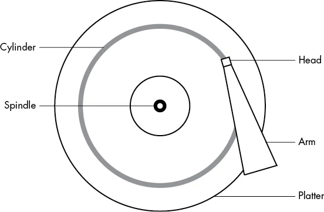

*图 4-3：从上方俯视硬盘*

硬盘由安装在主轴上的旋转盘片，以及连接在可移动磁臂上的磁头组成。磁臂能够沿盘片半径方向移动。当盘片在磁头下方旋转时，磁头就可以读取数据。磁臂固定在某个位置时，磁头只能读取一个固定圆周上的数据。这个圆周称为*柱面（cylinder）*，因为容量较大的硬盘可能有多个盘片，层层叠放并围绕同一主轴旋转。每个盘片的上表面和／或下表面可以各有一个磁头；所有磁头都连接在同一个磁臂组件上，同步移动。由于磁臂可以移动，磁盘上存在许多柱面：靠近中心的柱面较小，靠近外缘的柱面较大。最后，还可以把柱面划分为称作*扇区（sector）*的片段。这种理解磁盘几何结构的方式称为 *CHS*，即 *cylinder-head-sector*（柱面—磁头—扇区）。在旧系统中，可以通过这三个参数定位磁盘上的任意位置。

> *磁道（track）*是单个磁头能够访问的柱面部分。因此，在[图 4-3](#figure4-3) 中，柱面也就是一条磁道。这里不需要过多关注磁道的区别。

内核和各种分区程序可以告诉你磁盘报告的柱面数量。然而，对于稍微新一点的硬盘来说，*报告的这些数值都是虚构的！* 传统 CHS 寻址方式无法很好地适应现代磁盘硬件，也无法体现外圈柱面能够存储比内圈更多数据的事实。现代磁盘硬件支持*逻辑块寻址（Logical Block Addressing，LBA）*，通过块编号定位磁盘位置（这种接口直接得多），但 CHS 的痕迹依然存在。例如，MBR 分区表既包含 CHS 信息，也包含相应的 LBA 信息；某些引导加载程序仍然会愚蠢地相信 CHS 数值（不用担心，大多数 Linux 引导加载程序使用 LBA 数值）。

> *扇区*这个词容易让人困惑，因为 Linux 分区程序可能用它表示另一种数值。

> **补充：柱面边界重要吗？**
>
> 柱面的概念过去对分区至关重要，因为柱面是划分分区的理想边界。连续读取一个柱面上的数据非常快，因为盘片旋转时，磁头可以持续获取数据。由相邻柱面组成的分区也有利于快速连续访问，因为磁头在柱面之间不必移动太远。
>
> 尽管今天的硬盘外观与过去大致相同，但要求分区严格按照柱面边界对齐的观念已经过时。一些旧分区程序会在分区没有精确对齐柱面边界时发出警告。忽略即可；现代磁盘报告的 CHS 数值本来就不真实，你也无法据此做出有效调整。磁盘的 LBA 机制，加上较新分区工具中更完善的逻辑，能够确保分区得到合理布局。

#### 4.1.5 从固态硬盘读取数据

没有运动部件的存储设备，例如*固态硬盘（SSD）*，在访问特性上与旋转式硬盘截然不同。对 SSD 而言，随机访问并不是问题，因为不存在需要在盘片上移动的磁头；不过，某些特性仍然会影响 SSD 的性能。

影响 SSD 性能的一个重要因素是*分区对齐（partition alignment）*。从 SSD 读取数据时，数据是按块读取的，这些块称为*页（page）*，不要与虚拟内存页混淆。每次读取的大小可能是 4,096 或 8,192 字节，而且读取必须从该大小的整数倍位置开始。这意味着，如果分区及其中的数据没有位于合适的边界上，那么某些常见的小型操作（例如读取目录内容）可能需要读取两次，而不是一次。

较新版本的分区工具已经包含相应逻辑，可以让新建分区从磁盘开头的适当偏移位置开始，因此通常不必担心分区对齐错误。目前的分区工具并不进行复杂计算，而是直接把分区对齐到 1MB 边界，更准确地说，是每 2,048 个 512 字节块的边界。这是一种相当保守的做法，因为它同时兼容 4,096、8,192 等页大小，一直到 1,048,576 字节。

不过，如果你对此感兴趣，或者想确认分区确实从合适的边界开始，可以很容易地在 */sys/block* 目录中找到相关信息。下面是分区 */dev/sdf2* 的示例：

```bash
$ cat /sys/block/sdf/sdf2/start
1953126
```

这里的输出表示该分区相对于设备起始位置的偏移量，单位是 512 字节（Linux 系统同样容易令人困惑地把这种单位称为*扇区*）。如果这块 SSD 使用 4,096 字节的页，那么每页包含八个这样的扇区。只需要检查分区偏移量能否被 8 整除即可。本例中无法整除，因此该分区无法达到最佳性能。


### 4.2 文件系统

对于磁盘而言，连接内核空间与用户空间的最后一环通常是*文件系统*（filesystem）。当你运行 `ls`、`cd` 等命令时，所接触的就是文件系统。前面提到过，文件系统是一种数据库：它提供必要的结构，将简单的块设备转变为用户能够理解的、由文件和子目录组成的复杂层次结构。

过去，所有文件系统都位于磁盘及其他专门用于数据存储的物理介质上。不过，文件系统的树状目录结构和 I/O 接口用途广泛，因此如今文件系统还承担着许多其他任务，例如提供你在 */sys* 和 */proc* 中看到的系统接口。传统上，文件系统由内核实现，但 Plan 9 操作系统中的 9P 创新（<https://en.wikipedia.org/wiki/9P_(protocol)>）启发了用户空间文件系统的发展。Linux 的*用户空间文件系统（Filesystem in Userspace，FUSE）*功能使得在用户空间实现文件系统成为可能。

*虚拟文件系统（Virtual File System，VFS）*抽象层使文件系统的实现体系更加完整。正如 SCSI 子系统为不同设备类型与内核控制命令之间的通信提供统一标准一样，VFS 确保所有文件系统实现都支持标准接口，使用户空间应用程序能够以相同方式访问文件和目录。正是有了 VFS 的支持，Linux 才能够兼容数量极其庞大的文件系统。

#### 4.2.1 文件系统类型

Linux 支持的文件系统包括专门针对 Linux 优化的原生设计、Windows FAT 系列等外来类型、ISO 9660 等通用文件系统，以及许多其他类型。下面列出了最常见的数据存储文件系统。每个文件系统名称后面的括号中，是 Linux 识别的类型名称。

- *第四扩展文件系统（Fourth Extended filesystem，ext4）*是 Linux 原生扩展文件系统系列的当前版本。*第二扩展文件系统（Second Extended filesystem，ext2）*曾长期是 Linux 系统的默认选择，它受到 Unix 文件系统（UFS）和快速文件系统（FFS）等传统 Unix 文件系统的启发。*第三扩展文件系统（Third Extended filesystem，ext3）*增加了日志功能（日记日志是位于常规文件系统数据结构之外的一小块缓存），以增强数据完整性并加快启动速度。ext4 则是在此基础上的渐进式改进，支持比 ext2、ext3 更大的文件以及更多的子目录。

  扩展文件系统系列具有一定程度的向后兼容性。例如，你可以将 ext2 和 ext3 文件系统按彼此的类型挂载，也可以将 ext2 和 ext3 文件系统作为 ext4 挂载；但**不能**将 ext4 作为 ext2 或 ext3 挂载。
- *Btrfs，即 B 树文件系统（B-tree filesystem，btrfs）*，是一种较新的 Linux 原生文件系统，设计目标是突破 ext4 在扩展能力方面的限制。
- *FAT 文件系统*（msdos、vfat、exfat）与微软系统有关。简单的 msdos 类型支持 MS-DOS 系统中非常原始、仅有一种字母大小写形式的文件名。大多数可移动闪存介质，例如 SD 卡和 USB 闪存盘，默认采用 vfat（最大 4 GB）或 exfat（4 GB 及以上）分区。Windows 系统既可以使用基于 FAT 的文件系统，也可以使用更先进的 *NT 文件系统（NT File System，ntfs）*。
- *XFS* 是一种高性能文件系统，被某些发行版用作默认文件系统，例如 Red Hat Enterprise Linux 7.0 及后续版本。
- *HFS+*（hfsplus）是苹果的一项标准，曾用于大多数 Macintosh 系统。
- *ISO 9660*（iso9660）是 CD-ROM 标准。大多数 CD-ROM 都使用 ISO 9660 标准的某种变体。

> **专栏：Linux 文件系统的演进**
>
> 长期以来，扩展文件系统系列对大多数用户来说都完全够用。它能如此长久地保持事实上的标准地位，既证明了其实用性，也证明了它的适应能力。Linux 开发社区往往倾向于彻底替换那些无法满足当前需求的组件，但每当扩展文件系统显露出不足时，总有人通过升级来弥补。不过，文件系统技术已经取得许多新进展；由于向后兼容的要求，即使 ext4 也无法利用其中一些进展。这些进展主要涉及可扩展性，例如处理数量极其庞大的文件、大文件以及类似场景的能力。
>
> 在本书写作时，Btrfs 已成为一个主要 Linux 发行版的默认文件系统。如果这一选择被证明是成功的，那么 Btrfs 很可能具备取代扩展文件系统系列的条件。

#### 4.2.2 创建文件系统

如果你正在准备新的存储设备，那么完成第 4.1 节所述的分区操作后，就可以开始创建文件系统了。与分区一样，这项操作也是在用户空间完成的，因为用户空间进程可以直接访问和操作块设备。

`mkfs` 工具能够创建多种文件系统。例如，可以使用以下命令在 */dev/sdf2* 上创建 ext4 文件系统：

```bash
# mkfs -t ext4 /dev/sdf2
```

`mkfs` 程序会自动确定设备包含的块数，并设置一些合理的默认参数。除非你确实清楚自己在做什么，而且愿意仔细阅读相关文档，否则不要修改这些参数。

创建文件系统时，`mkfs` 会输出诊断信息，其中包括与超级块有关的内容。*超级块（superblock）*是文件系统数据库顶层的关键组成部分。它非常重要，因此 `mkfs` 会创建多个备份，以防原始超级块遭到破坏。建议在运行 `mkfs` 时记下几个超级块备份的位置编号，以便在磁盘故障导致超级块损坏时尝试恢复（参见第 4.2.11 节）。

> **警告：**
>
> 只有在添加新磁盘或对旧磁盘重新分区之后，才应执行创建文件系统的操作。对于每个没有现存数据的新分区（或其中的数据正是你想删除的分区），只需要创建一次文件系统。在已有文件系统上创建新的文件系统，实际上会破坏旧数据。

> **专栏：mkfs 究竟是什么？**
>
> 实际上，`mkfs` 只是一系列文件系统创建程序的前端。这些程序的名称形式为 `mkfs.fs`，其中 `fs` 表示文件系统类型。因此，当你运行 `mkfs -t ext4` 时，`mkfs` 会进一步调用 `mkfs.ext4`。
>
> 这里甚至还有另一层间接调用。查看这些命令背后的 *mkfs.\** 文件，你会看到类似下面的内容：
>
> ```bash
> $ ls -l /sbin/mkfs.*
> -rwxr-xr-x 1 root root 17896 Mar 29 21:49 /sbin/mkfs.bfs
> -rwxr-xr-x 1 root root 30280 Mar 29 21:49 /sbin/mkfs.cramfs
> lrwxrwxrwx 1 root root     6 Mar 30 13:25 /sbin/mkfs.ext2 -> mke2fs
> lrwxrwxrwx 1 root root     6 Mar 30 13:25 /sbin/mkfs.ext3 -> mke2fs
> lrwxrwxrwx 1 root root     6 Mar 30 13:25 /sbin/mkfs.ext4 -> mke2fs
> lrwxrwxrwx 1 root root     6 Mar 30 13:25 /sbin/mkfs.ext4dev -> mke2fs
> -rwxr-xr-x 1 root root 26200 Mar 29 21:49 /sbin/mkfs.minix
> lrwxrwxrwx 1 root root     7 Dec 19  2011 /sbin/mkfs.msdos -> mkdosfs
> lrwxrwxrwx 1 root root     6 Mar  5  2012 /sbin/mkfs.ntfs -> mkntfs
> lrwxrwxrwx 1 root root     7 Dec 19  2011 /sbin/mkfs.vfat -> mkdosfs
> ```
>
> 如你所见，*mkfs.ext4* 只是指向 *mke2fs* 的符号链接。如果你遇到某个系统没有特定的 `mkfs` 命令，或者需要查阅某种文件系统的文档，记住这一点会很有用。每种文件系统的创建工具都有自己的手册页，例如 mke2fs(8)。在大多数系统上，这不会造成问题，因为访问 mkfs.ext4(8) 手册页通常会将你引导到 mke2fs(8) 手册页。不过，仍然值得记住这种关系。


#### 4.2.3 挂载文件系统

在 Unix 中，将文件系统接入正在运行的系统的过程称为*挂载（mounting）*。系统启动时，内核会读取一些配置数据，并根据这些数据挂载根文件系统（`/`）。

要挂载文件系统，你必须知道以下信息：

- 文件系统所在的设备、位置或标识符（例如磁盘分区，即实际存放文件系统数据的位置）。某些特殊用途的文件系统，例如 proc 和 sysfs，并没有对应的存储位置。
- 文件系统的类型。
- *挂载点（mount point）*：文件系统将接入当前系统目录层次结构的位置。挂载点始终是一个普通目录。例如，你可以使用 */music* 作为存放音乐的文件系统的挂载点。挂载点不必直接位于 */* 下，它可以处于系统中的任何位置。

描述挂载操作时，通常会说“将某个设备挂载到某个挂载点上”。要查看系统当前的文件系统状态，可以运行 `mount`。输出可能很长，大致如下：

```bash
$ mount
/dev/sda1 on / type ext4 (rw,errors=remount-ro)
proc on /proc type proc (rw,noexec,nosuid,nodev)
sysfs on /sys type sysfs (rw,noexec,nosuid,nodev)
fusectl on /sys/fs/fuse/connections type fusectl (rw)
debugfs on /sys/kernel/debug type debugfs (rw)
securityfs on /sys/kernel/security type securityfs (rw)
udev on /dev type devtmpfs (rw,mode=0755)
devpts on /dev/pts type devpts (rw,noexec,nosuid,gid=5,mode=0620)
tmpfs on /run type tmpfs (rw,noexec,nosuid,size=10%,mode=0755)
--snip--
```

每一行对应一个当前已挂载的文件系统，其中各项依次为：

1. 设备，例如 */dev/sda3*。注意，其中一些并不是真正的设备（例如 `proc`），而只是设备名称的替代表示，因为这些特殊用途的文件系统不需要实际设备。
2. 单词 `on`。
3. 挂载点。
4. 单词 `type`。
5. 文件系统类型，通常用简短的标识符表示。
6. 挂载选项（位于括号中）。详情参见 4.2.6 节。

要手动挂载文件系统，可以使用 `mount` 命令，指定文件系统类型、设备以及目标挂载点：

```bash
# mount -t type device mountpoint
```

例如，要将设备 */dev/sdf2* 上的第四代扩展文件系统（ext4）挂载到 */home/extra*，可以执行：

```bash
# mount -t ext4 /dev/sdf2 /home/extra
```

通常不需要提供 `-t` `type` 选项，因为 `mount` 一般能够自行识别文件系统类型。不过，有时需要用它来区分两种相似的类型，例如不同的 FAT 系列文件系统。

要卸载（断开）文件系统，可以使用 `umount` 命令：

```bash
# umount mountpoint
```

除了指定挂载点，你也可以通过设备名称来卸载文件系统。

> 几乎所有 Linux 系统都提供一个临时挂载点 */mnt*，通常用于测试。你可以在实验时使用它；但如果打算长期挂载某个文件系统，最好另找一个位置或创建一个新的挂载点。

#### 4.2.4 文件系统 UUID

上一节介绍的挂载方式依赖设备名称。然而，设备名称可能发生变化，因为它们取决于内核发现设备的先后顺序。为解决这个问题，你可以通过文件系统的*通用唯一标识符（universally unique identifier，UUID）*来识别并挂载文件系统。UUID 是一种行业标准，相当于用于标识计算机系统中对象的唯一“序列号”。`mke2fs` 等文件系统创建程序会在初始化文件系统数据结构时生成 UUID。

要查看系统中的设备、对应的文件系统以及 UUID，可以使用 `blkid`（block ID）程序：

```bash
# blkid
/dev/sdf2: UUID="b600fe63-d2e9-461c-a5cd-d3b373a5e1d2" TYPE="ext4"
/dev/sda1: UUID="17f12d53-c3d7-4ab3-943e-a0a72366c9fa" TYPE="ext4" PARTUUID="c9a5ebb0-01"
/dev/sda5: UUID="b600fe63-d2e9-461c-a5cd-d3b373a5e1d2" TYPE="swap" PARTUUID="c9a5ebb0-05"
/dev/sde1: UUID="4859-EFEA" TYPE="vfat"
```

在这个例子中，`blkid` 找到了四个包含数据的分区：两个使用 ext4 文件系统，一个带有交换空间标记（参见 4.3 节），另一个使用基于 FAT 的文件系统。Linux 原生分区都有标准 UUID，而 FAT 分区没有。你可以使用 FAT 卷序列号（此处为 4859-EFEA）来引用该分区。

要通过 UUID 挂载文件系统，可以使用 `UUID` 挂载选项。例如，要把上面列表中的第一个文件系统挂载到 */home/extra*，可以输入：

```bash
# mount UUID=b600fe63-d2e9-461c-a5cd-d3b373a5e1d2 /home/extra
```

通常，你不会像这样手动通过 UUID 挂载文件系统，因为你一般已经知道设备名称，而按名称挂载设备要比输入冗长的 UUID 简单得多。不过，理解 UUID 仍然很重要。首先，在启动时通过 */etc/fstab* 自动挂载非 LVM 文件系统时，UUID 是首选方式（参见 4.2.8 节）。此外，许多发行版会在插入可移动存储介质时使用 UUID 作为挂载点名称。在上面的例子中，FAT 文件系统位于一张闪存卡上。当有用户登录 Ubuntu 系统时，插入这张卡后，系统会将该分区挂载到 */media/user/4859-EFEA*。第 3 章介绍的 `udevd` 守护进程负责处理设备插入时最初产生的事件。

必要时，你可以更改文件系统的 UUID（例如，当你从别处完整复制了一个文件系统，现在需要将副本与原件区分开时）。对于 ext2/ext3/ext4 文件系统，具体方法可参见 tune2fs(8) 手册页。

#### 4.2.5 磁盘缓冲、缓存与文件系统

与其他 Unix 变体一样，Linux 会对磁盘写入进行缓冲。这意味着，当进程请求修改文件系统时，内核通常不会立即将修改写入磁盘。相反，它会先将这些修改保存在 RAM 中，等内核判断时机合适后再实际写入磁盘。用户通常感知不到这一缓冲机制，而它能显著提高性能。

当你使用 `umount` 卸载文件系统时，内核会自动与磁盘进行*同步（synchronize）*，把缓冲区中的修改写入磁盘。你也可以随时运行 `sync` 命令，强制内核执行同步；默认情况下，它会同步系统中的所有磁盘。如果由于某种原因，你无法在关闭系统之前卸载文件系统，务必先运行 `sync`。

此外，内核还会使用 RAM 缓存从磁盘读取的数据块。因此，如果一个或多个进程反复访问同一个文件，内核就不必一次又一次地读取磁盘，而可以直接从缓存中读取，从而节省时间和系统资源。


#### 4.2.6 文件系统挂载选项

修改 `mount` 命令的行为有许多方式，在处理可移动介质或执行系统维护时经常需要这样做。事实上，`mount` 可用的选项数量多得惊人。详尽的 mount(8) 手册页是一个很好的参考资料，但初学者很难知道该从哪里入手以及哪些可以安全忽略。本节将介绍最实用的选项。

挂载选项大致分为两类：通用选项与特定于文件系统的选项。通用选项通常适用于所有文件系统类型，例如前面介绍的用于指定文件系统类型的 `-t` 选项。相比之下，特定于文件系统的选项仅适用于某些特定文件系统类型。

要激活文件系统选项，可以使用 `-o` 参数后跟选项名称。例如，`-o remount,rw` 可以将当前已挂载为只读的文件系统以读写模式重新挂载。

##### 通用短选项

通用选项采用简短的语法。最核心的选项包括：

1. `-r`：以只读模式挂载文件系统。该选项用途广泛，从写保护到系统引导均有涉及。访问 CD-ROM 等只读设备时无需显式指定此选项；系统会自动为你处理（并提示其只读状态）。
2. `-n`：确保 `mount` 不会尝试更新系统运行时挂载数据库 */etc/mtab*。默认情况下，如果 `mount` 无法写入此文件，挂载操作就会失败。因此该选项在系统启动阶段至关重要，因为根分区（包括系统挂载数据库）最初是只读的。此外，在单用户模式下尝试修复系统故障时，该选项也非常有用，因为此时系统挂载数据库可能不可用。
3. `-t`：`-t <类型>` 选项用于显式指定文件系统类型。

##### 长选项

像 `-r` 这样的短选项对于日益增多的挂载选项而言过于有限；字母表中的字母数量根本无法容纳所有可能的选项。此外，仅根据单个字母也很难判断选项的具体含义。许多通用选项以及所有特定于文件系统的选项都使用更长、更灵活的长选项格式。

要在命令行中使用 `mount` 的长选项，以 `-o` 开头，后跟以逗号分隔的关键字。下面是一个完整的示例，长选项紧跟在 `-o` 之后：

```bash
# mount -t vfat /dev/sde1 /dos -o ro,uid=1000
```

此处的两个长选项是 `ro` 和 `uid=1000`。`ro` 选项指定只读模式，等同于 `-r` 短选项。`uid=1000` 选项指示内核将文件系统上的所有文件均视为属于用户 ID 1000。

最实用的长选项包括：

1. `exec`, `noexec`：允许或禁止在文件系统上执行程序。
2. `suid`, `nosuid`：允许或禁止 `setuid` 特权程序生效。
3. `ro`：以只读模式挂载文件系统（等同于 `-r` 短选项）。
4. `rw`：以读写模式挂载文件系统。

> **提示**：
> Unix 和 DOS 文本文件之间存在差异，主要体现在换行符的处理上。在 Unix 中，仅使用换行符（`\n`，ASCII 0x0A）标记行末；而 DOS 则使用回车符（`\r`，ASCII 0x0D）紧跟换行符。虽然曾经多次尝试在文件系统级别进行自动换行转换，但这总会带来诸多隐患。像 vim 这样的现代文本编辑器能够自动检测文件的换行风格并妥善保持，通过这种方式统一代码风格要安全得多。

#### 4.2.7 重新挂载文件系统

在某些情况下，你需要修改当前已挂载文件系统的挂载选项；最常见的场景是在崩溃恢复期间将只读文件系统更改为可写。此时，你需要将文件系统重新附加到同一个挂载点上。

以下命令将以读写模式重新挂载根目录（需要使用 `-n` 选项，因为根目录只读时 `mount` 命令无法写入系统挂载数据库）：

```bash
# mount -n -o remount /
```

该命令假定 */etc/fstab* 中包含 */* 的正确设备条目（下一节将详细讨论）。如果不存在，则必须将设备作为附加参数显式指定。

#### 4.2.8 /etc/fstab 文件系统表

为了在开机引导时自动挂载文件系统，并摆脱反复手动输入 `mount` 命令的繁琐操作，Linux 系统在 */etc/fstab* 中维护了一份永久的文件系统与挂载选项列表。这是一个格式极其简单的纯文本文件，如代码清单 4-1 所示。

```
UUID=70ccd6e7-6ae6-44f6-812c-51aab8036d29 / ext4 errors=remount-ro 0 1
UUID=592dcfd1-58da-4769-9ea8-5f412a896980 none swap sw 0 0
/dev/sr0 /cdrom iso9660  ro,user,nosuid,noauto 0 0
```

*代码清单 4-1：/etc/fstab 中的文件系统与选项列表*

每一行对应一个文件系统，由 6 个字段组成。从左至右，这些字段分别是：

1. **设备或 UUID**：当前大多数现代 Linux 系统在 */etc/fstab* 中不再直接使用设备名，而是优先采用 UUID。
2. **挂载点**：指示文件系统挂载到目录树的哪个位置。
3. **文件系统类型**：列表中可能包含 `swap`，表示交换分区（参见第 4.3 节）。
4. **挂载选项**：以逗号分隔的长选项列表。
5. **dump 备份标志**：供历史悠久的 `dump` 命令使用的备份信息，现已过时，通常直接设为 `0`。
6. **文件系统完整性自检顺序**：用于确保 `fsck` 在启动时始终首先检查根分区。根文件系统应始终设置为 `1`；硬盘或 SSD 上的其他本地文件系统设置为 `2`。对于所有其他文件系统（包括只读设备、swap 以及 */proc* 伪文件系统），设置为 `0` 以禁用开机启动自检（参见第 4.2.11 节中的 `fsck` 命令）。

如果想要操作的文件系统已在 */etc/fstab* 中配置，使用 `mount` 命令时就可以使用快捷方式。例如在代码清单 4-1 中，要挂载光驱 CD-ROM，只需运行 `mount /cdrom` 即可。

你还可以使用以下命令同时挂载 */etc/fstab* 中所有未标记 `noauto` 选项的条目：

```bash
# mount -a
```

代码清单 4-1 中引入了一些新选项——即 `errors`、`noauto` 和 `user`，因为它们通常仅适用于 */etc/fstab* 文件中。此外，这里还会经常见到 `defaults` 选项。这些选项的含义如下：

1. `defaults`：使用 `mount` 的默认选项组合：读写模式、启用设备文件、允许执行程序、允许 `setuid` 位生效等。当不需要任何特殊选项、但需要填满 */etc/fstab* 的所有字段时，使用该选项。
2. `errors`：特定于 ext2/3/4 的参数，用于定义内核在挂载出现问题或遇到文件系统错误时的行为。默认值通常是 `errors=continue`，表示内核记录错误代码并继续运行。若要让内核在发生错误时自动以只读模式重新挂载文件系统，使用 `errors=remount-ro`。`errors=panic` 设置则指示内核在挂载出错时立即停止系统运行（Kernel Panic）。
3. `noauto`：指示 `mount -a` 命令忽略此条目。常用于防止开机引导时自动挂载可移动存储设备（如 U 盘）。
4. `user`：允许非特权普通用户挂载该条目，对于允许普通用户访问可移动介质非常方便。由于其他系统可能在可移动介质上植入恶意 *setuid-root* 程序，因此该选项会自动隐式启用 `nosuid`、`noexec` 和 `nodev`。请注意，对于移动存储介质，现代系统大多依托桌面守护进程自动挂载；但在特殊需求下，若需要向普通用户开放特定目录的挂载权限，该选项依然十分有用。

#### 4.2.9 /etc/fstab 的替代方案

虽然 */etc/fstab* 文件一直是描述文件系统及其挂载点的传统方式，但还有两种替代方案。第一种是使用 */etc/fstab.d* 目录，其中包含各个文件系统的独立配置文件（每个文件系统一个文件）。这种思路与本书后面会反复见到的许多其他配置目录非常相似。

第二种方案是为文件系统配置 *systemd 单元（systemd units）*。你将在第 6 章进一步了解 systemd 及其单元。不过，systemd 单元的配置通常由 */etc/fstab* 文件生成，或以它为基础，因此你可能会发现系统中的两种配置存在重叠。

#### 4.2.10 文件系统容量

要查看当前已挂载文件系统的大小和使用情况，可以使用 `df` 命令。它的输出可能非常长（随着专用文件系统越来越多，输出还会不断变长），但其中应当包含实际存储设备的信息。

```bash
$ df
Filesystem           1K-blocks      Used  Available Use% Mounted on
/dev/sda1            214234312 127989560   75339204  63% /
/dev/sdd2              3043836      4632    2864872   1% /media/user/uuid
```

下面简要说明 `df` 输出中的各列：

1. `Filesystem`：文件系统所在的设备。
2. `1K-blocks`：文件系统的总容量，以 1,024 字节为一个块计算。
3. `Used`：已占用的块数。
4. `Available`：可用的空闲块数。
5. `Use%`：已使用块所占的百分比。
6. `Mounted on`：挂载点。

> 如果你很难从 `df` 输出中找到某个目录对应的那一行，可以运行 `df dir`，其中 `dir` 是要检查的目录。这样，输出就只会显示该目录所在的文件系统。一个很常见的用法是 `df .`，它只显示当前目录所在设备的信息。

从示例中不难看出，两个文件系统的大小分别约为 215 GB 和 3 GB。不过，容量数字看起来可能有点奇怪：127,989,560 加上 75,339,204 并不等于 214,234,312，而且 127,989,560 也不是 214,234,312 的 63%。在这两种计算中，总容量都有 5% 没有体现出来。实际上，这部分空间确实存在，只是被隐藏在*保留块（reserved blocks）*中。文件系统快要填满时，只有超级用户才能使用这些保留块。这样可以防止系统服务器在磁盘空间耗尽时立即发生故障。

> **补充说明：查看磁盘使用量清单**
>
> 如果磁盘已经满了，你想找出那些占用大量空间的媒体文件，可以使用 `du` 命令。不带参数时，`du` 会从当前工作目录开始，输出目录层次结构中每个目录的磁盘使用量。（这可能是一份*非常长*的清单；如果想体验一下，可以运行 `cd /; du`。看够了就按 Ctrl-C。）`du -s` 会启用汇总模式，只打印总计。要统计某个目录下的全部内容（文件和子目录），先切换到该目录，再运行 `du -s *`；但请记住，这个命令可能漏掉一些以点开头的目录。
>
> POSIX 标准将块大小定义为 512 字节。不过，这种单位不太方便阅读，因此大多数 Linux 发行版中的 `df` 和 `du` 默认以 1,024 字节为单位输出。如果你坚持要以 512 字节块显示数字，可以设置 `POSIXLY_CORRECT` 环境变量。若要明确指定使用 1,024 字节块，可使用 `-k` 选项（两个工具都支持）。`df` 和 `du` 还提供 `-m` 选项，以 1 MB 块显示容量；以及 `-h` 选项，根据文件系统的整体大小，尽可能选择方便人阅读的单位。

#### 4.2.11 检查和修复文件系统

Unix 文件系统能够实现各种优化，靠的是一套复杂的数据库机制。为了让文件系统顺畅运行，内核必须相信已挂载的文件系统没有错误，同时也必须相信硬件能够可靠地存储数据。如果存在错误，就可能发生数据丢失和系统崩溃。

除硬件故障之外，文件系统错误通常是用户不正常关闭系统造成的，例如直接拔掉电源线。在这种情况下，内存中先前缓存的文件系统数据可能与磁盘上的数据不一致；而且，当你突然让计算机断电时，系统也可能正好在修改文件系统。虽然许多文件系统支持日志功能，大大降低了文件系统损坏的发生概率，但你仍应始终正确关闭系统。不管使用哪种文件系统，偶尔进行文件系统检查仍然是必要的，以确保一切正常。

检查文件系统的工具是 `fsck`。与 `mkfs` 一样，Linux 支持的不同文件系统类型都有相应版本的 `fsck`。例如，对扩展文件系统系列（ext2/ext3/ext4）运行 `fsck` 时，它会识别文件系统类型，并启动 `e2fsck` 工具。因此，通常不需要直接输入 `e2fsck`，除非 `fsck` 无法识别文件系统类型，或者你要查阅 `e2fsck` 的手册页。

本节介绍的内容专门针对扩展文件系统系列和 `e2fsck`。

要以交互式手动模式运行 `fsck`，可以把设备名称或挂载点（如 */etc/fstab* 中所列）作为参数。例如：

```bash
# fsck /dev/sdb1
```

> **警告：**
>
> 绝对不要对已挂载的文件系统使用 `fsck`。在检查期间，内核可能同时修改磁盘数据，导致运行时的数据不一致，进而使系统崩溃并损坏文件。只有一种例外：如果在单用户模式下将根分区以只读方式挂载，就可以对它运行 `fsck`。

在手动模式下，`fsck` 会详细报告各轮检查的状态。如果没有问题，输出大致如下：

```
Pass 1: Checking inodes, blocks, and sizes
Pass 2: Checking directory structure
Pass 3: Checking directory connectivity
Pass 4: Checking reference counts
Pass 5: Checking group summary information
/dev/sdb1: 11/1976 files (0.0% non-contiguous), 265/7891 blocks
```

如果 `fsck` 在手动模式下发现问题，就会暂停并询问如何修复。这些问题涉及文件系统的内部结构，例如重新连接失去关联的 inode，以及清理块（*inode* 是文件系统的基本组成部分；你将在 4.6 节了解其工作原理）。当 `fsck` 询问是否重新连接某个 inode 时，说明它找到了一个似乎没有名称的文件。重新连接后，`fsck` 会将该文件放进文件系统的 *lost+found* 目录，并以数字作为文件名。如果遇到这种情况，你需要根据文件内容猜测原来的名称；原始文件名很可能已经丢失。

一般来说，如果系统刚经历过一次非正常关机，逐一回答 `fsck` 的修复问题并没有太大意义，因为它可能需要修复许多小错误。幸运的是，`e2fsck` 提供了 `-p` 选项，可以不经询问自动修复常见问题，并在遇到严重错误时中止。实际上，Linux 发行版会在启动时运行某种形式的 `fsck -p`。（你也可能看到 `fsck -a`，它的作用相同。）

如果怀疑系统发生了严重故障，例如硬件损坏或设备配置错误，就必须谨慎决定下一步怎么做，因为在存在更大问题的情况下，`fsck` 可能把文件系统弄得更糟。（一个明显的征兆是：`fsck` 在手动模式下提出了*大量*问题。）

如果认为发生了非常严重的问题，可以先运行 `fsck -n`，只检查文件系统而不进行任何修改。如果你认为设备配置存在可以修复的问题（例如线缆松动，或者分区表中的块数不正确），应先修复这些问题，再真正运行 `fsck`，否则很可能丢失大量数据。

如果怀疑只有超级块（superblock）损坏了（例如有人向磁盘分区的起始位置写入了数据），可以尝试使用 `mkfs` 创建的超级块备份之一恢复文件系统。使用 `fsck -b num`，以位于块 `num` 的备用超级块代替损坏的超级块，然后只能希望恢复成功。

如果不知道备用超级块在哪里，可以尝试在设备上运行 `mkfs -n`，在不破坏数据的情况下列出备用超级块的块号。（再次强调：*务必确认*使用了 `-n`，否则真的会严重破坏文件系统。）

##### 检查 ext3 和 ext4 文件系统

通常不需要手动检查 ext3 和 ext4 文件系统，因为日志机制可以保证数据完整性（回想一下，*日志* 是一小块尚未写入文件系统指定位置的数据缓存）。如果系统没有正常关机，可以预期日志中还保留着一些数据。要把 ext3 或 ext4 文件系统日志中的内容写回常规文件系统数据库，可按如下方式运行 `e2fsck`：

```bash
# e2fsck –fy /dev/disk_device
```

不过，你可能需要以 ext2 模式挂载损坏的 ext3 或 ext4 文件系统，因为内核不会挂载日志非空的 ext3 或 ext4 文件系统。

##### 最糟糕的情况

如果磁盘问题更加严重，可供选择的办法就很少了：

- 可以尝试使用 `dd` 从磁盘中提取整个文件系统映像，并将其转移到另一块磁盘上大小相同的分区。
- 可以尝试尽可能修补文件系统，然后以只读模式挂载，抢救能够恢复的数据。
- 可以尝试使用 `debugfs`。

对于前两种情况，除非你打算直接手工检查原始数据，否则仍然需要先修复文件系统，再进行挂载。如果愿意，可以输入 `fsck -y`，对 `fsck` 的所有问题一律回答 `y`；但这只能作为最后的手段，因为修复过程中可能出现一些你更希望手动处理的问题。

`debugfs` 工具可以让你浏览文件系统中的文件，并将它们复制到其他位置。默认情况下，它以只读模式打开文件系统。如果正在恢复数据，最好尽量保持文件原状，避免进一步造成损坏。

如果情况真的已经非常绝望——例如磁盘发生灾难性故障，而且没有备份——那么除了寄希望于专业数据恢复服务能够“从盘片上刮出数据”，你可能也没有多少办法了。

#### 4.2.12 特殊用途文件系统

并非所有文件系统都代表物理介质上的存储空间。大多数 Unix 版本都有一些充当系统接口的文件系统。也就是说，文件系统不仅可以用来在设备上存储数据，还可以表示系统信息，例如进程 ID 和内核诊断信息。这种思想可以追溯到 */dev* 机制，它是将文件用作输入输出接口的早期模型。*/proc* 的概念源自研究版 Unix 的第八版，由 Tom J. Killian 实现；后来贝尔实验室（其中包括许多最初的 Unix 设计者）开发了 Plan 9，使这一思路得到进一步发展。Plan 9 是一种研究型操作系统，将文件系统抽象提升到了全新的层次（<https://en.wikipedia.org/wiki/Plan_9_from_Bell_Labs>）。

Linux 中常见的特殊文件系统类型包括：

1. `proc`：挂载在 */proc*。名称 `proc` 是 *process*（进程）的缩写。*/proc* 中每个以*数字*命名的目录，都对应系统中某个当前进程的 ID；目录中的文件表示该进程的不同方面。目录 */proc/self* 表示当前进程。Linux 的 `proc` 文件系统还在 */proc/cpuinfo* 等文件中提供了大量额外的内核和硬件信息。请注意，内核设计准则建议将与进程无关的信息从 */proc* 移到 */sys*，因此 */proc* 中的系统信息接口可能并不是最新的。
2. `sysfs`：挂载在 */sys*。（你已在第 3 章见过它。）
3. `tmpfs`：挂载在 */run* 等位置。使用 `tmpfs`，可以将物理内存和交换空间作为临时存储。你可以在需要的位置挂载 `tmpfs`，并使用 `size` 和 `nr_blocks` 长选项控制最大容量。不过，不要持续不断地向 `tmpfs` 所在位置写入大量内容，否则系统最终会耗尽内存，程序也会开始崩溃。
4. `squashfs`：一种只读文件系统，其内容以压缩格式存储，并通过回环设备按需解压。一个使用示例是 snap 软件包管理系统，它将软件包挂载在 */snap* 目录下。
5. `overlay`：一种将多个目录合并为统一视图的文件系统。容器经常使用 overlay 文件系统；你将在第 17 章了解它的工作方式。


### 4.3 交换空间

磁盘上的分区并不一定都包含文件系统。我们还可以利用磁盘空间来扩充计算机的 RAM。如果物理内存耗尽，Linux 的虚拟内存系统可以自动在内存与磁盘存储之间移动部分内存内容。这个过程称为*交换（swapping）*，因为系统会将暂时不活跃的程序所占用的内存内容换出到磁盘，并把磁盘上需要使用的内容换入内存。磁盘上用于保存内存页的区域称为*交换空间（swap space）*，简称 *swap*。

`free` 命令的输出会显示当前交换空间的使用情况，单位为 KB，如下所示：

```bash
$ free
             total       used       free
--snip--
Swap:       514072     189804     324268
```

#### 4.3.1 将磁盘分区用作交换空间

要将整个磁盘分区用作交换空间，请按以下步骤操作：

1. 确保该分区为空。
2. 运行 `mkswap` `dev`，其中 `dev` 是该分区对应的设备。这个命令会在分区上写入*交换空间标识（swap signature）*，表明该分区用于交换空间，而不是文件系统或其他用途。
3. 执行 `swapon` `dev`，向内核注册这块交换空间。

创建交换分区后，可以在 */etc/fstab* 文件中添加一条交换空间记录，让系统在启动时自动启用它。下面的示例将 */dev/sda5* 用作交换分区：

```
/dev/sda5 none swap sw 0 0
```

交换空间标识也有 UUID，因此请记住，现在许多系统会使用 UUID，而不是直接使用设备名称。

#### 4.3.2 将文件用作交换空间

如果创建交换分区意味着必须重新划分磁盘分区，那么也可以使用普通文件作为交换空间。这样做通常不会带来明显问题。

使用以下命令创建一个空文件，将其初始化为交换空间，并将它加入交换空间池：

```bash
# dd if=/dev/zero of=swap_file bs=1024k count=num_mb
# mkswap swap_file
# swapon swap_file
```

这里，`swap_file` 是新交换文件的名称，`num_mb` 是希望创建的文件大小，单位为 MB。

要从内核当前使用的交换空间池中移除某个交换分区或交换文件，可以使用 `swapoff` 命令。系统剩余的可用内存（物理内存与其他交换空间之和）必须足以容纳被移除部分中仍在使用的所有内存页。

#### 4.3.3 确定需要多少交换空间

过去，Unix 系统有一条广为流传的经验法则：交换空间至少应为物理内存的两倍。如今，磁盘与内存容量都已大幅增长，再加上系统使用方式发生了变化，这个问题已经不那么容易回答。一方面，磁盘空间相当充裕，因此分配超过物理内存两倍的交换空间似乎很有吸引力；另一方面，如果物理内存足够大，你可能根本不会用到交换空间。

“物理内存的两倍”这条规则源于一台计算机同时供多名用户登录使用的年代。由于并非所有用户都会同时活跃，当某个活跃用户需要更多内存时，把不活跃用户占用的内存内容换出到磁盘就很方便。

对于只有一个用户的计算机，同样的道理可能仍然适用。如果你运行了很多进程，通常可以将不活跃进程的一部分内存，甚至活跃进程中暂时不用的部分，换出到磁盘。但是，如果许多活跃进程同时需要内存，导致系统频繁访问交换空间，那么性能就会严重下降，因为磁盘 I/O（即使是 SSD）也远远跟不上系统其他部分的速度。解决办法只有增加内存、终止一些进程，或者抱怨几句。

有时，Linux 内核会选择将某个进程的部分内存换出，以便腾出更多空间用于磁盘缓存。为了避免这种行为，一些管理员会将特定系统配置为完全不使用交换空间。例如，高性能服务器不应该依赖交换空间，并且应尽可能避免磁盘访问。

> **注意：** 对于通用计算机，不配置任何交换空间是有风险的。如果物理内存和交换空间都彻底耗尽，Linux 内核就会调用内存不足终止器（out-of-memory killer，简称 OOM killer），通过终止某个进程来释放内存。显然，你不希望桌面应用程序遭遇这种情况。另一方面，高性能服务器通常配备完善的监控、冗余和负载均衡系统，以确保它们不会进入这样的危险状态。

你将在第 8 章进一步了解内存系统的工作原理。


### 4.4 逻辑卷管理器

到目前为止，我们讨论的都是通过分区直接管理和使用磁盘，也就是明确指定某些数据应当位于存储设备上的什么位置。你已经知道，访问 `/dev/sda1` 这样的块设备，就意味着根据 `/dev/sda` 上的分区表访问该设备上的某个区域，尽管具体的物理位置可能由硬件决定。

这种方式通常运作良好，但也有一些缺点，尤其是在系统安装完成之后需要调整磁盘时。例如，如果想升级一块磁盘，就必须安装新磁盘、创建分区、建立文件系统，可能还需要修改引导加载程序并完成其他操作，最后再切换到新磁盘。这个过程容易出错，而且需要多次重新启动。如果只是想额外安装一块磁盘来增加容量，情况可能更麻烦：你必须为新磁盘上的文件系统选择一个新的挂载点，并设法手动在新旧磁盘之间分配数据。

LVM（逻辑卷管理器）通过在物理块设备和文件系统之间增加一层来解决这些问题。它的基本思路是：选择一组*物理卷*（physical volume，PV；通常就是磁盘分区等块设备），将它们加入一个*卷组*（volume group，VG）。卷组相当于一个通用的存储空间池，然后可以从中划分出*逻辑卷*（logical volume，LV）。

[图 4-4](#figure4-4) 示意了一个卷组中这些组件之间的关系。图中有多个物理卷和逻辑卷，不过许多使用 LVM 的系统实际上只有一个物理卷和两个逻辑卷（分别用于根文件系统和交换空间）。

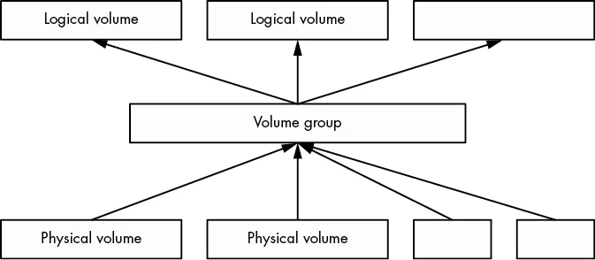

*图 4-4：物理卷和逻辑卷如何组合在一个卷组中*

逻辑卷本身就是块设备，通常包含文件系统或交换空间标识。因此，你可以把卷组与逻辑卷的关系理解为磁盘与分区的关系。关键区别在于：通常不需要由你指定逻辑卷在卷组中的具体布局，这些工作都由 LVM 完成。

LVM 支持一些功能强大而且非常实用的操作，例如：

- 向卷组中添加更多物理卷（例如另一块磁盘），以增加卷组容量。
- 只要卷组剩余空间足以容纳现有逻辑卷，就可以移除其中的物理卷。
- 调整逻辑卷的大小（进而可以使用 `fsadm` 工具调整文件系统大小）。

所有这些操作都可以在不重新启动计算机的情况下完成，而且在大多数情况下甚至不需要卸载文件系统。虽然添加新的物理磁盘硬件有时需要关机，但云计算环境通常允许在运行过程中添加新的块存储设备，因此对于需要这种灵活性的系统，LVM 是一个很好的选择。

接下来，我们将较为详细地探讨 LVM。首先介绍如何查看和操作逻辑卷及其组成部分，然后进一步了解 LVM 的工作原理，以及它所依赖的内核驱动程序。不过，理解本书后续内容并不一定需要掌握这里的讨论；如果你觉得这一节过于复杂，可以直接跳到第 5 章。

#### 4.4.2 使用 LVM

LVM 提供了许多用于管理卷和卷组的用户空间工具。大多数工具都以 `lvm` 命令为基础；`lvm` 是一个通用的交互式工具。此外，也有执行特定任务的独立命令（实际上只是指向 LVM 的符号链接）。例如，执行 `vgs` 命令，与在交互式 `lvm` 工具的 `lvm>` 提示符下输入 `vgs` 的效果相同。你会发现，`vgs`（通常位于 `/sbin`）是指向 `lvm` 的符号链接。本书将使用这些独立命令。

接下来几小节将介绍使用逻辑卷的系统有哪些组成部分。最初的示例来自一个在安装时选择了 LVM 分区方案的标准 Ubuntu 系统，因此许多名称中都包含 *Ubuntu* 一词。不过，这些技术细节并不专属于该发行版。

##### 列出并理解卷组

前面提到的 `vgs` 命令会显示系统当前配置的卷组。它的输出相当简洁。下面是示例 LVM 安装中可能看到的内容：

```bash
# vgs
  VG        #PV #LV #SN Attr   VSize   VFree
  ubuntu-vg   1   2   0 wz--n- <10.00g 36.00m
```

第一行是表头，后面的每一行代表一个卷组。各列的含义如下：

1. `VG`：卷组名称。`ubuntu-vg` 是 Ubuntu 安装程序配置 LVM 系统时分配的通用名称。
2. `#PV`：组成该卷组存储空间的物理卷数量。
3. `#LV`：卷组内逻辑卷的数量。
4. `#SN`：逻辑卷*快照*（snapshot）的数量。本书不会深入讨论快照。
5. `Attr`：卷组的若干状态属性。这里启用了 `w`（可写）、`z`（可调整大小）和 `n`（正常分配策略）。
6. `VSize`：卷组的大小。
7. `VFree`：卷组中尚未分配的空间大小。

对于大多数用途，这样的卷组概要信息已经足够。如果想进一步了解卷组，可以使用 `vgdisplay` 命令；它对于理解卷组的属性非常有帮助。下面是对同一个卷组执行 `vgdisplay` 的结果：

```bash
# vgdisplay
  --- Volume group ---
  VG Name               ubuntu-vg
  System ID
  Format                lvm2
  Metadata Areas        1
  Metadata Sequence No  3
  VG Access             read/write
  VG Status             resizable
  MAX LV                0
  Cur LV                2
  Open LV               2
  Max PV                0
  Cur PV                1
  Act PV                1
  VG Size               <10.00 GiB
  PE Size               4.00 MiB
  Total PE              2559
  Alloc PE / Size       2550 / 9.96 GiB
  Free  PE / Size       9 / 36.00 MiB
  VG UUID               0zs0TV-wnT5-laOy-vJ0h-rUae-YPdv-pPwaAs
```

其中一些项目之前已经见过，但还有几个值得注意的新项目：

1. `Open LV`：当前正在使用的逻辑卷数量。
2. `Cur PV`：组成该卷组的物理卷数量。
3. `Act LV`：卷组中处于活动状态的物理卷数量。
4. `VG UUID`：卷组的通用唯一标识符（UUID）。一个系统中可能存在多个同名卷组；在这种情况下，UUID 可以帮助你明确指定其中一个。大多数 LVM 工具（例如可用于解决同名问题的 `vgrename`）都接受 UUID 作为卷组名称的替代形式。接下来你还会看到许多不同的 UUID：LVM 的每个组成部分都有自己的 UUID。

*物理区段*（physical extent，在 `vgdisplay` 输出中缩写为 `PE`）是物理卷的一部分，类似于块，但粒度大得多。在这个示例中，每个 PE 的大小为 4MB。你可以看到，卷组中的大多数 PE 都已经分配出去，但这不必引起担忧。这只表示卷组中有多少空间被分配给了逻辑分区（在本例中是文件系统和交换空间），并不反映文件系统内部实际使用了多少空间。


##### 列出逻辑卷

与卷组类似，用于列出逻辑卷的命令有 `lvs`（简要列表）和 `lvdisplay`（更详细的信息）。下面是 `lvs` 的输出示例：

```bash
# lvs
  LV     VG        Attr       LSize   Pool Origin Data%  Meta%  Move Log Cpy%Sync Convert
  root   ubuntu-vg -wi-ao----  <9.01g
  swap_1 ubuntu-vg -wi-ao---- 976.00m
```

对于基本的 LVM 配置，只需理解前四列即可，其余列可能为空，就像这里一样（本书不会讨论这些列）。相关列的含义如下：

1. `LV`：逻辑卷名称。
2. `VG`：逻辑卷所在的卷组。
3. `Attr`：逻辑卷的属性。这里包括 `w`（可写）、`i`（继承分配策略）、`a`（已激活）和 `o`（已打开）。在更高级的卷组配置中，还会使用更多属性位置，尤其是第一、第七和第九个位置。
4. `LSize`：逻辑卷的大小。

运行信息更详细的 `lvdisplay`，有助于了解逻辑卷在系统中的位置。下面是其中一个逻辑卷的输出：

```bash
# lvdisplay /dev/ubuntu-vg/root
  --- Logical volume ---
  LV Path                /dev/ubuntu-vg/root
  LV Name                root
  VG Name                ubuntu-vg
  LV UUID                CELZaz-PWr3-tr3z-dA3P-syC7-KWsT-4YiUW2
  LV Write Access        read/write
  LV Creation host, time ubuntu, 2018-11-13 15:48:20 -0500
  LV Status              available
  # open                 1
  LV Size                <9.01 GiB
  Current LE             2306
  Segments               1
  Allocation             inherit
  Read ahead sectors     auto
  - currently set to     256
  Block device           253:0
```

这里有许多值得注意的信息，其中大部分含义都比较直观（注意，逻辑卷的 UUID 与其所在卷组的 UUID 不同）。你此前可能还没有见过、而且最重要的一项，是第一行的 `LV Path`：逻辑卷的设备路径。有些系统会在 systemd 挂载单元或 */etc/fstab* 中使用该路径来指定文件系统或交换空间的挂载位置，但并非所有系统都这样做。

尽管这里列出了逻辑卷块设备的主设备号和次设备号（分别是 253 和 0），以及一个看起来像设备路径的名称，但它实际上并不是内核使用的设备路径。查看 */dev/ubuntu-vg/root* 就会发现其中另有玄机：

```bash
$ ls -l /dev/ubuntu-vg/root
lrwxrwxrwx 1 root root 7 Nov 14 06:58 /dev/ubuntu-vg/root -> ../dm-0
```

可以看到，这只是一个指向 */dev/dm-0* 的符号链接。下面简要介绍它。

##### 使用逻辑卷设备

LVM 在系统上完成初始化设置后，逻辑卷的块设备会出现在 */dev/dm-0*、*/dev/dm-1* 等路径下，而且它们的编号顺序并不固定。由于这些设备名称不可预测，LVM 还会根据卷组名称和逻辑卷名称，为设备创建名称稳定的符号链接。前一节中的 */dev/ubuntu-vg/root* 就是一个例子。

在大多数实现中，还有另一个存放符号链接的位置：*/dev/mapper*。这里的命名方式同样基于卷组名称和逻辑卷名称，但不使用目录层次结构，而是采用类似 *ubuntu--vg-root* 的名称。在这个例子中，udev 将卷组名称中的单个连字符转换为两个连字符，然后再用一个连字符分隔卷组名称与逻辑卷名称。

许多系统会在 */etc/fstab*、systemd 和引导加载程序的配置中使用 */dev/mapper* 下的链接，以指向用作文件系统和交换空间的逻辑卷。

无论采用哪一种命名方式，这些符号链接最终都指向逻辑卷对应的块设备。你可以像操作其他块设备一样操作它们，例如创建文件系统或建立交换空间。

> 如果查看 */dev/mapper* 目录，还会发现一个名为 *control* 的文件。你可能会好奇它的用途，以及实际块设备文件为何以 *dm-* 开头：这是否与 */dev/mapper* 有关？我们将在本章末尾回答这些问题。

##### 操作物理卷

LVM 中最后一个需要重点了解的组成部分是*物理卷（physical volume，PV）*。卷组由一个或多个 PV 构成。尽管 PV 看起来是 LVM 系统中比较简单的部分，但它包含的信息比表面上看到的更多。与卷组和逻辑卷类似，查看 PV 的 LVM 命令有 `pvs`（简要列表）和 `pvdisplay`（详细信息）。下面是示例系统中的 `pvs` 输出：

```bash
# pvs
  PV         VG        Fmt  Attr PSize   PFree
  /dev/sda1  ubuntu-vg lvm2 a--  <10.00g 36.00m
```

下面是 `pvdisplay` 的输出：

```bash
# pvdisplay
  --- Physical volume ---
  PV Name               /dev/sda1
  VG Name               ubuntu-vg
  PV Size               <10.00 GiB / not usable 2.00 MiB
  Allocatable           yes
  PE Size               4.00 MiB
  Total PE              2559
  Free PE               9
  Allocated PE          2550
  PV UUID               v2Qb1A-XC2e-2G4l-NdgJ-lnan-rjm5-47eMe5
```

结合前面对卷组和逻辑卷的讨论，你应该能够理解这里的大部分输出。下面补充几点：

- 除块设备名称外，PV 没有其他专用名称，也不需要这样的名称：引用逻辑卷所需的名称都位于卷组及更高层级。不过，PV 确实有一个 UUID，这是组成卷组所必需的。
- 在这个例子中，PE 的数量与前面看到的卷组使用情况相符，因为该卷组只有这一个 PV。
- LVM 会将极少量空间标记为不可用，因为这部分空间不足以组成一个完整的 PE。
- `pvs` 输出的属性 `a` 对应于 `pvdisplay` 输出中的 `Allocatable`，表示当需要为卷组中的逻辑卷分配空间时，LVM 可以选择使用这个 PV。不过，本例中只有九个尚未分配的 PE（总计 36MB），因此可供新逻辑卷使用的空间已经不多。

如前所述，PV 保存的不仅是它自身对卷组贡献了多少空间的信息。每个 PV 都包含*物理卷元数据（physical volume metadata）*，其中记录了关于所属卷组及其逻辑卷的大量信息。我们稍后会研究 PV 元数据，但首先通过实际操作，看看前面学到的知识如何组合起来。


##### 构建逻辑卷系统

来看一个具体的实操示例：如何基于两个磁盘设备创建一个新的卷组并划分若干逻辑卷。我们将把两个容量分别为 5GB 和 15GB 的磁盘设备合并为一个卷组，然后将这个空间划分为两个各为 10GB 的逻辑卷——如果没有 LVM，这在传统分区机制下几乎是无法完成的任务。这里展示的示例使用 VirtualBox 虚拟磁盘。尽管容量在现代系统看来较小，但足以用于演示原理。

图 4-5 展示了卷系统的架构示意图。两个新磁盘分别为 */dev/sdb* 和 */dev/sdc*，新建的卷组命名为 `myvg`，划分的两个逻辑卷分别命名为 `mylv1` 和 `mylv2`。

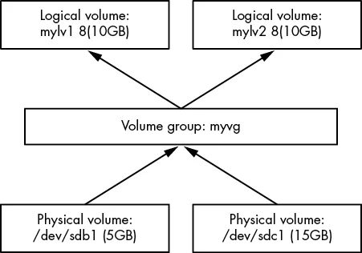

*图 4-5：构建逻辑卷系统*

首要任务是在每个磁盘上分别创建一个主分区并将其类型标记为 LVM。可以使用分区工具（参见第 4.1.2 节）完成此操作，使用分区类型 ID `8e`（或相应 GUID），使分区表如下所示：

```bash
# parted /dev/sdb print
Model: ATA VBOX HARDDISK (scsi)
Disk /dev/sdb: 5616MB
Sector size (logical/physical): 512B/512B
Partition Table: msdos
Disk Flags:

Number  Start   End     Size    Type     File system  Flags
 1      1049kB  5616MB  5615MB  primary               lvm
# parted /dev/sdc print
Model: ATA VBOX HARDDISK (scsi)
Disk /dev/sdc: 16.0GB
Sector size (logical/physical): 512B/512B
Partition Table: msdos
Disk Flags:

Number  Start   End     Size    Type     File system  Flags
 1      1049kB  16.0GB  16.0GB  primary               lvm
```

并不一定非要先对磁盘分区才能将其做成物理卷（PV）。PV 可以是任何块设备，甚至可以是整块未分区的裸磁盘设备（如 */dev/sdb*）。但是，提前进行分区有利于日后从磁盘引导，同时也为操作系统标识该块设备为 LVM 物理卷提供了直观的依据。

##### 创建物理卷与卷组

有了 */dev/sdb1* 和 */dev/sdc1* 两个新分区后，使用 LVM 的第一步是将其中一个分区指定为物理卷（PV）并将其分配给新卷组。单条命令 `vgcreate` 即可完成这一步。下面演示如何创建名为 `myvg` 的卷组，并将 */dev/sdb1* 作为初始物理卷：

```bash
# vgcreate myvg /dev/sdb1
  Physical volume "/dev/sdb1" successfully created.
  Volume group "myvg" successfully created
```

> **提示**：
> 你也可以先使用 `pvcreate` 命令显式单独创建物理卷。不过，如果目标分区上当前没有任何现有元数据，`vgcreate` 会自动替你执行该初始化步骤。

此时大多数系统会自动检测到新卷组；运行 `vgs` 命令进行验证（请注意，如果你的系统上已有其他现有卷组，它们也会一同列出）：

```bash
# vgs
  VG   #PV #LV #SN Attr   VSize  VFree
  myvg   1   0   0 wz--n- <5.23g <5.23g
```

> **提示**：
> 如果未看到新卷组，可先运行 `pvscan` 命令。如果系统无法自动捕获 LVM 的动态变更，每当做出配置修改时都需要运行 `pvscan`。

现在可以使用 `vgextend` 命令将第二个物理卷 */dev/sdc1* 添加到卷组中：

```bash
# vgextend myvg /dev/sdc1
  Physical volume "/dev/sdc1" successfully created.
  Volume group "myvg" successfully extended
```

再次运行 `vgs`，即可看到该卷组目前已包含 2 个物理卷，总容量为两个分区容量的总和（约 20GB）：

```bash
# vgs
  VG    #PV #LV #SN Attr   VSize   VFree
  my-vg   2   0   0 wz--n- <20.16g <20.16g
```

##### 创建逻辑卷

在块设备层面的最后一步是创建逻辑卷。如前所述，我们将创建两个各为 10GB 的逻辑卷，当然也可以根据需要自由试验其他分配方案，例如一个完整的大卷或多个较小的子卷。

`lvcreate` 命令用于在卷组中分配新的逻辑卷。创建简单逻辑卷唯一的细微要点在于：当卷组内有多个逻辑卷时需要确定其具体大小，并指定逻辑卷的映射类型。请记住，物理卷在底层被划分为盘区（Extent）；卷组中可用的物理盘区（PE）总数可能无法与所需容量*完全绝对*吻合，但误差非常微小，初次使用 LVM 时无需过多纠结于盘区的细微边界。

使用 `lvcreate` 时，可以通过 `--size` 选项直接以字节/容量数值（如 10g）指定大小，也可以通过 `--extents` 选项指定具体的物理盘区数量。

为了完成图 4-5 中的 LVM 拓扑设计，我们使用 `--size` 选项创建名为 `mylv1` 和 `mylv2` 的逻辑卷：

```bash
# lvcreate --size 10g --type linear -n mylv1 myvg
  Logical volume "mylv1" created.
# lvcreate --size 10g --type linear -n mylv2 myvg
  Logical volume "mylv2" created.
```

这里指定的类型是线性映射（`linear`），在不需要数据冗余或其他特殊高级特性时，这是最简单直接的映射模式。由于线性映射是系统默认行为，`--type linear` 实际上可以省略。

执行这些命令后，可以使用 `lvs` 命令验证逻辑卷是否已就绪，然后使用 `vgdisplay` 进一步审视卷组的当前详细状态：

```bash
# vgdisplay myvg
  --- Volume group ---
  VG Name               myvg
  System ID
  Format                lvm2
  Metadata Areas        2
  Metadata Sequence No  4
  VG Access             read/write
  VG Status             resizable
  MAX LV                0
  Cur LV                2
  Open LV               0
  Max PV                0
  Cur PV                2
  Act PV                2
  VG Size               20.16 GiB
  PE Size               4.00 MiB
  Total PE              5162
  Alloc PE / Size       5120 / 20.00 GiB
  Free  PE / Size       42 / 168.00 MiB
  VG UUID               1pHrOe-e5zy-TUtK-5gnN-SpDY-shM8-Cbokf3
```

可以看到当前剩余 42 个未分配的空闲盘区（Free PE，约 168 MiB），这是因为我们指定的 10GB 整数容量并未完全耗尽该卷组的所有可用盘区。

##### 操作逻辑卷：创建文件系统

有了可用的逻辑卷之后，就可以像对待普通的硬盘分区一样，在这些设备上格式化文件系统并挂载使用。前面提到过，设备映射器会在 */dev/mapper* 目录下生成符号链接，并且还会为该卷组专门创建目录（本例中为 */dev/myvg/*）。例如，可以执行以下三条命令来创建文件系统、临时挂载它，并查看逻辑卷上的实际可用空间：

```bash
# mkfs -t ext4 /dev/mapper/myvg-mylv1
mke2fs 1.44.1 (24-Mar-2018)
Creating filesystem with 2621440 4k blocks and 655360 inodes
Filesystem UUID: 83cc4119-625c-49d1-88c4-e2359a15a887
Superblock backups stored on blocks:
        32768, 98304, 163840, 229376, 294912, 819200, 884736, 1605632
Allocating group tables: done
Writing inode tables: done
Creating journal (16384 blocks): done
Writing superblocks and filesystem accounting information: done
# mount /dev/mapper/myvg-mylv1 /mnt
# df /mnt
Filesystem             1K-blocks  Used Available Use% Mounted on
/dev/mapper/myvg-mylv1  10255636 36888   9678076   1% /mnt
```

##### 删除逻辑卷

我们还没有对另一个逻辑卷 *mylv2* 进行操作。假设在后续使用中发现并不需要这第二个逻辑卷，决定将其删除，并扩展第一个逻辑卷 `mylv1` 以占满整个卷组的剩余空间。图 4-6 展示了这一重构目标。

假设你已经将待删除卷上的重要数据进行了妥善备份或迁移，并且该逻辑卷当前未被系统占用（即已经成功卸载），首先使用 `lvremove` 命令将其删除。在使用该命令操作逻辑卷时，需要采用斜杠分隔的命名语法（`卷组名/逻辑卷名`，如 `myvg/mylv2`）：

```bash
# lvremove myvg/mylv2
Do you really want to remove and DISCARD active logical volume myvg/mylv2? [y/n]: y
  Logical volume "mylv2" successfully removed
```

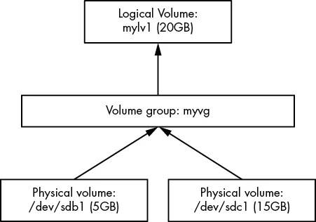

*图 4-6：重新配置逻辑卷的结果*

> **警告**：
> 执行 `lvremove` 时务必格外小心。由于在前面所见的 LVM 命令中并未广泛使用此斜杠语法，操作者可能会误将斜杠输入为空格。如果在此特定情况下出现输入失误，`lvremove` 将会误判为你要同时删除 `myvg` 和 `mylv2` 两个卷组上的*所有逻辑卷*！稍有不慎就可能直接将整块卷组清空，而不是仅仅删除某单个卷。

从上述交互中可以看到，`lvremove` 会通过二次确认提示来防止误操作，并且拒绝删除当前仍处于占用/挂载状态的卷。但切勿盲目地对所有系统提问都一律回复 `y`。

##### 调整逻辑卷与文件系统大小

现在可以对第一个逻辑卷 `mylv1` 进行在线扩容了。即使卷当前正在使用、其内部文件系统正处于挂载状态，扩容操作也可以直接进行。然而必须明确的是，这里包含两个独立的步骤：要使用扩容后的空间，不仅需要扩展底层的逻辑卷块设备，还需要扩展其内部的文件系统（这同样支持在线进行）。鉴于这是极为常见的运维操作，`lvresize` 命令专门提供了 `-r` 选项，能够自动联动完成文件系统的扩容。

为了清晰展示原理，我们先使用两条分步命令观察其内部细节。调整逻辑卷大小有多种数值表示方式，最直观的方法是将卷组中所有未分配的空闲盘区（PE）全部追加给逻辑卷。回顾之前的 `vgdisplay` 输出，空闲盘区数为 2,602。以下命令将这些空闲盘区全部追加给 `mylv1`：

```bash
# lvresize -l +2602 myvg/mylv1
  Size of logical volume myvg/mylv1 changed from 10.00 GiB (2560 extents) to 20.16 GiB (5162 extents).
  Logical volume myvg/mylv1 successfully resized.
```

接下来需要扩展内部的文件系统。可以使用 `fsadm` 命令来完成，通过 `-v` 详细模式可以直观观察其执行细节：

```bash
# fsadm -v resize /dev/mapper/myvg-mylv1
fsadm: "ext4" filesystem found on "/dev/mapper/myvg-mylv1".
fsadm: Device "/dev/mapper/myvg-mylv1" size is 21650997248 bytes
fsadm: Parsing tune2fs -l "/dev/mapper/myvg-mylv1"
fsadm: Resizing filesystem on device "/dev/mapper/myvg-mylv1" to 21650997248 bytes (2621440 -> 5285888 blocks of 4096 bytes)
fsadm: Executing resize2fs /dev/mapper/myvg-mylv1 5285888
resize2fs 1.44.1 (24-Mar-2018)
Filesystem at /dev/mapper/myvg-mylv1 is mounted on /mnt; on-line resizing required
old_desc_blocks = 2, new_desc_blocks = 3
The filesystem on /dev/mapper/myvg-mylv1 is now 5285888 (4k) blocks long.
```

从输出可以看出，`fsadm` 本质上是一个封装脚本，负责将通用参数转换为针对特定文件系统的底层工具（如 `resize2fs`）调用。默认情况下，如果不指定具体大小，它会自动扩展至占满整个底层块设备。

了解了分步调整的底层原理后，日常运维中最优雅高效的快捷方式是使用一条集成的 `lvresize` 命令，配合 `-r` 参数联动调整文件系统，直接将所有空闲空间按百分比全部吸收：

```bash
# lvresize -r -l +100%FREE myvg/mylv1
```

在系统挂载运行期间能够直接无缝在线扩展 ext2/ext3/ext4 文件系统是非常优秀的特性。遗憾的是，反向缩容（Shrink）并不支持在线操作。文件系统**严禁在挂载状态下进行缩小**。若要缩减卷容量，不仅必须先卸载文件系统，还必须以严格相反的顺序操作（必须先缩小文件系统，再缩小底层逻辑卷，并确保新的逻辑卷容量严格大于缩小后的文件系统所需空间）。因此在缩容时，使用 `lvresize -r` 同样能够极大地规避手动计算盘区边界出错的风险。

#### 4.4.3 LVM 的实现原理

了解了 LVM 比较实用的基本操作之后，我们来简要看看它的实现方式。与本书讨论的几乎所有其他主题一样，LVM 包含多个层次和组件，而且内核空间与用户空间的职责划分得相当清楚。

稍后你会看到，通过查找物理卷（PV）来发现卷组和逻辑卷的结构是一件有些复杂的事，而 Linux 内核并不愿意处理这些工作。实际上，这些操作完全没有必要在内核空间进行：PV 只是块设备，用户空间也能够随机访问块设备。事实上，LVM 本身（更准确地说，当前系统中的 LVM2）只是一个用户空间工具集的名称，这些工具了解 LVM 的结构。

另一方面，内核负责把针对逻辑卷块设备某个位置的请求，转发到实际设备上的真实位置。承担这一工作的驱动程序称为*设备映射器*（device mapper，有时简称 *devmapper*）。它是在普通块设备和文件系统之间增加的一层。顾名思义，设备映射器所做的事情类似于查地图：你几乎可以把它理解为将街道地址转换成全球经纬度坐标这样的绝对位置。（这是一种虚拟化；本书其他地方介绍的虚拟内存也采用类似的概念。）

LVM 用户空间工具与设备映射器之间还有一些衔接组件：若干在用户空间运行、用于管理内核中设备映射表的工具。下面从 LVM 开始，分别看看 LVM 一侧和内核一侧的工作。

##### LVM 工具与物理卷扫描

LVM 工具在执行任何操作之前，首先必须扫描可用的块设备，寻找 PV。LVM 在用户空间中大致需要执行以下步骤：

1. 找到系统中的所有 PV。
2. 根据 UUID 找出这些 PV 所属的全部卷组（相关信息保存在 PV 中）。
3. 验证各卷组是否完整，也就是确认属于卷组的所有必需 PV 都已存在。
4. 找到卷组中的所有逻辑卷。
5. 确定如何将 PV 中的数据映射到逻辑卷。

每个 PV 的开头都有一个头部，用于标识该卷及其所属卷组和其中的逻辑卷。LVM 工具可以整合这些信息，判断一个卷组及其逻辑卷所需的 PV 是否全部存在。如果检查通过，LVM 就可以着手将相关信息交给内核。

> 如果你想看看 PV 上的 LVM 头部是什么样子，可以运行类似下面的命令：
>
> ```bash
> # dd if=/dev/sdb1 count=1000 | strings | less
> ```
>
> 这里使用 */dev/sdb1* 作为 PV。不要期待输出会很美观，但它确实能显示 LVM 所需的信息。

任何 LVM 工具，例如 `pvscan`、`lvs` 或 `vgcreate`，都能够执行扫描和处理 PV 的工作。

##### 设备映射器

LVM 从各个 PV 的头部确定逻辑卷的结构之后，会与内核的设备映射器驱动通信，初始化逻辑卷对应的块设备，并加载映射表。它通过对 */dev/mapper/control* 设备文件执行 `ioctl(2)` 系统调用（常用的内核接口）来完成这一工作。直接监视这种交互并不现实，但可以使用 `dmsetup` 命令查看最终结果的详细信息。

要列出设备映射器当前管理的映射设备，可以使用 `dmsetup info`。对于本章前面创建的某个逻辑卷，你可能会看到如下输出：

```bash
# dmsetup info
Name:              myvg-mylv1
State:             ACTIVE
Read Ahead:        256
Tables present:    LIVE
Open count:        0
Event number:      0
Major, minor:      253, 1
Number of targets: 2
UUID: LVM-1pHrOee5zyTUtK5gnNSpDYshM8Cbokf3OfwX4T0w2XncjGrwct7nwGhpp7l7J5aQ
```

设备的主、次设备号对应映射设备的 */dev/dm-\** 设备文件；这里设备映射器的主设备号是 253。由于次设备号是 1，因此设备文件名为 */dev/dm-1*。请注意，内核还为映射设备保存了名称和另一个 UUID。这些信息由 LVM 提供给内核（内核使用的 UUID 只是将卷组 UUID 和逻辑卷 UUID 拼接起来）。

> 还记得 */dev/mapper/myvg-mylv1* 这样的符号链接吗？udev 会响应设备映射器创建的新设备，并使用类似 3.5.2 节介绍的规则文件来创建这些链接。

你还可以通过 `dmsetup table` 查看 LVM 交给设备映射器的映射表。下面是前面那个示例的输出：两个 10GB 的逻辑卷（`mylv1` 和 `mylv2`）分布在两个物理卷上，分别是 5GB 的 */dev/sdb1* 和 15GB 的 */dev/sdc1*：

```bash
# dmsetup table
myvg-mylv2: 0 10960896 linear 8:17 2048
myvg-mylv2: 10960896 10010624 linear 8:33 20973568
myvg-mylv1: 0 20971520 linear 8:33 2048
```

每一行表示某个映射设备的一个映射段。设备 `myvg-mylv2` 有两段，而 `myvg-mylv1` 只有一段。设备名称后面的字段依次为：

1. 映射设备上的起始偏移量，单位是 512 字节的“扇区”，也就是许多其他设备使用的常规块大小。
2. 该映射段的长度。
3. 映射方式。这里使用简单的一对一线性映射。
4. 源设备的主、次设备号，也就是 LVM 所称的物理卷。这里的 `8:17` 是 */dev/sdb1*，`8:33` 是 */dev/sdc1*。
5. 源设备上的起始偏移量。

这个例子有趣的地方在于，LVM 选择将 */dev/sdc1* 上的空间用于我们首先创建的逻辑卷 `mylv1`。LVM 希望将第一个 10GB 逻辑卷连续地放置，而只有 */dev/sdc1* 能够满足这一要求。然而，在创建第二个逻辑卷 `mylv2` 时，LVM 别无选择，只能把它拆成两个映射段，分别放在两个 PV 上。[图 4-7](#figure4-7) 展示了这种布局。

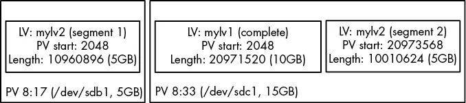

*图 4-7：LVM 如何安排 mylv1 和 mylv2*

进一步说，当我们删除 `mylv2`，并扩展 `mylv1` 以占用卷组中的剩余空间时，原来位于 */dev/sdc1* 上的起始偏移量保持不变，但其余映射发生了变化，以便包含两个 PV 的剩余空间：

```bash
# dmsetup table
myvg-mylv1: 0 31326208 linear 8:33 2048
myvg-mylv1: 31326208 10960896 linear 8:17 2048
```

[图 4-8](#figure4-8) 展示了调整后的布局。

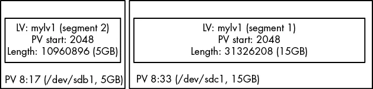

*图 4-8：删除 mylv2 并扩展 mylv1 后的布局*

你可以在虚拟机中尽情试验逻辑卷和设备映射器，观察最终生成的映射关系。许多功能，例如软件 RAID 和加密磁盘，都是建立在设备映射器之上的。

### 4.5 展望：磁盘与用户空间

在 Unix 系统的磁盘相关组件中，用户空间与内核之间的边界有时很难明确划分。正如你已经看到的，内核负责处理设备的原始块 I/O，而用户空间工具可以通过设备文件使用块 I/O。不过，用户空间通常只在初始化操作中直接使用块 I/O，例如分区、创建文件系统和创建交换空间。正常使用时，用户空间只使用内核在块 I/O 之上提供的文件系统支持。类似地，在虚拟内存系统中处理交换空间时，大多数繁琐的细节也由内核负责。

本章剩余内容将简要介绍 Linux 文件系统的内部机制。这些属于较为深入的知识，你当然不必掌握它们才能继续阅读本书。如果这是你第一次阅读本书，可以直接跳到下一章，开始了解 Linux 的启动过程。


### 4.6 传统文件系统的内部结构

传统 Unix 文件系统主要由两部分组成：一组用于存储数据的数据块，以及管理这些数据块的数据库系统。这个数据库以 inode 数据结构为核心。*inode*（索引节点）是一组描述特定文件的数据，其中包括文件类型、权限，以及可能最重要的一项——文件数据位于数据块池中的什么位置。每个 inode 都有一个编号，记录在 inode 表中。

文件名和目录也通过 inode 来实现。目录 inode 包含一个列表，其中记录文件名以及指向其他 inode 的链接。

举一个实际例子：我创建了一个新文件系统，将其挂载，然后把当前目录切换到挂载点。接着用以下命令添加了一些文件和目录：

```bash
$ mkdir dir_1
$ mkdir dir_2
$ echo a > dir_1/file_1
$ echo b > dir_1/file_2
$ echo c > dir_1/file_3
$ echo d > dir_2/file_4
$ ln dir_1/file_3 dir_2/file_5
```

注意，我将 *dir\_2/file\_5* 创建为 *dir\_1/file\_3* 的硬链接，这意味着这两个文件名实际上代表同一个文件（稍后会详细解释）。你也可以自行尝试，不一定非要在新建的文件系统上操作。

如果查看这个文件系统中的目录，其内容会如[图 4-9](#figure4-9) 所示。

>
>
> 如果你在自己的系统上尝试，inode 编号很可能不同，尤其是在现有文件系统中执行创建文件和目录的命令时。具体编号并不重要，重要的是这些编号指向的数据。

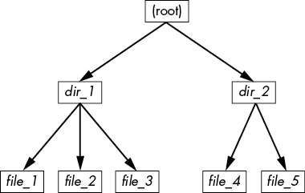

*图 4-9：文件系统在用户层面的表示*

文件系统实际由 inode 组成的布局如[图 4-10](#figure4-10) 所示，看起来远不如用户层面的表示那么整齐。

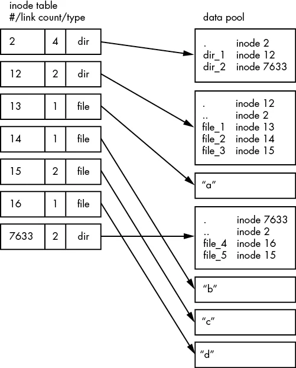

*图 4-10：图 4-9 所示文件系统的 inode 结构*

该如何理解这张图呢？对于任何 ext2/3/4 文件系统，都从编号为 2 的 inode 开始，它是*根 inode*（不要把它与系统的根文件系统混淆）。从[图 4-10](#figure4-10) 的 inode 表中可以看出，它是一个目录 inode（*dir*），因此可以沿箭头找到数据块池，查看根目录的内容：两个名为 *dir\_1* 和 *dir\_2* 的条目，分别对应 inode 12 和 7633。要继续查看这些条目，就回到 inode 表中查找相应的 inode。

为了访问这个文件系统中的 *dir\_1/file\_2*，内核会执行以下步骤：

1. 解析路径的各个组成部分：先是名为 *dir\_1* 的目录，然后是名为 *file\_2* 的路径分量。
2. 沿着根 inode 找到其目录数据。
3. 在 inode 2 的目录数据中找到 *dir\_1*，该条目指向 inode 12。
4. 在 inode 表中查找 inode 12，并确认它是一个目录 inode。
5. 沿着 inode 12 的数据链接找到其目录信息（数据块池中从上往下数的第二个框）。
6. 在 inode 12 的目录数据中找到路径的第二个分量（*file\_2*）。该条目指向 inode 14。
7. 在目录表中查找 inode 14。这是一个文件 inode。

至此，内核已经知道该文件的属性，并且可以沿着 inode 14 的数据链接打开它。

正是这种 inode 指向目录数据结构、目录数据结构又指向 inode 的机制，构成了我们熟悉的文件系统层次结构。另外，请注意，目录 inode 中还包含 *.*（当前目录）和 *..*（父目录，根目录除外）条目。它们使我们能够方便地确定相对位置，并沿目录结构向上返回。

#### 4.6.1 inode 的详细信息与链接计数

要查看某个目录中的 inode 编号，可以使用 `ls -i` 命令。以下是本例根目录中的输出（如需更详细的 inode 信息，可使用 `stat` 命令）：

```bash
$ ls -i
  12 dir_1  7633 dir_2
```

你可能会好奇 inode 表中的*链接计数*（link count）是什么。其实，你已经在常见的 `ls -l` 命令输出中见过它，只是可能没有留意。那么，链接计数与[图 4-9](#figure4-9) 中的文件有什么关系，尤其是通过“硬链接”创建的 *file\_5*？链接计数字段表示整个文件系统中指向某个 inode 的目录条目总数。大多数文件的链接计数为 1，因为它们在目录条目中只出现一次。这是正常情况：创建文件时，通常会同时创建一个新的目录条目和一个与之对应的新 inode。不过，inode 15 出现了两次：它最初作为 *dir\_1/file\_3* 创建，随后又通过 *dir\_2/file\_5* 建立了一个指向它的链接。硬链接实际上就是在目录中手动添加一个指向现有 inode 的条目。使用不带 `-s` 选项的 `ln` 命令，可以手动创建新的硬链接。

这也是为什么删除文件有时被称为*解除链接*（unlinking）。如果执行 `rm dir_1/file_2`，内核会在 inode 12 的目录条目中查找名为 *file\_2* 的条目。找到它对应 inode 14 后，内核会移除这个目录条目，并将 inode 14 的链接计数减 1。这样，inode 14 的链接计数就变成了 0，内核由此知道已经没有任何文件名指向它，因此可以删除该 inode 及其关联的数据。

但如果执行 `rm dir_1/file_3`，最终结果只是 inode 15 的链接计数从 2 变为 1（因为 *dir\_2/file\_5* 仍指向它），所以内核知道不应删除这个 inode。

目录的链接计数也采用大致相同的机制。注意，inode 12 的链接计数为 2，因为有两个目录条目链接到它：一个是 inode 2 的目录条目中的 *dir\_1*，另一个是它自身目录条目中的自引用（`.`）。如果创建新目录 *dir\_1/dir\_3*，inode 12 的链接计数就会增加到 3，因为新目录中会有一个指向 inode 12 的父目录条目（`..`），就像 inode 12 自身的父目录链接指向 inode 2 一样。

链接计数有一个小小的例外：根 inode 2 的链接计数为 4，但[图 4-10](#figure4-10) 只显示了三个目录条目链接。“第四个”链接位于文件系统的超级块（superblock）中，因为超级块会告诉系统到哪里寻找根 inode。

不必害怕在自己的系统上动手实验。创建一个目录结构，再使用 `ls -i` 或 `stat` 逐步查看其中各部分，是安全无害的操作。你不需要 root 权限（除非要挂载并创建新的文件系统）。

#### 4.6.2 数据块分配

我们的讨论还缺少一环：为新文件分配数据块池中的数据块时，文件系统如何知道哪些块已经被占用，哪些块仍可使用？最基本的方法之一，是使用额外的管理数据结构——*块位图*（block bitmap）。在这种方案中，文件系统预留一段字节序列，其中每一位对应数据块池中的一个块。位值为 0 表示该块空闲，为 1 表示已被使用。因此，分配和释放数据块只需要切换相应的位值。

当 inode 表中的数据与块分配信息不一致，或链接计数有误时，文件系统就会出现问题。例如，系统没有正常关机时就可能发生这种情况。因此，按照 4.2.11 节所述检查文件系统时，`fsck` 程序会遍历 inode 表和目录结构，重新计算链接计数并生成新的块分配映射（例如块位图），然后将新生成的数据与磁盘上的文件系统进行比较。如果发现不一致，`fsck` 就必须修正链接计数，并决定如何处理那些遍历目录结构时未能找到的 inode 和／或数据。大多数 `fsck` 程序会将这些“孤儿”恢复为文件系统 *lost+found* 目录中的新文件。

#### 4.6.3 在用户空间中操作文件系统

在用户空间操作文件和目录时，通常不需要过多关心底层实现。进程应通过内核系统调用访问已挂载文件系统中的文件和目录内容。不过，有意思的是，用户空间确实可以取得某些看似属于底层实现的文件系统信息：尤其是，`stat()` 系统调用会返回 inode 编号和链接计数。

如果你不负责维护文件系统，是否还需要关心 inode 编号、链接计数以及其他实现细节？一般不需要。这些信息之所以可供用户态程序访问，主要是为了向后兼容。此外，并非 Linux 支持的所有文件系统都具有上述内部结构。VFS 接口层确保系统调用始终返回 inode 编号和链接计数，但这些数字未必具有实际意义。

对于非传统文件系统，你可能无法执行传统 Unix 文件系统中的某些操作。例如，在已挂载的 VFAT 文件系统上，不能使用 `ln` 创建硬链接，因为它的目录条目结构是为 Windows 而非 Unix/Linux 设计的，不支持这一概念。

幸运的是，Linux 向用户空间提供的系统调用进行了充分的抽象，使文件访问变得简单：无需了解底层实现，就能访问文件。此外，文件名的格式很灵活，也支持大小写混合的名称，因此可以方便地支持其他采用层次结构的文件系统。

请记住，对某种文件系统的支持不一定非得实现在内核中。例如，对于用户空间文件系统，内核只需充当系统调用的传递通道。

---


## 第 5 章：Linux 内核如何启动

现在，你已经了解 Linux 系统的物理结构和逻辑结构、内核是什么，以及如何操作进程。本章将介绍内核如何启动，也就是如何完成*引导（boot）*。换句话说，你将了解内核如何被载入内存，以及从那时起直到第一个用户进程启动之前，内核会做些什么。

引导过程可以简化为以下步骤：

1. 计算机的 BIOS 或引导固件加载并运行引导加载程序（boot loader）。
2. 引导加载程序在磁盘上找到内核映像，将其载入内存并启动内核。
3. 内核初始化设备及其驱动程序。
4. 内核挂载根文件系统。
5. 内核启动一个名为 *init* 的程序，其进程 ID 为 1。此时便是*用户空间的起点*。
6. init 启动系统中的其余进程。
7. 在某个时刻，init 会启动一个允许用户登录的进程，通常是在引导序列的末尾或接近末尾时。

本章介绍前几个阶段，重点放在引导加载程序和内核上。第 6 章将从用户空间启动的阶段继续，详细介绍 *systemd*——Linux 系统中使用最广泛的 init 实现。

能够辨认引导过程中的各个阶段，对于排查启动故障和从整体上理解系统都非常有价值。不过，许多 Linux 发行版的默认行为常常使你难以、甚至根本无法在最初几个引导阶段进行时观察它们。因此，你很可能只有在这些阶段结束并登录系统后，才能仔细查看相关信息。

### 5.1 启动消息

传统的 Unix 系统在引导时会输出大量诊断消息，用于说明引导过程的进展。这些消息首先来自内核，随后来自 init 启动的进程和初始化过程。不过，这些消息既不美观也不统一，有时甚至不能提供多少有用信息。此外，硬件性能的提升使内核的启动速度比过去快得多；消息一闪而过，很难看清正在发生什么。因此，大多数现代 Linux 发行版都会尽量通过启动画面及其他视觉内容隐藏引导诊断信息，让用户在系统启动时把注意力放在别处。

查看内核引导期间及运行期间诊断消息的最佳方法，是使用 `journalctl` 命令检索内核日志。运行 `journalctl -k` 可以显示本次启动的消息，而使用 `-b` 选项还可以查看此前启动过程的消息。我们将在第 7 章更详细地介绍日志（journal）。

如果系统没有使用 systemd，可以查找 */var/log/kern.log* 之类的日志文件，或者运行 `dmesg` 命令查看*内核环形缓冲区（kernel ring buffer）*中的消息。

下面是 `journalctl -k` 命令可能显示的一段输出示例：

```
microcode: microcode updated early to revision 0xd6, date = 2019-10-03
Linux version 4.15.0-112-generic (buildd@lcy01-amd64-027) (gcc version 7.5.0 (Ubuntu 7.5.0-3ubuntu1~18.04)) #113-Ubuntu SMP Thu Jul 9 23:41:39 UTC 2020 (Ubuntu 4.15.0-112.113-generic 4.15.18)
Command line: BOOT_IMAGE=/boot/vmlinuz-4.15.0-112-generic root=UUID=17f12d53-c3d7-4ab3-943e-a0a72366c9fa ro quiet splash vt.handoff=1
KERNEL supported cpus:
--snip--
scsi 2:0:0:0: Direct-Access     ATA      KINGSTON SM2280S 01.R PQ: 0 ANSI: 5
sd 2:0:0:0: Attached scsi generic sg0 type 0
sd 2:0:0:0: [sda] 468862128 512-byte logical blocks: (240 GB/224 GiB)
sd 2:0:0:0: [sda] Write Protect is off
sd 2:0:0:0: [sda] Mode Sense: 00 3a 00 00
sd 2:0:0:0: [sda] Write cache: enabled, read cache: enabled, doesn't support DPO or FUA
 sda: sda1 sda2 < sda5 >
sd 2:0:0:0: [sda] Attached SCSI disk
--snip--
```

内核启动之后，用户空间的启动过程通常也会产生消息。这些消息可能更难查看和回顾，因为在大多数系统中，你无法在单个日志文件里找到它们。启动脚本通常会将消息发送到控制台，而这些消息会在引导完成后被清除。不过，在 Linux 系统上这不是什么问题，因为 systemd 会捕获启动及运行期间原本会发送到控制台的诊断消息。

### 5.2 内核初始化与引导选项

Linux 内核启动后，通常按照以下顺序进行初始化：

1. 检查 CPU
2. 检查内存
3. 发现设备总线
4. 发现设备
5. 设置辅助内核子系统（如网络子系统）
6. 挂载根文件系统
7. 启动用户空间

前两个步骤并没有太多特别之处，但当内核开始处理设备时，就会遇到依赖关系问题。例如，正如第 3 章所介绍的，磁盘设备驱动程序可能依赖总线支持和 SCSI 子系统的支持。随后，在初始化过程的较后阶段，内核还必须先挂载根文件系统，才能启动 init。

一般来说，你不必担心这些依赖关系；需要注意的例外是，某些必需组件可能是可加载的内核模块，而不是主内核的一部分。有些计算机必须在挂载真正的根文件系统之前加载这些内核模块。我们将在 6.7 节介绍这个问题，以及使用初始 RAM 文件系统（initrd）解决该问题的办法。

内核会输出某些消息，表明它正准备启动第一个用户进程：

```
Freeing unused kernel memory: 2408K
Write protecting the kernel read-only data: 20480k
Freeing unused kernel memory: 2008K
Freeing unused kernel memory: 1892K
```

这里，内核不仅在清理未使用的内存，也在保护自身的数据。接下来，如果你使用的内核版本足够新，就会看到内核将第一个用户空间进程作为 init 启动：

```
Run /init as init process
   with arguments:
    --snip--
```

再往后，你应该能够看到根文件系统被挂载、systemd 开始运行，并向内核日志发送一些自己的消息：

```
EXT4-fs (sda1): mounted filesystem with ordered data mode. Opts: (null)
systemd[1]: systemd 237 running in system mode. (+PAM +AUDIT +SELINUX +IMA +APPARMOR +SMACK +SYSVINIT +UTMP +LIBCRYPTSETUP +GCRYPT +GNUTLS +ACL +XZ +LZ4 +SECCOMP +BLKID +ELFUTILS +KMOD -IDN2 +IDN -PCRE2 default-hierarchy=hybrid)
systemd[1]: Detected architecture x86-64.
systemd[1]: Set hostname to <duplex>.
```

到了这里，你就可以确定用户空间已经启动。


### 5.3 内核参数

Linux 内核启动时，会接收一组文本形式的*内核参数*，其中包含一些额外的系统信息。这些参数可以指定多种不同的行为，例如内核应输出多少诊断信息，以及设备驱动程序的专用选项。

你可以查看 */proc/cmdline* 文件，了解传递给当前正在运行的内核的参数：

```bash
$ cat /proc/cmdline
BOOT_IMAGE=/boot/vmlinuz-4.15.0-43-generic root=UUID=17f12d53-c3d7-4ab3-943e-a0a72366c9fa ro quiet splash vt.handoff=1
```

参数可以是简单的单词标志，例如 `ro` 和 `quiet`；也可以是 `key``=``value` 形式的键值对，例如 `vt.handoff=1`。许多参数并不重要，例如用于显示启动画面的 `splash` 标志，但有一个参数至关重要，那就是 `root`。它指定根文件系统的位置；如果没有这个参数，内核就无法正确启动用户空间。

根文件系统可以通过设备文件指定，如下例所示：

```
root=/dev/sda1
```

在大多数现代系统中，另外两种指定方式更为常见。第一种是使用逻辑卷，例如：

```
root=/dev/mapper/my-system-root
```

你也可能看到 UUID（参见 4.2.4 节）：

```
root=UUID=17f12d53-c3d7-4ab3-943e-a0a72366c9fa
```

这两种方式都更可取，因为它们不依赖于内核中特定的设备映射关系。

`ro` 参数指示内核在启动用户空间时以只读模式挂载根文件系统。这是正常的做法：只读模式可以确保 `fsck` 在系统执行其他重要操作之前，安全地检查根文件系统。检查完成后，启动过程会以读写模式重新挂载根文件系统。

当 Linux 内核遇到无法识别的参数时，会将其保存下来。随后，内核在启动用户空间时将该参数传递给 init。例如，如果在内核参数中添加 `-s`，内核就会把 `-s` 传给 init 程序，指示它以单用户模式启动。

如果你想了解基本的启动参数，可以阅读 bootparam(7) 手册页，其中提供了概览。如果需要查找某个非常具体的参数，可以查阅 Linux 内核附带的参考文件 *kernel-params.txt*。

了解这些基础知识后，你可以直接跳到第 6 章，学习用户空间启动、初始 RAM 磁盘，以及内核作为第一个进程运行的 init 程序的具体细节。本章剩余部分将详细介绍内核如何加载到内存并启动，包括内核如何获取启动参数。

### 5.4 引导加载程序

在启动过程的最初阶段，也就是内核和 init 启动之前，会先运行一个*引导加载程序*（boot loader）来启动内核。它的任务听起来很简单：从磁盘上的某个位置将内核加载到内存中，然后使用一组内核参数启动内核。然而，这项工作比看起来复杂得多。要理解其中的原因，可以考虑引导加载程序必须回答的两个问题：

- 内核位于哪里？
- 启动内核时应该向它传递哪些内核参数？

通常，答案是内核及其参数位于根文件系统的某个位置。查找内核参数听起来似乎很容易，但请记住，此时内核本身尚未运行，而通常正是内核负责遍历文件系统、寻找所需的文件。更糟的是，平时用于访问磁盘的内核设备驱动程序也尚不可用。可以把这看作一种“先有鸡还是先有蛋”的问题。实际情况还可能更加复杂，不过现在先来看看引导加载程序如何克服驱动程序和文件系统带来的障碍。

引导加载程序确实需要驱动程序来访问磁盘，但它使用的并不是内核所使用的驱动程序。在 PC 上，引导加载程序通过传统的*基本输入输出系统（BIOS）*或较新的*统一可扩展固件接口（UEFI）*访问磁盘。（*可扩展固件接口*，即 *EFI*，以及 UEFI，将在 5.8.2 节中进一步讨论。）现代磁盘硬件包含固件，使 BIOS 或 UEFI 能够通过*逻辑块寻址（LBA）*访问所连接的存储硬件。LBA 是一种通用且简单的磁盘数据访问方式，但性能较差。不过这并不是问题，因为引导加载程序通常是唯一必须使用这种模式访问磁盘的程序；内核启动之后，就能使用自己的高性能驱动程序。

> 要确定系统使用的是 BIOS 还是 UEFI，可以运行 `efibootmgr`。如果显示了引导目标列表，说明系统使用 UEFI；如果提示不支持 EFI 变量，说明系统使用 BIOS。另一种方法是检查 */sys/firmware/**efi* 是否存在；如果存在，系统就使用 UEFI。

解决了对磁盘原始数据的访问问题之后，引导加载程序还必须在文件系统中找到需要的数据。大多数常见的引导加载程序都能读取分区表，并内置了以只读方式访问文件系统的支持。因此，它们能够找到并读取将内核加载到内存所需的文件。这项能力让引导加载程序的动态配置和功能扩展容易得多。Linux 引导加载程序并非一直具备这种能力；在没有这种能力时，配置引导加载程序要困难得多。

总体而言，技术演进呈现出一种模式：内核首先增加新功能（尤其是存储技术方面的功能），随后引导加载程序再添加这些功能的独立简化版本，以适应变化。

#### 5.4.1 引导加载程序的任务

Linux 引导加载程序的核心功能包括：

- 从多个内核中进行选择。
- 在不同的内核参数组合之间切换。
- 允许用户手动覆盖和编辑内核映像名称及参数（例如，为进入单用户模式而修改参数）。
- 支持启动其他操作系统。

自 Linux 内核诞生以来，引导加载程序已经变得先进得多，增加了命令行历史记录和菜单系统等功能。不过，有一项基本需求始终没有改变：必须能够灵活选择内核映像和参数。（一个令人意外的现象是，某些需求实际上已经减少了。例如，现在可以通过 USB 存储设备进行紧急启动或恢复启动，因此你很少需要担心手动输入内核参数或进入单用户模式。）如今的引导加载程序功能比以往任何时候都强大。如果你正在构建自定义内核，或者只是想调整一些参数，这些能力就特别有用。

#### 5.4.2 引导加载程序概览

以下是你可能遇到的主要引导加载程序：

1. **GRUB**：Linux 系统中几乎通用的标准，提供 BIOS/MBR 和 UEFI 版本。
2. **LILO**：最早的一批 Linux 引导加载程序之一。ELILO 是其 UEFI 版本。
3. **SYSLINUX**：可以配置为从多种不同类型的文件系统运行。
4. **LOADLIN**：从 MS-DOS 启动内核。
5. **systemd-boot**：一个简单的 UEFI 启动管理器。
6. **coreboot**（原名 LinuxBIOS）：一种高性能的 PC BIOS 替代方案，可以包含内核。
7. **Linux Kernel EFISTUB**：一个内核插件，可直接从 EFI/UEFI 系统分区（ESP）加载内核。
8. **efilinux**：一种 UEFI 引导加载程序，旨在为其他 UEFI 引导加载程序提供模型和参考实现。

本书几乎只讨论 GRUB。选择其他引导加载程序的理由通常是：它们比 GRUB 更容易配置、速度更快，或者提供某种特殊用途的功能。

通过进入能够输入内核名称和参数的引导提示符，你可以学到很多有关引导加载程序的知识。为此，你需要知道如何进入引导提示符或菜单。遗憾的是，这有时很难弄清楚，因为 Linux 发行版通常会大幅定制引导加载程序的行为和外观。仅凭观察启动过程，通常无法判断发行版使用的是哪一种引导加载程序。

接下来的几节将介绍如何进入引导提示符，以便输入内核名称和参数。熟悉这些操作之后，你将学习如何配置和安装引导加载程序。


### 5.5 GRUB 简介

GRUB 是 *Grand Unified Boot Loader*（统一引导加载程序）的缩写。本书介绍的是 GRUB 2，不过还有一个较早的版本，称为 GRUB Legacy，目前已不再被广泛使用。

GRUB 最重要的能力之一是浏览文件系统，这使得选择内核映像和配置文件变得十分方便。要直观地了解这一功能，同时熟悉 GRUB，最好的方法之一就是查看它的菜单。这个界面并不难操作，但你很可能从未见过它。

要进入 GRUB 菜单，可以在 BIOS 启动画面刚出现时按住 shift 键；如果系统使用 UEFI，则按 esc 键。否则，引导加载程序可能不会在加载内核之前暂停。[图 5-1](#figure5-1) 展示了 GRUB 菜单。

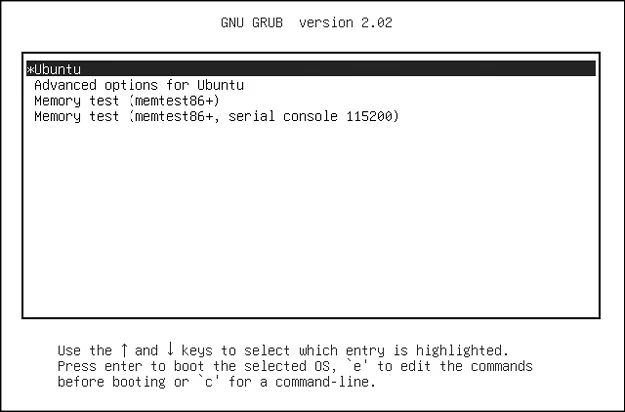

*图 5-1：GRUB 菜单*

可以按照以下步骤探索引导加载程序：

1. 重新启动 Linux 系统，或打开系统电源。
2. 在 BIOS 自检期间按住 shift 键，或在固件启动画面出现时按 esc 键，以进入 GRUB 菜单。（有时这些画面不会显示，因此你需要估计按键的时机。）
3. 按 e 键，查看默认启动选项对应的引导加载程序配置命令。你应该会看到类似[图 5-2](#figure5-2) 的画面（可能需要向下滚动才能看到所有细节）。

   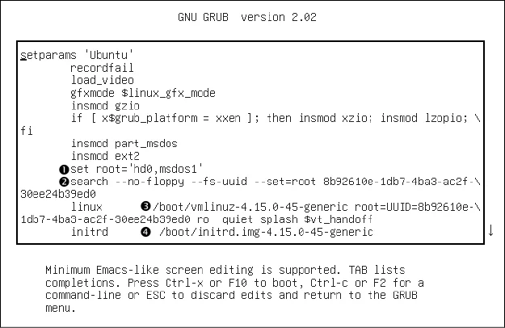

   *图 5-2：GRUB 配置编辑器*

这个画面告诉我们：在当前配置中，根设备通过 UUID 设置；内核映像是 */boot/vmlinuz-4.15.0-45-generic*；内核参数包括 `ro`、`quiet` 和 `splash`；初始 RAM 文件系统是 */boot/initrd.img-4.15.0-45-generic*。不过，如果你以前没有见过这种配置，可能会觉得有些困惑：为什么会出现多次 `root`，而且它们还不一样？这里为什么会有 `insmod`？如果你以前见过这个命令，可能记得它通常与由 udevd 运行的 Linux 内核功能有关。

产生这些疑问很正常，因为 GRUB 并不*使用* Linux 内核（别忘了，它的任务是*启动*内核）。你看到的配置完全由 GRUB 内部的功能和命令组成；GRUB 有自己独立的运行环境。

造成混淆的部分原因是，GRUB 借用了许多其他系统中的术语。GRUB 有自己的“内核”，也有自己的 `insmod` 命令，用来动态加载 GRUB 模块；它们与 Linux 内核完全无关。许多 GRUB 命令与 Unix shell 命令相似，甚至还有一个用于列出文件的 `ls` 命令。

> GRUB 有一个用于 LVM 的模块。如果内核位于逻辑卷上，系统启动就需要这个模块。你可能会在自己的系统中看到它。

最容易引起混淆的，还是 GRUB 对 *root* 一词的使用。通常，你会把 root 理解为系统的根文件系统。在 GRUB 配置中，这种意义上的 root 是一个内核参数，位于 `linux` 命令的映像文件名之后。

配置中其他所有对 root 的引用，指的都是 GRUB 自己的根设备，它只存在于 GRUB 内部。GRUB 的“根”是 GRUB 用来查找内核映像和 RAM 文件系统映像的文件系统。

在[图 5-2](#figure5-2) 中，GRUB 首先把根设备设置为一个 GRUB 专用的设备名（`hd0,msdos1`），这是该配置的默认值（标记 1）。随后，下一条命令让 GRUB 在分区上搜索特定的 UUID（标记 2）。如果找到该 UUID，就把 GRUB 根设备设置为对应分区。

最后，`linux` 命令的第一个参数（`/boot/vmlinuz-`……）指定 Linux 内核映像文件的位置（标记 3）。GRUB 从它自己的根文件系统中加载这个文件。`initrd` 命令与之类似，用来指定第 6 章将介绍的初始 RAM 文件系统文件（标记 4）。

你可以直接在 GRUB 中编辑这份配置；通常，这是临时修复错误启动配置最简单的方法。要永久解决启动问题，则需要修改配置文件（参见 5.5.2 节）。不过，现在我们先深入一步，通过命令行界面了解 GRUB 的一些内部机制。

#### 5.5.1 使用 GRUB 命令行探索设备和分区

从[图 5-2](#figure5-2) 可以看到，GRUB 有自己的设备寻址方式。例如，它找到的第一块硬盘叫作 hd0，第二块叫作 hd1，依此类推。设备名称的分配可能发生变化；好在 GRUB 能搜索所有分区的 UUID，从而找到内核所在的分区。你已经在[图 5-2](#figure5-2) 中看到了 `search` 命令的这种用法。

##### 列出设备

要了解 GRUB 如何引用系统中的设备，可以在启动菜单或配置编辑器中按 c 键，进入 GRUB 命令行。此时应该出现 GRUB 提示符：

```
grub>
```

你可以在这里输入配置中出现的任何命令。不过，作为起点，不妨先试试诊断命令 `ls`。不带参数时，它会列出 GRUB 已知的设备：

```
grub> ls
(hd0) (hd0,msdos1)
```

在这个例子中，`(hd0)` 表示一块主磁盘设备，`(hd0,msdos1)` 表示该磁盘上的一个分区。如果磁盘上还有交换分区，它也会列出来，例如 `(hd0,msdos5)`。分区名称中的 `msdos` 前缀说明磁盘使用 MBR 分区表；如果是 GPT 分区表，前缀则是 `gpt`，这种分区表常见于 UEFI 系统。（还有更复杂的组合，会出现第三个标识符，例如分区内部又包含 BSD disklabel 分区映射。不过，除非你在同一台机器上运行多个操作系统，否则通常不必关心这种情况。）

要获取更详细的信息，可以使用 `ls -l`。这个命令尤其有用，因为它会显示分区文件系统的 UUID。例如：

```
grub> ls -l
Device hd0: No known filesystem detected – Sector size 512B - Total size 32009856KiB
        Partition hd0,msdos1: Filesystem type ext* – Last modification time
          2019-02-14 19:11:28 Thursday, UUID 8b92610e-1db7-4ba3-ac2f-30ee24b39ed0 - Partition start at 1024Kib - Total size 32008192KiB
```

这块磁盘的第一个 MBR 分区包含 Linux ext2/3/4 文件系统。如果系统使用独立的交换分区，输出中还会出现另一个分区，但你无法仅凭这段输出判断它的类型。

##### 浏览文件

现在来看看 GRUB 浏览文件系统的能力。首先用 `echo` 命令确定 GRUB 的根设备（回想一下，这是 GRUB 预期找到内核的位置）：

```
grub> echo $root
hd0,msdos1
```

要用 GRUB 的 `ls` 命令列出该根设备上的文件和目录，可以在分区名称后加一个正斜杠：

```
grub> ls (hd0,msdos1)/
```

每次输入实际的根分区名称比较麻烦，因此可以用 `root` 变量代替，节省输入时间：

```
grub> ls ($root)/
```

输出会是一份简短的文件和目录名称列表，例如 *etc/*、*bin/* 和 *dev/*。此时，GRUB 的 `ls` 命令执行的功能已经完全不同：之前它列出的是设备、分区表，也可能包含一些文件系统头部信息；现在它真正查看的是文件系统的内容。

你还可以用类似的方法进一步查看分区中的文件和目录。例如，要检查 */boot* 目录，可以先输入：

```
grub> ls ($root)/boot
```

> 可以使用上下方向键浏览 GRUB 命令历史，使用左右方向键编辑当前命令行。标准的 readline 快捷键（如 ctrl-N、ctrl-P 等）也同样有效。

你还可以使用 `set` 命令查看当前设置的所有 GRUB 变量：

```
grub> set
?=0
color_highlight=black/white
color_normal=white/black
--snip--
prefix=(hd0,msdos1)/boot/grub
root=hd0,msdos1
```

其中最重要的变量之一是 `$prefix`，它指定 GRUB 预期查找配置文件及辅助支持文件的文件系统和目录。接下来我们将讨论 GRUB 的配置。

使用完 GRUB 命令行界面后，可以按 esc 键返回 GRUB 菜单。或者，如果你已经设置了启动所需的全部配置（包括 `linux` 命令，必要时还包括 `initrd` 命令），也可以输入 `boot` 命令，按照当前配置启动系统。无论如何，现在先启动系统。接下来我们要研究 GRUB 配置，而在完整的系统环境中进行这项工作最为方便。


#### 5.5.2 GRUB 配置

GRUB 的配置目录通常是 */boot/grub* 或 */boot/grub2*。其中包含主要配置文件 *grub.cfg*、一个与体系结构相关的目录（例如 *i386-pc*，其中存放以 *.mod* 为后缀的可加载模块），以及字体和本地化信息等其他文件。我们不会直接修改 *grub.cfg*，而是使用 `grub-mkconfig` 命令（在 Fedora 上为 `grub2-mkconfig`）。

##### 查看 grub.cfg

首先，快速浏览一下 *grub.cfg*，看看 GRUB 如何初始化菜单和内核选项。你会发现，这个文件由 GRUB 命令组成：通常先执行若干初始化步骤，随后是一系列对应不同内核及启动配置的菜单项。初始化过程本身并不复杂，但开头有许多条件判断，可能让你误以为它很复杂。第一部分实际上只包含一些函数定义、默认值以及视频设置命令，例如：

```
if loadfont $font ; then
  set gfxmode=auto
  load_video
  insmod gfxterm
  --snip--
```

> 许多变量（例如 `$font`）来自 *grub.cfg* 开头附近的一次 `load_env` 调用。

在配置文件的后面，你会找到可用的启动配置，每项都以 `menuentry` 命令开头。根据上一节学到的知识，你应该能够阅读并理解下面这个示例：

```
menuentry 'Ubuntu' --class ubuntu --class gnu-linux --class gnu --class os $menuentry_id_option 'gnulinux-simple-8b92610e-1db7-4ba3-ac2f-30ee24b39ed0' {
        recordfail
        load_video
        gfxmode $linux_gfx_mode
        insmod gzio
        if [ x$grub_platform = xxen ]; then insmod xzio; insmod lzopio; fi
        insmod part_msdos
        insmod ext2
        set root='hd0,msdos1'
        search --no-floppy --fs-uuid --set=root 8b92610e-1db7-4ba3-ac2f-30ee24b39ed0
        linux   /boot/vmlinuz-4.15.0-45-generic root=UUID=8b92610e-1db7-4ba3-ac2f-30ee24b39ed0 ro quiet splash $vt_handoff
        initrd  /boot/initrd.img-4.15.0-45-generic
}
```

检查你的 *grub.cfg* 文件，寻找包含多个 `menuentry` 命令的 `submenu` 命令。许多发行版会使用 `submenu` 将旧版本内核收纳起来，以免 GRUB 菜单显得过于拥挤。

##### 生成新的配置文件

如果想修改 GRUB 配置，不要直接编辑 *grub.cfg*，因为它是自动生成的，系统有时会覆盖它。你应当在其他位置设置新配置，然后运行 `grub-mkconfig` 来生成新的配置文件。

要了解配置文件的生成过程，请查看 *grub.cfg* 的最开头。那里应该有类似下面这样的注释行：

```bash
### BEGIN /etc/grub.d/00_header
```

进一步查看就会发现，*/etc/grub.d* 中几乎每个文件都是一个 shell 脚本，用于生成 *grub.cfg* 的一部分。`grub-mkconfig` 命令本身也是一个 shell 脚本，它会运行 */etc/grub.d* 中的所有脚本。请记住，GRUB 自身并不会在启动时运行这些脚本；我们是在用户空间运行它们，以生成供 GRUB 执行的 *grub.cfg* 文件。

试着以 root 身份运行下面的命令。不必担心覆盖当前配置：单独运行这条命令只会把生成的配置输出到标准输出。

```bash
# grub-mkconfig
```

如果想向 GRUB 配置添加菜单项或其他命令，该怎么办？简短的回答是：把自定义内容写入 GRUB 配置目录下的新文件 *custom.cfg*（通常是 */boot/grub/custom.cfg*）。

详细的回答稍微复杂一些。*/etc/grub.d* 配置目录提供了两种选择：*40\_custom* 和 *41\_custom*。前者 *40\_custom* 是一个可以自行编辑的脚本，但这种方式最不稳定：软件包升级很可能破坏你所做的修改。后者 *41\_custom* 则更简单，它只包含一系列在 GRUB 启动时加载 *custom.cfg* 的命令。如果选择第二种方式，你的修改不会出现在生成配置文件的过程中，因为相关工作由 GRUB 在启动时完成。

> 文件名前面的数字决定处理顺序；数字越小，在配置文件中出现得越早。

这两种自定义配置方式的功能都不算特别丰富，但你完全可以添加自己的脚本来生成配置数据。在 */etc/grub.d* 目录中，你还可能看到针对特定发行版的扩展。例如，Ubuntu 会在配置中加入内存测试程序（`memtest86+`）的启动选项。

要生成新的 GRUB 配置文件并将其写入指定位置，可以使用 `grub-mkconfig` 的 `-o` 选项，将配置写入 GRUB 目录，例如：

```bash
# grub-mkconfig -o /boot/grub/grub.cfg
```

和往常一样，先备份旧配置，并确认要写入的是正确的目录。

接下来，我们将深入讨论 GRUB 和引导加载程序的一些技术细节。如果你已经不想再看有关引导加载程序和内核的内容，可以直接跳到第 6 章。


#### 5.5.3 安装 GRUB

安装 GRUB 比配置 GRUB 更复杂。幸运的是，通常你不必操心安装问题，因为发行版应该会替你完成。不过，如果你正在尝试复制或恢复一块可引导磁盘，或者准备自己设计引导流程，就可能需要亲自安装 GRUB。

在继续之前，请阅读 5.4 节，了解 PC 的引导方式，并确定自己使用的是 MBR 还是 UEFI 引导。接下来，构建 GRUB 软件，并确定 GRUB 目录的位置；默认位置是 */boot/grub*。如果发行版已经替你构建好了 GRUB，就不必自行构建；否则，可以参考第 16 章，了解如何从源代码构建软件。务必选择正确的构建目标：MBR 和 UEFI 引导所需的目标不同（32 位和 64 位 EFI 之间甚至也有区别）。

##### 在当前系统上安装 GRUB

安装引导加载程序时，你或安装程序需要确定以下信息：

- 当前运行的系统所看到的目标 GRUB 目录。如前所述，通常是 */boot/grub*；但如果你要将 GRUB 安装到另一块磁盘，供另一台系统使用，目录位置就可能不同。
- GRUB 目标磁盘在当前系统中的设备名称。
- 对于 UEFI 引导，还需要知道 EFI 系统分区在当前系统中的挂载点（通常是 */boot/efi*）。

请记住，GRUB 是一个模块化系统，但要加载模块，它首先必须能够读取包含 GRUB 目录的文件系统。你的任务是构建一个能够读取该文件系统的 GRUB 版本，让它随后可以加载其余配置（*grub.cfg*）和所需模块。在 Linux 上，这通常意味着构建一个预先加载了 *ext2.mod* 模块（可能还包括 *lvm.mod*）的 GRUB 版本。得到这个版本后，只需把它放到磁盘的可引导区域，并将其余必要文件放入 */boot/grub*。

幸运的是，GRUB 附带了一个名为 `grub-install` 的实用程序（不要与某些旧系统上可能存在的 `install-grub` 混淆），它可以替你完成安装 GRUB 文件和配置所需的大部分工作。例如，假设当前磁盘是 */dev/sda*，你希望使用当前的 */boot/grub* 目录，将 GRUB 安装到这块磁盘的 MBR，可以运行：

```bash
# grub-install /dev/sda
```

> **警告：**
>
> 错误地安装 GRUB 可能破坏系统的引导流程，因此不要轻率执行这条命令。如果你有所顾虑，应先研究如何使用 `dd` 备份 MBR，备份其他已经安装的 GRUB 目录，并确保自己准备好了应急引导方案。

##### 使用 MBR 在外部存储设备上安装 GRUB

如果要将 GRUB 安装到当前系统之外的存储设备上，就必须手动指定该设备上的 GRUB 目录在当前系统中所对应的位置。例如，假设目标设备是 */dev/sdc*，其包含 */boot* 的根文件系统（例如 */dev/sdc1*）已经挂载到当前系统的 */mnt*。这意味着，在安装 GRUB 时，当前系统看到的 GRUB 文件位置是 */mnt/boot/grub*。运行 `grub-install` 时，应像下面这样指定文件的安装位置：

```bash
# grub-install --boot-directory=/mnt/boot /dev/sdc
```

在大多数 MBR 系统上，*/boot* 是根文件系统的一部分，但有些安装方案会将 */boot* 放在单独的文件系统中。务必弄清目标系统的 */boot* 实际位于哪里。

##### 使用 UEFI 安装 GRUB

按理说，UEFI 安装应该更容易，因为你只需将引导加载程序复制到正确的位置。但你还必须向固件“登记”这个引导加载程序，也就是使用 `efibootmgr` 命令把加载程序的配置保存到 NVRAM 中。如果系统提供了 `efibootmgr`，`grub-install` 会调用它。因此，通常可以这样在 UEFI 系统上安装 GRUB：

```bash
# grub-install --efi-directory=efi_dir –-bootloader-id=name
```

这里，`efi_dir` 是当前系统中 UEFI 目录所在的位置（通常为 */boot/efi/EFI*，因为 UEFI 分区一般挂载在 */boot/efi*）；`name` 则是引导加载程序的标识符。

遗憾的是，安装 UEFI 引导加载程序时可能遇到许多问题。例如，如果你要把它安装到一块最终会移至另一台计算机的磁盘上，就必须弄清如何向新计算机的固件登记该引导加载程序。此外，可移动介质的安装步骤也有所不同。

但其中一个最大的问题是 UEFI 安全启动。

### 5.6 UEFI 安全启动的问题

影响 Linux 安装的一个较新问题，是如何处理新款 PC 上的*安全启动（secure boot）*功能。启用该功能后，UEFI 会要求任何引导加载程序都必须经过受信任机构的数字签名，才能运行。微软要求预装 Windows 8 及后续版本的硬件厂商使用安全启动。因此，如果你尝试在这样的系统上安装未经签名的引导加载程序，固件就会拒绝运行它，操作系统也就无法加载。

主流 Linux 发行版通常能够正常使用安全启动，因为它们提供了经过签名的引导加载程序，一般基于 UEFI 版本的 GRUB。UEFI 与 GRUB 之间通常还会有一个经过签名的小型中间程序，称为 *shim*：UEFI 先运行 shim，再由 shim 执行 GRUB。如果计算机处于不可信的环境，或者必须满足特定安全要求，那么防止未经授权的软件启动就是一项重要功能。因此，有些发行版更进一步，要求整个引导流程（包括内核）都经过签名。

安全启动系统也存在一些缺点，尤其是对于想尝试自行构建引导加载程序的人。你可以在 UEFI 设置中关闭安全启动，以绕过这一要求。不过，对于双系统引导的机器，这种做法未必能顺利奏效，因为 Windows 可能要求启用安全启动才能运行。


### 5.7 链式加载其他操作系统

UEFI 使加载其他操作系统变得相对容易，因为你可以在 EFI 分区中安装多个引导加载程序。然而，较旧的 MBR 方式并不支持这种功能。即使使用 UEFI，你仍可能有一个分区，其中安装了采用 MBR 方式的引导加载程序，并希望使用它。GRUB 不一定要配置并启动 Linux 内核，也可以加载并运行磁盘上某个特定分区中的另一个引导加载程序；这称为*链式加载*（chainloading）。

要进行链式加载，需要在 GRUB 配置中创建一个新的菜单项（可以使用“生成新的配置文件”一节所介绍的方法之一）。下面是一个示例，用于启动安装在某块磁盘第三个分区上的 Windows：

```
menuentry "Windows" {
	insmod chain
	insmod ntfs
	set root=(hd0,3)
	chainloader +1
}
```

`+1` 选项告诉 `chainloader` 加载分区第一个扇区中的内容。你也可以让它直接加载某个文件，例如使用下面的配置加载 MS-DOS 引导程序 *io.sys*：

```
menuentry "DOS" {
	insmod chain
	insmod fat
	set root=(hd0,3)
	chainloader /io.sys
}
```

### 5.8 引导加载程序的细节

现在我们简要了解一下引导加载程序的内部工作机制。要理解 GRUB 这样的引导加载程序如何工作，首先需要看看 PC 开机时的启动过程。由于传统 PC 引导机制存在诸多不足，引导方案有多种变体，但主要可以分为两类：MBR 和 UEFI。

#### 5.8.1 MBR 引导

除了第 4.1 节介绍的分区信息外，MBR 还包含一小块 441 字节的区域。PC BIOS 完成开机自检（Power-On Self-Test，POST）后，会加载并执行这一区域中的代码。遗憾的是，这点空间几乎不足以容纳任何完整的引导加载程序，因此必须使用额外空间，从而形成有时被称为*多阶段引导加载程序*（multistage boot loader）的机制。在这种情况下，MBR 中最初的代码只负责加载引导加载程序的其余部分。其余代码通常被放在 MBR 与磁盘第一个分区之间的空间中。这种做法并不十分安全，因为任何程序都有可能覆盖其中的代码；但大多数引导加载程序都会这么做，包括大多数 GRUB 安装。

如果使用 BIOS 从采用 GPT 分区表的磁盘启动，那么把引导加载程序代码放在 MBR 后面的办法就行不通了，因为 GPT 信息恰好位于 MBR 后面的区域。（为了向后兼容，GPT 保留了传统 MBR。）GPT 的解决办法是创建一个称为 *BIOS 引导分区*（BIOS boot partition）的小分区，其特殊 UUID 为 `21686148-6449-6E6F-744E-656564454649`，以便存放完整的引导加载程序代码。不过，这种配置并不常见，因为 GPT 通常与 UEFI 配合使用，而不是传统 BIOS。它一般只出现在具有超大磁盘（超过 2TB）的旧系统上；这样的磁盘容量已经超出了 MBR 的支持范围。

#### 5.8.2 UEFI 引导

PC 制造商和软件公司意识到传统 PC BIOS 存在严重局限，于是决定开发一种替代方案，称为可扩展固件接口（Extensible Firmware Interface，EFI）。本章前面已经在几个地方简要介绍过 EFI。EFI 花了一段时间才在普通 PC 上普及，但如今它已经成为最常见的方案，尤其是在微软要求 Windows 使用安全启动之后。现行标准是统一可扩展固件接口（Unified EFI，UEFI），其中包含内置 Shell、读取分区表以及浏览文件系统等功能。GPT 分区方案也是 UEFI 标准的一部分。

UEFI 系统与 MBR 系统的引导方式截然不同，而且在大多数情况下更容易理解。可执行引导代码不再位于文件系统之外，而是始终存在一个特殊的 VFAT 文件系统，称为 EFI 系统分区（EFI System Partition，ESP）。该分区包含一个名为 *EFI* 的目录。ESP 在 Linux 系统中通常挂载在 */boot/efi*，因此你很可能会在 */boot/efi/EFI* 下找到大部分 EFI 目录结构。每个引导加载程序都有自己的标识符和相应子目录，例如 *efi/microsoft*、*efi/apple*、*efi/ubuntu* 或 *efi/grub*。引导加载程序文件以 *.efi* 为扩展名，存放在这些子目录之一中，旁边还可能有其他辅助文件。如果你查看这些目录，可能会发现 *grubx64.efi*（GRUB 的 EFI 版本）和 *shimx64.efi* 等文件。

> ESP 与第 5.8.1 节介绍的 BIOS 引导分区不同，两者的 UUID 也不同。正常情况下，你不会遇到同时包含这两种分区的系统。

不过，这里有一个需要注意的地方：你不能直接把旧的引导加载程序代码放进 ESP，因为旧代码是为 BIOS 接口编写的。你必须使用专门针对 UEFI 编写的引导加载程序。例如，使用 GRUB 时，必须安装 UEFI 版本，而不是 BIOS 版本。此外，正如前面“在 UEFI 下安装 GRUB”一节所述，还必须向固件登记新的引导加载程序。

最后，正如第 5.6 节提到的，我们还必须处理“安全启动”问题。

#### 5.8.3 GRUB 的工作原理

最后，我们通过观察 GRUB 的执行过程来结束对它的讨论：

1. PC BIOS 或固件初始化硬件，并按照启动顺序搜索存储设备中的引导代码。
2. 找到引导代码后，BIOS 或固件加载并执行它。GRUB 从这里开始运行。
3. 加载 GRUB 核心部分。
4. 核心部分进行初始化。此时 GRUB 已经能够访问磁盘和文件系统。
5. GRUB 识别自己的引导分区，并从中加载配置。
6. GRUB 允许用户修改配置。
7. 等待超时或用户操作后，GRUB 执行配置（即第 5.5.2 节介绍的 *grub.cfg* 文件中的命令序列）。
8. 执行配置的过程中，GRUB 可能从引导分区加载额外代码（模块）。其中一些模块可能已经预先加载。
9. GRUB 执行 `boot` 命令，按照配置中 `linux` 命令的指定加载并执行内核。

由于传统 PC 引导机制的局限，上述第 3 步和第 4 步（加载 GRUB 核心部分）可能相当复杂。最关键的问题是：“GRUB 核心究竟在哪里？”主要有三种可能：

- 部分代码放在 MBR 与第一个分区起始位置之间。
- 位于普通分区中。
- 位于特殊的引导分区中，例如 GPT 引导分区、ESP 或其他位置。

除使用 UEFI/ESP 的情况外，PC BIOS 都会从 MBR 加载 512 字节，GRUB 便从这里开始运行。这一小段代码（源自 GRUB 目录中的 *boot.img*）还不是 GRUB 核心，但它包含核心部分的起始位置，并从那里加载核心。

而在使用 ESP 时，GRUB 核心则作为文件存放在该分区中。固件可以浏览 ESP，直接执行其中的整个 GRUB，或者其他操作系统的引导加载程序。（为了处理安全启动，ESP 中可能还有一个在 GRUB 之前运行的 shim，但基本原理相同。）

不过，对大多数系统而言，实际过程还不止于此。引导加载程序可能还需要先把初始 RAM 文件系统映像加载到内存中，然后才能加载并执行内核。这正是 `initrd` 配置参数的作用，我们将在第 6.7 节讨论。但在学习初始 RAM 文件系统之前，你应当先了解用户空间的启动过程——这也是下一章的主题。

---


## 第 6 章：用户空间如何启动

内核启动 `init`（第一个用户空间进程）的时刻非常重要。这不仅是因为此时内存和 CPU 终于可以用于系统的正常运行，还因为从这一刻起，我们能够观察整个系统的其余部分是如何逐步建立起来的。在此之前，内核沿着一条受到严格控制的执行路径运行，而这条路径由数量相对较少的软件开发者定义。用户空间则更加模块化，也更容易定制；同时，用户空间启动和运行所涉及的内容也更容易观察。如果你愿意动手探索，这一点就很有用，因为理解和修改用户空间的启动过程并不需要底层编程知识。

用户空间大致按照以下顺序启动：

1. `init`
2. 必要的底层服务，例如 `udevd` 和 `syslogd`
3. 网络配置
4. 中层和高层服务（例如 `cron`、打印服务等）
5. 登录提示界面、图形用户界面（GUI），以及 Web 服务器等高层应用程序

### 6.1 init 简介

*init* 和 Linux 系统中的其他程序一样，也是一个用户空间程序。你可以在 */sbin* 目录下找到它，那里还存放着许多其他系统二进制程序。它的主要用途是启动和停止系统中必不可少的服务进程。

在主流 Linux 发行版的所有现行版本中，`init` 的标准实现都是 systemd。本章重点介绍 systemd 的工作方式以及如何与它交互。

在较旧的系统上，你还可能遇到另外两种 `init`。System V init 是一种传统的顺序式初始化系统（Sys V 通常读作“sys-five”，源自 Unix System V），曾用于 7.0 版之前的 Red Hat Enterprise Linux（RHEL）以及 Debian 8 之前的版本。Upstart 则是 Ubuntu 15.04 之前版本所使用的 `init`。

此外还存在其他 `init` 实现，尤其是在嵌入式平台上。例如，Android 有自己的 `init`；名为 *runit* 的实现则在轻量级系统中颇受欢迎。BSD 系统也有自己的 `init`，不过你不太可能在当代 Linux 计算机上见到它们。（有些发行版还修改过 System V init 的配置方式，使其类似 BSD 风格。）

人们开发不同的 `init` 实现，是为了解决 System V init 的一些不足。要理解这些问题，可以先看看传统 `init` 的内部工作方式。它基本上就是让 `init` 按顺序一次运行一个脚本。每个脚本通常负责启动一项服务，或者配置系统中的某个独立部分。在大多数情况下，服务依赖关系比较容易处理；同时，通过修改脚本，也可以灵活满足一些特殊的启动需求。

然而，这种方案存在明显的局限性，可以分为“性能问题”和“系统管理上的麻烦”两类。其中最重要的包括：

- **性能受到限制。** 启动序列中的两个部分通常不能同时运行。
- **运行中系统的管理可能很困难。** 启动脚本负责启动服务守护进程。若要查找某个服务守护进程的 PID，你需要使用 `ps`、该服务专用的其他机制，或者一种半标准化的 PID 记录方式，例如 */var/run/myservice.pid*。
- **启动脚本往往包含大量重复的样板代码。** 这有时会让人难以阅读和理解脚本实际执行的操作。
- **缺乏按需启动服务和按需配置的机制。** 大多数服务在系统启动时就运行，系统配置也大多在那时确定。传统的 `inetd` 守护进程曾经能够处理按需启动的网络服务，但如今已基本不再使用。

现代 `init` 系统通过改变服务的启动方式、监控方式以及依赖关系的配置方式，解决了这些问题。稍后你会看到 systemd 如何做到这一点。不过，首先需要确认你的系统是否正在使用 systemd。

### 6.2 确认系统使用的 init

判断系统所使用的 `init` 版本通常并不困难。查看 `init(1)` 手册页，一般就能立即得到答案。如果仍不确定，可以按以下方法检查：

- 如果系统中存在 */usr/lib/systemd* 和 */etc/systemd* 目录，那么你使用的是 systemd。
- 如果存在 */etc/init* 目录，且其中包含多个 *.conf* 文件，那么你很可能使用的是 Upstart（除非你运行的是 Debian 7 或更早的版本，那种情况下更可能使用 System V init）。本书不介绍 Upstart，因为 systemd 已经在很大程度上取代了它。
- 如果以上情况都不符合，但系统中存在 */etc/inittab* 文件，那么你很可能使用的是 System V init。请跳转到第 6.5 节。

### 6.3 systemd

systemd 是 Linux 上较新的 `init` 实现之一。除了处理常规启动过程，它还试图整合一些标准 Unix 服务的功能，例如 `cron` 和 `inetd`。它的设计在一定程度上受到了 Apple 的 `launchd` 启发。

systemd 真正区别于前代系统的地方，在于其先进的服务管理能力。与传统 `init` 不同，systemd 可以在服务守护进程启动后持续跟踪它们，还能将与某项服务相关的多个进程归为一组，让你更有能力了解和控制系统中究竟运行着什么。

systemd 以目标为导向。从最高层次看，你可以为某项系统任务定义一个目标，称为 *单元（unit）*。单元可以包含执行常见启动任务的指令，例如启动一个守护进程；它也可以具有依赖关系，而这些依赖项同样是其他单元。当你启动（或称为*激活*）一个单元时，systemd 会尝试激活它所依赖的单元，然后继续处理该单元本身的具体工作。

启动服务时，systemd 并不遵循固定不变的顺序，而是在单元准备就绪时激活它们。系统完成启动后，systemd 还可以响应系统事件（例如第 3 章介绍的 `uevent`），激活其他单元。

我们先从整体上了解单元、激活过程以及系统初始启动过程。随后，再深入研究单元配置的具体细节和各种依赖关系。在这个过程中，你也会掌握如何查看和控制正在运行的系统。

#### 6.3.1 单元与单元类型

systemd 比以前的 `init` 实现更具雄心的一点在于，它不仅管理进程和服务，还能管理文件系统挂载、监视网络连接请求、运行定时器等。每一种能力都称为一种*单元类型（unit type）*，而每项具体功能（例如某个服务）则称为一个*单元（unit）*。启用一个单元，就是*激活*它。每个单元都有自己的配置文件；我们将在第 6.3.3 节探讨这些文件。

以下是典型 Linux 系统中负责启动阶段任务的几种最重要的单元类型：

1. **服务单元（service unit）**：控制 Unix 系统中的服务守护进程。
2. **目标单元（target unit）**：控制其他单元，通常通过将它们组合起来实现。
3. **套接字单元（socket unit）**：表示接收传入网络连接请求的位置。
4. **挂载单元（mount unit）**：表示将文件系统挂载到系统中的操作。

   > 你可以在 `systemd(1)` 手册页中找到完整的单元类型列表。

在这些类型中，服务单元和目标单元最常见，也最容易理解。下面看看系统启动时它们是如何协同工作的。

#### 6.3.2 启动过程与单元依赖图

启动系统时，实际上是在激活一个默认单元，通常是名为 *default.target* 的目标单元。这个目标单元将若干服务单元和挂载单元作为依赖项组合在一起。因此，我们可以相对容易地大致了解系统启动时将发生什么。

你可能会以为单元之间的依赖关系会形成一棵树：最上方有一个单元，向下分出若干分支，对应启动过程的后续阶段。但实际上，它们形成的是一张*图*。启动过程后期的某个单元可能依赖多个较早启动的单元，从而使依赖树前面的不同分支重新汇合。你甚至可以使用 `systemd-analyze dot` 命令生成依赖关系图。在典型系统上，完整的依赖图相当庞大（渲染时需要大量计算资源），而且很难阅读；不过，你可以通过筛选单元，将注意力集中在其中的某些部分。

[图 6-1](#figure6-1) 展示了典型系统中 *default.target* 单元依赖图的极小一部分。激活该单元时，图中它下方的所有单元也会被激活。

> 在大多数系统中，*default.target* 是指向另一个高层目标单元的链接，例如代表用户界面启动的目标单元。在[图 6-1](#figure6-1) 所示的系统中，*default.target* 将启动图形用户界面所需的单元组合在一起。

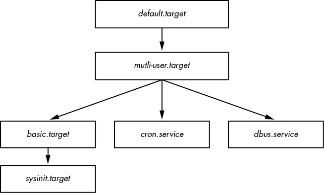

*图 6-1：单元依赖图*

这张图经过了大幅简化。在你自己的系统上，仅仅查看最顶层单元的配置文件，再逐层向下追踪，并不能切实可行地画出所有依赖关系。我们将在第 6.3.6 节进一步研究依赖关系的工作方式。


#### 6.3.3 systemd 配置

systemd 的配置文件分散在系统中的许多目录里，因此当你要查找某个特定文件时，可能需要花些功夫。systemd 配置主要涉及两个目录：*系统单元目录*（全局配置，通常是 */lib/systemd/system* 或 */usr/lib/systemd/system*）和*系统配置目录*（本地定义，通常是 */etc/systemd/system*）。

为了避免混淆，请遵循一条规则：不要修改系统单元目录中的文件，因为这些文件由发行版负责维护。本地修改应放在系统配置目录中。这也是一条适用于整个系统的通用原则：如果可以选择修改 */usr* 或 */etc* 中的内容，应始终修改 */etc* 中的内容。

可以使用以下命令查看当前 systemd 的配置搜索路径及其优先级：

```bash
$ systemctl -p UnitPath show
UnitPath=/etc/systemd/system.control /run/systemd/system.control /run/systemd/transient /etc/systemd/system /run/systemd/system /run/systemd/generator /lib/systemd/system /run/systemd/generator.late
```

要查看自己系统上的系统单元目录和系统配置目录，可以使用以下命令：

```bash
$ pkg-config systemd --variable=systemdsystemunitdir
/lib/systemd/system
$ pkg-config systemd --variable=systemdsystemconfdir
/etc/systemd/system
```

##### 单元文件

单元文件的格式源自 XDG Desktop Entry 规范（用于 *.desktop* 文件，与 Microsoft 系统上的 *.ini* 文件非常相似）。这种格式使用方括号（`[]`）标记节名，并在每个节中设置变量及其对应的值（即选项）。

以桌面总线守护进程的 *dbus-daemon.service* 单元文件为例：

```ini
[Unit]
Description=D-Bus System Message Bus
Documentation=man:dbus-daemon(1)
Requires=dbus.socket
RefuseManualStart=yes

[Service]
ExecStart=/usr/bin/dbus-daemon --system --address=systemd: --nofork --nopidfile --systemd-activation --syslog-only
ExecReload=/usr/bin/dbus-send --print-reply --system --type=method_call --dest= org.freedesktop.DBus / org.freedesktop.DBus.ReloadConfig
```

这里有两个节：`[Unit]` 和 `[Service]`。`[Unit]` 节提供单元的基本信息，包括描述和依赖关系。特别要注意的是，这个单元依赖 *dbus.socket* 单元。

在这样的服务单元中，`[Service]` 节包含服务的具体信息，例如如何准备、启动和重新加载服务。你可以在 systemd.service(5) 和 systemd.exec(5) 手册页中找到完整的配置选项列表；本书 6.3.5 节讨论进程跟踪时，也会涉及这些内容。

许多其他单元配置文件也同样直观。例如，服务单元文件 *sshd.service* 通过启动 sshd 来提供远程安全 Shell 登录功能。

> 你在自己系统中找到的单元文件可能略有不同。例如，这里可以看到 Fedora 使用 *dbus-daemon.service* 这个名称，而 Ubuntu 使用 *dbus.service*。实际文件的内容也可能有所变化，不过这些差异往往只是表面上的。

##### 变量

你经常会在单元文件中看到变量。下面是另一个单元文件中的一段配置，它用于第 10 章将要介绍的安全 Shell：

```ini
[Service]
EnvironmentFile=/etc/sysconfig/sshd
ExecStartPre=/usr/sbin/sshd-keygen
ExecStart=/usr/sbin/sshd -D $OPTIONS $CRYPTO_POLICY
ExecReload=/bin/kill -HUP $MAINPID
```

所有以美元符号（`$`）开头的内容都是变量。虽然这些变量采用相同的语法，但它们的来源并不相同。`$OPTIONS` 和 `$CRYPTO_POLICY` 是可以在激活单元时传递给 sshd 的选项，它们在 `EnvironmentFile` 设置指定的文件中定义。在这个例子中，你可以查看 */etc/sysconfig/sshd*，确认这些变量是否已设置，以及设置了什么值。

相比之下，`$MAINPID` 包含该服务的*被跟踪进程*的进程 ID（参见 6.3.5 节）。激活单元时，systemd 会记录并保存这个 PID，以便你以后操作该服务对应的进程。*sshd.service* 单元文件使用 `$MAINPID`，在需要重新加载配置时向 sshd 发送挂起（HUP）信号。这是处理 Unix 守护进程配置重载和重启时非常常见的技术。

##### 替换符

*替换符*（specifier）是单元文件中经常出现的一种类似变量的功能。替换符以百分号（`%`）开头。例如，`%n` 表示当前单元的名称，`%H` 表示当前主机名。

你还可以使用替换符，根据一个单元文件创建同类单元的多个实例。例如，控制虚拟控制台（如 *tty1* 和 *tty2*）登录提示的 `getty` 进程就采用了这种方式。要使用这一功能，可以在单元文件名的点号之前、单元名称末尾添加 `@` 符号。

例如，在大多数发行版中，`getty` 的单元文件名是 *getty@.service*，因此可以动态创建 *getty@tty1* 和 *getty@tty2* 等单元。`@` 后面的部分称为*实例*（instance）。查看这类单元文件时，你可能还会看到 `%I` 或 `%i` 替换符。当 systemd 根据包含实例的单元文件激活服务时，它会用实例名称替换 `%I` 或 `%i`，从而构成新的服务名称。


#### 6.3.4 systemd 的操作

你主要通过 `systemctl` 命令与 systemd 交互。它可以启动和停止服务、列出状态、重新加载配置，以及执行许多其他操作。

最基本的命令用于获取单元信息。例如，要查看系统中当前处于活动状态的单元列表，可以执行 `list-units` 命令。（这是 `systemctl` 的默认命令，因此严格来说不必指定 `list-units` 参数。）

```bash
$ systemctl list-units
```

其输出格式与典型的 Unix 信息列表命令相似。例如，表头以及 *-.mount*（根文件系统）对应的那一行如下所示：

```
UNIT                      LOAD   ACTIVE SUB       DESCRIPTION
-.mount                   loaded active mounted   Root Mount
```

默认情况下，`systemctl list-units` 会输出大量内容，因为典型系统中有许多活动单元。不过，这仍然是经过缩减的输出，因为 `systemctl` 会截断特别长的单元名称。要查看完整的单元名称，请使用 `--full` 选项；要查看所有单元（而不仅是活动单元），请使用 `--all` 选项。

`systemctl` 的一项特别实用的功能是查询指定单元的状态。例如，下面是一条典型的 `status` 命令及其部分输出：

```bash
$ systemctl status sshd.service
· sshd.service - OpenBSD Secure Shell server
   Loaded: loaded (/usr/lib/systemd/system/sshd.service; enabled; vendor preset: enabled)
   Active: active (running) since Fri 2021-04-16 08:15:41 EDT; 1 months 1 days ago
 Main PID: 1110 (sshd)
    Tasks: 1 (limit: 4915)
   CGroup: /system.slice/sshd.service
           ⌙1110 /usr/sbin/sshd -D
```

输出后面还可能跟着若干条日志消息。如果你习惯使用传统的 init 系统，可能会惊讶于这一条命令能提供如此多的有用信息。它不仅显示单元的状态，还会显示与服务关联的进程、单元的启动时间，以及在有日志可用时显示若干条日志消息。

其他类型单元的状态输出也包含类似的有用信息。例如，挂载单元的输出会包含挂载发生的时间、实际使用的命令行及其退出状态。

输出中有一个值得注意的部分，即控制组（control group，cgroup）的名称。在前面的例子中，控制组是 `/system.slice/sshd.service`，其下方列出了属于该控制组的进程。不过，如果某个单元的进程（例如挂载单元的进程）已经终止，你也可能看到名称以 `systemd:/system` 开头的控制组。使用 `systemd-cgls` 命令，可以单独查看与 systemd 相关的控制组，而不必显示单元状态的其他信息。第 6.3.5 节将进一步介绍 systemd 如何使用 cgroup，第 8.6 节则会解释 cgroup 的工作原理。

`status` 命令只显示该单元最近的诊断日志消息。要查看某个单元的全部日志消息，可以使用：

```bash
$ journalctl --unit=unit_name
```

第 7 章将更详细地介绍 `journalctl`。

> 根据系统和用户配置的不同，运行 `journalctl` 可能需要超级用户权限。

##### 作业与单元的启动、停止和重新加载之间的关系

要启动、停止和重新启动单元，可以分别使用 `systemctl start`、`systemctl stop` 和 `systemctl restart` 命令。不过，如果修改了单元配置文件，可以通过以下两种方式之一通知 systemd 重新加载配置：

1. `systemctl reload unit`：只重新加载 `unit` 的配置。
2. `systemctl daemon-reload`：重新加载所有单元配置。

在 systemd 中，启动、重新激活和重新启动单元的请求称为*作业*（job），本质上就是单元状态的变更。可以使用以下命令查看系统当前的作业：

```bash
$ systemctl list-jobs
```

如果系统已经运行了一段时间，通常可以预期没有活动作业，因为启动系统所需的所有激活操作应该都已完成。不过，在引导过程中，有时你登录得足够快，就能看到那些启动非常缓慢的单元所对应的作业。例如：

```
  JOB UNIT                      TYPE            STATE
   1 graphical.target          start           waiting
   2 multi-user.target         start           waiting
  71 systemd-...nlevel.service start           waiting
  75 sm-client.service         start           waiting
  76 sendmail.service          start           running
 120 systemd-...ead-done.timer start           waiting
```

在这个例子中，作业 76（启动 *sendmail.service* 单元）耗费了很长时间。列表中的其他作业都处于等待状态，很可能都是在等待作业 76。当 *sendmail.service* 完成启动并完全进入活动状态后，作业 76 就会结束，其余作业也会完成，作业列表随之清空。

> *作业*（job）这个术语可能令人困惑，尤其是因为其他一些 init 系统会用它来指代更接近 systemd 单元的功能。此外，这里的作业与 Shell 的作业控制毫无关系。

有关如何关闭和重新启动系统，请参见第 6.6 节。

##### 向 systemd 添加单元

向 systemd 添加单元，主要就是创建单元文件，然后激活它，并在需要时启用它。通常应将自行编写的单元文件放在系统配置目录（*/etc/systemd/system*）中，这样既不会与发行版自带的单元文件混淆，也能避免发行版升级时覆盖自己的文件。

由于很容易创建既不执行实际操作、也不会干扰系统的目标单元（target unit），不妨动手试一试。按照以下步骤创建两个目标单元，并让其中一个依赖另一个：

1. 在 */etc/systemd/system* 中创建名为 *test1.target* 的单元文件：

   ```ini
   [Unit]
   Description=test 1
   ```

2. 创建 *test2.target* 文件，并让它依赖 *test1.target*：

   ```ini
   [Unit]
   Description=test 2
   Wants=test1.target
   ```

   这里的 `Wants` 关键字定义了一项依赖关系：激活 *test2.target* 时，也会激活 *test1.target*。现在激活 *test2.target*，看看实际效果：

   ```bash
   # systemctl start test2.target
   ```

3. 确认两个单元都处于活动状态：

   ```bash
   # systemctl status test1.target test2.target
   · test1.target - test 1
      Loaded: loaded (/etc/systemd/system/test1.target; static; vendor preset: enabled)
      Active: active since Tue 2019-05-28 14:45:00 EDT; 16s ago
   
   May 28 14:45:00 duplex systemd[1]: Reached target test 1.
   
   · test2.target - test 2
      Loaded: loaded (/etc/systemd/system/test2.target; static; vendor preset: enabled)
      Active: active since Tue 2019-05-28 14:45:00 EDT; 17s ago
   ```

4. 如果单元文件包含 `[Install]` 节，那么在激活该单元之前，需要先将其“启用”（enable）：

   ```bash
   # systemctl enable unit
   ```

`[Install]` 节是创建依赖关系的另一种方式。第 6.3.6 节将更详细地介绍它以及整个依赖关系机制。

##### 从 systemd 中移除单元

要移除一个单元，请按照以下步骤操作：

1. 如有必要，先停止该单元：

   ```bash
   # systemctl stop unit
   ```

2. 如果单元包含 `[Install]` 节，请禁用它，以删除依赖关系系统创建的所有符号链接：

   ```bash
   # systemctl disable unit
   ```

之后，如果愿意，就可以删除该单元文件。

> 禁用一个被隐式启用的单元（也就是没有 `[Install]` 节的单元）不会产生任何效果。


#### 6.3.5 systemd 进程跟踪与同步

systemd 希望能够掌握它所启动的每个进程的适量信息，并对这些进程保持一定程度的控制。从历史上看，这一直很难做到。服务可能以不同方式启动：它可以派生出自己的新实例，甚至可以转变为守护进程，脱离最初的进程。此外，也无法预先确定一个服务器会生成多少个子进程。

为了便于管理已经激活的单元，systemd 使用前面提到的 cgroups。它是 Linux 内核的一项功能，能够更细致地跟踪进程的层次关系。使用 cgroups 还有一个好处：软件包开发者或系统管理员在创建可正常工作的单元文件时，需要完成的工作更少。在 systemd 中，你不必考虑服务所有可能的启动行为；你只需要知道服务的启动进程是否会派生子进程。使用服务单元文件中的 `Type` 选项来指定启动行为。基本的启动方式有两种：

1. `Type=simple`：服务进程不会派生子进程后自行终止；它会一直作为主要服务进程运行。
2. `Type=forking`：服务会派生子进程，systemd 则预期原来的服务进程会终止。原进程终止后，systemd 就认为服务已准备就绪。

`Type=simple` 没有考虑服务初始化可能需要一段时间。因此，对于那些必须等到该服务真正就绪才能启动的依赖单元，systemd 并不知道何时应该启动它们。一种解决办法是采用延迟启动（参见 6.3.7 节）。不过，有些 `Type` 启动方式允许服务自行通知 systemd：它已经准备好了。

1. `Type=notify`：服务准备就绪后，会通过一个专门的函数调用向 systemd 发送通知。
2. `Type=dbus`：服务准备就绪后，会在 D-Bus（Desktop Bus，桌面总线）上注册自己。

另一种服务启动方式由 `Type=oneshot` 指定。在这种方式下，服务进程启动后会彻底终止，不留下任何子进程。它与 `Type=simple` 类似，区别在于 systemd 直到服务进程终止时才认为服务已经启动。任何严格依赖于它的单元（稍后会介绍）都必须等到这一终止过程完成后才能启动。使用 `Type=oneshot` 的服务还会默认获得 `RemainAfterExit=yes` 指令，使 systemd 即使在服务进程结束后，仍将该服务视为处于活动状态。

最后一个选项是 `Type=idle`。它的工作方式与 `simple` 类似，但会要求 systemd 等到所有正在执行的作业结束后，才启动这个服务。这样做只是为了推迟服务启动，直到其他服务启动完毕，避免各个服务的输出相互干扰。请记住，一旦服务启动，负责启动它的 systemd 作业就会结束。因此，等待其他作业全部结束，就能确保此时没有其他服务正在启动。

如果你想了解 cgroups 的工作原理，我们将在 8.6 节进一步讨论。

#### 6.3.6 systemd 依赖关系

一个能够灵活处理启动期间及运行期间依赖关系的系统，必然需要一定的复杂性，因为过于严格的规则可能导致系统性能下降或运行不稳定。例如，假设你希望在数据库服务器启动之后才显示登录提示，于是把登录提示设置为严格依赖数据库服务器。这意味着，如果数据库服务器启动失败，登录提示也会失败，你甚至无法登录机器来修复问题！

Unix 系统的启动任务通常具有相当好的容错能力。某些任务即使失败，也往往不会给常规服务造成严重问题。例如，如果你移除了系统的数据磁盘，却保留了它在 */etc/fstab* 中的条目（或者 systemd 中的挂载单元），那么启动时挂载该文件系统就会失败。虽然这可能影响应用服务器（例如 Web 服务器），但通常不会影响系统的基本运行。

为了兼顾灵活性和容错性，systemd 提供了多种依赖关系类型和形式。先来看看几种基本类型，下面使用它们在配置中对应的关键字：

1. `Requires`：严格依赖。激活一个具有 `Requires` 依赖的单元时，systemd 会尝试激活被依赖的单元。如果被依赖的单元失败，systemd 也会停用依赖它的单元。
2. `Wants`：仅用于激活的依赖。激活一个单元时，systemd 会激活它通过 `Wants` 指定的依赖单元，但不在乎这些依赖单元是否失败。
3. `Requisite`：要求被依赖单元已经处于活动状态。在激活一个具有 `Requisite` 依赖的单元之前，systemd 首先检查被依赖单元的状态。如果它尚未激活，那么当前单元的激活就会失败。
4. `Conflicts`：互斥依赖。激活一个带有 `Conflicts` 依赖的单元时，如果与之冲突的单元已经处于活动状态，systemd 会自动停用后者。相互冲突的单元无法同时成功激活。

`Wants` 依赖尤其重要，因为它不会将失败传播给其他单元。systemd.service(5) 手册页指出，只要可能，就应该使用这种方式来指定依赖关系。原因不难理解：这种行为能使系统更加健壮，并保留传统 init 的一个优点——较早启动的组件失败，不一定会阻止后续组件启动。

只要指定要查看的依赖类型（例如 `Wants` 或 `Requires`），就可以通过 `systemctl` 命令查看一个单元的依赖关系：

```bash
# systemctl show -p type unit
```

##### 启动顺序

到目前为止，我们看到的依赖关系语法都没有明确指定启动顺序。例如，激活大多数具有 `Requires` 或 `Wants` 依赖的服务单元时，相关单元会同时启动。这是理想的情况，因为我们希望尽可能并行启动更多服务，从而缩短引导时间。不过，有时一个单元必须在另一个单元之后启动。例如，在 [图 6-1](#figure6-1) 所依据的系统中，*default.target* 单元被设置为在 *multi-user.target* 之后启动（图中没有显示这种顺序关系）。

要按特定顺序激活单元，可以使用以下依赖修饰符：

1. `Before`：当前单元会在所列单元之前激活。例如，如果 *foo.target* 中包含 `Before=bar.target`，systemd 就会先激活 *foo.target*，再激活 *bar.target*。
2. `After`：当前单元会在所列单元之后激活。

使用顺序约束时，systemd 会等到相关单元进入活动状态，再激活依赖它的单元。


##### 默认依赖与隐式依赖

在探索依赖关系时（尤其是使用 `systemd-analyze` 时），你可能会发现，某些单元具有一些并未在单元文件或其他可见机制中明确声明的依赖关系。这种情况最容易出现在带有 `Wants` 依赖的目标单元中：你会发现，对于 `Wants` 所列出的单元，systemd 还会附加一个 `After` 修饰符。这些额外的依赖关系由 systemd 在内部处理，在启动时计算得出，而不是保存在配置文件中。

这种自动添加的 `After` 修饰符称为*默认依赖*（default dependency）。它是对单元配置的自动补充，目的是避免常见错误，同时让单元文件保持简洁。不同类型的单元，其默认依赖也不同。例如，systemd 为目标单元添加的默认依赖与为服务单元添加的并不相同。你可以在相应单元配置手册页的 DEFAULT DEPENDENCIES 一节中查阅这些差异，例如 systemd.service(5) 和 systemd.target(5)。

如果要禁用某个单元的默认依赖，可以在其配置文件中添加 `DefaultDependencies=no`。

##### 条件依赖

你可以使用多种*条件依赖*参数来检查操作系统的状态，而不只是检查 systemd 单元。例如：

1. `ConditionPathExists=p`：如果系统中存在路径 *p*（文件路径），则条件为真。
2. `ConditionPathIsDirectory=p`：如果 *p* 是目录，则条件为真。
3. `ConditionFileNotEmpty=p`：如果 *p* 是文件且长度不为零，则条件为真。

当 systemd 尝试激活某个单元时，如果该单元的条件依赖不成立，该单元就不会被激活。不过，这种判断只作用于包含该条件的单元本身。也就是说，如果你激活一个同时具有条件依赖和其他单元依赖的单元，无论条件是真还是假，systemd 都会尝试激活它所依赖的那些单元。

其他依赖类型大多是前面几种依赖的变体。例如，`RequiresOverridable` 在正常运行时与 `Requires` 相同，但当手动激活一个单元时，它的行为类似 `Wants`。完整列表请参阅 systemd.unit(5) 手册页。

##### [Install] 节与启用单元（The [Install] Section and Enabling Units）

到目前为止，我们讨论的都是如何在依赖方单元的配置文件中定义依赖关系。实际上，也可以“反过来”定义：在被依赖单元的文件中指定哪些单元依赖它。只需在 `[Install]` 节中添加 `WantedBy` 或 `RequiredBy` 参数即可。这样就能调整某个单元应该在什么时候启动，而不必修改其他配置文件（例如，当你不想编辑系统自带的单元文件时）。

为了理解这种机制，回顾 6.3.4 节中的示例。那里有两个单元 *test1.target* 和 *test2.target*，其中 *test2.target* 通过 `Wants` 依赖 *test1.target*。现在可以修改配置，让 *test1.target* 变成：

```ini
[Unit]
Description=test 1

[Install]
WantedBy=test2.target
```

而 *test2.target* 的配置如下：

```ini
[Unit]
Description=test 2
```

现在其中一个单元包含 `[Install]` 节，因此在启动它之前，需要先通过 `systemctl` *启用*该单元。对于 *test1.target*，操作如下：

```bash
# systemctl enable test1.target
Created symlink /etc/systemd/system/test2.target.wants/test1.target → /etc/systemd/system/test1.target.
```

请注意命令输出：启用单元的效果，是在与依赖方单元对应的 *.wants* 子目录中创建一个符号链接（本例中的依赖方是 *test2.target*）。现在依赖关系已经建立，执行 `systemctl start test2.target` 就可以同时启动这两个单元。

> 启用单元并不等于激活单元。

要禁用该单元（同时移除符号链接），可以执行：

```bash
# systemctl disable test1.target
Removed /etc/systemd/system/test2.target.wants/test1.target.
```

本例中的两个单元也适合用来尝试不同的启动情形。例如，试试看只启动 *test1.target* 会怎样；或者，在没有启用 *test1.target* 的情况下尝试启动 *test2.target*。你也可以将 `WantedBy` 改为 `RequiredBy`。（记住，可以使用 `systemctl status` 查看单元状态。）

在正常运行期间，systemd 会忽略单元文件中的 `[Install]` 节，但会识别它的存在，并且默认将该单元视为尚未启用。启用单元的设置会在重新启动后继续保留。

`[Install]` 节通常负责在系统配置目录（*/etc/systemd/system*）中建立 *.wants* 和 *.requires* 目录下的链接。不过，单元配置目录（*[/usr]/lib/systemd/system*）也包含 *.wants* 目录；你还可以手动添加不对应任何单元文件 `[Install]` 节的链接。这种手动添加链接的方法，可以在不修改单元文件的情况下增加依赖关系，避免日后软件升级覆盖文件。但通常不推荐这样做，因为手动添加的依赖关系不容易追踪。


#### 6.3.7 systemd 按需启动与资源并行化启动

systemd 的一项功能是将某个单元的启动推迟到真正需要它的时候。典型的配置过程如下：

1. 为你希望提供的系统服务创建一个 systemd 单元（称为单元 A）。
2. 找出单元 A 用来提供服务的系统资源，例如网络端口或套接字、文件或者设备。
3. 创建另一个 systemd 单元（单元 R）来表示这一资源。这类单元按类型划分，例如套接字单元、路径单元和设备单元。
4. 定义单元 A 与单元 R 之间的关系。通常可以根据单元名称隐式建立关系，但也可以显式指定，稍后会看到相关示例。

配置完成后，运行过程如下：

1. 单元 R 被激活后，systemd 开始监视相应资源。
2. 当有程序尝试访问该资源时，systemd 暂时阻止访问，并缓冲发送给资源的输入。
3. systemd 激活单元 A。
4. 服务准备就绪后，单元 A 接管该资源，读取缓冲的输入，然后正常运行。

这里有几个需要注意的问题：

- 必须确保资源单元涵盖服务提供的所有资源。通常这不难，因为大多数服务只有一个访问入口。
- 必须确保资源单元与其代表的服务单元正确关联。这种关联可以是隐式的，也可以是显式的；某些情况下，还有多种选项可以决定 systemd 如何将资源交接给服务单元。
- 并非所有服务器程序都知道如何与 systemd 提供的资源单元配合工作。

如果你已经了解 `inetd`、`xinetd` 和 `automount` 等传统工具的用途，就会发现它们与这里的机制有很多相似之处。事实上，这个概念并不新鲜；systemd 甚至支持自动挂载单元。

##### 套接字单元与服务单元示例

来看一个简单的网络回显服务示例。这部分内容稍有难度；在阅读第 9 章关于 TCP、端口和监听的讨论，以及第 10 章关于套接字的内容之前，你可能无法完全理解，但应该能够掌握基本思路。

回显服务会把网络客户端连接后发送的内容原样返回。这里的服务监听 TCP 端口 22222。首先创建一个表示该端口的*套接字单元*，其 *echo.socket* 文件如下：

```ini
[Unit]
Description=echo socket

[Socket]
ListenStream=22222
Accept=true
```

注意，这个单元文件没有提到它所支持的服务单元。那么对应的服务单元文件是什么呢？

它的名称是 *echo@.service*。两者通过命名约定关联：如果服务单元文件与 *.socket* 文件具有相同的前缀（这里是 *echo*），systemd 就知道在套接字单元上发生活动时激活对应的服务单元。在这个例子中，*echo.socket* 上出现活动后，systemd 会创建一个 *echo@.service* 实例。下面是 *echo@.service* 单元文件：

```ini
[Unit]
Description=echo service

[Service]
ExecStart=/bin/cat
StandardInput=socket
```

> 如果你不喜欢依据名称前缀隐式激活单元，或者需要关联前缀不同的单元，可以在定义资源的单元中使用显式选项。例如，在 *foo.service* 中使用 `Socket=bar.socket`，让 *bar.socket* 将其套接字交给 *foo.service*。

要运行这个示例，先启动 *echo.socket* 单元：

```bash
# systemctl start echo.socket
```

现在可以用 `telnet` 等工具连接本机的 TCP 端口 22222，测试服务。服务会重复你输入的内容。以下是一次示例交互：

```bash
$ telnet localhost 22222
Trying 127.0.0.1...
Connected to localhost.
Escape character is '^]'.
Hi there.
Hi there.
```

如果玩够了，想返回 Shell，请在单独一行按 Ctrl-]，然后按 Ctrl-D。要停止该服务，可以停止套接字单元：

```bash
# systemctl stop echo.socket
```

> 你的 Linux 发行版可能默认没有安装 `telnet`。

##### 实例与资源交接

因为 *echo@.service* 单元支持同时运行多个实例，所以名称中包含 *@*（回忆一下，*@* 表示参数化）。为什么需要多个实例？假设多个网络客户端同时连接服务，而你希望每个连接都有自己的服务实例。此时，服务单元*必须*支持多个实例，因为我们在 *echo.socket* 中设置了 `Accept=true`。这个选项要求 systemd 不仅监听端口，还要代表服务单元接受传入连接，并将连接交给服务单元，为每个连接创建独立实例。每个实例都从连接读取数据，并将其视为标准输入；它甚至不一定需要知道这些数据来自网络连接。

> 大多数网络连接需要的灵活性远不止将数据简单地传递给标准输入和标准输出。因此，不要指望仅凭这里展示的 *echo@.service* 单元文件就能构建复杂的网络服务。

如果服务单元能够自行接受连接，就不要在其文件名中使用 *@*，也不要在套接字单元中设置 `Accept=true`。这种情况下，服务单元会从 systemd 手中完全接管套接字；在服务单元结束之前，systemd 不会再次尝试监听该网络端口。

由于资源类型繁多，资源向服务单元交接的选项也各不相同，因此很难做出统一概括。此外，相关选项的文档分散在多个手册页中。关于面向资源的单元，请参阅 `systemd.socket(5)`、`systemd.path(5)` 和 `systemd.device(5)`。对于服务单元，一个经常被忽视的文档是 `systemd.exec(5)`，其中说明了服务单元在激活时如何接收资源。

##### 使用辅助单元优化启动

systemd 的总体目标之一，是简化依赖关系的启动顺序并缩短引导时间。套接字单元等资源单元提供了一种与按需启动相似的实现方式。我们仍然有一个服务单元，以及一个代表该服务所提供资源的辅助单元；但这一次，systemd 在激活辅助单元后会立即启动服务单元，而不是等待资源访问请求出现。

采用这种方案的原因是，*systemd-journald.service* 等引导期间必需的服务单元需要一些时间才能启动，而许多其他单元又依赖它们。不过，systemd 可以非常迅速地提供某个单元所需的基本资源（例如套接字单元），随后立即激活这个基础服务单元，以及所有依赖它的单元。待基础服务准备就绪后，再由它接管资源。

[图 6-2](#figure6-2) 展示了传统顺序启动系统中的情况。在这条启动时间线上，服务 E 提供必需的资源 R。服务 A、B 和 C 都依赖资源 R，但彼此之间没有依赖关系，因此它们必须等服务 E 启动后才能运行。由于系统必须等前一个服务启动完成后才启动下一个服务，轮到服务 C 时就已经过去了相当长的时间。

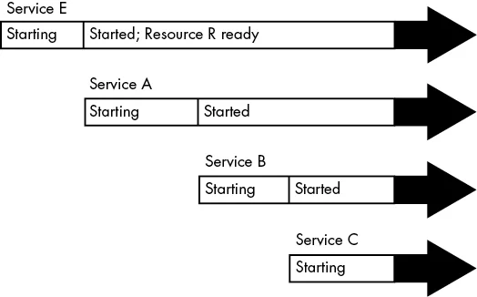

*图 6-2：存在资源依赖关系时的顺序启动时间线*

[图 6-3](#figure6-3) 展示了一种等效的 systemd 启动配置。服务由单元 A、B、C 和 E 表示，另外新增单元 R 来表示单元 E 提供的资源。由于 systemd 能在单元 E 启动期间就为单元 R 提供访问接口，因此单元 A、B、C 和 E 可以同时开始启动。单元 E 准备就绪后，便接管单元 R 所代表的资源。这里有一个值得注意的地方：单元 A、B 或 C 在完成自身启动之前，可能根本不需要访问单元 R 提供的资源。我们所做的，只是让它们能够在需要时尽早开始访问该资源。

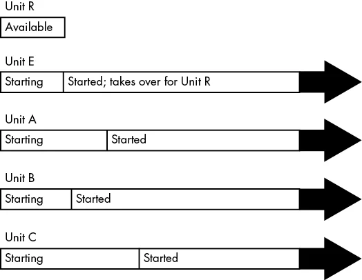

*图 6-3：使用资源单元的 systemd 启动时间线*

> 以这种方式并行启动时，大量单元同时启动可能使系统暂时变慢。

关键在于：虽然这里并没有实现真正的按需启动，但使用的正是那些使按需启动成为可能的功能。要查看现实中的常见示例，可以研究运行 systemd 的机器上的 journald 和 D-Bus 配置单元；它们很可能采用了这种并行化方式。


#### 6.3.8 systemd 辅助组件

随着 systemd 越来越普及，它所支持的功能也逐渐扩展，开始直接或通过辅助兼容层处理一些与系统启动和服务管理无关的任务。你可能会注意到 */lib/systemd* 目录中有许多程序；它们就是与这些功能相关的可执行文件。

下面列举几个具体的系统服务：

1. **udevd**：你已经在第 3 章学习过它；它是 systemd 的一部分。
2. **journald**：日志服务，负责处理多种日志机制，其中包括传统 Unix 的 `syslog` 服务。第 7 章将进一步介绍它。
3. **resolved**：用于 DNS 的名称服务缓存守护进程；你将在第 9 章了解它。

这些服务的可执行文件都带有 `systemd-` 前缀。例如，与 systemd 集成的 udevd 名为 `systemd-udevd`。

如果进一步研究，你会发现其中有些程序其实是相对简单的封装程序。它们负责运行标准的系统实用工具，并将执行结果通知 systemd。`systemd-fsck` 就是一个例子。

如果你在 */lib/systemd* 中看到一个不认识的程序，可以查看它的手册页。手册页很可能不仅介绍这个工具本身，还会说明它所配合的单元类型。

### 6.4 System V 运行级别

了解了 systemd 及其工作原理之后，我们换个角度，看看传统 System V init 的一些特性。在 Linux 系统运行的任何时刻，总有一组基本进程（例如 crond 和 udevd）处于运行状态。在 System V init 中，机器的这种状态称为*运行级别*（runlevel），用 0 到 6 之间的数字表示。系统的大部分运行时间都处于某一个运行级别；但当你关闭机器时，init 会切换到另一个运行级别，以便有序地终止系统服务，并通知内核停止运行。

你可以使用 `who -r` 命令查看系统的运行级别，如下所示：

```bash
$ who -r
run-level 5  2019-01-27 16:43
```

这段输出表明当前运行级别为 5，同时给出了进入这一运行级别的日期和时间。

运行级别有多种用途，其中最常见的是区分系统启动、关机、单用户模式和控制台模式等状态。例如，传统上大多数系统使用运行级别 2 到 4 对应文本控制台，而运行级别 5 表示系统启动图形界面登录。

不过，运行级别正在逐渐成为历史。虽然 systemd 仍然支持运行级别，但它认为用运行级别来表示系统最终状态的方式已经过时，更倾向于使用目标单元（target unit）。对 systemd 来说，运行级别主要是为了启动那些只支持 System V init 脚本的服务而保留的。


### 6.5 System V init

System V init 是 Linux 上使用历史最悠久的 init 实现之一。它的核心思想是：通过精心安排的启动顺序，使系统能够有序地启动并进入不同的运行级别。如今，大多数服务器和桌面系统已经很少使用 System V init，但你仍可能在 RHEL 7.0 以前的版本，以及路由器、手机等嵌入式 Linux 环境中遇到它。此外，一些较旧的软件包可能只提供为 System V init 编写的启动脚本；systemd 可以通过兼容模式处理这些脚本，我们将在 6.5.5 节讨论。这里先介绍基本原理，但请记住，你实际使用的系统可能根本不会涉及本节内容。

典型的 System V init 安装由两部分组成：一个中央配置文件，以及大量通过符号链接组织起来的启动脚本。一切都从配置文件 */etc/inittab* 开始。如果系统使用 System V init，可以在 *inittab* 文件中寻找类似下面的一行：

```
id:5:initdefault:
```

这表示默认运行级别为 5。

*inittab* 中的每一行都采用以下格式，四个字段依次用冒号分隔：

1. 唯一标识符（一个短字符串，例如上例中的 `id`）。
2. 适用的运行级别编号（可以有多个）。
3. init 应执行的动作（在上例中，将默认运行级别设为 5）。
4. 要执行的命令（可选）。

要了解 *inittab* 中的命令如何工作，请看下面这一行：

```
l5:5:wait:/etc/rc.d/rc 5
```

这一行非常重要，因为它会触发系统的大部分配置操作和服务启动。在这里，`wait` 动作决定了 System V init 何时以及如何执行命令：进入运行级别 5 时，执行一次 `/etc/rc.d/rc 5`，并等待它结束，然后才继续执行其他操作。`rc 5` 命令会按数字顺序执行 */etc/rc5.d* 中名称以数字开头的相应项目。稍后我们将详细介绍这一过程。

除了 `initdefault` 和 `wait`，下面是 *inittab* 中最常见的几种动作：

`respawn`

1. `respawn` 动作指示 init 执行后面的命令；如果命令执行结束，就再次运行它。你可能在 *inittab* 中看到类似这样的内容：

   ```
   1:2345:respawn:/sbin/mingetty tty1
   ```
2. `getty` 程序负责提供登录提示。上面这一行用于第一个虚拟控制台（*/dev/tty1*），也就是按下 Alt-F1 或 Ctrl-Alt-F1 时看到的控制台（参见 3.4.7 节）。`respawn` 动作能够在用户注销后重新显示登录提示。

`ctrlaltdel`

1. `ctrlaltdel` 动作控制用户在虚拟控制台按下 Ctrl-Alt-Del 时系统的行为。在大多数系统中，它会通过 `shutdown` 命令执行某种重启操作（参见 6.6 节）。

`sysinit`

1. `sysinit` 动作指定 init 启动后、进入任何运行级别之前首先执行的操作。

   > 有关更多可用动作，请参阅 `inittab(5)` 手册页。

#### 6.5.1 System V init：启动命令顺序

现在来看看 System V init 如何在允许用户登录之前启动系统服务。回顾前面的 *inittab* 配置行：

```
l5:5:wait:/etc/rc.d/rc 5
```

这短短一行会触发许多其他程序。实际上，`rc` 是 *run commands*（运行命令）的缩写，人们也常把这些命令称为*脚本*、*程序*或*服务*。但这些命令存放在哪里呢？

这一行中的 `5` 表示运行级别 5。对应的命令通常位于 */etc/rc.d/rc5.d* 或 */etc/rc5.d*。（运行级别 1 使用 *rc1.d*，运行级别 2 使用 *rc2.d*，依此类推。）例如，在 *rc5.d* 目录中，你可能看到：

```
S10sysklogd     S20ppp          S99gpm
S12kerneld      S25netstd_nfs   S99httpd
S15netstd_init  S30netstd_misc  S99rmnologin
S18netbase      S45pcmcia       S99sshd
S20acct         S89atd
S20logoutd      S89cron
```

`rc 5` 命令会依次执行 *rc5.d* 目录中的程序，相当于按下面的顺序运行命令：

```
S10sysklogd start
S12kerneld start
S15netstd_init start
S18netbase start
--snip--
S99sshd start
```

注意每条命令后面的 `start` 参数。命令名称开头的大写字母 *S* 表示该命令应以*启动*模式运行，而紧随其后的数字（00 到 99）决定了 `rc` 启动命令的先后顺序。*rc\*.d* 中的命令通常是 Shell 脚本，用于启动 */sbin* 或 */usr/sbin* 中的程序。

通常，可以使用 `less` 或其他分页查看程序阅读脚本，从而了解某条命令的具体作用。

> 某些 *rc\*.d* 目录还包含以 *K* 开头的命令（*kill*，即停止模式）。此时，`rc` 会向命令传入 `stop` 参数，而不是 `start`。你最可能在用于关闭系统的运行级别中遇到这些 `K` 命令。

你也可以手动执行这些命令，不过通常应通过 *init.d* 目录而不是 *rc\*.d* 目录来操作。接下来就介绍这一点。

#### 6.5.2 System V init 的符号链接集合

*rc\*.d* 目录中的内容实际上是指向另一个目录 *init.d* 中相应文件的符号链接。如果你打算操作、添加、删除或修改 *rc\*.d* 目录中的服务，就需要理解这些符号链接。对 *rc5.d* 这样的目录执行长格式列表命令，会看到类似下面的结构：

```
lrwxrwxrwx . . . S10sysklogd -> ../init.d/sysklogd
lrwxrwxrwx . . . S12kerneld -> ../init.d/kerneld
lrwxrwxrwx . . . S15netstd_init -> ../init.d/netstd_init
lrwxrwxrwx . . . S18netbase -> ../init.d/netbase
--snip--
lrwxrwxrwx . . . S99httpd -> ../init.d/httpd
--snip--
```

像这样分布在多个子目录中的大量符号链接，称为 *link farm*（符号链接集合）。Linux 发行版使用这些链接，是为了让所有运行级别都能够复用同一套启动脚本。这是一种约定，并非强制要求，但它使组织和管理更加简单。

##### 启动和停止服务

要手动启动或停止服务，应使用 *init.d* 目录中的脚本。例如，手动启动 httpd Web 服务器的一种方式是执行 `init.d/httpd start`。同样，要停止正在运行的服务，可以使用 `stop` 参数（例如 `httpd stop`）。

##### 修改启动顺序

在 System V init 中，修改启动顺序通常意味着修改符号链接集合。最常见的需求，是阻止 *init.d* 目录中的某个命令在特定运行级别执行。但修改时必须小心。例如，你可能想直接删除相应 *rc\*.d* 目录中的符号链接；然而，如果以后需要恢复它，你可能已经记不清原来的确切名称。比较好的方法之一，是在链接名称前面加上下划线（`_`）：

```bash
# mv S99httpd _S99httpd
```

这样一来，由于文件名不再以 *S* 或 *K* 开头，`rc` 就会忽略 *\_S99httpd*；与此同时，原来的名称仍然保留在文件名中，方便识别其用途。

要添加服务，可以参照 *init.d* 目录中的其他脚本创建一个新脚本，再在适当的 *rc\*.d* 目录中建立符号链接。最简单的方法，是复制一个你已经理解的 *init.d* 脚本，然后按需要修改（关于 Shell 脚本的更多内容，参见第 11 章）。

添加服务时，要在启动顺序中选择合适的位置。如果服务启动得太早，它可能因为依赖的其他服务尚未启动而无法正常工作。对于非关键服务，大多数系统管理员倾向于使用 90 多的编号，使这些服务在系统自带的大部分服务之后启动。

#### 6.5.3 run-parts

System V init 用来执行 *init.d* 脚本的机制，也出现在许多其他 Linux 系统中，不论这些系统是否使用 System V init。实现这一功能的工具叫作 `run-parts`。它所做的事情很简单：按照某种可预测的顺序，运行指定目录中的一批可执行程序。你可以把 `run-parts` 想象成一个人：他先在某个目录中执行 `ls`，然后逐个运行输出列表中的程序。

默认行为是运行目录中的所有程序，但通常也可以选择运行其中某些程序、忽略其他程序。在一些发行版中，不需要对所运行的程序进行太多控制。例如，Fedora 附带的 `run-parts` 工具就非常简单。

其他发行版（例如 Debian 和 Ubuntu）的 `run-parts` 程序则更加复杂。它们支持根据正则表达式选择要运行的程序（例如，用 `S[0-9]{2}` 匹配 */etc/init.d* 运行级别目录中所有“启动”脚本），还支持向程序传递参数。这些能力使你能够用一条命令启动或停止某个 System V 运行级别所对应的服务。

实际上，你不必掌握 `run-parts` 的具体用法；很多人甚至不知道它的存在。只需记住：你偶尔会在脚本中看到它，而它存在的目的就是执行指定目录中的程序。

#### 6.5.4 控制 System V init

有时，你需要向 init 发出指令，让它切换运行级别、重新读取配置，或者关闭系统。控制 System V init 使用的是 `telinit`。例如，要切换到运行级别 3，可以输入：

```bash
# telinit 3
```

切换运行级别时，init 会尝试终止那些不属于新运行级别 *inittab* 配置的进程，因此切换时要谨慎。

当你添加或删除任务，或者对 *inittab* 文件做了其他修改时，必须通知 init 重新加载该文件。相应的命令是：

```bash
# telinit q
```

也可以使用 `telinit s` 切换到单用户模式。

#### 6.5.5 systemd 的 System V 兼容性

systemd 与其他新一代 init 系统的一个区别在于，它会尝试更完整地跟踪由兼容 System V 的 init 脚本启动的服务。其工作过程如下：

1. 首先，systemd 激活 *runlevel<N>.target*，其中 *N* 是运行级别编号。
2. 对于 */etc/rc<N>.d* 中的每一个符号链接，systemd 都会找到它在 */etc/init.d* 中对应的脚本。
3. systemd 将脚本名称关联到一个服务单元（例如，*/etc/init.d/foo* 对应 *foo.service*）。
4. systemd 激活该服务单元，并根据脚本在 *rc<N>.d* 中的名称，以 `start` 或 `stop` 参数执行脚本。
5. systemd 尝试将该脚本启动的进程与对应的服务单元关联起来。

由于 systemd 将这些脚本关联到了服务单元名称，你就可以使用 `systemctl` 重启服务或查看服务状态。不过，不要对 System V 兼容模式抱有不切实际的期待：例如，它仍然必须按顺序逐个运行 init 脚本。


### 6.6 关闭系统

init 控制着系统的关闭与重启方式。无论运行的是哪个版本的 init，关闭系统所使用的命令都是相同的。正确关闭 Linux 计算机的方法是使用 `shutdown` 命令。

`shutdown` 有两种基本用法。如果要让系统**停机**（halt），系统就会关闭并保持停止状态。要立即停机，执行：

```bash
# shutdown -h now
```

在大多数计算机和 Linux 版本上，停机会切断计算机的电源。你也可以**重新启动**计算机。要重启，只需将 `-h` 换成 `-r`。

关闭过程需要几秒钟。在关机过程中，应避免直接复位计算机或切断其电源。

在前面的示例中，`now` 表示关机时间。时间参数是必需的，但指定时间的方法有很多。例如，如果希望计算机在未来某个时刻关闭，可以使用 `+``n`，其中 `n` 是 `shutdown` 执行关机前等待的分钟数。其他选项请参阅 shutdown(8) 手册页。

要让系统在 10 分钟后重启，输入：

```bash
# shutdown -r +10
```

在 Linux 中，`shutdown` 会通知所有已登录的用户计算机即将关闭，但它本身并不承担多少实际工作。如果指定的时间不是 `now`，`shutdown` 命令会创建一个名为 */etc/nologin* 的文件。只要这个文件存在，系统就会禁止除超级用户以外的其他用户登录。

当预定的关机时间到来时，`shutdown` 会通知 init 开始关机流程。对于 systemd，这意味着激活关机单元；对于 System V init，则意味着将运行级别切换为 0（停机）或 6（重启）。无论使用哪一种 init 实现或配置，关机过程通常如下：

1. init 请求所有进程正常退出。
2. 如果某个进程在一段时间后仍未响应，init 就会尝试终止它，首先发送 TERM 信号。
3. 如果 TERM 信号不起作用，init 会向仍未退出的进程发送 KILL 信号。
4. 系统将系统文件固定到适当状态，并完成其他关机准备工作。
5. 系统卸载根文件系统之外的所有文件系统。
6. 系统以只读方式重新挂载根文件系统。
7. 系统使用 `sync` 程序将所有缓冲的数据写入文件系统。
8. 最后一步是通过 `reboot(2)` 系统调用通知内核重启或停止。这一步可以由 init 执行，也可以由 `reboot`、`halt` 或 `poweroff` 等辅助程序执行。

`reboot` 和 `halt` 程序的行为取决于调用它们时的具体情况，这一点可能令人困惑。默认情况下，这些程序会使用 `-r` 或 `-h` 选项调用 `shutdown`。但是，如果系统已经处于停机或重启运行级别，这些程序就会通知内核立即关闭系统。如果你确实想尽快关闭计算机，不在乎非正常关机可能造成的损害，可以使用 `-f`（强制）选项。

### 6.7 初始 RAM 文件系统

Linux 的引导过程在很大程度上相当直观。不过，其中有一个组件一直有些令人费解：*initramfs*，即**初始 RAM 文件系统**。你可以把它看成正常用户空间启动之前插入的一小段用户空间环境。不过，首先来看看为什么需要它。

问题源于存储硬件的种类繁多。请记住，Linux 内核并不通过 PC BIOS 接口或 EFI 从磁盘读取数据，因此，要挂载根文件系统，内核必须具备支持底层存储机制的驱动程序。例如，如果根文件系统位于连接到第三方控制器的 RAID 阵列上，内核就必须先有该控制器的驱动程序。遗憾的是，存储控制器驱动程序实在太多，Linux 发行版无法把它们全部编入内核，因此许多驱动程序以可加载模块的形式提供。但可加载模块本身是文件；如果内核一开始连文件系统都没有挂载，就无法加载它所需要的驱动模块。

解决办法是将少量内核驱动模块和一些其他实用程序收集起来，打包成归档文件。引导加载程序会在运行内核之前把这个归档文件加载到内存中。内核启动后，将归档文件的内容解压到一个临时 RAM 文件系统（initramfs）中，把它挂载在 */*，然后把控制权移交给 initramfs 中的 init，进入用户空间。接着，initramfs 中包含的工具便能帮助内核加载访问真正根文件系统所必需的驱动模块。最后，这些工具挂载真正的根文件系统并启动真正的 init。

具体实现各不相同，而且仍在不断演进。在某些发行版中，initramfs 上的 init 只是一个相当简单的 shell 脚本：它启动 udevd 来加载驱动程序，然后挂载真正的根文件系统，并执行其中的 init。而在使用 systemd 的发行版中，你通常会看到 initramfs 中包含一套完整的 systemd 安装，但没有单元配置文件，只有少量 udevd 配置文件。

初始 RAM 文件系统自诞生以来，有一个基本特征（至少到目前为止）始终没有改变：**如果不需要它，就可以跳过它**。也就是说，如果内核已经包含挂载根文件系统所需的全部驱动程序，就可以在引导加载程序的配置中省略初始 RAM 文件系统。如果一切顺利，省略它能够略微缩短启动时间。你可以在引导时使用 GRUB 菜单编辑器删除 `initrd` 行，亲自尝试一下。（最好不要直接修改 GRUB 配置文件来做实验，因为一旦出错，可能很难修复。）不过，跳过初始 RAM 文件系统已经逐渐变得更加困难，因为按 UUID 挂载等功能可能无法由发行版提供的通用内核直接完成。

你可以查看初始 RAM 文件系统的内容，不过需要做一点调查。现在大多数系统使用由 `mkinitramfs` 创建的归档文件，可以用 `unmkinitramfs` 解包。其他系统可能仍在使用较早的压缩 `cpio` 归档文件（参阅 cpio(1) 手册页）。

一个特别值得关注的部分，是初始 RAM 文件系统上的 init 进程接近结束时执行的“切换”（pivot）。这一过程负责移除临时文件系统中的内容（以节省内存），并永久切换到真正的根文件系统。

通常你不会自行创建初始 RAM 文件系统，因为这是一个相当繁琐的过程。有许多工具可以生成初始 RAM 文件系统映像，你使用的发行版很可能已经提供了其中一种。最常见的两个工具是 `mkinitramfs` 和 `dracut`。

> **术语说明：** *初始 RAM 文件系统*（*initramfs*）特指以 `cpio` 归档文件作为临时文件系统来源的实现。还有一种更早的实现叫作*初始 RAM 磁盘*（*initial RAM disk*，即 *initrd*），它使用磁盘映像作为临时文件系统的基础。由于维护 `cpio` 归档文件容易得多，旧式 initrd 已逐渐不再使用。不过，你仍会经常看到人们用 *initrd* 来指代基于 `cpio` 的初始 RAM 文件系统，文件名和配置文件中也常常保留 *initrd* 这个名称。

### 6.8 紧急引导与单用户模式

当系统出现问题时，通常首先可以尝试使用发行版的“实时”（live）映像，或者使用专门的救援映像（例如 SystemRescueCD）来引导系统。这类映像可以放在可移动介质上。实时映像本质上是一个无需安装即可启动和运行的 Linux 系统；大多数发行版的安装映像也可以充当实时映像。常见的系统修复任务包括：

- 在系统崩溃后检查文件系统。
- 重置忘记的密码。
- 修复 */etc/fstab* 和 */etc/passwd* 等关键文件中的问题。
- 在系统崩溃后从备份中恢复。

另一种快速启动到可用状态的方法是**单用户模式**（single-user mode）。其思路是让系统迅速启动到一个 root shell，而不必启动一大堆服务。在 System V init 中，单用户模式通常对应运行级别 1；在 systemd 中，则由 *rescue.target* 表示。通常可以通过向引导加载程序传递 `-s` 参数进入该模式。进入单用户模式时，你可能需要输入 root 密码。

单用户模式最大的缺点是它提供的功能十分有限。网络几乎肯定不可用（即便可用，也很难使用），没有图形用户界面，甚至终端也可能无法正常工作。因此，实时映像几乎总是更受推荐的选择。

### 6.9 展望

到这里，你已经了解了 Linux 系统中内核和用户空间的启动阶段，以及 systemd 如何跟踪已经启动的服务。接下来，我们将进一步深入用户空间。首先要探讨两个方面：一是所有 Linux 程序在与用户空间的某些组成部分交互时都会使用的一系列系统配置文件；二是 systemd 启动的一些基本服务。

---
