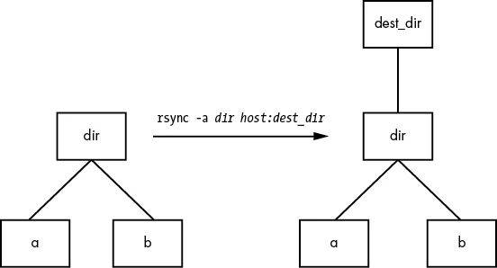
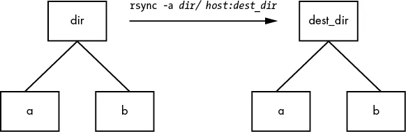
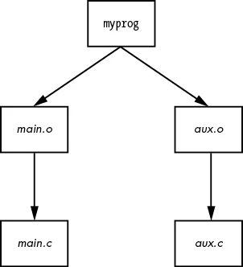
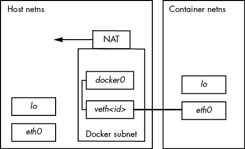

# How Linux Works（下卷：环境定制、软件构建与虚拟化容器）

## 第 12 章：网络文件传输与共享

本章概览在网络中的计算机之间分发和共享文件的各种方法。首先，我们将介绍除了前面已经见过的 `scp` 和 `sftp` 之外的文件复制方法。随后讨论真正的文件共享，也就是把一台计算机上的目录挂载到另一台计算机上。

由于分发和共享文件的方法很多，下面列出一些典型场景及其对应的解决方案：

| 使用场景 | 解决方案 |
| --- | --- |
| 临时将 Linux 计算机上的文件或目录提供给其他计算机访问。 | Python SimpleHTTPServer（第 12.1 节） |
| 在计算机之间分发（复制）文件，尤其是需要定期执行时。 | rsync（第 12.2 节） |
| 经常将 Linux 计算机上的文件共享给 Windows 计算机。 | Samba（第 12.4 节） |
| 在 Linux 计算机上挂载 Windows 共享。 | CIFS（第 12.4 节） |
| 以最少的配置，在 Linux 计算机之间实现小规模文件共享。 | SSHFS（第 12.5 节） |
| 从可信的局域网中的 NAS 或其他服务器挂载较大的文件系统。 | NFS（第 12.6 节） |
| 将云存储挂载到 Linux 计算机上。 | 各种基于 FUSE 的文件系统（第 12.7 节） |

请注意，这里没有涉及跨越多个地点、面向大量用户的大规模共享。虽然并非无法实现，但这样的方案通常需要投入相当多的工作，超出了本书的范围。本章最后会讨论为什么会这样。

与本书的许多其他章节不同，本章最后一部分并不属于高级内容。事实上，你可能从那些最具“理论性”的章节中收获最多。第 12.3 节和第 12.8 节将帮助你理解：*为什么*一开始就会有这么多不同的选择。

### 12.1 快速复制

假设你想把一个或多个文件从自己的 Linux 计算机复制到个人网络中的另一台计算机，而且不在乎是否能反向复制，也不需要其他复杂功能——你只想尽快把文件传过去。Python 提供了一种方便的办法。进入包含这些文件的目录，然后运行：

```bash
$ python -m SimpleHTTPServer
```

这会启动一个基本的 Web 服务器，使网络中的任何浏览器都能访问当前目录。默认情况下，服务器监听 8000 端口。因此，如果运行该命令的计算机地址为 `10.1.2.4`，只需在目标计算机的浏览器中访问 *http://10.1.2.4:8000*，就可以取得所需文件。

> **警告：**
>
> 这种方法假定你的本地网络是安全的。不要在公共网络或任何不受信任的网络环境中这样做。

### 12.2 rsync

当你需要复制的不再只是一两个文件时，可以考虑使用需要目标端提供服务器支持的工具。例如，只要远程目标支持 SSH 和 SCP 服务，就可以用 `scp -r` 将整个目录结构复制到另一处（Windows 和 macOS 也提供这种支持）。我们已经在第 10 章见过这种方法：

```bash
$ scp -r directory user@remote_host[:dest_dir]
```

这种方法能完成任务，但灵活性不高。尤其是传输结束后，远程主机上的目录不一定是源目录的精确副本。如果远程计算机上已经存在 `directory` 目录，并且里面有一些多余的文件，传输后这些文件仍然会保留。

如果你打算定期执行这类操作（尤其是计划将其自动化），就应该使用专门的同步工具，因为它还能进行分析和验证。在 Linux 上，`rsync` 是标准的同步工具，性能良好，并提供多种实用的传输方式。本节将介绍 `rsync` 的一些基本操作模式，并说明它的若干特殊之处。

#### 12.2.1 rsync 入门

要在两台主机之间使用 `rsync`，必须在源主机和目标主机上都安装 `rsync` 程序，并且能够从一台计算机访问另一台计算机。传输文件最简单的方法是使用远程 Shell 账户。这里假设你希望通过 SSH 访问来传输文件。不过要记住，`rsync` 即使用于同一台计算机上不同位置之间的文件和目录复制（例如从一个文件系统复制到另一个文件系统），也很有用。

从表面上看，`rsync` 命令与 `scp` 没有太大区别。实际上，你可以使用相同形式的参数来运行 `rsync`。例如，要将一组文件复制到 *host* 上你的主目录，输入：

```bash
$ rsync file1 file2 ... host:
```

在现代系统上，`rsync` 默认假定你使用 SSH 连接远程主机。

请留意下面的错误消息：

```
rsync not found
rsync: connection unexpectedly closed (0 bytes read so far)
rsync error: error in rsync protocol data stream (code 12) at io.c(165)
```

这表示远程 Shell 无法在远程系统中找到 `rsync`。如果远程系统已经安装 `rsync`，只是它不在该用户的命令搜索路径中，可以使用 `--rsync-path=``path` 手动指定程序位置。

如果两台主机上的用户名不同，可以在命令参数中的远程主机名前加上 `user@`，其中 `user` 是你在 `host` 上的用户名：

```bash
$ rsync file1 file2 ... user@host:
```

除非提供额外选项，否则 `rsync` 只复制文件。实际上，如果只使用目前介绍过的选项，并将目录 `dir` 作为参数，就会看到下面的消息：

```
skipping directory dir
```

要传输完整的目录层次结构，包括符号链接、权限、模式和设备，请使用 `-a` 选项。此外，如果想把文件复制到远程主机上主目录之外的其他目录，可以把目标目录名放在远程主机名之后，如下所示：

```bash
$ rsync -a dir host:dest_dir
```

复制目录可能比较棘手，因此，如果你不确定文件传输时究竟会发生什么，可以组合使用 `-nv` 选项。`-n` 告诉 `rsync` 以“试运行”（dry run）模式操作，也就是只模拟执行，而不真正复制文件。`-v` 表示详细模式，会显示传输过程及所涉及文件的详细信息：

```bash
$ rsync -nva dir host:dest_dir
```

输出大致如下：

```
building file list ... done
ml/nftrans/nftrans.html
[more files]
wrote 2183 bytes read 24 bytes 401.27 bytes/sec
```

#### 12.2.2 创建目录结构的精确副本

默认情况下，`rsync` 复制文件和目录时不会考虑目标目录原有的内容。例如，如果你把包含文件 *a* 和 *b* 的目录 *d* 传输到另一台计算机，而目标计算机上已经有文件 *d/c*，那么执行 `rsync` 后，目标目录中将同时存在 *d/a*、*d/b* 和 *d/c*。

要创建源目录的精确副本，必须删除目标目录中那些在源目录中不存在的文件，例如上述例子中的 *d/c*。可以使用 `--delete` 选项：

```bash
$ rsync -a --delete dir host:dest_dir
```

> **警告：**
>
> 这一操作可能很危险，因此请花时间检查目标目录，确认其中没有会被意外删除的文件。记住，如果不确定传输会产生什么结果，应使用 `-nv` 选项进行试运行，以便准确了解 `rsync` 打算删除哪些文件。


#### 12.2.3 使用末尾斜杠

在 `rsync` 命令行中将目录指定为源路径时，要格外小心。考虑我们一直使用的基本命令：

```bash
$ rsync -a dir host:dest_dir
```

传输完成后，远程主机 `host` 上的 `dest_dir` 目录中会有一个 `dir` 目录。[图 12-1](#figure12-1) 展示了 `rsync` 通常如何处理包含名为 *a* 和 *b* 的文件的目录。



*图 12-1：rsync 的常规复制方式*

然而，如果在源路径名称末尾加上斜杠（`/`），行为就会发生显著变化：

```bash
$ rsync -a dir/ host:dest_dir
```

在这种情况下，`rsync` 会把 `dir` **内部的所有内容**复制到 `host` 上的 `dest_dir`，但不会在目标主机上创建 `dir` 目录。因此，你可以把传输 `dir/` 理解为类似于在本地文件系统中执行 `cp dir/* dest_dir` 的操作。

例如，假设目录 *dir* 中有文件 *a* 和 *b*（即 *dir/a* 和 *dir/b*）。你使用带末尾斜杠的命令，将它们传输到 `host` 上的 `dest_dir`：

```bash
$ rsync -a dir/ host:dest_dir
```

传输完成后，`dest_dir` 中会包含 *a* 和 *b* 的副本，但**不包含** *dir* 目录。相反，如果省略 *dir* 后面的 `/`，`dest_dir` 中就会出现一个 *dir* 目录的副本，其中包含 *a* 和 *b*。这样，远程主机上的结果路径就是 `dest_dir/dir/a` 和 `dest_dir/dir/b`。[图 12-2](#figure12-2) 展示了对[图 12-1](#figure12-1) 中的目录结构使用末尾斜杠时，`rsync` 的处理方式。

在向远程主机传输文件和目录时，意外地在路径末尾添加 `/`，通常只会造成一些麻烦：你可以登录远程主机，创建 *dir* 目录，再把传过去的项目全部移回 *dir*。遗憾的是，当末尾 `/` 与 `--delete` 选项一起使用时，后果可能严重得多；务必格外谨慎，因为这样很容易删除不相关的文件。



*图 12-2：rsync 中末尾斜杠的影响*

> **警告：**
>
> 考虑到这种风险，还应留意 Shell 的文件名自动补全功能。许多 Shell 会在你按下 Tab 键补全目录名时，自动在末尾加上斜杠。

#### 12.2.4 排除文件和目录

`rsync` 的一项重要功能，是能够从传输操作中排除指定的文件和目录。例如，你想把本地的 *src* 目录传输到 *host*，但不希望传输任何名为 *.git* 的项目，可以这样做：

```bash
$ rsync -a --exclude=.git src host:
```

请注意，这条命令会排除**所有**名为 *.git* 的文件和目录，因为 `--exclude` 接收的是一种匹配模式，而不是绝对文件名。要只排除某个特定项目，可以指定以 `/` 开头的绝对路径，如下所示：

```bash
$ rsync -a --exclude=/src/.git src host:
```

> 这里 `/src/.git` 中开头的 `/` 并不代表系统的根目录，而是指此次传输的基准目录。

下面还有一些关于排除模式的技巧：

- 可以使用任意多个 `--exclude` 参数。
- 如果经常重复使用同一组模式，可以把它们写入纯文本文件（每行一个模式），然后使用 `--exclude-from=file`。
- 如果要排除名为 *item* 的目录，但仍然包含同名文件，可以在模式末尾加上斜杠：`--exclude=item/`。
- 排除模式是针对完整的文件名或目录名组成部分进行匹配的，也可以包含简单的 glob（通配符）。例如，`t*s` 可以匹配 *this*，但不能匹配 *ethers*。
- 如果排除了某个目录或文件名，却发现排除模式限制过严，可以使用 `--include` 明确包含其他文件或目录。

#### 12.2.5 检查传输、增加保护措施及使用详细模式

为了加快运行速度，`rsync` 会进行快速检查，判断传输源中的文件是否已经存在于目标位置。检查依据是文件大小和最后修改时间的组合。第一次将整个目录层次结构传输到远程主机时，`rsync` 会发现目标位置没有这些文件，于是传输所有内容。使用 `rsync -n` 进行试运行，可以帮助你确认这一点。

执行一次 `rsync` 后，再使用 `rsync -v` 运行一遍。这次你应该看不到文件出现在传输列表中，因为两端已经存在相同的一组文件，修改时间也相同。

当源端与目标端的文件不一致时，`rsync` 会传输源文件，并覆盖远程端已有的对应文件。不过，默认行为有时并不能满足需求：你可能希望在跳过文件之前，更有把握地确认两者确实相同，或者希望增加一些额外的保护措施。以下选项会很有用：

1. `--checksum`（缩写为 `-c`）：计算文件的校验和（一种几乎唯一的标识），以判断文件是否相同。此选项会在传输过程中消耗一定的 I/O 和 CPU 资源，但如果处理的是敏感数据，或者经常遇到大小相同的文件，就很有必要使用它。
2. `--ignore-existing`：不覆盖目标端已经存在的文件。
3. `--backup`（缩写为 `-b`）：不直接覆盖目标端已有文件，而是在传输新文件之前，先给旧文件名添加 `~` 后缀，将其重命名。
4. `--suffix=s`：将 `--backup` 使用的后缀从 `~` 改为 `s`。
5. `--update`（缩写为 `-u`）：如果目标端某个文件的日期晚于源端对应文件，就不覆盖它。

不带特殊选项时，`rsync` 通常会安静地运行，只有出现问题才输出信息。不过，你可以使用 `rsync -v` 启用详细模式，或使用 `rsync -vv` 查看更多细节。（你可以添加任意多个 `v`，但两个通常已经绰绰有余。）如果想在传输结束后查看完整的统计摘要，可以使用 `rsync --stats`。

#### 12.2.6 压缩数据

许多用户喜欢把 `-z` 和 `-a` 结合起来使用，以便在传输前压缩数据：

```bash
$ rsync -az dir host:dest_dir
```

在某些情况下，压缩可以提升性能，例如通过慢速连接上传大量数据（如上行链路较慢），或者两台主机之间的延迟较高时。不过，在高速局域网中，两端机器可能受限于压缩和解压缩所需的 CPU 时间，因此不压缩反而可能传输得更快。

#### 12.2.7 限制带宽

向远程主机上传大量数据时，很容易占满互联网连接的上行带宽。虽然这种传输不会占用你通常较大的下行带宽，但如果任由 `rsync` 以最大速度运行，网络连接仍会显得很慢，因为 HTTP 请求等向外发送的 TCP 数据包也必须与文件传输争夺上行带宽。

为了解决这个问题，可以使用 `--bwlimit`，给上行链路留出一些余量。例如，要把带宽限制在 100,000 Kbps，可以执行类似下面的命令：

```bash
$ rsync --bwlimit=100000 -a dir host:dest_dir
```

#### 12.2.8 将文件传输到本地计算机

`rsync` 不仅可以将文件从本地计算机复制到远程主机。只要把远程主机和远程源路径放在命令行的第一个参数位置，就可以将文件从远程计算机传回本地。例如，要将远程系统上的 `src_dir` 传输到本地主机的 `dest_dir`，可以运行：

```bash
$ rsync -a host:src_dir dest_dir
```

> 如前所述，也可以使用 `rsync` 在本地计算机上复制目录；只需在两个参数中都省略 `host:` 即可。

#### 12.2.9 关于 rsync 的更多内容

每当需要复制大量文件时，`rsync` 都应该是你首先想到的工具之一。以批处理方式运行 `rsync`，将同一组文件复制到多台主机，尤其有用：它可以加快耗时较长的传输，而且传输中断后还能够继续。

`rsync` 也很适合用于备份。例如，可以将 Amazon S3 等互联网存储挂载到 Linux 系统上，再使用 `rsync --delete` 定期将文件系统与网络存储同步，从而实现一种非常有效的备份方案。

除了这里介绍的选项，`rsync` 还有许多其他命令行选项。要快速了解它们，可以运行 `rsync --help`。更详细的信息可参阅 rsync(1) 手册页，以及 `rsync` 官方网站（<https://rsync.samba.org/>）。


### 12.3 文件共享简介

你的 Linux 计算机很可能并不是网络中唯一的一台机器。只要网络中有多台计算机，通常就会有在它们之间共享文件的需求。在本章余下的内容中，我们首先讨论与 Windows 和 macOS 计算机之间的文件共享，并进一步了解 Linux 如何适应与完全不同的系统环境交互。最后，我们会介绍如何在 Linux 计算机之间共享文件，或者从网络附加存储（NAS）设备访问文件，重点是作为客户端使用 SSHFS 和网络文件系统（NFS）。

#### 12.3.1 文件共享的用途与性能

使用任何文件共享系统时，首先应该问自己：为什么需要它？在传统的 Unix 网络中，主要有两个原因：方便，以及本地存储空间不足。用户可以登录网络中的多台计算机，而每台计算机都能访问该用户的主目录。与为网络中的每台机器购买和维护大量本地存储相比，把存储集中在少量服务器上要经济得多。

不过，这种模式的优点往往被一个多年来始终存在的重大缺点掩盖：**网络存储的性能通常不如本地存储**。某些数据访问方式倒没有问题。例如，现代硬件和网络完全可以把视频、音频数据从服务器流式传输到媒体播放器，部分原因是这种数据访问模式非常容易预测。服务器从大文件或数据流发送数据时，知道客户端很可能会按顺序读取，因此能够高效地预读并缓冲数据。

然而，如果需要执行更复杂的操作，或者同时访问许多不同的文件，你会发现 CPU 经常不得不等待网络。造成这种现象的主要原因之一是**延迟（latency）**，即进行一次任意的网络文件访问、直到收到数据所花费的时间。服务器在向客户端发送数据之前，必须先接收并解析请求，然后定位和加载数据。最初的几个步骤通常最耗时，而且几乎每次访问新文件都需要重复执行。

因此，在考虑使用网络文件共享时，应当先弄清楚目的。如果共享的是大量不需要频繁随机访问的数据，通常不会遇到什么问题。但如果你要编辑视频，或者开发一个规模较大的软件系统，最好还是把全部文件保存在本地存储中。

#### 12.3.2 文件共享安全性

传统上，文件共享协议并没有把安全性放在很高的优先级。这会影响你应该如何以及在何处部署文件共享。如果你对共享文件的计算机之间的网络安全性有任何疑虑，就应该在配置时同时考虑**授权与身份认证**以及**加密**。良好的授权和身份认证机制可以确保只有持有正确凭据的用户才能访问文件，同时确认服务器确实是它所声称的服务器；加密则确保文件数据在传输到目的地的过程中不会被窃取。

最容易配置的文件共享方案通常也是最不安全的。不幸的是，并不存在一种标准化的方法，可以为所有此类访问提供安全保护。不过，如果愿意花时间正确组合相关组件，便可以使用 stunnel、IPSec 和 VPN 等工具，在基本文件共享协议的下层提供安全保护。

### 12.4 使用 Samba 共享文件

如果网络中有运行 Windows 的计算机，你很可能希望这些计算机能够通过 Windows 标准网络协议——**服务器消息块（Server Message Block，SMB）**——访问 Linux 系统上的文件和打印机。macOS 也支持 SMB 文件共享，不过你还可以使用 12.5 节介绍的 SSHFS。

Unix 系统的标准文件共享软件套件称为 **Samba**。Samba 不仅允许网络中的 Windows 计算机访问 Linux 系统，还支持反方向的操作：借助 Samba 客户端软件，你可以从 Linux 计算机访问 Windows 服务器上的文件和打印机。

要设置 Samba 服务器，请执行以下步骤：

1. 创建 *smb.conf* 文件。
2. 在 *smb.conf* 中添加文件共享配置节。
3. 在 *smb.conf* 中添加打印机共享配置节。
4. 启动 Samba 守护进程 `nmbd` 和 `smbd`。

如果通过发行版的软件包安装 Samba，系统通常会使用一些合理的默认值完成服务器的初始设置。不过，安装程序大概无法判断你具体想向客户端提供 Linux 计算机上的哪些**共享资源（shares）**。

> 本章对 Samba 的讨论并不打算面面俱到，而是仅限于让同一子网中的 Windows 计算机通过 Windows 的“网络位置”浏览器看到一台独立的 Linux 计算机。由于访问控制和网络拓扑有许多不同的可能性，Samba 的配置方式也非常多。关于大型服务器配置的详细信息，请参阅 Gerald Carter、Jay Ts 和 Robert Eckstein 所著的 *Using Samba* 第 3 版（O’Reilly，2007），以及 Samba 网站（<https://samba.org/>）。

#### 12.4.1 服务器配置

Samba 的核心配置文件是 *smb.conf*。大多数发行版把它放在某个 *etc* 目录下，例如 */etc/samba*。不过，你可能需要搜索才能找到它，因为该文件也可能位于某个 *lib* 目录下，例如 */usr/local/samba/lib*。

*smb.conf* 的格式类似你在其他地方见过的 XDG 风格配置格式（例如 systemd 的配置格式），由若干使用方括号标记的配置节组成，例如 `[global]` 和 `[printers]`。*smb.conf* 中的 `[global]` 节包含适用于整个服务器和所有共享资源的通用选项。这些选项主要与网络配置和访问控制有关。下面的 `[global]` 示例展示了如何设置服务器名称、描述和工作组：

```bash
[global]
# server name
netbios name = name
# server description
server string = My server via Samba
# workgroup
workgroup = MYNETWORK
```

这些参数的作用如下：

1. `netbios name`：服务器名称。如果省略该参数，Samba 就使用 Unix 主机名。NetBIOS 是 SMB 主机之间经常用于通信的一种 API。
2. `server string`：服务器的简短描述。默认值为 Samba 的版本号。
3. `workgroup`：Windows 工作组名称。如果你的计算机属于 Windows 域，应把该参数设置为域名。

#### 12.4.2 服务器访问控制

你可以在 *smb.conf* 中添加选项，以限制哪些计算机和用户能够访问 Samba 服务器。下面列出了可以在 `[global]` 节和单独共享资源的配置节（本章稍后介绍）中设置的部分选项：

1. `interfaces`：指定 Samba 应在哪些网络或网络接口上监听（接受连接）。例如：

   ```
   interfaces = 10.23.2.0/255.255.255.0
   interfaces = enp0s31f6
   ```
2. `bind interfaces only`：使用 `interfaces` 参数时，将其设置为 `yes`，即可把访问限制在通过指定接口能够直接到达的计算机上。
3. `valid users`：指定允许访问的用户。例如：

   ```
   valid users = jruser, bill
   ```
4. `guest ok`：将该参数设置为 `true`，可允许网络上的匿名用户访问某个共享资源。只有确信网络是私有网络时才应该这样做。
5. `browseable`：控制网络浏览器是否能够看到共享资源。如果对某个共享资源将此参数设置为 `no`，仍然可以访问 Samba 服务器上的该共享资源，但必须事先知道它的准确名称。


#### 12.4.3 密码

一般来说，你应该只允许用户通过密码认证访问 Samba 服务器。遗憾的是，Unix 的基本密码系统与 Windows 的密码系统不同。因此，除非你允许通过网络传输明文密码，或者使用 Windows 域服务器验证密码，否则就必须设置一套替代的密码系统。本节介绍如何使用 Samba 的*简单数据库（Trivial Database，TDB）*后端来建立这样的系统；这种方式适用于小型网络。

首先，在 *smb.conf* 的 `[global]` 段中添加以下配置，定义 Samba 密码数据库的特性：

```bash
# use the tdb for Samba to enable encrypted passwords
security = user
passdb backend = tdbsam
obey pam restrictions = yes
smb passwd file = /etc/samba/passwd_smb
```

这些配置使你能够通过 `smbpasswd` 命令管理 Samba 密码数据库。`obey pam restrictions` 参数确保用户通过 `smbpasswd` 修改密码时，也必须遵守 PAM（可插拔身份认证模块，第 7 章已介绍）对普通密码修改施加的规则。对于 `passdb backend` 参数，你还可以在冒号后指定 TDB 文件的路径，例如 `tdbsam:/etc/samba/private/passwd.tdb`。

> 如果可以使用 Windows 域，你可以设置 `security = domain`，让 Samba 使用域的身份认证系统，从而不必维护自己的密码数据库。不过，要让域用户访问运行 Samba 的计算机，每个域用户仍必须在该计算机上拥有一个用户名相同的本地账户。

##### 添加和删除用户

要让 Windows 用户访问 Samba 服务器，首先需要通过 `smbpasswd -a` 命令将该用户加入密码数据库：

```bash
# smbpasswd -a username
```

传给 `smbpasswd` 的 `username` 参数必须是 Linux 系统中已经存在的有效用户名。

与普通系统中的 `passwd` 程序一样，`smbpasswd` 会要求你输入两次新 SMB 用户的密码。密码通过必要的安全检查后，`smbpasswd` 会确认新用户已创建。

要删除用户，可以使用 `smbpasswd` 的 `-x` 选项：

```bash
# smbpasswd -x username
```

如果只是暂时停用用户，可以使用 `-d` 选项；以后再通过 `-e` 选项重新启用：

```bash
# smbpasswd -d username
# smbpasswd -e username
```

##### 修改密码

超级用户可以运行 `smbpasswd` 并仅指定用户名（不添加其他选项或关键字），以修改 Samba 密码：

```bash
# smbpasswd username
```

不过，如果 Samba 服务器正在运行，任何用户都可以直接在命令行输入 `smbpasswd`，修改自己的 Samba 密码。

最后，还有一项配置需要特别留意。如果在 *smb.conf* 中看到下面这一行，请务必小心：

```
unix password sync = yes
```

这项配置会使 `smbpasswd` 在修改 Samba 密码的*同时*，也修改用户的普通系统密码。结果可能令人十分困惑：例如，用户本来只想将 Samba 密码改成一个不同于 Linux 密码的值，后来却发现自己无法再登录 Linux 系统。某些发行版提供的 Samba 服务器软件包甚至默认启用了这个参数！

#### 12.4.4 手动启动服务器

如果你是通过发行版的软件包安装 Samba，通常不必操心如何启动服务器。可以查看 `systemctl --type=service` 的输出进行确认。不过，如果 Samba 是从源代码安装的，就需要使用以下参数运行 `nmbd` 和 `smbd`，其中 `smb_config_file` 是 *smb.conf* 文件的完整路径：

```bash
# nmbd -D -s smb_config_file
# smbd -D -s smb_config_file
```

`nmbd` 守护进程是一个 NetBIOS 名称服务器，而 `smbd` 则负责实际处理文件共享请求。`-D` 选项表示以守护进程模式运行。如果在 `smbd` 运行期间修改了 *smb.conf*，可以向该守护进程发送 HUP 信号，通知它配置发生了变化。不过，几乎总是让 systemd 负责监管服务器更为合适；在这种情况下，你可以通过 `systemctl` 完成相关操作。

#### 12.4.5 诊断信息与日志文件

如果 Samba 服务器在启动时出了问题，命令行上会显示错误消息。不过，运行期间的诊断信息会写入 *log.nmbd* 和 *log.smbd* 日志文件。这些文件通常位于 */var/log* 下的某个目录，例如 */var/log/samba*。你还会在该目录中找到其他日志文件，例如分别记录各个客户端活动的日志。


#### 12.4.6 文件共享配置

要将一个目录导出给 SMB 客户端（也就是与客户端共享目录），可以在 *smb.conf* 文件中添加如下配置节。其中，`label` 是你希望为共享指定的名称（例如 `mydocuments`），而 `path` 是目录的完整路径：

```
[label]
path = path
comment = share description
guest ok = no
writable = yes
printable = no
```

以下参数在目录共享中很有用：

1. `guest ok`：设为 `yes` 时，允许访客访问该共享。`public` 是这个参数的同义词。
2. `writable`：设为 `yes` 或 `true` 时，表示该共享可读写。不要允许访客访问可读写的共享。
3. `printable`：显然，对于目录共享，该参数必须设为 `no` 或 `false`。
4. `veto files`：此参数禁止导出匹配指定模式的文件。每个模式都必须放在正斜杠之间（形式为 `/pattern/`）。下面的示例会禁止共享目标文件，以及所有名称为 *bin* 的文件或目录：

   ```
   veto files = /*.o/bin/
   ```

#### 12.4.7 主目录

如果希望向用户共享其主目录，可以在 *smb.conf* 文件中添加名为 `[homes]` 的配置节。该配置节应如下所示：

```
[homes]
comment = home directories
browseable = no
writable = yes
```

默认情况下，Samba 会读取已登录用户在 */etc/passwd* 中的条目，以确定 `[homes]` 对应的主目录。不过，如果你不希望 Samba 采用这种方式（也就是说，你希望 Windows 用户的主目录与普通 Linux 主目录位于不同位置），可以在 `path` 参数中使用 `%S` 替换变量。例如，下面的配置会将用户的 `[homes]` 目录改为 */u/user*：

```
path = /u/%S
```

Samba 会将 `%S` 替换为当前用户名。

#### 12.4.8 打印机共享

通过在 *smb.conf* 文件中添加 `[printers]` 配置节，你可以将打印机共享给 Windows 客户端。如果使用标准的 Unix 打印系统 CUPS，该配置节如下所示：

```
[printers]
comment = Printers
browseable = yes
printing = CUPS
path = cups
printable = yes
writable = no
```

要使用 `printing = CUPS` 参数，你安装的 Samba 必须在配置和链接时包含 CUPS 库。

> 根据具体配置，你可能还希望通过 `guest ok = yes` 允许访客访问打印机，而不是要求每个需要使用打印机的人都拥有 Samba 密码或账户。例如，使用防火墙规则将打印机访问限制在某一个子网内，就很容易做到。


#### 12.4.9 Samba 客户端

Samba 客户端程序 `smbclient` 可以访问远程 Windows 共享资源，也可以向共享打印机发送打印任务。当你必须与不提供 Unix 友好通信方式的 Windows 服务器交互时，这个程序非常有用。

开始使用 `smbclient` 时，可以通过 `-L` 选项列出名为 `SERVER` 的远程服务器上的共享资源：

```bash
$ smbclient -L -U username SERVER
```

如果你的 Linux 用户名与 `SERVER` 上的用户名相同，就不需要指定 `-U username`。

执行该命令后，`smbclient` 会要求输入密码。如果想以访客身份尝试访问共享资源，可以直接按 Enter；否则，请输入你在 `SERVER` 上的密码。成功后，你应该会看到类似下面的共享列表：

```
Sharename   Type        Comment
---------   ----        -------
Software    Disk        Software distribution
Scratch     Disk        Scratch space
IPC$        IPC         IPC Service
ADMIN$      IPC         IPC Service
Printer1    Printer     Printer in room 231A
Printer2    Printer     Printer in basement
```

`Type` 字段有助于理解每项共享资源的类型。你只需要关注 `Disk` 和 `Printer` 类型的共享资源（`IPC` 共享用于远程管理）。这个列表包含两个磁盘共享和两个打印机共享。要访问其中某个共享资源，请使用 `Sharename` 列中的名称。

##### 作为客户端访问文件

如果你只是偶尔需要访问磁盘共享中的文件，可以使用以下命令（同样，如果 Linux 用户名与服务器上的用户名一致，就可以省略 `-U username`）：

```bash
$ smbclient -U username '\\SERVER\sharename'
```

连接成功后，你会看到如下提示符，表示现在可以传输文件了：

```
smb: \>
```

在这种文件传输模式下，`smbclient` 与 Unix 的 `ftp` 类似，可以执行以下命令：

1. `get file`：将远程服务器上的 `file` 复制到当前本地目录。
2. `put file`：将本地计算机上的 `file` 复制到远程服务器。
3. `cd dir`：将远程服务器上的当前目录切换为 `dir`。
4. `lcd localdir`：将当前本地目录切换为 `localdir`。
5. `pwd`：显示远程服务器上的当前目录，包括服务器名和共享名。
6. `!command`：在本地主机上执行 `command`。其中 `!pwd` 和 `!ls` 特别实用，可用于检查本地的目录位置和文件状态。
7. `help`：显示完整的命令列表。

##### 使用 CIFS 文件系统

如果希望以更方便的方式访问 Windows 服务器上的文件，可以使用 `mount` 将共享资源直接挂载到本机文件系统。命令格式如下（注意这里使用的是 `SERVER:sharename`，而不是通常的 `\\SERVER\sharename` 格式）：

```bash
# mount -t cifs SERVER:sharename mountpoint -o user=username,pass=password
```

要以这种方式使用 `mount`，系统必须安装通用互联网文件系统（Common Internet File System，CIFS）工具。大多数发行版都将这些工具作为单独的软件包提供。

### 12.5 SSHFS

介绍完 Windows 文件共享系统后，本节来讨论 Linux 系统之间的文件共享。对于不太复杂的使用场景，SSHFS 是一个值得考虑的便捷方案。它实际上是一种用户空间文件系统：通过建立 SSH 连接，将远程计算机上的文件呈现在本机的某个挂载点下。大多数发行版默认并不安装 SSHFS，因此你可能需要安装发行版提供的 SSHFS 软件包。

从命令行使用 SSHFS 的语法，表面上与前面见过的 SSH 命令很相似。当然，你需要指定远程主机上要共享的目录，以及本机所需的挂载点：

```bash
$ sshfs username@host:dir mountpoint
```

与 SSH 一样，如果本地和远程主机使用相同的用户名，可以省略 `username@`；如果只想挂载远程主机上的用户主目录，也可以省略 `:dir`。必要时，该命令会要求输入远程主机上的密码。

因为 SSHFS 是用户空间文件系统，所以普通用户需要使用 `fusermount` 卸载：

```bash
$ fusermount -u mountpoint
```

超级用户也可以通过 `umount` 卸载这类文件系统。为了保持文件所有权和安全性的一致性，通常最好由普通用户挂载这种文件系统。

SSHFS 具有以下优点：

- **配置工作量小。** 远程主机唯一需要满足的条件是启用 SFTP，而大多数 SSH 服务器默认都会启用它。
- **不依赖特定的网络配置。** 只要能够建立 SSH 连接，SSHFS 就能工作，无论连接位于安全的局域网内，还是经过不安全的远程网络。

SSHFS 也存在以下缺点：

- **性能有所下降。** 加密、数据转换和传输都会带来大量额外开销（不过实际影响可能没有你想象的那么大）。
- **多用户配置受到限制。**

如果你觉得 SSHFS 可能适合自己的需求，非常值得尝试，因为它的配置实在很简单。

### 12.6 NFS

NFS 是 Unix 系统之间最常用的传统文件共享系统之一。针对不同的应用场景，NFS 有许多不同的版本。NFS 可以通过 TCP 或 UDP 提供服务，并具有大量身份认证和加密选项（遗憾的是，其中很少有选项会默认启用）。由于可选配置太多，NFS 本身就是一个很大的主题，因此这里只介绍最基本的内容。

要使用 NFS 挂载服务器上的远程目录，可以采用与挂载 CIFS 目录相同的基本语法：

```bash
# mount -t nfs server:directory mountpoint
```

严格来说，不必指定 `-t nfs`，因为 `mount` 应该能够自动判断文件系统类型。不过，你可能希望查看 `nfs(5)` 手册页中的挂载选项。其中的 `sec` 选项提供了几种不同的安全配置方式。在小型封闭网络中，许多管理员会采用基于主机的访问控制。更复杂的方式（例如基于 Kerberos 的身份认证）则需要对系统其他部分进行额外配置。

当你越来越多地通过网络使用文件系统时，可以配置自动挂载器（automounter），使系统只有在实际访问文件系统时才执行挂载，从而避免启动过程中出现依赖问题。传统的自动挂载工具名为 `automount`，后来又出现了名为 `amd` 的新版本；不过，如今这类功能大部分已被 systemd 的 `automount` 单元类型取代。

> **补充说明：NFS 服务器**
>
> 配置 NFS 服务器向其他 Linux 计算机共享文件，比配置客户端复杂。你需要运行服务器守护进程（`mountd` 和 `nfsd`），并设置 */etc/exports* 文件，列出要共享的目录。不过，本书不会介绍 NFS 服务器的配置，主要是因为直接购买一台网络附加存储（NAS）设备来负责网络存储共享，往往方便得多。许多 NAS 设备基于 Linux，因此自然支持 NFS 服务器。厂商还会提供自己的管理工具，帮助用户完成 RAID 配置和云备份等繁琐任务，从而提高 NAS 设备的实用价值。


### 12.7 云存储

说到云备份，另一种网络文件存储选择就是云存储，例如 AWS S3 或 Google Cloud Storage。这些系统的性能不如局域网中的存储设备，但它们有两个显著的优点：你不必亲自维护它们，而且通常也不需要为备份操心。

除了所有云存储提供商都会提供的 Web 接口和编程接口之外，还有一些方法可以将大多数类型的云存储挂载到 Linux 系统上。与我们迄今为止见过的大多数文件系统不同，这些方案几乎全部实现为 FUSE（File System in User Space，用户空间文件系统）接口。对于 S3 等流行的云存储服务，甚至存在多种实现可供选择。这并不奇怪，因为 FUSE 处理程序本质上不过是一个用户空间守护进程，负责在数据源和内核之间充当中介。

本书不介绍云存储客户端的具体设置方法，因为每种客户端的配置方式都不一样。

### 12.8 网络文件共享的现状

读到这里，你可能觉得有关 NFS 和一般文件共享的讨论似乎不够完整。确实可能如此，但这种不完整在某种程度上也反映了文件共享系统本身的状况。我们在 12.3.1 和 12.3.2 节讨论过性能和安全问题。尤其是，NFS 的基础安全水平相当低，要提高安全性需要投入大量额外工作。CIFS 系统在这方面稍好一些，因为现代软件已经内置了必要的加密层。不过，性能方面的限制并不容易克服，更不用说当系统暂时无法访问网络存储时，其性能可能会恶化到什么程度。

人们曾多次尝试解决这些问题。其中或许最全面的方案是 Andrew 文件系统（Andrew File System，AFS）。AFS 最早设计于 20 世纪 80 年代，其架构就是围绕这些问题的解决方案建立的。那么，为什么大家没有普遍采用 AFS 或类似的系统呢？

这个问题没有唯一的答案，但很大程度上与设计中某些部分缺乏灵活性有关。例如，它的安全机制要求使用 Kerberos 身份认证系统。尽管 Kerberos 几乎随处可用，但它从未成为 Unix 系统上的标准配置，而且部署和维护都需要相当多的工作（你还得为它搭建服务器）。

对于大型机构来说，满足 Kerberos 之类的要求并不困难。这恰好也是 AFS 得以广泛应用的环境：大学和金融机构都是 AFS 的重要用户。但对于规模较小的用户来说，省去这些工作要容易得多，因此他们更愿意选择 NFS 或 CIFS 共享之类的简单方案。这类限制甚至延伸到了 Windows 领域：从 Windows 2000 开始，微软就将 Kerberos 作为其服务器产品的默认身份认证机制，但小型网络通常不会建立带有这类服务器的 Windows 域。

除了身份认证这一前提条件之外，还有一个源于技术实现的问题。传统上，许多网络文件系统客户端都是以内核代码实现的，NFS 尤其如此。遗憾的是，网络文件系统的需求足够复杂，以至于这种做法开始带来问题。仅身份认证这一项，就不应该放在内核中实现。内核中的客户端实现还会严重限制潜在开发者的范围，从而妨碍整个系统的发展。有些情况下，客户端代码位于用户空间，但底层总还是需要对内核进行某种定制。

目前，在 Linux/Unix 世界中，我们仍然没有一种真正标准化的网络文件共享方式——至少对于非大型机构，或不愿投入大量配置维护工作的用户而言是这样。不过，这种情况未必会一直持续下去。

当服务提供商开始推出云存储时，人们很清楚，传统的网络文件共享形式并不适用。在云环境中，访问方式建立在 TLS 等安全机制之上，因此无需部署 Kerberos 那样的大型系统就能访问存储。正如上一节所说，现在可以通过多种 FUSE 方案访问云存储。我们不再需要依赖内核来实现客户端的任何部分；各种身份认证、加密或其他处理都可以轻松地在用户空间完成。

这一切意味着，未来的文件共享设计很可能在安全性以及文件名转换等其他方面提供更大的灵活性。

---


## 第 13 章：用户环境

本书主要关注 Linux 系统中通常位于服务器进程和交互式用户会话底层的那些部分。不过，系统与用户终究需要在某个地方相遇。启动文件在这里扮演着重要角色，因为它们为 Shell 和其他交互式程序设置默认值，并决定用户登录时系统的行为方式。

大多数用户并不十分留意自己的启动文件，通常只有在想添加一些方便使用的功能（例如别名）时才会修改它们。随着时间推移，这些文件可能堆积大量不必要的环境变量和测试语句，进而引发令人烦恼、甚至相当严重的问题。

如果你已经使用 Linux 计算机一段时间，可能会发现主目录里逐渐积累了数量惊人的启动文件。这些文件有时被称为*点文件*（*dot files*），因为它们的名称几乎总是以点号（`.`）开头，因此默认不会出现在 `ls` 和大多数文件管理器的显示结果中。其中许多文件是在你第一次运行某个程序时自动创建的，你可能永远都不需要修改它们。本章主要介绍 Shell 启动文件，因为它们是你最有可能修改或从头重写的文件。首先来看看，在处理这些文件时应该多么谨慎。

### 13.1 创建启动文件的指导原则

设计启动文件时，要把用户放在心上。如果你是一台计算机的唯一用户，就不必担心太多，因为任何错误只会影响你自己，而且通常不难修复。但是，如果你编写的启动文件将成为某台计算机或某个网络中所有新用户的默认配置，或者你认为有人可能会把你的文件复制到另一台计算机上使用，那么这个过程就需要格外小心。如果你在启动文件中犯了一个错误，并将它分发给 10 个用户，最终可能就得修复这个错误 10 次。

为其他用户创建启动文件时，请牢记两个基本目标：

1. **简单性（Simplicity）**：尽量减少启动文件的数量，并让文件尽可能简短、简单，这样既便于修改，也不容易被改坏。启动文件中每多一项内容，就多了一个可能出错的地方。
2. **可读性（Readability）**：在文件中添加充分的注释，让用户能够清楚了解文件各部分的作用。

### 13.2 何时修改启动文件

修改启动文件之前，先问问自己是否真的应该这么做。以下是一些修改启动文件的合理理由：

- 你想更改默认的命令提示符。
- 你需要适配某些重要的、本地安装的软件。（不过，应该先考虑使用包装脚本。）
- 现有的启动文件已经损坏。

如果 Linux 发行版中的一切都运行正常，修改时就要小心。有时，默认启动文件会与 `/etc` 中的其他文件相互配合。

话虽如此，如果你对更改默认设置没有兴趣，大概也不会读到这一章。因此，接下来看看哪些内容最重要。

### 13.3 Shell 启动文件的组成部分

Shell 启动文件中应该放些什么？有些内容似乎显而易见，比如命令搜索路径和提示符设置。但是，搜索路径里究竟*应该*包含什么？怎样的提示符才算合理？启动文件里放多少内容才算过多？

本节讨论 Shell 启动文件的基本组成部分，从命令搜索路径、提示符和别名，一直到权限掩码。

#### 13.3.1 命令搜索路径

任何 Shell 启动文件中最重要的部分都是命令搜索路径。它应该涵盖普通用户感兴趣的所有应用程序所在的目录。至少应按以下顺序包含这些目录：

```
/usr/local/bin
/usr/bin
/bin
```

这样的顺序可以确保，你能够使用位于 `/usr/local` 中的站点专用版本来覆盖标准的默认程序。

大多数 Linux 发行版几乎会将所有软件包提供的用户程序可执行文件安装到 `/usr/bin`。多年来也出现了一些例外，例如把游戏放在 `/usr/games`，或把图形应用程序放在单独的位置，因此应先检查系统的默认设置。同时要确保系统上所有通用程序都能通过前面列出的某个目录找到。否则，你的系统可能已经变得难以管理。不要为了适应每个新软件的安装目录，就不断修改用户环境中的默认搜索路径。处理独立安装目录的一种简便方法，是在 `/usr/local/bin` 中创建符号链接。

许多用户会创建自己的 `bin` 目录来存放 Shell 脚本和程序，因此你可能希望把这个目录添加到搜索路径的最前面：

```bash
$HOME/bin
```

> 一种较新的惯例是把可执行文件放在 `$HOME/.local/bin` 中。

如果你需要使用系统实用程序（例如 `sysctl`、`fdisk` 和 `lsmod`），请将以下 `sbin` 目录添加到搜索路径：

```
/usr/local/sbin
/usr/sbin
/sbin
```

> **补充说明：在搜索路径中添加点号**
>
> 还有一个虽小却颇具争议的命令搜索路径组成部分值得讨论：点号。把点号（`.`）放进搜索路径，就可以直接运行当前目录中的程序，而不必在程序名前面加上 `./`。编写脚本或编译程序时，这看起来很方便，但由于以下两个原因，这不是一个好主意：
>
> - **可能产生安全问题。** 你*绝不应该*把点号放在搜索路径的*最前面*。举例来说，攻击者可能在通过互联网分发的归档文件中放入一个名为 `ls` 的木马程序。即使把点号放在搜索路径末尾，攻击者仍可能利用用户误输入 `sl` 或 `ks` 等命令的机会发动攻击。
> - **行为不一致，而且容易造成混淆。** 搜索路径中的点号意味着，同一条命令的行为可能随着当前工作目录的不同而改变。

#### 13.3.2 手册页搜索路径

传统上，手册页搜索路径由 `MANPATH` 环境变量决定。不过，你不应该设置这个变量，因为这样会覆盖 `/etc/manpath.config` 中的系统默认设置。


#### 13.3.3 命令提示符

经验丰富的用户往往会避免使用冗长、复杂而又没有实际用途的命令提示符。相比之下，许多系统管理员和 Linux 发行版却喜欢把各种信息都塞进默认提示符。甚至不少 Shell 自带的默认提示符也显得杂乱，或者包含大量无用信息。例如，`bash` 的默认提示符就包含 Shell 名称和版本号。应该根据用户的实际需要来选择提示符内容；只有确实有帮助时，才把当前工作目录、主机名和用户名放进去。

最重要的是，应避免使用对 Shell 有特殊意义的字符，例如：

```
{ } = & < >
```

> 尤其要小心 `>` 字符。如果不慎复制并粘贴 Shell 窗口中的一段内容，它可能导致当前目录中出现一些莫名其妙的空文件（`>` 会把输出重定向到文件）。

下面是一个简单的 `bash` 提示符设置，以惯用的 `$` 结尾（传统 `csh` 提示符则以 `%` 结尾）：

```
PS1='\u\$ '
```

其中 `\u` 是 Shell 会求值的表达式，表示当前用户名（参见 bash(1) 手册页的 PROMPTING 一节）。其他常用表达式包括：

1. `\h`：主机名（不包含域名的短名称）。
2. `\!`：历史命令编号。
3. `\w`：当前目录。由于路径可能很长，可以改用 `\W`，只显示路径的最后一个组成部分。
4. `\$`：普通用户显示 `$`，root 用户显示 `#`。

#### 13.3.4 别名

现代用户环境中一个颇有争议的话题是*别名*（alias）的作用。别名是 Shell 的一项功能，可以在执行命令前用一个字符串替换另一个字符串。它可以作为快捷方式，减少输入量，但也存在几个缺点：

- 处理命令参数可能比较棘手。
- 容易令人困惑。Shell 内建的 `which` 命令可以告诉你某个名称是否为别名，却不会告诉你别名在哪里定义。
- 别名不适合用于子 Shell 和非交互式 Shell，也不会传递给子 Shell。

定义别名时，一个典型错误是给现有命令添加额外参数，例如把 `ls` 定义成 `ls -F`。轻则在不想使用 `-F` 时难以去掉它，重则可能让不知道命令已被修改的用户遭遇严重后果。

考虑到这些缺点，应该尽可能避免使用别名；编写 Shell 函数，甚至一个全新的 Shell 脚本，通常更简单。计算机启动和执行 Shell 的速度已经足够快，别名和独立命令之间的性能差异通常不会被察觉。

不过，当你希望修改 Shell 环境的一部分时，别名确实有用。由于 Shell 脚本在子 Shell 中运行，无法借助脚本直接修改当前 Shell 的环境变量。（但可以定义 Shell 函数来完成这一任务。）

#### 13.3.5 权限掩码

如第 2 章所述，Shell 内建的 `umask`（权限掩码）功能用于设置默认权限。应该在某个启动文件中加入 `umask` 命令，确保运行的程序按预期权限创建文件。有两个合理的选择：

1. `077`：这是限制最严格的权限掩码，不允许其他用户访问新建的文件和目录。在不希望其他用户查看自己文件的多用户系统中，通常很合适。不过，将它设为默认值有时会造成问题：用户希望共享文件，却不懂得如何正确设置权限。（缺乏经验的用户往往会把文件设为所有人都可写。）
2. `022`：允许其他用户读取新建的文件和目录。对单用户系统而言，这可能是个不错的选择，因为许多以伪用户身份运行的守护进程无法访问采用更严格的 `077` 掩码创建的文件和目录。

> 某些应用程序（尤其是邮件程序）会覆盖 umask，把它改成 `077`，因为它们认为所创建的文件只应由文件所有者访问。

### 13.4 启动文件的执行顺序与示例

了解了应该在 Shell 启动文件中放些什么之后，接下来看看具体示例。令人意外的是，编写启动文件时最困难、最令人困惑的事情之一，竟然是决定使用哪一个启动文件。本节介绍两种最流行的 Unix Shell：`bash` 和 `tcsh`。

#### 13.4.1 bash Shell

在 `bash` 中，可以使用 *.bash\_profile*、*.profile*、*.bash\_login* 和 *.bashrc* 等启动文件。命令搜索路径、手册页路径、提示符、别名和权限掩码应该放在哪个文件中呢？建议使用 *.bashrc*，再创建一个指向 *.bashrc* 的 *.bash\_profile* 符号链接，因为 `bash` 有几种不同的 Shell 实例类型。

Shell 实例主要分为交互式和非交互式两种。这里我们只关心交互式 Shell，因为非交互式 Shell（例如运行 Shell 脚本的 Shell）通常不读取启动文件。交互式 Shell 是指你在终端中用来执行命令的 Shell，正如本书前面所使用的那些。交互式 Shell 还可以分为*登录 Shell*和*非登录 Shell*。

##### 登录 Shell

传统上，通过终端使用 */bin/login* 等程序首次登录系统时，得到的就是登录 Shell。通过 SSH 远程登录也会得到登录 Shell。其基本含义是：登录 Shell 是一个初始 Shell。可以运行 `echo $0` 来判断当前 Shell 是否为登录 Shell；如果输出的第一个字符是 `-`，它就是登录 Shell。

`bash` 作为登录 Shell 启动时，会先执行 */etc/profile*，然后依次查找用户的 *.bash\_profile*、*.bash\_login* 和 *.profile*，只执行找到的第一个文件。

听起来可能有些奇怪，但非交互式 Shell 也可以作为登录 Shell 启动，以强制它执行启动文件。只需在启动 Shell 时使用 `-l` 或 `--login` 选项。

##### 非登录 Shell

非登录 Shell 是登录系统后额外启动的 Shell。简单地说，它就是任何不属于登录 Shell 的交互式 Shell。窗口系统中的终端程序（如 `xterm`、GNOME Terminal 等）默认启动非登录 Shell，除非你明确要求启动登录 Shell。

`bash` 作为非登录 Shell 启动时，会执行 */etc/bash.bashrc*，然后执行用户的 *.bashrc*。

##### 两种 Shell 带来的影响

之所以存在两套启动文件，是因为早期用户通过传统终端登录，首先获得登录 Shell，然后借助窗口系统或 `screen` 程序启动非登录子 Shell。对于非登录子 Shell，重复设置用户环境、重新运行那些已经执行过的程序被认为是一种浪费。因此，可以把复杂的初始化命令放进 *.bash\_profile* 等登录 Shell 启动文件，而在 *.bashrc* 中只保留别名等“轻量级”设置。

如今，大多数桌面用户通过图形显示管理器登录（下一章会进一步介绍）。其中多数会先启动一个非交互式登录 Shell，以保留登录 Shell 与非登录 Shell 的区分。如果显示管理器没有这样做，就必须在 *.bashrc* 中设置完整的环境（搜索路径、手册页路径等），否则终端窗口中的 Shell 根本得不到这些设置。但如果还需要在控制台或远程登录，就*也*必须准备 *.bash\_profile*，因为这些登录 Shell 不会主动读取 *.bashrc*。

##### .bashrc 示例

如何编写一个既适用于非登录 Shell、又能作为 *.bash\_profile* 使用的 *.bashrc* 呢？下面是一个非常基础、但完全够用的示例：

```bash
# Command path.
PATH=/usr/local/bin:/usr/bin:/bin:/usr/games
PATH=$HOME/bin:$PATH

# PS1 is the regular prompt.
# Substitutions include:
# \u username \h hostname \w current directory
# \! history number \s shell name \$ $ if regular user
PS1='\u\$ '

# EDITOR and VISUAL determine the editor that programs such as less
# and mail clients invoke when asked to edit a file.
EDITOR=vi
VISUAL=vi

# PAGER is the default text file viewer for programs such as man.
PAGER=less

# These are some handy options for less.
# A different style is LESS=FRX
# (F=quit at end, R=show raw characters, X=don't use alt screen)
LESS=meiX

# You must export environment variables.
export PATH EDITOR VISUAL PAGER LESS

# By default, give other users read-only access to most new files.
umask 022
```

在这个启动文件中，`$HOME/bin` 被放在搜索路径最前面，因此其中的可执行文件会优先于系统版本执行。如果需要系统管理命令，可以把 `/sbin` 和 `/usr/sbin` 加入搜索路径。

如前所述，可以通过符号链接让 *.bashrc* 与 *.bash\_profile* 共用同一份内容；也可以让两者的关系更加清晰，创建一个只有下面这一行的 *.bash\_profile*：

```
. $HOME/.bashrc
```

##### 检查登录 Shell 和交互式 Shell

如果 *.bashrc* 与 *.bash\_profile* 的内容一致，通常不必为登录 Shell 额外运行命令。不过，如果想让登录 Shell 和非登录 Shell 执行不同的操作，可以在 *.bashrc* 中加入下面的判断：它检查 Shell 的 `$-` 变量中是否包含字符 `i`。

```
case $- in
 *i*) # interactive commands go here
    command
    --snip--
    ;;
 *)   # non-interactive commands go here
    command
    --snip--
    ;;
esac
```


#### 13.4.2 tcsh Shell

在几乎所有 Linux 系统上，标准的 `csh` 实际上都是 `tcsh`。它是增强版的 C shell，推广了命令行编辑、多种模式的文件名补全和命令补全等功能。即使你没有把 `tcsh` 作为新用户的默认 Shell（默认值应该是 `bash`），仍然应当提供 `tcsh` 的启动文件，以备用户使用 `tcsh`。

在 `tcsh` 中，你不必操心登录 Shell 与非登录 Shell 的区别。启动时，`tcsh` 首先查找 *.tcshrc*；如果没有找到，就查找 `csh` 的启动文件 *.cshrc*。之所以采用这个顺序，是因为你可以在 *.tcshrc* 中使用 `tcsh` 特有、但 `csh` 不支持的扩展。不过，你最好还是使用传统的 *.cshrc*，而不是 *.tcshrc*：几乎不会有人用 `csh` 来运行你的启动文件。即便某个用户真的在另一台系统上遇到了 `csh`，你的 *.cshrc* 也能正常工作。

##### .cshrc 示例

下面是一个 *.cshrc* 示例：

```bash
# Command path.
setenv PATH $HOME/bin:/usr/local/bin:/usr/bin:/bin

# EDITOR and VISUAL determine the editor that programs such as less
# and mail clients invoke when asked to edit a file.
setenv EDITOR vi
setenv VISUAL vi

# PAGER is the default text file viewer for programs such as man.
setenv PAGER less

# These are some handy options for less.
setenv LESS meiX

# By default, give other users read-only access to most new files.
umask 022

# Customize the prompt.
# Substitutions include:
# %n username %m hostname %/ current directory
# %h history number %l current terminal %% %
set prompt="%m%% "
```

### 13.5 默认用户设置

编写启动文件、为新用户选择默认设置的最佳方法，是在系统上创建一个新的测试用户进行实验。创建测试用户时，让其主目录保持为空，不要把自己的启动文件复制到测试用户的目录中，而是从头编写新的启动文件。

当你认为配置已经可以正常工作时，使用所有可能的方式以新测试用户身份登录，例如通过控制台或远程登录。尽可能全面地测试，包括窗口系统的运行和手册页的显示。对测试用户的配置满意后，再创建第二个测试用户，把第一个测试用户的启动文件复制过去。如果一切仍然正常，那么你就得到了一套可以分发给新用户的启动文件。

本节介绍适合新用户的一些合理默认设置。

#### 13.5.1 Shell 默认设置

Linux 系统上任何新用户的默认 Shell 都应该是 `bash`，原因如下：

- 用户交互时使用的 Shell 与编写 Shell 脚本时使用的 Shell 相同。（由于许多这里不展开讨论的原因，`csh` 是出了名的不适合编写脚本的工具——根本不要考虑它。）
- `bash` 是 Linux 发行版的默认 Shell。
- `bash` 使用 GNU readline 库接收输入，因此其界面与许多其他工具一致。
- `bash` 可以让你以细致、易于理解的方式控制输入/输出重定向和文件句柄。

不过，许多经验丰富的 Unix 老手仍然使用 `csh` 或 `tcsh` 之类的 Shell，仅仅因为他们最熟悉这些工具，舍不得更换。当然，你可以选择自己喜欢的任何 Shell；但如果没有特别偏好，就选 `bash`，并将它作为系统中新用户的默认 Shell。（用户可以使用 `chsh` 命令按自己的喜好更改 Shell。）

> 还有许多其他 Shell，例如 `rc`、`ksh`、`zsh`、`es` 等。有些不适合初学者使用，不过对于希望尝试其他 Shell 的新用户而言，`zsh` 和 `fish` 有时也很受欢迎。

#### 13.5.2 编辑器

在传统系统上，默认编辑器是 `vi` 或 `emacs`。这两种编辑器几乎可以保证在任何 Unix 系统上都存在（或至少可以获得），因此从长远来看，它们给新用户带来的麻烦最少。不过，Linux 发行版经常将 `nano` 配置为默认编辑器，因为它更容易让初学者上手。

与 Shell 启动文件一样，应避免使用庞大的默认编辑器启动文件。在 *.exrc* 启动文件中加上一点 `set showmatch`（让 `vi` 显示匹配的括号）无伤大雅，但应避免显著改变编辑器行为或外观的设置，例如 `showmode` 功能、自动缩进和换行边界。

#### 13.5.3 分页程序

分页程序（pager）是像 `less` 这样每次显示一页文本的程序。将默认的 `PAGER` 环境变量设为 `less` 是完全合理的。

### 13.6 启动文件中的常见陷阱

编写启动文件时，应避免以下问题：

- 不要在 Shell 启动文件中放入任何图形界面命令。并不是所有 Shell 都运行在图形环境中。
- 不要在 Shell 启动文件中设置 `DISPLAY` 环境变量。我们尚未介绍图形环境，但这样做可能导致图形会话出现异常。
- 不要在 Shell 启动文件中设置终端类型。
- 不要吝惜默认启动文件中用于解释配置的注释。
- 不要在启动文件中运行会向标准输出打印内容的命令。
- 绝对不要在 Shell 启动文件中设置 `LD_LIBRARY_PATH`（参见 15.1.3 节）。

### 13.7 关于启动的其他话题

由于本书只讨论 Linux 系统的底层机制，因此不会介绍窗口环境的启动文件。这实际上是一个很大的话题：负责让你登录现代 Linux 系统的显示管理器有自己的一套启动文件，例如 *.xsession*、*.xinitrc*，以及与 GNOME、KDE 有关的各种繁多组合。

窗口系统的选择可能让人眼花缭乱，而且 Linux 并没有一种通用的窗口环境启动方式。下一章将介绍其中的一些可能性。不过，当你弄清楚自己的系统如何运行时，可能会忍不住大量修改与图形环境相关的文件。这并无不可，但不要把这种做法推广给新用户。保持 Shell 启动文件简单的原则，对图形用户界面（GUI）的启动文件同样非常有效。事实上，你很可能根本不需要修改 GUI 启动文件。

---


## 第 14 章：Linux 桌面与打印概览

本章将简要介绍典型 Linux 桌面系统中的各种组件。在 Linux 系统的各类软件中，桌面领域可谓最丰富多彩、变化最多的领域之一，因为可供选择的环境和应用程序实在太多，而且大多数发行版都让用户能够相对轻松地尝试不同的选择。

与存储和网络等 Linux 系统的其他部分不同，桌面结构并不涉及层次繁多的组件体系。相反，每个组件负责一项特定任务，并在必要时与其他组件通信。某些组件确实会共用基础构件（尤其是图形工具包所使用的库），你可以把这些构件视为简单的抽象层，但其层次关系基本也就到此为止了。

本章将从整体上讨论桌面组件，同时稍微深入地介绍其中两个部分：大多数桌面背后的核心基础设施，以及系统中广泛使用的进程间通信服务 *D-Bus*。动手操作和示例将限于少数诊断工具。尽管这些工具在日常使用中并不特别实用（大多数图形用户界面并不需要你通过 Shell 命令与之交互），但它们能帮助你理解系统底层的工作机制，也可能带来一些乐趣。我们还将简要介绍打印，因为桌面工作站经常需要共用打印机。

### 14.1 桌面组件

Linux 桌面配置具有很高的灵活性。Linux 用户体验到的大部分内容（桌面的“外观与使用感受”）都来自应用程序或应用程序的基础组件。如果你不喜欢某个应用程序，通常可以找到替代品。如果想要的东西不存在，你还可以自己编写。Linux 开发者对于桌面应该如何工作往往有各种不同的偏好，因此用户也拥有大量选择。

为了协同工作，所有应用程序都必须具备某些共同基础。在本书写作时，Linux 桌面的核心正处于转型期。从早期直到不久之前，Linux 桌面一直使用 X（*X Window System*，即 X 窗口系统；也常以其维护组织的名称称为 *Xorg*）。不过，这种情况正在改变：许多发行版已经转向基于 *Wayland* 协议的一组软件来构建窗口系统。

要理解推动底层技术发生这种变化的原因，我们先来了解一些图形显示的基本知识。

#### 14.1.1 帧缓冲区

任何图形显示机制的最底层都是*帧缓冲区（framebuffer）*，也就是一块由图形硬件读取、并将其中的数据传送到屏幕上显示的内存。帧缓冲区中几个字节的数据代表屏幕上的一个像素，因此，如果想改变屏幕上的显示内容，就需要向帧缓冲区内存写入新的值。

窗口系统必须解决的一个问题是如何管理对帧缓冲区的写入。在现代系统中，各个窗口（或一组窗口）分别属于不同的进程，并独立更新自己的图形内容。如果允许用户移动窗口，并使窗口彼此重叠，那么应用程序如何知道应该在哪里绘图？又该如何保证一个应用程序不能覆盖其他窗口的图形内容呢？

#### 14.1.2 X 窗口系统

X 窗口系统采用的方法是设置一个服务器（称为 *X 服务器*），让它充当某种桌面“内核”，管理从窗口渲染、显示器配置到键盘和鼠标等设备输入的各项事务。X 服务器并不规定界面应该如何运行或呈现；这些工作由 *X 客户端*程序负责。终端窗口、Web 浏览器等基本 X 客户端应用程序会连接到 X 服务器，请求绘制窗口。随后，X 服务器决定窗口应放在哪里、客户端的图形应在哪里渲染，并承担一部分向帧缓冲区渲染图形的工作。必要时，X 服务器还会将输入事件转发给相应客户端。

由于 X 服务器是几乎所有操作的中间环节，它可能成为明显的性能瓶颈。此外，它还包含许多已不再使用的功能，而且历史相当悠久，可以追溯到 20 世纪 80 年代。不过，X 一直具有足够的灵活性，能够容纳许多新功能，从而延续了它的使用寿命。本章稍后将介绍与 X 窗口系统交互的基础知识。

#### 14.1.3 Wayland

与 X 不同，Wayland 在设计上明显更加去中心化。它没有一个大型显示服务器来为众多图形客户端管理帧缓冲区，也没有统一负责图形渲染的中央机构。相反，每个客户端都为自己的窗口获得一块独立的内存缓冲区（可以把它看成某种子帧缓冲区），然后由称为*合成器（compositor）*的软件将所有客户端的缓冲区组合成适合复制到屏幕帧缓冲区的形式。由于硬件通常会为这项工作提供支持，合成器可以非常高效。

从某些方面来说，Wayland 的图形模型与大多数 X 客户端多年来采用的实际做法并没有太大差别。许多客户端并不依靠 X 服务器协助绘制，而是自己把全部数据渲染成位图，再将位图发送给 X 服务器。X 在一定程度上也承认了这种做法：它提供了一个已经使用多年的合成扩展。

在将输入转发给正确应用程序这件事上，大多数 Wayland 配置和许多 X 服务器都使用名为 *libinput* 的库，对传递给客户端的事件进行标准化。Wayland 协议并不强制要求使用这个库，但在桌面系统上，它几乎无处不在。我们将在 14.3.2 节讨论 libinput。

#### 14.1.4 窗口管理器

X 与 Wayland 系统的一项重大区别体现在*窗口管理器（window manager）*上。窗口管理器决定如何在屏幕上排列窗口，也是用户体验的核心。在 X 中，窗口管理器是一个协助服务器工作的客户端：它绘制窗口装饰（如标题栏和关闭按钮）、处理针对这些装饰的输入事件，并告诉服务器应该把窗口移到哪里。

而在 Wayland 中，窗口管理器或多或少*就是*服务器本身。它负责将所有客户端的窗口缓冲区合成到显示帧缓冲区中，并负责分发输入设备事件。因此，它必须承担比 X 窗口管理器更多的工作，不过其中大量代码可以在不同的窗口管理器实现之间共用。

两种系统中都有许多窗口管理器实现，但由于历史更长，X 的选择要丰富得多。不过，大多数流行的窗口管理器，例如 GNOME 的 Mutter 和 KDE 的 KWin，也已经扩展了 Wayland 合成支持。无论采用哪种底层技术，Linux 都不太可能出现一个统一的标准窗口管理器。用户的喜好和需求多种多样，而且不断变化，因此新的窗口管理器也在不断出现。

#### 14.1.5 图形工具包

桌面应用程序包含按钮、菜单等常见元素，这些元素称为*控件（widget）*。为了加快开发速度，并提供统一的外观，程序员使用图形*工具包（toolkit）*来实现这些元素。在 Windows 或 macOS 等操作系统上，系统供应商会提供通用工具包，大多数程序员也会采用它。在 Linux 上，GTK+ 是最常见的工具包之一，不过你也会经常看到基于 Qt 框架或其他工具包构建的控件。

工具包通常由共享库和支持文件组成，例如图片和主题信息。

#### 14.1.6 桌面环境

虽然工具包可以让用户看到统一的外观，但桌面中的某些细节还需要不同应用程序相互配合。例如，一个应用程序可能希望与另一个应用程序共享数据，或者更新桌面上的公共通知栏。为了满足这些需求，工具包和其他库会被组合成更大的软件包，称为*桌面环境（desktop environment）*。GNOME、KDE 和 Xfce 都是常见的 Linux 桌面环境。

工具包是大多数桌面环境的核心，但要构建统一的桌面，桌面环境还必须包含大量支持文件，例如构成主题的图标和配置。此外，还需要通过文档规定设计约定，例如应用程序菜单和标题应如何呈现，以及应用程序应如何响应特定的系统事件。

#### 14.1.7 应用程序

桌面体系的最上层是应用程序，例如 Web 浏览器和终端窗口。X 应用程序可以非常简单（如古老的 `xclock` 程序），也可以非常复杂（如 Chrome 浏览器和 LibreOffice 办公套件）。这些应用程序通常能够独立运行，但它们也经常通过进程间通信来获知相关事件。例如，应用程序可以表示自己希望在你连接新的存储设备，或者收到新邮件、即时消息时得到通知。这种通信通常通过 D-Bus 完成，详见 14.5 节。

### 14.2 你正在运行 Wayland 还是 X？

开始动手操作之前，需要先确定系统使用的是哪种图形系统。只需打开一个 Shell，检查环境变量 `$WAYLAND_DISPLAY` 的值。如果它的值类似 `wayland-0`，说明你正在运行 Wayland。如果没有设置这个变量，那么你运行的很可能是 X（虽然存在例外，但使用这个方法时，你不太可能遇到那些特殊情况）。

这两个系统并不是互斥的。如果系统使用 Wayland，它很可能同时运行着一个兼容 X 的服务器。你也可以在 X 内部启动 Wayland 合成器，不过这样做可能会产生一些奇特的情况（稍后会进一步介绍）。

---

*本部分结束。下一部分从 14.3《深入了解 Wayland》开始。*


### 14.3 深入了解 Wayland

我们先从 Wayland 讲起，因为它正在成为新的标准，而且目前许多发行版已经默认使用它。遗憾的是，部分由于其设计方式和相对年轻的历史，能够用来探查 Wayland 内部情况的工具没有 X 那么多。不过，我们还是尽可能了解一下。

首先，要弄清楚 Wayland *是什么*、*不是什么*。*Wayland* 这个名称指的是合成窗口管理器与图形客户端程序之间使用的通信协议。如果你试图寻找一个庞大的 Wayland 核心软件包，是找不到的；不过，你会找到 Wayland 库，大多数客户端（至少目前如此）都通过它来使用这一协议。

此外，还有一个名为 Weston 的参考合成窗口管理器，以及一些配套的客户端和实用程序。这里的*参考*意味着 Weston 包含合成器所需的功能，但由于它的界面非常简陋，并不是为普通用户的日常使用而设计的。其目的是让合成窗口管理器的开发者能够查看 Weston 的源代码，了解如何正确实现关键功能。

#### 14.3.1 合成窗口管理器

听起来或许有些奇怪，但你可能并不知道自己实际运行的是哪一个 Wayland 合成窗口管理器。你也许能从界面的某个信息选项中找到它的名称，但并没有统一的查看位置。不过，通常都可以通过追踪合成器用于与客户端通信的 Unix 域套接字，找到正在运行的合成器进程。套接字的名称就是 `WAYLAND_DISPLAY` 环境变量中指定的显示名称，通常为 `wayland-0`；它一般位于 */run/user/<uid>* 目录中，其中 *<uid>* 是你的用户 ID（如果不在这里，请检查 `$XDG_RUNTIME_DIR` 环境变量）。以 root 身份运行 `ss` 命令，可以找到监听这个套接字的进程，不过输出看起来会有点混乱：

```bash
# ss -xlp | grep wayland-
u_str             LISTEN              0                    128                                                                         /run/user/1000/wayland-0 755881                                                * 0             users:(("gnome-shell",pid=1522,fd=30),("gnome-shell",pid=1522,fd=28))
```

不过，只要仔细查看就能找到所需的信息：这里的合成器进程是 `gnome-shell`，进程 ID 为 1522。遗憾的是，这里还存在另一层间接关系：GNOME Shell 是 Mutter 的一个插件，而 Mutter 才是 GNOME 桌面环境所使用的合成窗口管理器。（这里将 GNOME Shell 称为插件，其实只是说它以库的形式调用 Mutter。）

> Wayland 系统有一个比较特别的地方，就是它绘制标题栏等窗口装饰的机制。在 X 中，所有窗口装饰都由窗口管理器负责绘制；但在 Wayland 的早期实现中，这项工作交给了客户端应用程序，因此有时同一屏幕上的窗口会出现各种不同风格的装饰。如今，协议中有一个称为 XDG-Decoration 的部分，允许客户端与窗口管理器协商，确定窗口管理器是否愿意负责绘制装饰。

在 Wayland 合成器的语境下，可以把*显示区域（display）*理解为由帧缓冲区表示的可见空间。如果计算机连接了多个显示器，一个显示区域也可以横跨多个显示器。

虽然不常见，但你可以同时运行多个合成器。一种方法是在不同的虚拟终端上运行它们。在这种情况下，第一个合成器的显示名称通常设为 `wayland-0`，第二个设为 `wayland-1`，依此类推。

可以使用 `weston-info` 命令稍微了解一下合成器。它会显示合成器提供的接口的一些特征。不过，除了显示区域和某些输入设备的信息以外，不要期待它能提供太多内容。

#### 14.3.2 libinput

为了将键盘等设备的输入从内核传递给客户端，Wayland 合成器需要收集输入信息，将其整理成标准化形式，再发送给适当的客户端。libinput 库提供了必要的支持，用来从各种 */dev/input* 内核设备收集并处理输入。在 Wayland 中，合成器通常不会原封不动地转发输入事件，而是先把事件转换成 Wayland 协议规定的形式，再发送给客户端。

一般来说，像 libinput 这样的库并不值得专门花太多篇幅介绍，但它附带了一个同样名为 `libinput` 的小工具，可以查看内核呈现的输入设备及其事件。

试着运行以下命令查看可用的输入设备（输出可能很长，做好分页查看的准备）：

```bash
# libinput list-devices
--snip--
Device:           Cypress USB Keyboard
Kernel:           /dev/input/event3
Group:            6
Seat:             seat0, default
Capabilities:     keyboard
Tap-to-click:     n/a
Tap-and-drag:     n/a
Tap drag lock:    n/a
Left-handed:      n/a
--snip--
```

在这段截取的输出中，可以看到设备类型（键盘）以及内核 `evdev` 设备的位置（*/dev/input/event3*）。当你像下面这样监听事件时，也会看到这个设备：

```bash
# libinput debug-events --show-keycodes
-event2   DEVICE_ADDED     Power Button                      seat0 default group1  cap:k
--snip--
-event5   DEVICE_ADDED     Logitech T400                     seat0 default group5  cap:kp left scroll-nat scroll-button
-event3   DEVICE_ADDED     Cypress USB Keyboard              seat0 default group6  cap:k
--snip--
 event3   KEYBOARD_KEY      +1.04s      KEY_H (35) pressed
 event3   KEYBOARD_KEY      +1.10s      KEY_H (35) released
 event3   KEYBOARD_KEY      +3.06s      KEY_I (23) pressed
 event3   KEYBOARD_KEY      +3.16s      KEY_I (23) released
```

运行这个命令后，移动鼠标指针并按下几个按键。你会看到描述这些事件的输出。

请记住，libinput 库只是一个捕获内核事件的系统。因此，它不仅用于 Wayland，也用于 X 窗口系统。

#### 14.3.3 Wayland 中的 X 兼容性

在一般性地讨论 X 窗口系统之前，我们先来了解它与 Wayland 的兼容性。基于 X 的应用程序数量极其庞大，如果缺乏对 X 的支持，从 X 迁移到 Wayland 的努力就会受到很大阻碍。目前有两种并行的方法可以弥合这一差距。

第一种方法是为应用程序增加 Wayland 支持，使它成为原生 Wayland 应用程序。大多数在 X 上运行的图形应用程序已经使用了 GNOME、KDE 等桌面环境提供的图形工具包。由于这些工具包已经完成了对 Wayland 的支持，将一个 X 应用程序改造成原生 Wayland 应用程序通常并不困难。开发者除了需要留意窗口装饰和输入设备配置方面的支持，还只需处理应用程序中偶尔残留的 X 库依赖。对许多主要应用程序来说，这项工作已经完成。

另一种方法是通过 Wayland 中的兼容层运行 X 应用程序。实现方式是在 Wayland 客户端中运行一整套 X 服务器。这个服务器称为 `Xwayland`，实际上是在 X 客户端下方增加的一层；大多数合成器的启动流程都会默认运行它。`Xwayland` 服务器需要转换输入事件，并单独维护自己的窗口缓冲区。增加这样的中间层总会带来一点性能损失，但在大多数情况下影响可以忽略不计。

反过来的兼容性就没有这么好了。你无法用相同的方式在 X 上运行 Wayland 客户端（理论上可以编写这样的系统，但意义不大）。不过，你可以在一个 X 窗口内部运行合成器。例如，如果正在使用 X，只需在命令行运行 `weston`，就能启动一个合成器。你可以在其中打开终端窗口和其他 Wayland 应用程序；如果正确启动了 `Xwayland`，甚至还可以在这个合成器中运行 X 客户端。

但是，如果让这个合成器一直运行，然后返回常规的 X 会话，可能会发现某些工具的行为不符合预期：它们可能出现在合成器窗口中，而不是你原本期望的 X 窗口中。原因是，GNOME 和 KDE 等系统上的许多应用程序如今同时支持 X 和 Wayland。它们会优先寻找 Wayland 合成器；而且，如果没有设置 `WAYLAND_DISPLAY` 环境变量，`libwayland` 中用于寻找显示区域的代码默认会尝试 `wayland-0`。只要应用程序找到一个可用的合成器，就会尽可能使用它。

避免这一问题的最佳方法，就是不要在 X 内部运行合成器，也不要让合成器与 X 服务器同时运行。


### 14.4 深入了解 X 窗口系统

与基于 Wayland 的系统相比，X 窗口系统（<http://www.x.org/>）在历史上一直是一个规模庞大的系统。它的基础发行包包含 X 服务器、客户端支持库以及客户端程序。随着 GNOME 和 KDE 等桌面环境的出现，X 的角色逐渐发生了变化：如今，它更多地专注于负责渲染和输入设备管理的核心服务器，以及经过简化的客户端库。

在系统中很容易辨认出 X 服务器。它的进程名是 `X` 或 `Xorg`。查看进程列表，通常会看到它带着多个选项运行，例如：

```
Xorg -core :0 -seat seat0 -auth /var/run/lightdm/root/:0 -nolisten tcp vt7 -novtswitch
```

这里的 `:0` 称为 *X 显示（X display）*，是一个标识符，代表使用同一套键盘和／或鼠标访问的一台或多台显示器。通常，一个显示对应连接到计算机的一台显示器，但也可以将多台显示器归入同一个显示。对于在 X 会话中运行的进程，`DISPLAY` 环境变量会被设置为该显示标识符。

> 显示还可以进一步划分为多个屏幕，例如 `:0.0` 和 `:0.1`。不过，这种情况已经相当少见，因为 RandR 等 X 扩展能够将多台显示器组合成一个更大的虚拟屏幕。

在 Linux 上，X 服务器运行于虚拟终端之上。在这个示例中，`vt7` 参数表示它被指定在 */dev/tty7* 上运行（通常，服务器会在第一个可用的虚拟终端上启动）。Linux 允许同时运行多个 X 服务器，只要它们分别使用不同的虚拟终端，并且每个服务器都有唯一的显示标识符即可。你可以使用 Ctrl-Alt-Fn 组合键或 `chvt` 命令在这些服务器之间切换。

#### 14.4.1 显示管理器

通常，你不会直接在命令行中启动 X 服务器，因为启动服务器本身并不会指定要在其上运行哪些客户端。如果只启动服务器，屏幕上只会出现一片空白。因此，最常见的启动方式是使用*显示管理器（display manager）*。显示管理器是一种负责启动服务器并在屏幕上显示登录界面的程序。当你登录后，它会启动窗口管理器、文件管理器等一组客户端程序，让你能够开始使用计算机。

可用的显示管理器有很多，例如用于 GNOME 的 `gdm` 和用于 KDE 的 `kdm`。前面 X 服务器命令参数中出现的 `lightdm` 是一种跨桌面环境的显示管理器，旨在能够启动 GNOME 或 KDE 会话。

如果你坚持从虚拟控制台启动 X 会话，而不是使用显示管理器，可以运行 `startx` 或 `xinit` 命令。不过，由于启动机制和启动文件不同，这样得到的会话很可能十分简陋，与显示管理器启动的会话看起来完全不同。

#### 14.4.2 网络透明性

X 的一项特性是*网络透明性*。由于客户端通过协议与服务器通信，因此客户端可以通过网络直接连接到另一台计算机上的服务器。为此，X 服务器可以在 TCP 端口 6000 上监听连接。连接到该端口的客户端经过身份验证后，便可以向服务器发送窗口。

遗憾的是，这种方式通常不提供加密，因此并不安全。为了消除这一安全隐患，如今大多数发行版都会禁用 X 服务器的网络监听功能（通过服务器的 `-nolisten tcp` 选项）。不过，你仍然可以按照第 10 章介绍的方法，使用 SSH 隧道运行远程计算机上的 X 客户端：通过隧道将 X 服务器的 Unix 域套接字连接到远程计算机上的套接字。

> 对于 Wayland，没有一种简单的远程运行方式，因为客户端拥有自己的屏幕内存，合成器必须直接访问这些内存才能显示内容。不过，包括 RDP（远程桌面协议）在内的许多新兴系统可以与合成器协作，提供远程访问功能。

#### 14.4.3 探索 X 客户端的方法

虽然人们通常不会想到通过命令行操作图形用户界面，但有几种实用工具可以帮助你探索 X 窗口系统的组成部分。特别是，你可以在客户端运行时检查它们。

最简单的工具之一是 `xwininfo`。不带参数运行时，它会要求你单击某个窗口：

```bash
$ xwininfo
xwininfo: Please select the window about which you
          would like information by clicking the
          mouse in that window.
```

单击后，它会输出该窗口的一系列信息，例如位置和尺寸：

```
xwininfo: Window id: 0x5400024 "xterm"

  Absolute upper-left X:  1075
  Absolute upper-left Y:  594
--snip--
```

请注意这里的窗口 ID。X 服务器和窗口管理器通过这个标识符跟踪各个窗口。若要列出所有窗口 ID 和客户端，可以使用 `xlsclients -l` 命令。

#### 14.4.4 X 事件

X 客户端通过*事件（event）*系统获取输入，以及有关服务器状态的其他信息。X 事件的工作方式与其他异步进程间通信事件类似，例如 udev 事件和 D-Bus 事件。X 服务器从输入设备等来源接收信息，然后将这些输入作为事件重新分发给感兴趣的 X 客户端。

你可以使用 `xev` 命令来试验事件。运行它会打开一个新窗口，你可以将鼠标移入窗口、单击或输入文字。进行这些操作时，`xev` 会输出它从服务器收到的 X 事件的描述。例如，下面是鼠标移动事件的输出示例：

```bash
$ xev
--snip--
MotionNotify event, serial 36, synthetic NO, window 0x6800001,
    root 0xbb, subw 0x0, time 43937883, (47,174), root:(1692,486),
    state 0x0, is_hint 0, same_screen YES

MotionNotify event, serial 36, synthetic NO, window 0x6800001,
    root 0xbb, subw 0x0, time 43937891, (43,177), root:(1688,489),
    state 0x0, is_hint 0, same_screen YES
```

注意括号中的坐标。第一组坐标表示鼠标指针在窗口内部的 x、y 位置；第二组坐标（`root:`）表示指针在整个显示区域中的位置。

其他底层事件包括按键和鼠标按钮单击，而更高级的事件则可以表示鼠标是否进入或离开窗口，以及窗口是否从窗口管理器获得或失去焦点。例如，下面分别是鼠标离开窗口和窗口失去焦点时的事件：

```
LeaveNotify event, serial 36, synthetic NO, window 0x6800001,
    root 0xbb, subw 0x0, time 44348653, (55,185), root:(1679,420),
    mode NotifyNormal, detail NotifyNonlinear, same_screen YES,
    focus YES, state 0

FocusOut event, serial 36, synthetic NO, window 0x6800001,
    mode NotifyNormal, detail NotifyNonlinear
```

`xev` 的一个常见用途是在重新映射键盘时，获取不同键盘的按键代码（keycode）和按键符号（key symbol）。下面是按下 L 键时的输出，其中的按键代码是 46：

```
KeyPress event, serial 32, synthetic NO, window 0x4c00001,
    root 0xbb, subw 0x0, time 2084270084, (131,120), root:(197,172),
    state 0x0, keycode 46 (keysym 0x6c, l), same_screen YES,
    XLookupString gives 1 bytes: (6c) "l"
    XmbLookupString gives 1 bytes: (6c) "l"
    XFilterEvent returns: False
```

你还可以通过 `-id` `id` 选项，将 `xev` 附加到一个现有窗口。将 `id` 替换为从 `xwininfo` 获得的窗口 ID（它是一个以 `0x` 开头的十六进制数）。


#### 14.4.5 X 输入与首选项设置

X 有一个可能令人十分困惑的特点：设置首选项往往不止一种方法，而且有些方法可能不起作用。例如，在 Linux 系统上，一项常见的键盘偏好设置是将 Caps Lock 键重新映射为 Ctrl 键。实现这一点的方法有很多，从使用旧式的 `xmodmap` 命令做少量调整，到使用 `setxkbmap` 工具提供一套全新的键盘映射。你怎么知道应该使用哪一种方法（如果确实有可用的方法）呢？关键在于弄清系统中的哪些组件负责相应功能，但这可能很难判断。还要记住，桌面环境可能提供自己的设置，并覆盖其他配置。了解这一点之后，下面介绍一些底层基础设施。

##### 输入设备（概述）

X 服务器使用 *X 输入扩展（X Input Extension）* 管理来自各种设备的输入。输入设备有两种基本类型：键盘和指针设备（鼠标），而且可以连接任意数量的设备。为了同时处理多个同类型设备，X 输入扩展会创建一个*虚拟核心（virtual core）*设备，将各设备的输入汇集并传递给 X 服务器。

要查看计算机上的设备配置，请运行 `xinput --list`：

```bash
$ xinput --list
∣ Virtual core pointer                           id=2    [master pointer  (3)]
∣   ↳Virtual core XTEST pointer                 id=4    [slave  pointer  (2)]
∣   ↳ Logitech Unifying Device                  id=8    [slave  pointer  (2)]
⌊ Virtual core keyboard                          id=3    [master keyboard (2)]
    ↳ Virtual core XTEST keyboard               id=5    [slave  keyboard (3)]
    ↳ Power Button                              id=6    [slave  keyboard (3)]
    ↳ Power Button                              id=7    [slave  keyboard (3)]
    ↳ Cypress USB Keyboard                      id=9    [slave  keyboard (3)]
```

每个设备都有一个关联的 ID，可供 `xinput` 和其他命令使用。在这份输出中，ID 为 2 和 3 的是核心设备，ID 为 8 和 9 的是真实设备。请注意，计算机上的电源按钮也被当作 X 输入设备。

大多数 X 客户端都监听来自核心设备的输入，因为它们没有必要关心究竟是哪台设备触发了事件。事实上，大多数客户端对 X 输入扩展一无所知。不过，客户端也可以利用该扩展专门识别某个设备。

每个设备都关联着一组*属性（properties）*。要查看这些属性，可以向 `xinput` 提供设备编号：

```bash
$ xinput --list-props 8
Device 'Logitech Unifying Device. Wireless PID:4026':
        Device Enabled (126):   1
        Coordinate Transformation Matrix (128): 1.000000, 0.000000, 0.000000, 0.000000, 1.000000, 0.000000, 0.000000, 0.000000, 1.000000
        Device Accel Profile (256):     0
        Device Accel Constant Deceleration (257):       1.000000
        Device Accel Adaptive Deceleration (258):       1.000000
        Device Accel Velocity Scaling (259):    10.000000
--snip--
```

可以使用 `--set-prop` 选项修改许多属性。更多信息请参阅 xinput(1) 手册页。

##### 鼠标

可以通过 `xinput` 命令调整设备相关设置，其中许多最有用的选项与鼠标（指针设备）有关。虽然不少设置可以直接通过属性修改，但通常使用 `xinput` 专门提供的 `--set-ptr-feedback` 和 `--set-button-map` 选项更方便。例如，如果有一只设备标识为 `dev` 的三键鼠标，希望交换左右按键的顺序（这对左撇子用户很有用），可以尝试：

```bash
$ xinput --set-button-map dev 3 2 1
```

##### 键盘

世界各地使用着多种不同的键盘布局，这给任何窗口系统的集成都带来了特殊困难。X 的核心协议一直具备内部键盘映射功能，可以通过 `xmodmap` 命令进行调整，但稍微新一些的系统都会使用 XKB（X 键盘扩展）来获得更精细的控制。

XKB 相当复杂，以至于许多人在需要快速修改时仍会使用 `xmodmap`。XKB 的基本思路是：先定义键盘映射，再使用 `xkbcomp` 命令编译，最后通过 `setxkbmap` 命令将映射加载到 X 服务器并启用。这个系统有两个特别有意思的特性：

- 可以定义局部映射，用于补充现有映射。这在把 Caps Lock 键改成 Ctrl 键等任务中尤其方便，许多桌面环境中的图形化键盘首选项工具也会利用这一特性。
- 可以为每个连接的键盘分别定义映射。

##### 桌面背景

X 服务器的*根窗口（root window）*就是显示画面的背景。旧式 X 命令 `xsetroot` 可以设置根窗口的背景颜色及其他特征，但在大多数计算机上它没有效果，因为根窗口根本不可见。相反，大多数桌面环境会在所有其他窗口后面放置一个大窗口，以实现“动态壁纸”和桌面文件浏览等功能。确实有办法从命令行更改背景（例如，在某些 GNOME 安装中使用 `gsettings` 命令），不过，如果你真的*想*这么做，那你大概是太有闲工夫了。

##### xset

`xset` 可能是历史最悠久的首选项设置命令。如今已经不太常用了，但仍可运行 `xset q`，快速查看某些功能的状态。其中最有用的可能是屏幕保护程序和*显示器电源管理信号（Display Power Management Signaling，DPMS）*设置。

### 14.5 D-Bus

Linux 桌面发展过程中最重要的成果之一，是一种消息传递系统——*桌面总线（Desktop Bus，D-Bus）*。D-Bus 之所以重要，一方面是因为它提供了进程间通信机制，使桌面应用程序能够彼此交流；另一方面，大多数 Linux 系统还使用它向进程通知系统事件，例如插入 USB 驱动器。

D-Bus 本身包含一个库，通过协议和配套函数规范进程间通信，让任意两个进程能够相互交谈。单凭这个库，它提供的功能并不比 Unix 域套接字等普通 IPC 机制多多少，只是形式更完善。真正让 D-Bus 发挥作用的是一个名为 `dbus-daemon` 的中央“枢纽”。需要响应事件的进程可以连接到 `dbus-daemon`，注册接收特定类型的事件。连接到总线的进程也会产生事件。例如，`udisks-daemon` 进程监视 udev 的磁盘事件，并把事件发送给 `dbus-daemon`，后者再转发给关注磁盘事件的应用程序。

#### 14.5.1 系统实例与会话实例

D-Bus 已经成为 Linux 系统不可或缺的一部分，其应用范围也超出了桌面。例如，systemd 和 Upstart 都具有 D-Bus 通信通道。不过，让核心系统依赖桌面工具，与 Linux 的一条设计原则相违背。

为了解决这一问题，实际上可以运行两种不同的 `dbus-daemon` 实例（进程）。第一种是*系统实例（system instance）*，由 init 在系统启动时使用 `--system` 选项启动。系统实例通常以 D-Bus 用户身份运行，其配置文件为 */etc/dbus-1/system.conf*（不过，你大概不应该修改它）。进程可以通过 Unix 域套接字 */var/run/dbus/system\_bus\_socket* 连接到系统实例。

另一种是可选的*会话实例（session instance）*，它独立于系统 D-Bus 实例，仅在启动桌面会话时运行。你启动的桌面应用程序会连接到这个实例。

#### 14.5.2 D-Bus 消息监视

要理解系统实例和会话实例这两种 `dbus-daemon` 的区别，一个很好的办法是监视总线上传输的事件。试着以系统模式运行 `dbus-monitor` 工具：

```bash
# dbus-monitor --system
signal sender=org.freedesktop.DBus -> dest=:1.952 serial=2 path=/org/freedesktop/DBus; interface=org.freedesktop.DBus; member=NameAcquired
   string ":1.952"
```

这里的启动消息表明监视程序已经连接到总线，并获得了一个名称。这样运行时通常不会看到太多活动，因为系统实例一般并不十分繁忙。若想观察事件，可以尝试插入一个 USB 存储设备。

相比之下，会话实例要忙碌得多。假设你已经登录桌面会话，请尝试：

```bash
$ dbus-monitor --session
```

现在操作一个桌面应用程序，例如文件管理器。如果你的桌面支持 D-Bus，应该会看到大量消息，反映各种状态变化。请记住，并不是所有应用程序都会产生消息。


### 14.6 打印

在 Linux 上打印文档是一个多阶段的过程：

1. 执行打印操作的程序通常先将文档转换为 PostScript 格式。这一步并非必需。
2. 程序将文档发送到打印服务器。
3. 打印服务器接收文档，并将其放入打印队列。
4. 当轮到该文档时，打印服务器将其发送给打印过滤器。
5. 如果文档不是 PostScript 格式，打印过滤器可能会进行格式转换。
6. 如果目标打印机无法理解 PostScript，打印机驱动程序会将文档转换为打印机兼容的格式。
7. 打印机驱动程序还会向文档添加可选指令，例如纸盒选择和双面打印选项。
8. 打印服务器通过后端程序将文档发送到打印机。

这个过程最令人困惑的地方，或许是为什么如此多的步骤都围绕 PostScript 展开。PostScript 实际上是一种编程语言，因此使用它打印文件时，你实际上是在向打印机发送一个程序。PostScript 是类 Unix 系统的打印标准，就像 *.tar* 格式是归档文件的标准一样。（如今一些应用程序会输出 PDF，但 PDF 转换起来相对容易。）

我们稍后会进一步讨论打印格式，不过先来看看打印队列系统。

#### 14.6.1 CUPS

Linux 的标准打印系统是 *CUPS*（<http://www.cups.org/>），macOS 使用的也是同一套系统。CUPS 的服务器守护进程名为 `cupsd`，你可以使用 `lpr` 命令作为简单的客户端，向该守护进程发送文件。

CUPS 的一个重要特性是实现了 *互联网打印协议（Internet Print Protocol，IPP）*。该协议允许客户端和服务器通过 TCP 631 端口进行类似 HTTP 的事务交互。实际上，如果你的系统正在运行 CUPS，通常可以访问 *http://localhost:631/*，查看当前配置并检查打印任务。大多数网络打印机和打印服务器都支持 IPP，Windows 也支持，因此配置远程打印机往往比较简单。

你可能无法通过 Web 界面管理打印系统，因为默认设置的安全性并不充分。相反，你所使用的发行版很可能提供了图形化设置界面，用于添加和修改打印机。这些工具会操作配置文件，配置文件通常位于 */etc/cups*。由于配置可能相当复杂，通常最好让这些工具代劳。即使遇到问题、需要手动配置，通常也最好先通过图形工具创建一台打印机，以便有一个可供修改的起点。

#### 14.6.2 格式转换与打印过滤器

许多打印机（包括几乎所有低端型号）都无法理解 PostScript 或 PDF。为了支持这些打印机，Linux 打印系统必须将文档转换成特定打印机所需的格式。CUPS 会将文档发送给 *光栅图像处理器（Raster Image Processor，RIP）*，由它生成位图。RIP 几乎总是使用 Ghostscript（`gs`）程序来完成大部分实际工作，但整个过程仍然有些复杂，因为位图必须符合打印机要求的格式。因此，CUPS 使用的打印机驱动程序会查询该打印机的 *PostScript 打印机描述（PostScript Printer Definition，PPD）* 文件，以确定分辨率、纸张尺寸等设置。

### 14.7 其他桌面相关话题

Linux 桌面环境有一个有趣的特点：通常可以自行选择要使用哪些组件，并停止使用那些不喜欢的组件。如果想了解各种桌面项目，可以查看 *https://www.freedesktop.org/* 上的邮件列表和项目链接。

Linux 桌面领域的另一项重要发展是开源项目 Chromium OS，以及它在 Chromebook 电脑上对应的 Google Chrome OS。这是一套 Linux 系统，使用了本章介绍的许多桌面技术，但其核心是 Chromium/Chrome Web 浏览器。Chrome OS 去除了传统桌面环境中的许多组成部分。

虽然研究和尝试桌面环境很有意思，但我们在这里就结束这一话题。不过，如果本章激发了你的兴趣，让你想参与桌面环境的开发，那么你需要了解开发工具的工作原理——这正是下一章要讨论的内容。

---


## 第 15 章：开发工具

Linux 深受程序员欢迎，这不仅是因为它提供了种类繁多的工具和开发环境，还因为系统文档非常完善，而且内部运作十分透明。在 Linux 计算机上，即使你不是程序员，也能从开发工具中获益。这是个好消息，因为与其他操作系统相比，开发工具在 Linux 系统管理中扮演着更重要的角色。至少，你应该能够识别常见的开发工具，并大致了解如何运行它们。

本章会在不长的篇幅中介绍大量内容，但你不必全部掌握。这里的例子都很简单，即使不会编程，也能跟着操作。你也可以先快速浏览，之后再回来细读。有关共享库的讨论可能是本章最值得掌握的部分；不过，要理解共享库从何而来，首先需要了解程序是怎样构建出来的。

### 15.1 C 编译器

学会使用 C 语言编译器，可以帮助你深入理解 Linux 系统中各种程序的来源。Linux 上的大多数实用工具和许多应用程序都是用 C 或 C++ 编写的。本章主要使用 C 语言示例，但这些知识也适用于 C++。

C 程序遵循传统的开发流程：编写程序、编译程序，然后运行。也就是说，当你写好 C 程序并准备运行时，必须先将人类可读的代码**编译**成计算机处理器能够理解的底层二进制形式。你编写的代码称为**源代码**（source code），一个程序的源代码可能分布在多个文件中。相比之下，本章稍后介绍的脚本语言通常不需要预先编译。

> 大多数 Linux 发行版默认不会安装编译 C 代码所需的全部工具。如果找不到这里介绍的工具，可以在 Debian/Ubuntu 上安装 `build-essential` 软件包，或在 Fedora/CentOS 上使用 `yum` 的 “Development Tools” 组安装功能。如果仍然找不到，可以搜索包含 “gcc” 或 “C compiler” 的软件包。

在大多数 Unix 系统中，C 编译器程序是 GNU C 编译器 `gcc`（也经常使用传统名称 `cc`）；与此同时，LLVM 项目较新的 `clang` 编译器也越来越流行。C 源代码文件的扩展名是 *.c*。下面是 Brian W. Kernighan 和 Dennis M. Ritchie 所著《The C Programming Language》第 2 版（Prentice Hall，1988 年）中的一个完整、独立的 C 源文件 *hello.c*：

```bash
#include <stdio.h>

int main() {
    printf("Hello, World.\n");
}
```

将这段源代码保存为 *hello.c*，然后运行以下命令调用编译器：

```bash
$ cc hello.c
```

编译结果是一个名为 *a.out* 的可执行文件，你可以像运行系统中的其他可执行文件一样运行它。不过，通常最好给生成的程序取一个更明确的名字，例如 *hello*。可以使用编译器的 `-o` 选项：

```bash
$ cc -o hello hello.c
```

对于小程序，编译过程基本就是这样。有时还需要添加额外的库或头文件搜索目录，但在讨论这些主题之前，我们先看看稍大一些的程序。

#### 15.1.1 编译多个源文件

大多数 C 程序都太大，不适合全部放进一个源文件。过于庞大的文件不仅难以组织和维护，有时甚至会让编译器难以处理。因此，开发者通常将源代码拆分成多个组成部分，每个部分分别存放在一个文件中。

编译大多数 *.c* 文件时，并不会立刻生成可执行程序。通常需要对每个文件使用编译器的 `-c` 选项，生成包含二进制**目标代码**（object code）的**目标文件**（object file）；这些目标代码最终会组合到可执行程序中。假设我们有两个文件：负责启动程序的 *main.c*，以及负责实际工作的 *aux.c*，内容如下。

*main.c*：

```c
void hello_call();

int main() {
    hello_call();
}
```

*aux.c*：

```bash
#include <stdio.h>

void hello_call() {
    printf("Hello, World.\n");
}
```

构建程序的大部分工作由下面两条编译命令完成，它们分别生成目标文件：

```bash
$ cc -c main.c
$ cc -c aux.c
```

命令执行完毕后，会得到两个目标文件：*main.o* 和 *aux.o*。

目标文件是处理器几乎能够理解的二进制文件，但还有一些问题尚未解决。首先，操作系统不知道该如何直接启动一个目标文件；其次，要构成完整的程序，通常还需要将多个目标文件以及某些系统库组合起来。

要把一个或多个目标文件构建成能够正常运行的可执行程序，必须运行**链接器**（linker），即 Unix 中的 `ld` 命令。不过，程序员很少直接在命令行调用 `ld`，因为 C 编译器知道如何调用链接器。要把这两个目标文件链接为名叫 `myprog` 的可执行程序，可以执行：

```bash
$ cc -o myprog main.o aux.o
```

> 虽然可以使用单独的命令编译每个源文件，但上面的例子已经表明，在编译过程中追踪所有文件并不容易。随着源文件数量增加，这个问题会更加严重。15.2 节介绍的 `make` 系统是 Unix 中管理和自动化编译工作的传统标准工具。接下来两节会讨论更多需要管理的文件，你将看到 `make` 这样的工具有多重要。

现在再看看 *aux.c*。如前所述，真正执行程序工作的代码就在这个文件里。构建一个程序时，可能需要许多类似 *aux.o* 的目标文件。进一步设想，其他程序也可能需要我们编写的这些例程。那么，能不能重复利用这些目标文件呢？这正是下一节要讨论的内容。

#### 15.1.2 与库链接

仅仅编译源代码，通常不足以得到构建实用程序所需的全部目标代码。要构建完整程序，还需要**库**（library）。C 库是一组预先编译好的通用组件，可以被纳入程序中；从本质上说，它就是一组目标文件的集合（通常还附带一些头文件，我们会在 15.1.4 节讨论）。例如，许多可执行程序会使用标准数学库，因为它提供了三角函数等功能。

库主要在**链接阶段**发挥作用，也就是链接器程序 `ld` 根据目标文件创建可执行程序的时候。使用某个库进行链接，通常称为“**链接到**某个库”（linking against a library）。这个阶段也是最容易遇到问题的地方。例如，如果程序使用了 curses 库，却忘记告诉编译器链接该库，就可能看到这样的链接错误：

```
badobject.o(.text+0x28): undefined reference to 'initscr'
```

这类错误信息中最重要的是找不到的函数名。链接器检查 *badobject.o* 目标文件时，无法找到 `initscr` 函数，因此不能创建可执行程序。在这个例子中，你可能会根据缺失的 `initscr()` 函数推测忘记链接 curses 库。搜索这个函数名，通常就能找到相应的手册页或其他库参考资料。

> “未定义的引用”（undefined reference）并不一定意味着缺少库，也可能是链接命令漏掉了程序自己的某个目标文件。通常不难区分库函数和自己编写的函数，因为你很可能认得自己写过的函数，或者至少能够搜索到它们。

要解决这个问题，首先需要找到 curses 库，然后使用编译器的 `-l` 选项链接它。库文件分布在系统的不同位置，不过大多数都位于名为 *lib* 的子目录中（*/usr/lib* 是系统默认位置）。在前面的例子中，基本的 curses 库文件名为 *libcurses.a*，所以库名是 `curses`。因此，可以使用以下命令链接程序：

```bash
$ cc -o badobject badobject.o -lcurses
```

如果库位于非标准目录，必须告诉链接器到哪里寻找，使用的选项是 `-L`。假设 `badobject` 程序还需要位于 */usr/junk/lib* 的 *libcrud.a*，那么编译并生成可执行文件时，可以使用类似下面的命令：

```bash
$ cc -o badobject badobject.o -lcurses -L/usr/junk/lib -lcrud
```

> 如果想在某个库中搜索特定函数，可以使用 `nm` 命令，并添加 `--defined-only` 符号过滤选项。要做好面对大量输出的准备，例如可以试试 `nm --defined-only libcurses.a`。在许多发行版中，也可以使用 `less` 查看库文件的内容。（你可能需要使用 `locate` 命令寻找 libcurses.a；如今许多发行版会把库放在 */usr/lib* 下按处理器架构划分的子目录中，例如 */usr/lib/x86_64-linux-gnu/*。）

系统中还有一个称为 **C 标准库**的库，包含 C 语言的一些基本组成部分。它的基本文件名为 *libc.a*。编译程序时，除非明确要求排除，否则总会包含这个库。系统上的大多数程序使用的是它的共享版本，下面就来看看共享库是如何工作的。


#### 15.1.3 使用共享库

以 *.a* 结尾的库文件（例如 *libcurses.a*）称为**静态库**。当你将程序与静态库链接时，链接器会把库文件中所需的机器代码复制到可执行文件中。完成链接后，最终的可执行文件在运行时不再需要原来的库文件；由于它拥有库代码的独立副本，即使 *.a* 文件发生变化，可执行文件的行为也不会随之改变。

不过，库的体积和使用数量都在不断增长，这使静态库在磁盘空间和内存利用方面显得浪费。此外，如果后来发现某个静态库存在缺陷或安全问题，除了找到所有与之链接的可执行文件并重新编译之外，就没有办法修改它们。

**共享库**可以解决这些问题。程序与共享库链接时，不会将库代码复制到最终的可执行文件中，而只是加入对库文件中代码名称的**引用**。程序运行时，系统会在需要时将库代码加载到进程的内存空间。多个进程可以在内存中共享同一份共享库代码。如果需要对库代码进行小幅修改，通常也不必重新编译使用该库的程序。更新 Linux 发行版的软件时，更新的软件包可能包含共享库。更新管理器要求重新启动计算机，有时就是为了确保系统的各个部分都使用新版共享库。

共享库也有自己的代价：管理比较困难，链接过程也稍显复杂。不过，只要掌握以下四点，就能有效管理共享库：

- 如何列出可执行文件所需的共享库
- 可执行文件如何查找共享库
- 如何将程序与共享库链接
- 如何避免共享库的常见陷阱

接下来几节介绍如何使用和维护系统中的共享库。如果你想深入了解共享库的工作原理，或想了解一般的链接器，可以阅读 John R. Levine 的 *Linkers and Loaders*（Morgan Kaufmann，1999），David M. Beazley、Brian D. Ward 和 Ian R. Cooke 的“The Inside Story on Shared Libraries and Dynamic Loading”（*Computing in Science & Engineering*，2001 年 9/10 月），或 Program Library HOWTO（*https://bit.ly/3q3MbS6*）等在线资料。`ld.so(8)` 手册页也值得阅读。

##### 如何列出共享库依赖项

共享库文件通常与静态库放在相同的位置。Linux 系统中两个标准库目录是 */lib* 和 */usr/lib*，不过系统各处还可能分布着许多其他库目录。*/lib* 目录不应包含静态库。

共享库的文件名带有包含 *.so*（shared object，共享对象）的后缀，例如 *libc-2.15.so* 和 *libc.so.6*。要查看程序使用了哪些共享库，运行 `ldd` `prog`，其中 `prog` 是可执行文件名。下面是对 Shell 执行该命令的示例：

```bash
$ ldd /bin/bash
    linux-vdso.so.1 (0x00007ffff31cc000)
    libgtk3-nocsd.so.0 => /usr/lib/x86_64-linux-gnu/libgtk3-nocsd.so.0 (0x00007f72bf3a4000)
    libtinfo.so.5 => /lib/x86_64-linux-gnu/libtinfo.so.5 (0x00007f72bf17a000)
    libdl.so.2 => /lib/x86_64-linux-gnu/libdl.so.2 (0x00007f72bef76000)
    libc.so.6 => /lib/x86_64-linux-gnu/libc.so.6 (0x00007f72beb85000)
    libpthread.so.0 => /lib/x86_64-linux-gnu/libpthread.so.0 (0x00007f72be966000)
    /lib64/ld-linux-x86-64.so.2 (0x00007f72bf8c5000)
```

为了获得最佳性能和灵活性，可执行文件通常并不知道共享库的具体位置；它只知道库名，也可能带有一点有关库位置的提示。一个名为 `ld.so` 的小程序（**运行时动态链接器／加载器**）负责在程序运行时查找并加载共享库。在上面的 `ldd` 输出中，`=>` 左侧是库名，也就是可执行文件所知道的信息；右侧则是 `ld.so` 找到该库的位置。

输出的最后一行显示了 `ld.so` 的实际位置：*/lib/ld-linux.so.2*。

##### ld.so 如何查找共享库

共享库的常见故障之一，是动态链接器找不到某个库。通常，动态链接器**应该**首先查找可执行文件预先配置的**运行时库搜索路径**（*rpath*，如果存在）。稍后你会看到如何创建这一搜索路径。

接下来，动态链接器会检查系统缓存 */etc/ld.so.cache*，判断库是否位于标准位置。这个缓存能够快速查询缓存配置文件 */etc/ld.so.conf* 所列目录中的库文件名。

> 与前面见过的许多 Linux 配置文件一样，`ld.so.conf` 也可能进一步包含来自 */etc/ld.so.conf.d* 等目录的多个文件。

*ld.so.conf*（及其包含的文件）中的每一行都是一个希望纳入缓存的目录名。目录列表通常很短，例如：

```
/lib/i686-linux-gnu
/usr/lib/i686-linux-gnu
```

标准库目录 */lib* 和 */usr/lib* 是隐含包含的，因此不需要将它们写入 */etc/ld.so.conf*。

如果修改了 *ld.so.conf*，或者改动了某个共享库目录，就必须手动运行以下命令重新生成 */etc/ld.so.cache*：

```bash
# ldconfig -v
```

`-v` 选项会详细显示 `ldconfig` 添加到缓存中的库，以及检测到的变化。

`ld.so` 还有一个查找共享库的位置来源：环境变量 `LD_LIBRARY_PATH`。我们很快就会讨论它。

不要养成随意向 */etc/ld.so.conf* 添加内容的习惯。你应该清楚系统缓存中有哪些共享库；如果把各种稀奇古怪的共享库目录统统加入缓存，就可能造成冲突，使系统变得极其混乱。编译需要使用冷门库目录的软件时，应当为可执行文件设置内置的运行时库搜索路径。下面来看看具体做法。

##### 如何将程序与共享库链接

假设你需要将 `myprog` 与位于 */opt/obscure/lib* 的共享库 *libweird.so.1* 链接。你不应该把这个特殊路径写进 */etc/ld.so.conf*，因此需要在链接时将路径传递给链接器。可以使用下面的命令：

```bash
$ cc -o myprog myprog.o -Wl,-rpath=/opt/obscure/lib -L/opt/obscure/lib -lweird
```

`-Wl,-rpath` 选项告诉链接器将指定目录加入可执行文件的运行时库搜索路径。不过，即使使用了 `-Wl,-rpath`，仍然需要 `-L` 选项。

如果需要修改现有二进制文件的运行时库搜索路径，可以使用 `patchelf` 程序，但通常最好在编译时完成这项设置。（ELF，即 Executable and Linkable Format，可执行与可链接格式，是 Linux 系统中可执行文件和库所使用的标准格式。）

##### 如何避免共享库问题

共享库提供了出色的灵活性，甚至能实现一些令人惊叹的技巧，但如果滥用，也可能把系统弄得一团糟。尤其容易出现以下三类严重问题：

- 缺少库文件
- 性能极差
- 库版本不匹配

共享库问题的头号根源是环境变量 `LD_LIBRARY_PATH`。将它设置为以冒号分隔的目录列表后，`ld.so` 在查找共享库时会**优先于其他位置**搜索这些目录。如果移动了库文件，又没有程序源代码、无法使用 `patchelf`，或者只是懒得重新编译可执行文件，这是一种让程序重新运行的廉价办法。但这种便利也有代价。

**绝不要**在 Shell 启动文件中或编译软件时设置 `LD_LIBRARY_PATH`。运行时动态链接器遇到这个变量时，往往需要反复搜索所列目录中的全部内容，次数可能多得超乎想象。这会严重影响性能；更重要的是，运行时链接器会为**每一个**程序搜索这些目录，从而可能造成库冲突或版本不匹配。

如果你**必须**使用 `LD_LIBRARY_PATH` 来运行某个没有源代码的糟糕程序（或者某个你不愿重新编译的应用程序，比如 Firefox 之类的大型程序），可以使用包装脚本。假设可执行文件是 */opt/crummy/bin/crummy.bin*，需要的共享库位于 */opt/crummy/lib*。可以编写名为 `crummy` 的包装脚本：

```bash
#!/bin/sh
LD_LIBRARY_PATH=/opt/crummy/lib
export LD_LIBRARY_PATH
exec /opt/crummy/bin/crummy.bin $@
```

避免使用 `LD_LIBRARY_PATH`，就能防止大多数共享库问题。不过，开发者偶尔还会遇到另一个重要问题：某个库的 API 可能在次要版本升级时发生细微变化，从而破坏已安装的软件。最好的解决办法是提前预防：要么采用一致的方法安装共享库，使用 `-Wl,-rpath` 创建运行时链接路径；要么直接使用那些冷门库的静态版本。


#### 15.1.4 使用头文件（包含文件）及其目录

C 语言的*头文件*是额外的源代码文件，通常包含类型声明和库函数声明，其中很多声明对应于前面介绍的库。例如，*stdio.h* 就是一个头文件（参见 15.1 节中的简单程序）。

许多编译问题都与头文件有关。这类问题大多发生在编译器找不到头文件或库的时候。有时，程序员还会忘记在需要某个头文件的代码中添加 `#include` 指令，导致部分源代码无法编译。

##### 包含文件的问题

找到正确的头文件并不总是容易的。有时你很幸运，可以用 `locate` 找到它；但有时不同目录里有多个同名的包含文件，让人难以判断哪个才是正确的。如果编译器找不到某个包含文件，错误消息会像这样：

```
badinclude.c:1:22: fatal error: notfound.h: No such file or directory
```

这条消息表明，编译器找不到 *badinclude.c* 所引用的 *notfound.h* 头文件。如果查看 *badinclude.c*（按照错误提示，查看第 1 行），就会看到类似下面的内容：

```bash
#include <notfound.h>
```

这样的包含指令并不指定头文件应当存放在哪里，只要求它位于默认位置，或者位于编译器命令行指定的位置。这些位置的目录名通常包含 *include*。Unix 默认的头文件目录是 */usr/include*；除非你明确要求编译器不要搜索该目录，否则它总会在那里查找。当然，如果头文件就在默认目录中，你一般不会遇到上面的错误。因此，我们来看看怎样让编译器搜索其他头文件目录。

例如，假设你在 */usr/junk/include* 中找到了 *notfound.h*。要让编译器将这个目录加入搜索路径，可以使用 `-I` 选项：

```bash
$ cc -c -I/usr/junk/include badinclude.c
```

现在，编译器就不应该再因为 *badinclude.c* 中引用该头文件的那一行而出错了。

> 关于如何查找缺失的包含文件，你将在第 16 章了解更多。

还需要留意另一种包含写法：使用双引号（`""`）而不是尖括号（`< >`），例如：

```bash
#include "myheader.h"
```

双引号表示这个头文件不在系统包含目录中，通常意味着它与源文件位于同一目录。如果这种写法引发了问题，很可能是因为你正在尝试编译一份不完整的源代码。

##### C 预处理器

实际上，查找这些包含文件的工作并不是由 C 编译器本身完成的，而是由 *C 预处理器*完成。编译器在真正解析程序之前，会先让预处理器处理源代码。预处理器将源代码改写成编译器能够理解的形式；它既能让源代码更易读，也能提供一些简便写法。

源代码中的预处理命令称为*指令*（directive），都以 `#` 字符开头。指令主要有三种类型：

1. **包含文件**：`#include` 指令要求预处理器包含某个文件的全部内容。注意，前面介绍的编译器 `-I` 选项，实际上就是让预处理器到指定目录中搜索包含文件。
2. **宏定义**：例如，`#define BLAH something` 会告诉预处理器，将源代码中所有出现的 `BLAH` 替换为 `something`。按照惯例，宏名全部使用大写字母；不过，程序员有时也会使用看起来像函数名或变量名的宏名，这并不奇怪。（这种做法偶尔会造成极其棘手的问题。有些程序员甚至以滥用预处理器为乐。）

   > 除了直接在源代码中定义宏，你还可以通过编译器参数定义宏：`-DBLAH=something` 的作用与前面的 `#define` 指令相同。

3. **条件指令**：你可以使用 `#ifdef`、`#if` 和 `#endif` 标记某些代码段。`#ifdef MACRO` 检查预处理宏 `MACRO` 是否已定义，而 `#if condition` 则检查 `condition` 是否非零。对于这两种指令，如果 `if` 后面的条件为假，预处理器就不会将 `#if` 与下一个 `#endif` 之间的程序文本传给编译器。如果你打算阅读 C 代码，最好熟悉这种写法。

   来看一个条件指令的例子。当预处理器遇到下面的代码时，会检查是否定义了 `DEBUG` 宏。如果已经定义，就把包含 `fprintf()` 的那一行交给编译器；否则就跳过这一行，从 `#endif` 后面继续处理文件：

   ```bash
   #ifdef DEBUG
     fprintf(stderr, "This is a debugging message.\n");
   #endif
   ```

   > C 预处理器并不了解 C 语言的语法、变量、函数及其他语言元素。它只理解自己的宏和指令。

在 Unix 中，C 预处理器名为 `cpp`，不过你也可以通过 `gcc -E` 运行它。但实际上，你很少需要单独运行预处理器。

### 15.2 make

如果一个程序包含多个源代码文件，或者需要特殊的编译器选项，那么手动编译就会非常繁琐。这个问题已经存在多年，Unix 传统上使用名为 `make` 的编译管理工具来解决它。如果你使用 Unix 系统，应该对 `make` 有一些了解，因为某些系统工具在运行时也依赖 `make`。不过，本章所介绍的只是冰山一角。关于 `make`，甚至有专门的书籍，例如 Robert Mecklenburg 所著的 *Managing Projects with GNU Make*（第 3 版，O’Reilly，2005 年）。此外，大多数 Linux 软件包在构建时，都会在 `make` 或类似工具之上再使用一层工具。构建系统种类繁多，我们将在第 16 章介绍其中一种，名为 autotools。

`make` 是一个庞大的系统，但理解它的基本工作原理并不困难。当你看到名为 *Makefile* 或 *makefile* 的文件时，就知道这里使用了 `make`。（不妨运行一下 `make`，看看能不能构建出什么东西。）

`make` 的核心概念是*目标*（target），即你想要完成的任务。目标可以是文件（例如 *.o* 目标文件或可执行文件），也可以是一个标签。此外，某些目标依赖其他目标。例如，在链接生成可执行文件之前，必须先准备好所有需要的 *.o* 文件。这些前置要求称为*依赖项*（dependencies）。

为了构建目标，`make` 会遵循一条*规则*（rule），例如规定如何将 *.c* 源文件转换成 *.o* 目标文件。`make` 已经内置了一些规则，但你也可以自定义规则来满足自己的需要。


#### 15.2.1 Makefile 示例

沿用 15.1.1 节中的示例文件，下面这个非常简单的 Makefile 使用 *aux.c* 和 *main.c* 构建名为 `myprog` 的程序：

```
1 # object files
2 OBJS=aux.o main.o

3 all: 4myprog

myprog: 5$(OBJS)
        6$(CC) -o myprog $(OBJS)
```

Makefile 第一行中的 `#` ① 表示注释。

下一行只是一个宏定义，将变量 `OBJS` 设置为两个目标文件名 ②。稍后会用到它。现在先留意宏的定义方式，以及后面引用它的写法（`$(OBJS)`）。

接下来是 Makefile 的第一个目标 `all` ③。第一个目标始终是默认目标，也就是在命令行中只运行 `make` 时，它希望构建的目标。

目标的构建规则位于冒号之后。对于 `all`，这个 Makefile 指出需要满足名为 `myprog` 的依赖项 ④。这是文件中的第一个依赖关系：`all` 依赖 `myprog`。注意，`myprog` 既可以是实际文件，也可以是另一条规则的目标。在这里，它两者都是：它是 `all` 的依赖项，同时也是依赖 `OBJS` 的规则的目标。

为了构建 `myprog`，Makefile 在依赖项中使用了宏 `$(OBJS)` ⑤。该宏展开为 *aux.o* 和 *main.o*，表示 `myprog` 依赖这两个文件（它们必须是实际文件，因为 Makefile 中没有以这些名称命名的目标）。

> `$(CC)` ⑥ 前面的空白是一个制表符（Tab）。`make` 对制表符的要求非常严格。

这个 Makefile 假定同一目录下有两个 C 源文件，分别叫 *aux.c* 和 *main.c*。运行 `make` 会得到如下输出，其中显示了 `make` 执行的命令：

```bash
$ make
cc    -c -o aux.o aux.c
cc    -c -o main.o main.c
cc -o myprog aux.o main.o
```

依赖关系如[图 15-1](#figure15-1)所示。

#### 15.2.2 内置规则

`make` 是怎么知道要从 *aux.c* 生成 *aux.o* 的呢？毕竟 Makefile 中并没有提到 *aux.c*。答案是，`make` 有一套内置规则。它知道当你需要一个 *.o* 文件时，应该寻找相应的 *.c* 文件；而且还知道如何对该 *.c* 文件执行 `cc -c`，从而生成目标 *.o* 文件。



*图 15-1：Makefile 依赖关系*

#### 15.2.3 最终程序的构建

生成 `myprog` 的最后一步稍微有些复杂，但思路很清楚。获得 `$(OBJS)` 中的两个目标文件后，就可以按照下面这一行调用 C 编译器（`$(CC)` 会展开为编译器名称）：

```bash
        $(CC) -o myprog $(OBJS)
```

如前所述，`$(CC)` 前面的空白是一个制表符。每一条独占一行的系统命令前面都**必须**插入一个 Tab。

请留意下面这种错误：

```
Makefile:7: *** missing separator.  Stop.
```

出现这样的错误，说明 Makefile 存在问题。制表符就是分隔符；如果缺少它，或者有其他内容干扰，就会看到这条错误信息。

#### 15.2.4 依赖项更新

关于 `make`，最后一个必须了解的基本概念是：通常，它的目标是让构建目标与其依赖项保持同步。此外，`make` 只会采取达到这一目的所必需的最少步骤，因此能够节省大量时间。对于前面的示例，如果连续执行两次 `make`，第一次会构建 `myprog`，第二次则会输出：

```
make: Nothing to be done for 'all'.
```

第二次执行时，`make` 检查规则后发现 `myprog` 已经存在，而且自上次构建以来，没有任何依赖项发生变化，所以不会再次构建 `myprog`。可以通过以下步骤验证：

1. 运行 `touch aux.c`。
2. 再次运行 `make`。这次 `make` 会发现 *aux.c* 比目录中现有的 *aux.o* 更新，因此重新编译生成 *aux.o*。
3. `myprog` 依赖 *aux.o*；现在 *aux.o* 又比现有的 `myprog` 更新，因此 `make` 必须重新生成 `myprog`。

这种连锁反应十分常见。

#### 15.2.5 命令行参数和选项

如果了解 `make` 的命令行参数和选项，就能充分发挥它的作用。

最实用的功能之一是在命令行中指定单个目标。对于前面的 Makefile，如果只想生成 *aux.o*，可以运行 `make aux.o`。

也可以在命令行中定义宏。例如，要使用 `clang` 编译器，可以尝试：

```bash
$ make CC=clang
```

此时，`make` 使用你指定的 `CC` 值，而不是默认编译器 `cc`。命令行宏尤其适合测试预处理器定义和库，特别是稍后将讨论的 `CFLAGS` 和 `LDFLAGS` 宏。

事实上，运行 `make` 甚至不一定需要 Makefile。如果内置规则能够匹配目标，你可以直接让 `make` 尝试生成它。例如，假设有一个非常简单的程序源文件 *blah.c*，可以试试 `make blah`。执行过程如下：

```bash
$ make blah
cc   blah.o   -o blah
```

这种用法只适用于最简单的 C 程序。如果程序需要额外的库或特殊的头文件目录，通常还是应该编写 Makefile。实际上，在处理 Fortran、Lex 或 Yacc 等工具、又不清楚编译器或工具如何使用时，不借助 Makefile 运行 `make` 才最有用。何不让 `make` 试着帮你弄清楚呢？即使无法生成目标，它通常也能提供有关工具用法的有用线索。

下面两个 `make` 选项尤其值得注意：

1. `-n`：打印构建所需的命令，但不实际执行。
2. `-f file`：让 `make` 读取 `file`，而不是默认的 `Makefile` 或 `makefile`。

#### 15.2.6 标准宏和变量

`make` 有许多特殊的宏和变量。两者并不总是容易区分；这里使用“宏”一词，表示在 `make` 开始构建目标之后通常不会变化的值。

如前所示，你可以在 Makefile 的开头设置宏。以下是最常用的宏：

1. `CFLAGS`：C 编译器选项。从 *.c* 文件生成目标代码时，`make` 会将它作为参数传给编译器。
2. `LDFLAGS`：类似 `CFLAGS`，但用于从目标代码生成可执行文件时的链接器选项。
3. `LDLIBS`：如果使用 `LDFLAGS`，但不想把库名称选项与搜索路径混在一起，就把库名称选项放在这里。
4. `CC`：C 编译器，默认值为 `cc`。
5. `CPPFLAGS`：C **预处理器**选项。当 `make` 以某种方式运行 C 预处理器时，会将这个宏展开后的值作为参数传入。
6. `CXXFLAGS`：GNU `make` 使用它来指定 C++ 编译器标志。

`make` 的**变量**会随着目标的构建而变化。变量引用以美元符号（`$`）开头。设置变量的方法有多种，其中一些常用变量会在目标规则内部自动赋值。例如：

1. `$@`：在规则内部展开为当前目标。
2. `$<`：在规则内部展开为当前目标的第一个依赖项。
3. `$*`：展开为当前目标的**基本名称**（或词干）。例如，构建 *blah.o* 时，它展开为 *blah*。

下面的例子展示了一种常见模式：使用 `myprog`，通过规则将 *.in* 文件转换为 *.out* 文件：

```
.SUFFIXES: .in
.in.out: $<
	myprog $< -o $*.out
```

你还会在许多 Makefile 中看到 `.c.o:` 这样的规则，用于自定义运行 C 编译器、生成目标文件的方式。

Linux 上最完整的 `make` 变量列表可参阅 `make` 的 info 手册。


#### 15.2.7 常用目标

大多数开发者都会在 Makefile 中加入几个常见的附加目标，用来执行与编译有关的辅助工作：

1. **`clean`**：`clean` 目标几乎无处不在。运行 `make clean` 通常会让 `make` 删除全部目标文件和可执行文件，以便重新构建或打包软件。下面是 `myprog` 的 Makefile 中的一条示例规则：

   ```
   clean:
           rm -f $(OBJS) myprog
   ```

2. **`distclean`**：通过 GNU autotools 系统生成的 Makefile 总会有 `distclean` 目标，用来删除原始发行包中没有的所有内容，包括 Makefile 本身。第 16 章会进一步介绍它。极少数情况下，开发者可能选择不通过该目标删除可执行文件，而改用 `realclean` 等其他目标。
3. **`install`**：该目标将文件和编译好的程序复制到 Makefile 认为适当的系统位置。这可能有危险，因此实际执行之前，务必先运行 `make -n install`，看看将会执行哪些命令。
4. **`test` 或 `check`**：一些开发者提供 `test` 或 `check` 目标，以便在构建完成后确认程序能够正常工作。
5. **`depend`**：该目标调用带有 `-M` 选项的编译器分析源代码，从而生成依赖关系。它看起来有些特别，因为经常会修改 Makefile 本身。如今这种做法已不常见，但如果遇到要求使用该规则的说明，仍应按说明操作。
6. **`all`**：如前文所述，它通常是 Makefile 的第一个目标。你经常会看到其他地方引用这个目标，而不是直接引用某个可执行文件。

#### 15.2.8 Makefile 的组织方式

尽管 Makefile 的风格多种多样，大多数程序员仍会遵循一些通用经验。首先，在 Makefile 开头的宏定义部分，库和头文件包含路径通常会按软件包分组：

```
MYPACKAGE_INCLUDES=-I/usr/local/include/mypackage
MYPACKAGE_LIB=-L/usr/local/lib/mypackage -lmypackage

PNG_INCLUDES=-I/usr/local/include
PNG_LIB=-L/usr/local/lib -lpng
```

各种编译器和链接器选项通常也分别使用宏来表示，例如：

```
CFLAGS=$(CFLAGS) $(MYPACKAGE_INCLUDES) $(PNG_INCLUDES)
LDFLAGS=$(LDFLAGS) $(MYPACKAGE_LIB) $(PNG_LIB)
```

目标文件通常按照最终生成的可执行程序分组。假设某个软件包会生成两个可执行文件 `boring` 和 `trite`，两者各有一个自己的 *.c* 源文件，同时都需要 *util.c* 中的代码。你可能会看到这样的定义：

```
UTIL_OBJS=util.o

BORING_OBJS=$(UTIL_OBJS) boring.o
TRITE_OBJS=$(UTIL_OBJS) trite.o

PROGS=boring trite
```

Makefile 的其余部分可能如下所示：

```bash
all: $(PROGS)

boring: $(BORING_OBJS)
        $(CC) -o $@ $(BORING_OBJS) $(LDFLAGS)

trite: $(TRITE_OBJS)
        $(CC) -o $@ $(TRITE_OBJS) $(LDFLAGS)
```

你可以把两个可执行文件的目标合并成一条规则，但通常不建议这样做，因为这样会让规则难以迁移到另一个 Makefile，也不方便删除某个可执行文件或重新组合目标。此外，依赖关系也会出错：如果 `boring` 和 `trite` 共用一条规则，那么 `trite` 就会依赖 *boring.c*，`boring` 也会依赖 *trite.c*；无论修改哪一个源文件，`make` 都会尝试重新构建两个程序。

> 如果需要为某个目标文件定义特殊规则，应把它放在构建相应可执行文件的规则之前。如果多个可执行文件共用该目标文件，则应把它的规则放在所有相关可执行文件规则之前。

### 15.3 Lex 和 Yacc

在编译那些需要读取配置文件或命令的程序时，你可能会遇到 Lex 和 Yacc。这些工具是构建编程语言的基础组件。

- **Lex** 是一种*词法分析器*，它把文本转换成带有标记的编号符号。GNU/Linux 上的版本称为 `flex`。使用 Lex 时，链接器可能需要 `-ll` 或 `-lfl` 选项。
- **Yacc** 是一种*语法分析器*，尝试根据一套*文法*来读取词法符号。GNU 的语法分析器是 `bison`；运行 `bison -y` 可以获得与 Yacc 兼容的行为。链接时可能需要 `-ly` 选项。

### 15.4 脚本语言

很久以前，普通 Unix 系统管理员除了 Bourne shell 和 awk 之外，几乎不必关心其他脚本语言。Shell 脚本（见第 11 章）至今仍是 Unix 的重要组成部分，但 awk 在脚本领域的地位已有所下降。与此同时，许多功能强大的后继语言出现了，甚至有不少系统程序从 C 转向了脚本语言（例如较为合理的 `whois` 程序版本）。下面来看一些脚本语言的基础知识。

首先要知道，脚本的第一行通常与 Bourne shell 脚本的 shebang 行类似。例如，Python 脚本可以这样开头：

```bash
#!/usr/bin/python
```

也可以这样写：它会在命令搜索路径中查找第一个 Python 解释器，而不是固定使用 */usr/bin* 中的版本：

```bash
#!/usr/bin/env python
```

正如第 11 章所述，以 `#!`（shebang）开头的可执行文本文件就是脚本。这个前缀后面的路径是脚本语言解释器的可执行文件路径。当 Unix 尝试运行以 `#!` 开头的可执行文件时，会运行 `#!` 后面指定的程序，并把文件剩余部分作为该程序的标准输入。因此，下面这个文件也算脚本：

```bash
#!/usr/bin/tail -2
This program won't print this line,
but it will print this line...
and this line, too.
```

Shell 脚本第一行经常会出现一种基本错误：脚本语言解释器的路径无效。假设把上面的脚本命名为 `myscript`，但系统中的 `tail` 实际位于 */bin* 而非 */usr/bin*。这时执行 `myscript` 就会出现：

```
bash: ./myscript: /usr/bin/tail: bad interpreter: No such file or directory
```

不要指望脚本第一行能够可靠地处理多个参数。也就是说，上例中的 `-2` 可能有效，但如果再添加一个参数，系统可能把 `-2` 和新参数连同空格一起当作一个参数。这种行为因系统而异，不值得在这种小问题上耗费太多精力。

下面介绍几种脚本语言。

#### 15.4.1 Python

Python 是一种拥有大量拥趸和强大功能的脚本语言，擅长文本处理、数据库访问、网络编程和多线程等任务。它具有强大的交互模式，以及组织良好的对象模型。

Python 的可执行文件名为 `python`，通常位于 */usr/bin*。不过，Python 的用途远不止在命令行运行脚本：从数据分析到 Web 应用，都能见到它。David M. Beazley 的 *Python Distilled*（Addison-Wesley，2021）是很好的入门读物。

#### 15.4.2 Perl

Perl 是 Unix 上较早出现的第三方脚本语言之一，堪称编程工具中的“瑞士军用链锯”。虽然近年来 Perl 的影响力在很大程度上被 Python 取代，但它在文本处理、格式转换和文件操作方面尤其出色，你仍可能遇到许多使用 Perl 编写的工具。Randal L. Schwartz、brian d foy 和 Tom Phoenix 的 *Learning Perl* 第 7 版（O’Reilly，2016）是教程式入门书；更全面的参考资料是 chromatic 的 *Modern Perl* 第 4 版（Onyx Neon Press，2016）。

#### 15.4.3 其他脚本语言

你还可能遇到以下脚本语言：

1. **PHP**：一种超文本处理语言，常见于动态 Web 脚本。也有人用 PHP 编写独立脚本。网站：<http://www.php.net/>。
2. **Ruby**：面向对象编程的爱好者和许多 Web 开发者喜欢使用这种语言（<http://www.ruby-lang.org/>）。
3. **JavaScript**：主要用于浏览器内部，操纵动态网页内容。由于它存在不少缺陷，许多有经验的程序员不愿把它作为独立脚本语言使用，但 Web 编程几乎无法避开它。近年来，名为 Node.js 的实现越来越多地用于服务端编程和脚本编写，其可执行文件名为 `node`。
4. **Emacs Lisp**：Lisp 编程语言的一种变体，供 Emacs 文本编辑器使用。
5. **MATLAB、Octave**：MATLAB 是商业矩阵与数学编程语言及其函数库；Octave 则是一个非常相似的自由软件项目。
6. **R**：一种流行的自由统计分析语言。详情参见 <http://www.r-project.org/>，以及 Norman Matloff 的 *The Art of R Programming*（No Starch Press，2011）。
7. **Mathematica**：另一种带有函数库的商业数学编程语言。
8. **m4**：一种宏处理语言，通常只会在 GNU autotools 中遇到。
9. **Tcl**：Tcl（工具命令语言）是一种简单的脚本语言，通常与 Tk 图形界面工具包和自动化工具 Expect 联系在一起。虽然 Tcl 已不像过去那样广泛使用，但不要低估它的能力。许多资深开发者仍然偏爱 Tk，尤其看重它的嵌入式使用能力。详情参见 <http://www.tcl.tk/>。


### 15.5 Java

Java 和 C 一样，是一种编译型语言，但语法更简单，并且对面向对象编程提供了强大的支持。它在 Unix 系统中有一些特定的应用领域。例如，Java 经常被用作 Web 应用程序的运行环境，也广泛用于专门用途的应用程序。Android 应用程序通常使用 Java 编写。虽然在典型的 Linux 桌面上不常见到 Java，但你至少应该了解独立 Java 应用程序的运行方式。

Java 编译器有两种：一种是原生编译器，它像 C 编译器一样，为你的系统生成机器码；另一种是字节码编译器，生成供字节码解释器执行的代码。字节码解释器有时也称为*虚拟机*，但它与第 17 章介绍的、由虚拟机监控器提供的虚拟机不同。在 Linux 上，你遇到的几乎总是字节码。

Java 字节码文件的扩展名为 *.class*。Java 运行时环境（Java Runtime Environment，JRE）包含运行 Java 字节码所需的全部程序。要运行一个字节码文件，可以使用：

```bash
$ java file.class
```

你也可能遇到扩展名为 *.jar* 的字节码文件。这种文件是由多个 *.class* 文件打包而成的归档文件。要运行 *.jar* 文件，使用以下语法：

```bash
$ java -jar file.jar
```

有时，你需要将 `JAVA_HOME` 环境变量设置为 Java 安装目录的前缀路径。如果运气特别不好，你可能还需要设置 `CLASSPATH`，把程序所需的类所在目录包含进去。它与可执行文件使用的普通 `PATH` 变量类似，也是由冒号分隔的一组目录。

如果需要把 *.java* 文件编译成字节码，就需要 Java 开发工具包（Java Development Kit，JDK）。你可以使用 JDK 中的 `javac` 编译器生成 *.class* 文件：

```bash
$ javac file.java
```

JDK 还附带 `jar` 程序，可以创建和拆解 *.jar* 文件。它的工作方式类似于 `tar`。

### 15.6 展望：编译软件包

编译器和脚本语言的世界非常广阔，而且仍在不断发展。在本书写作时，Go（golang）和 Rust 等新兴编译型语言正在应用程序开发和系统编程领域逐渐流行起来。

LLVM 编译器基础设施套件（<http://llvm.org/>）显著降低了编译器开发的难度。如果你对编译器的设计与实现感兴趣，有两本不错的参考书：Alfred V. Aho 等人编写的 *Compilers: Principles, Techniques, and Tools*（第 2 版，Addison-Wesley，2006 年），以及 Dick Grune 等人编写的 *Modern Compiler Design*（第 2 版，Springer，2012 年）。至于脚本语言的开发，由于不同语言的实现差异很大，通常最好查阅在线资源。

现在，你已经掌握了系统中编程工具的基础知识，可以进一步了解这些工具能够完成哪些工作。下一章将专门介绍如何在 Linux 上从源代码构建软件包。

---


## 第 16 章：从 C 源代码编译软件简介

大多数非专有的第三方 Unix 软件包都会以源代码形式发布，供用户自行构建和安装。其中一个原因是 Unix（包括 Linux 本身）存在众多不同的变种和硬件架构，要为所有可能的平台组合分发二进制软件包相当困难。另一个至少同样重要的原因是，在 Unix 社区广泛分发源代码，能够鼓励用户为软件贡献错误修复和新功能，这也正是“开源”（*open source*）一词的意义所在。

Linux 系统中几乎所有软件都能获取到源代码，从内核、C 库到 Web 浏览器，无一例外。你甚至可以通过从源代码（重新）安装系统的某些部分，更新和扩展整个系统。不过，除非你特别享受这一过程，或者有其他明确理由，否则**不应该**尝试通过从源代码安装**所有**软件来更新自己的机器。

Linux 发行版通常提供了简便的方法来更新系统的核心部分，例如 */bin* 中的程序。发行版有一个尤其重要的特点：它们通常能很快修复安全问题。但也不要指望发行版替你提供一切。以下是你可能希望自行安装某些软件包的原因：

- 自行控制配置选项。
- 将软件安装到任意位置。你甚至可以同时安装同一软件包的多个不同版本。
- 控制所安装的版本。发行版并不总能及时提供所有软件包的最新版本，尤其是软件包的附加组件（例如 Python 库）。
- 更深入地了解软件包的工作原理。

### 16.1 软件构建系统

Linux 上存在许多编程环境，从传统的 C 语言到 Python 等解释型脚本语言。除了 Linux 发行版提供的工具外，每种环境通常至少还有一套自己的软件包构建和安装系统。

本章将只使用其中一种构建系统，介绍如何编译和安装 C 源代码：由 GNU autotools 工具集生成的配置脚本。这套系统通常被认为相当稳定，许多基本的 Linux 实用程序都采用它。由于它建立在 `make` 等现有工具之上，在实际操作过后，你就能够把学到的知识迁移到其他构建系统中。

从 C 源代码安装软件包，通常需要执行以下步骤：

1. 解压源代码归档文件。
2. 配置软件包。
3. 运行 `make` 或其他构建命令，编译生成程序。
4. 运行 `make install` 或发行版专用的安装命令，安装软件包。

> 在继续阅读本章之前，你应当掌握第 15 章介绍的基础知识。

### 16.2 解压 C 源代码软件包

软件包的源代码通常以 *.tar.gz*、*.tar.bz2* 或 *.tar.xz* 文件的形式分发，你应当按照第 2.18 节介绍的方法解压。不过，在解压之前，先使用 `tar tvf` 或 `tar ztvf` 检查归档文件的内容，因为有些软件包不会在解压位置自动创建自己的子目录。

如果看到下面这样的输出，说明这个软件包大概可以安全地直接解压：

```
package-1.23/Makefile.in
package-1.23/README
package-1.23/main.c
package-1.23/bar.c
--snip--
```

但你也可能发现，并非所有文件都位于同一个目录中（例如上例中的 *package-1.23*）：

```
Makefile
README
main.c
--snip--
```

解压这样的归档文件可能会把当前目录弄得一团糟。为了避免这种情况，可以先创建一个新目录，并使用 `cd` 进入该目录，然后再解压归档文件。

最后，要警惕包含绝对路径文件名的软件包，例如：

```
/etc/passwd
/etc/inetd.conf
```

你不太可能遇到这样的软件包，但如果真的遇到了，应当从系统中删除该归档文件。它很可能包含特洛伊木马或其他恶意代码。

解压源代码归档文件后，面对眼前的一大堆文件，首先应该试着了解软件包的基本情况。尤其要留意名为 *README* 和 *INSTALL* 或类似名称的文件。**始终先阅读 README 文件**，因为它们通常包含软件包的介绍、简短手册、安装提示以及其他有用信息。许多软件包还附带 *INSTALL* 文件，其中说明如何编译和安装。要特别留意其中要求的特殊编译器选项和定义。

除了 *README* 和 *INSTALL* 文件，软件包中的其他文件大致可分为三类：

- **与 `make` 系统相关的文件**，例如 *Makefile*、*Makefile.in*、*configure* 和 *CMakeLists.txt*。某些非常古老的软件包直接附带一个可能需要手动修改的 Makefile，但大多数软件包使用 GNU autoconf 或 CMake 等配置工具。它们提供脚本或配置文件（例如 *configure* 或 *CMakeLists.txt*），根据系统设置和配置选项，协助从 *Makefile.in* 生成 Makefile。
- **源代码文件**，扩展名通常为 *.c*、*.h* 或 *.cc*。C 源文件可能出现在软件包目录的任何位置；C++ 源文件通常使用 *.cc*、*.C* 或 *.cxx* 扩展名。
- **目标文件或二进制文件**，例如扩展名为 *.o* 的文件。源代码发行包中通常不应包含目标文件，但在少数情况下，软件包维护者可能无权发布某些源代码，因此需要你对这些目标文件进行特殊处理才能使用。多数情况下，如果源代码发行包中包含目标文件（或二进制可执行文件），说明软件包的打包质量不佳。此时应运行 `make clean`，确保重新进行干净的编译。

### 16.3 GNU Autoconf

尽管 C 源代码通常具有较好的可移植性，但不同平台之间的差异使得大多数软件包无法仅凭一个通用 Makefile 完成编译。早期的解决办法是为每个操作系统分别提供 Makefile，或者提供一个便于用户修改的 Makefile。后来，这种做法逐渐演变为：通过脚本分析构建软件包的系统，并据此生成 Makefile。

GNU autoconf 是一种流行的自动生成 Makefile 的系统。使用这套系统的软件包通常包含名为 *configure*、*Makefile.in* 和 *config.h.in* 的文件。扩展名为 *.in* 的文件是模板；其基本思路是运行 `configure` 脚本，检测当前系统的特征，再替换 *.in* 文件中的相应内容，生成真正用于构建的文件。对最终用户而言，这个过程很简单：要从 *Makefile.in* 生成 Makefile，只需运行 `configure`：

```bash
$ ./configure
```

脚本检查系统是否满足各项前提条件时，你应该会看到大量诊断输出。如果一切顺利，`configure` 将创建一个或多个 Makefile、一个 *config.h* 文件，以及一个缓存文件（*config.cache*），从而避免下次重复执行某些检测。

接下来就可以运行 `make` 来编译软件包了。`configure` 成功并不一定意味着 `make` 也会成功，但成功的可能性相当高。（有关配置和编译失败时的排查建议，请参阅第 16.6 节。）

下面我们来亲自体验这一过程。

> 此时，你的系统必须已经安装了所有必需的构建工具。对于 Debian 和 Ubuntu，最简单的办法是安装 `build-essential` 软件包；对于类似 Fedora 的系统，可以使用 “Development Tools” `groupinstall` 软件包组。


#### 16.3.1 Autoconf 示例

在讨论如何改变 autoconf 的行为之前，先来看一个简单示例，了解实际操作时会遇到什么。你将在自己的主目录中安装 GNU coreutils 软件包（以免破坏系统）。从 <http://ftp.gnu.org/gnu/coreutils/> 获取软件包（通常最好选择最新版本），解压后进入其目录，然后像下面这样进行配置：

```bash
$ ./configure --prefix=$HOME/mycoreutils
checking for a BSD-compatible install... /usr/bin/install -c
checking whether build environment is sane... yes
--snip--
config.status: executing po-directories commands
config.status: creating po/POTFILES
config.status: creating po/Makefile
```

现在运行 `make`：

```bash
$ make
  GEN      lib/alloca.h
  GEN      lib/c++defs.h
--snip--
make[2]: Leaving directory '/home/juser/coreutils-8.32/gnulib-tests'
make[1]: Leaving directory '/home/juser/coreutils-8.32'
```

接下来，尝试运行刚刚生成的某个可执行文件，例如 *./src/ls*；还可以运行 `make check`，执行软件包附带的一系列测试。（这可能需要一些时间，但观察测试过程很有意思。）

最后，就可以安装软件包了。先使用 `make -n` 进行一次模拟运行，看看 `make install` 会执行哪些操作，而不真正安装：

```bash
$ make -n install
```

浏览输出结果。如果没有发现异常（例如，软件包试图安装到 *mycoreutils* 目录之外的地方），就正式安装：

```bash
$ make install
```

现在，你的主目录下应该出现一个名为 *mycoreutils* 的子目录，其中包含 *bin*、*share* 等子目录。可以查看 *bin* 中的一些程序——你刚刚亲手构建了第 2 章介绍过的许多基本工具。最后，由于你已经把 *mycoreutils* 配置成独立于系统其他部分的安装目录，因此可以直接将它完整删除，而不必担心损坏系统。

#### 16.3.2 使用软件包管理工具安装

在大多数发行版中，你可以把新软件安装为一个软件包，以便以后通过发行版的软件包管理工具维护。基于 Debian 的发行版（例如 Ubuntu）在这方面可能最方便：不直接运行普通的 `make install`，而是使用 `checkinstall` 工具安装，如下所示：

```bash
# checkinstall make install
```

运行此命令后，屏幕上会显示即将构建的软件包的相关设置，并允许你修改。继续安装时，`checkinstall` 会跟踪所有准备安装到系统中的文件，并将它们打包成一个 *.deb* 文件。之后，你就可以使用 `dpkg` 安装（或卸载）这个新软件包。

创建 RPM 软件包要复杂一些，因为首先需要为软件包建立一套目录树。可以使用 `rpmdev-setuptree` 命令完成这一步，再用 `rpmbuild` 工具完成后续操作。对于这一过程，最好参考在线教程。

#### 16.3.3 configure 脚本选项

你刚刚已经见过 `configure` 脚本最实用的选项之一：使用 `--prefix` 指定安装目录。默认情况下，由 autoconf 生成的 Makefile 中，`install` 目标使用的安装前缀（*prefix*）是 */usr/local*。也就是说，可执行程序会安装到 */usr/local/bin*，库会安装到 */usr/local/lib*，依此类推。你经常需要像下面这样修改安装前缀：

```bash
$ ./configure --prefix=new_prefix
```

大多数 `configure` 脚本都支持 `--help`，用来列出其他配置选项。遗憾的是，这份列表通常很长，有时很难判断哪些选项比较重要。下面列出几个关键选项：

1. `--bindir=directory`：将可执行程序安装到 `directory`。
2. `--sbindir=directory`：将系统管理用的可执行程序安装到 `directory`。
3. `--libdir=directory`：将库安装到 `directory`。
4. `--disable-shared`：阻止软件包构建共享库。根据具体库的情况，这可以减少日后的麻烦（参见 15.1.3 节）。
5. `--with-package=directory`：告诉 `configure`，`package` 位于 `directory`。当某个必需的库安装在非标准位置时，这个选项很有用。遗憾的是，并非所有 `configure` 脚本都支持此类选项，而且其确切语法有时不容易确定。

> **补充说明：使用独立的构建目录**
>
> 如果想尝试这些选项，可以创建独立的构建目录。方法是在系统中的任意位置新建一个目录，然后在该目录中运行原始软件包源代码目录里的 `configure` 脚本。你会发现，`configure` 随后会在新的构建目录中建立一组符号链接，所有链接都指向原软件包目录中的源代码树。（有些开发者更喜欢采用这种构建方式，因为原始源代码树不会被修改。如果你想使用同一份源代码，为多个平台或多组配置选项进行构建，这种方式也很方便。）

#### 16.3.4 环境变量

你可以通过环境变量影响 `configure` 的行为；`configure` 脚本会将这些变量传递到 `make` 变量中。其中最重要的是 `CPPFLAGS`、`CFLAGS` 和 `LDFLAGS`。不过要注意，`configure` 对环境变量可能非常挑剔。例如，在指定头文件目录时，通常应该使用 `CPPFLAGS` 而不是 `CFLAGS`，因为 `configure` 经常会独立于编译器运行预处理器。

在 `bash` 中，向 `configure` 传递环境变量最简单的方式，是在命令行的 `./configure` 前面写上变量赋值。例如，要为预处理器定义一个 `DEBUG` 宏，可以使用：

```bash
$ CPPFLAGS=-DDEBUG ./configure
```

也可以把变量作为选项传递给 `configure`，例如：

```bash
$ ./configure CPPFLAGS=-DDEBUG
```

当 `configure` 不知道应该到哪里寻找第三方头文件和库时，环境变量尤其有用。例如，要让预处理器搜索 `include_dir`，可以运行：

```bash
$ CPPFLAGS=-Iinclude_dir ./configure
```

如 15.2.6 节所示，要让链接器在 `lib_dir` 中搜索，可以使用：

```bash
$ LDFLAGS=-Llib_dir ./configure
```

如果 `lib_dir` 中包含共享库（参见 15.1.3 节），上面的命令很可能不会设置运行时动态链接器的搜索路径。在这种情况下，除了 `-L` 之外，还要使用链接器的 `-rpath` 选项：

```bash
$ LDFLAGS="-Llib_dir -Wl,-rpath=lib_dir" ./configure
```

设置变量时务必小心。一个很小的笔误就可能让编译器出错，进而导致 `configure` 失败。例如，假设你忘记在 `-I` 中写连字符 `-`，输入了：

```bash
$ CPPFLAGS=Iinclude_dir ./configure
```

这会产生类似下面的错误：

```
configure: error: C compiler cannot create executables
See 'config.log' for more details
```

检查这次失败所生成的 *config.log*，可以找到如下内容：

```
configure:5037: checking whether the C compiler works
configure:5059: gcc  Iinclude_dir  conftest.c  >&5
gcc: error: Iinclude_dir: No such file or directory
configure:5063: $? = 1
configure:5101: result: no
```


#### 16.3.5 Autoconf 构建目标

成功运行 `configure` 后，你会发现它生成的 Makefile 除了标准的 `all` 和 `install` 目标之外，还提供了不少实用目标：

1. `make clean` 如第 15 章所述，该命令删除所有目标文件、可执行文件和库文件。
2. `make distclean` 与 `make clean` 类似，但还会删除所有自动生成的文件，包括 Makefile、*config.h*、*config.log* 等。其目的是让源代码目录在运行 `make distclean` 后恢复到刚解压发行包时的状态。
3. `make check` 有些软件包附带一系列测试，用来验证编译后的程序能否正常工作；`make check` 就会运行这些测试。
4. `make install-strip` 与 `make install` 类似，但会在安装时从可执行文件和库中剥离符号表及其他调试信息。经过剥离的二进制文件占用的空间要小得多。

#### 16.3.6 Autoconf 日志文件

如果配置过程中出现问题，而且原因并不明显，可以查看 *config.log* 来查找问题。遗憾的是，*config.log* 往往非常庞大，因此很难准确定位问题所在。

通常的办法是先跳到 *config.log* 的末尾（例如在 `less` 中输入大写的 G），然后向前翻页，直到找到问题。不过，文件末尾仍有大量内容，因为 `configure` 会在那里输出整个运行环境，包括输出变量、缓存变量以及其他定义。因此，与其直接从末尾逐页向前翻，不如先跳到末尾，再向后搜索某个字符串，例如 `for more details`，或者失败的 `configure` 输出末尾附近的其他文本片段。（记住，在 `less` 中可以使用 `?` 命令开始反向搜索。）错误信息很可能就在搜索结果的上方。

#### 16.3.7 pkg-config

系统中有大量第三方库，如果把它们全部放在同一个位置，管理起来可能会很混乱。然而，如果为每个库分别设置安装前缀，那么在构建依赖这些第三方库的软件包时，又可能遇到问题。例如，要编译 OpenSSH，就需要 OpenSSL 库。怎样才能告诉 OpenSSH 的配置程序 OpenSSL 库位于哪里，以及具体需要哪些库呢？

现在，许多库使用 `pkg-config` 程序，不仅公布其头文件和库文件的位置，还明确给出编译和链接程序所需的选项。其语法如下：

```bash
$ pkg-config options package1 package2 ...
```

例如，要找出某个常用压缩库所需的链接选项，可以运行：

```bash
$ pkg-config --libs zlib
```

输出应该类似于：

```
-lz
```

要查看 `pkg-config` 已知的所有库及其简要说明，可以运行：

```bash
$ pkg-config --list-all
```

##### pkg-config 的工作原理

如果进一步查看其内部机制，就会发现 `pkg-config` 通过读取扩展名为 *.pc* 的配置文件来获取软件包信息。例如，下面是在 Ubuntu 系统上看到的 OpenSSL 套接字库配置文件 *openssl.pc*（位于 */usr/lib/x86\_64-linux-gnu/pkgconfig*）：

```
prefix=/usr
exec_prefix=${prefix}
libdir=${exec_prefix}/lib/x86_64-linux-gnu
includedir=${prefix}/include

Name: OpenSSL
Description: Secure Sockets Layer and cryptography libraries and tools
Version: 1.1.1f
Requires:
Libs: -L${libdir} -lssl -lcrypto
Libs.private: -ldl -lz
Cflags: -I${includedir} exec_prefix=${prefix}
```

你可以修改这个文件，例如在库链接选项中加入 `-Wl,-rpath=${libdir}`，以设置运行时库搜索路径。不过，更重要的问题是：`pkg-config` 最初是如何找到这些 *.pc* 文件的？默认情况下，`pkg-config` 会在其安装前缀下的 *lib/pkgconfig* 目录中查找。例如，安装前缀为 */usr/local* 的 `pkg-config` 会查找 */usr/local/lib/pkgconfig*。

> 对于许多软件包，只有安装了相应的开发包之后，你才能看到它们的 *.pc* 文件。例如，在 Ubuntu 系统上，要获得 *openssl.pc*，必须安装 `libssl-dev` 软件包。

##### 如何在非标准位置安装 pkg-config 文件

遗憾的是，默认情况下，`pkg-config` 不会读取其安装前缀之外的任何 *.pc* 文件。这意味着，位于非标准位置（例如 */opt/openssl/lib/pkgconfig/openssl.pc*）的 *.pc* 文件，普通的 `pkg-config` 安装将无法找到。要让 `pkg-config` 能够使用安装前缀之外的 *.pc* 文件，基本上有两种办法：

- 从实际的 *.pc* 文件创建符号链接（或复制文件）到集中管理的 *pkgconfig* 目录。
- 设置 `PKG_CONFIG_PATH` 环境变量，使其包含额外的 *pkgconfig* 目录。不过，这种方法不太适合在整个系统范围内使用。

### 16.4 安装实践

知道*如何*构建和安装软件固然很好，但知道*什么时候*以及*在哪里*安装自己的软件包更有用。Linux 发行版在安装时往往尽可能包含大量软件，因此，你应该先确认是否真的有必要自行安装软件包。自行安装有以下优点：

- 可以自定义软件包的默认设置。
- 在安装软件包的过程中，通常能够更清楚地了解如何使用它。
- 可以自行决定运行哪个发布版本。
- 自定义软件包更容易备份。
- 更容易通过网络分发自行安装的软件包（前提是系统架构一致，并且安装位置相对独立）。

缺点则包括：

- 如果要安装的软件包已经存在于系统中，你可能覆盖重要文件，从而引发问题。可以使用稍后介绍的 */usr/local* 安装前缀来避免这种情况。即使系统尚未安装该软件包，也应检查发行版是否提供了相应的软件包。如果提供了，就要记住这一点，以免以后不小心又安装了发行版提供的版本。
- 自行安装需要花费时间。
- 自定义软件包不会自动升级。发行版通常不需要你投入太多精力，就能保持大多数软件包处于较新状态。对于与网络交互的软件包，这一点尤其值得关注，因为你需要确保始终获得最新的安全更新。
- 如果实际上并不使用该软件包，那么安装它就是浪费时间。
- 软件包存在被错误配置的风险。

除非你正在构建高度定制的系统，否则自行安装本章前面编译过的 coreutils 软件包中的程序（例如 `ls`、`cat` 等）并没有太大意义。另一方面，如果你非常重视 Apache 等网络服务器，那么自行安装这些服务器是获得完整控制权的最佳方式。

#### 16.4.1 安装到哪里

GNU Autoconf 和许多其他软件包的默认安装前缀是 */usr/local*，这是本地安装软件的传统目录。操作系统升级时会忽略 */usr/local*，因此升级操作系统不会让你失去安装在那里的软件。对于规模较小的本地软件安装，*/usr/local* 是一个不错的选择。唯一的问题是，如果安装了大量自定义软件，这里可能会变得非常混乱。成千上万个来源各异的小文件可能散布在 */usr/local* 目录树中，而你根本不知道它们来自哪里。

如果情况真的变得难以管理，就应该按照第 16.3.2 节介绍的方法，创建自己的软件包。


### 16.5 应用补丁

对软件源代码所做的大多数修改，都可以在开发者维护的在线源代码版本（例如 Git 仓库）的分支中找到。不过，偶尔你也会拿到一个需要应用到源代码上的*补丁（patch）*，用于修复错误或添加功能。你还可能看到用 *diff* 一词来指代补丁，因为 `diff` 程序可以生成补丁。

补丁的开头通常类似这样：

```
--- src/file.c.orig     2015-07-17 14:29:12.000000000 +0100
+++ src/file.c   2015-09-18 10:22:17.000000000 +0100
@@ -2,16 +2,12 @@
```

补丁通常会修改不止一个文件。可以在补丁中搜索连续的三个减号（`---`），找出哪些文件需要修改；同时，务必查看补丁开头，以确定应用补丁时应该处于哪个工作目录。注意，上面的示例引用的是 *src/file.c*。因此，在应用补丁前，应切换到包含 *src* 的目录，**而不是**进入 *src* 目录本身。

要应用补丁，请运行 `patch` 命令：

```bash
$ patch -p0 < patch_file
```

如果一切顺利，`patch` 会直接退出，并留下已经更新的文件。不过，`patch` 也可能提出以下问题：

```
File to patch:
```

这通常意味着你不在正确的目录中，但也可能说明手头的源代码与补丁所针对的源代码不一致。在后一种情况下，你很可能无计可施。即使你能找出其中某些需要打补丁的文件，其他文件也可能无法正确更新，最终留下无法编译的源代码。

有时，你可能会遇到路径中包含软件包版本号的补丁，例如：

```
--- package-3.42/src/file.c.orig     2015-07-17 14:29:12.000000000 +0100
+++ package-3.42/src/file.c   2015-09-18 10:22:17.000000000 +0100
```

如果你的软件包版本号略有不同（或者只是重命名了目录），可以让 `patch` 去掉路径开头的若干级目录。例如，假设你和前面一样，位于包含 *src* 的目录中。要让 `patch` 忽略路径中的 *package-3.42/* 部分（也就是去掉第一级路径组成部分），可以使用 `-p1`：

```bash
$ patch -p1 < patch_file
```

### 16.6 排查编译与安装问题

如果你理解了第 15 章介绍的编译器错误、编译器警告、链接器错误以及共享库问题之间的区别，那么修复构建软件时出现的许多故障应该不会太困难。本节介绍一些常见问题。虽然使用 Autoconf 构建软件时不太可能遇到其中的大部分问题，但了解这些错误的表现形式总没有坏处。

在讨论具体问题之前，先要确保你能够读懂某些类型的 `make` 输出。区分真正的错误与被忽略的错误十分重要。下面是一条确实需要调查的错误信息：

```
make: *** [target] Error 1
```

不过，有些 Makefile 预料到某些操作可能发生错误，并且知道这些错误无关紧要。通常可以忽略下面这样的消息：

```
make: *** [target] Error 1 (ignored)
```

此外，在构建大型软件包时，GNU `make` 往往会多次递归调用自身。错误消息中的各层 `make` 实例会以 `[``N``]` 标记，其中 `N` 是一个数字。通常，查看**紧接在编译器错误消息之后**的那条 `make` 错误，就能迅速定位问题。例如：

```
compiler error message involving file.c
make[3]: *** [file.o] Error 1
make[3]: Leaving directory '/home/src/package-5.0/src'
make[2]: *** [all] Error 2
make[2]: Leaving directory '/home/src/package-5.0/src'
make[1]: *** [all-recursive] Error 1
make[1]: Leaving directory '/home/src/package-5.0/'
make: *** [all] Error 2
```

这里的前三行已经提供了所需的信息：问题集中在 *file.c* 文件上，它位于 */home/src/package-5.0/src* 目录中。遗憾的是，额外输出的内容往往非常多，重要信息可能因此难以发现。学会过滤后续那些层层传递的 `make` 错误消息，将大大有助于找出问题的真正原因。


#### 16.6.1 具体错误

下面列出了一些你可能遇到的常见构建错误。

**问题**

1. 编译器错误信息：

   ```
   src.c:22: conflicting types for 'item'
   /usr/include/file.h:47: previous declaration of 'item'
   ```

**解释与解决方法**

1. 程序员在 *src.c* 第 22 行错误地重新声明了 `item`。通常只要删除有问题的那一行，就能解决这个问题（可以将其注释掉、使用 `#ifdef` 条件编译，或者采用其他可行的方法）。

**问题**

1. 编译器错误信息：

   ```
   src.c:37: 'time_t' undeclared (first use this function)
   --snip--
   src.c:37: parse error before '...'
   ```

**解释与解决方法**

1. 程序员忘记包含一个重要的头文件。查找缺失头文件的最佳途径是查看手册页。首先检查报错的代码行（这里是 *src.c* 第 37 行）。它很可能包含类似下面这样的变量声明：

   ```c
   time_t v1;
   ```

   接着在程序中向后搜索 `v1`，看看它在哪里与函数调用一起使用。例如：

   ```
   v1 = time(NULL);
   ```

   现在运行 `man 2 time` 或 `man 3 time`，查找名为 `time()` 的系统调用或库函数。在这个例子中，第 2 节的手册页包含了所需信息：

   ```bash
   SYNOPSIS
         #include <time.h>
   
         time_t time(time_t *t);
   ```

   这说明 `time()` 需要 *time.h*。在 *src.c* 开头加入 `#include <time.h>`，然后重新尝试编译。

**问题**

1. 编译器（预处理器）错误信息：

   ```
   src.c:4: pkg.h: No such file or directory
   (long list of errors follows)
   ```

**解释与解决方法**

1. 编译器对 *src.c* 运行了 C 预处理器，但找不到要包含的 *pkg.h* 文件。源代码可能依赖一个尚未安装的库，也可能只是需要告诉编译器非标准的头文件搜索路径。通常只需要在 C 预处理器选项（`CPPFLAGS`）中添加 `-I` 头文件搜索路径即可。（请记住，除了头文件路径之外，你可能还需要相应的 `-L` 链接器选项。）

   如果看起来并不是缺少某个库，那么还有一种可能性，尽管这种情况比较少见：你正在尝试为源代码不支持的操作系统进行编译。查看 Makefile 和 *README* 文件，了解支持的平台。

   如果你使用的是基于 Debian 的发行版，可以用 `apt-file` 命令搜索头文件名：

   ```bash
   $ apt-file search pkg.h
   ```

   这样可能找到所需的开发软件包。对于使用 `yum` 的发行版，可以尝试：

   ```bash
   $ yum provides */pkg.h
   ```

**问题**

1. `make` 错误信息：

   ```
   make: prog: Command not found
   ```

**解释与解决方法**

1. 构建这个软件包需要系统中存在 `prog`。如果 `prog` 是 `cc`、`gcc` 或 `ld` 之类的程序，说明你的系统没有安装开发工具。另一方面，如果你认为 `prog` 已经安装，可以尝试修改 Makefile，明确写出 `prog` 的完整路径。

   在少数源代码配置不佳的情况下，`make` 会先构建 `prog`，随后立即调用它，并假定当前目录（`.`）包含在命令搜索路径中。如果你的 `$PATH` 不包含当前目录，可以编辑 Makefile，把 `prog` 改为 `./prog`。另一种办法是临时将 `.` 追加到搜索路径中。

### 16.7 展望

我们只介绍了构建软件的基础知识。等你熟悉自行构建软件之后，可以尝试以下内容：

- 学习使用 autoconf 之外的构建系统，例如 CMake 和 SCons。
- 为自己的软件建立构建流程。如果你正在编写软件，就需要选择一种构建系统，并学会使用它。对于 GNU autoconf 软件包的制作，可以参考 John Calcote 所著的 *Autotools*（第 2 版，No Starch Press，2019 年）。
- 编译 Linux 内核。内核的构建系统与其他工具完全不同，它有一套专门用于定制内核及内核模块的配置系统。不过，构建过程本身并不复杂；如果你理解引导加载程序的工作方式，就不会遇到太大困难。但操作时务必谨慎：一定要保留旧内核，以防新内核无法引导系统。
- 探索特定发行版的源码软件包。Linux 发行版会以特殊的源码软件包形式维护自己的软件源代码版本。有时，你能从中找到有用的补丁，为缺乏维护的软件包扩展功能或修复问题。源码软件包管理系统还包含自动构建工具，例如 Debian 的 `debuild` 和基于 RPM 的 `mock`。

构建软件往往是学习编程和软件开发的起点。本章和上一章介绍的工具，能够帮助你弄清系统软件究竟从何而来。接下来，阅读源代码、修改代码以及编写自己的软件，都不再是难以迈出的步骤。


## 第 17 章：虚拟化

在计算机系统中，*虚拟（virtual）* 一词的含义可能有些模糊。它主要表示一种中间层：把复杂或零散的底层结构转换为简化的接口，让多个使用者都能使用。我们已经见过一个例子——虚拟内存。它让多个进程访问一大片内存，同时使每个进程都仿佛拥有自己独立、隔离的内存空间。

这个定义仍然有些抽象，因此不妨从虚拟化的典型目的来理解它：**创建彼此隔离的环境，使多个系统能够同时运行而互不冲突。**

虚拟机在较高层面上相对容易理解，因此我们将从虚拟机开始介绍虚拟化。不过，讨论仍将停留在这一层面，重点解释使用虚拟机时可能遇到的诸多术语，而不会深入浩繁的实现细节。

接下来，我们会更具体地讨论容器技术。容器建立在本书已经介绍过的技术之上，因此可以借此了解如何将这些组件组合起来。此外，容器也比较容易通过交互操作进行探索。

### 17.1 虚拟机

虚拟机与虚拟内存基于相同的思想，只不过虚拟化的对象从内存扩展到了机器的**全部硬件**。在这种模型下，软件帮助你创建一台全新的机器，包括处理器、内存、输入/输出接口等，然后在其中运行完整的操作系统——连内核也包含在内。这类虚拟机更准确的名称是*系统虚拟机（system virtual machine）*，它已经存在了几十年。例如，IBM 大型机历来使用系统虚拟机来建立多用户环境；每个用户则拥有自己的虚拟机，运行 CMS 这一简单的单用户操作系统。

你可以完全通过软件构建虚拟机（通常称为*模拟器，emulator*），也可以像虚拟内存那样尽可能利用底层硬件。考虑到性能优势，本书在 Linux 环境下主要关注后一种方式。不过也要知道，许多流行的模拟器可以支持 Commodore 64、Atari 2600 等老式计算机和游戏系统。

虚拟机的世界种类繁多，相关术语也相当庞杂。我们主要从普通 Linux 用户可能遇到的情形出发，解释这些术语的含义，同时介绍虚拟硬件与真实硬件之间可能存在的一些差别。

> 幸运的是，使用虚拟机远比解释虚拟机容易。例如，在 VirtualBox 中，你可以通过图形界面创建和运行虚拟机；如果需要在脚本中自动执行这些操作，也可以使用命令行工具 `VBoxManage`。云服务的 Web 界面同样方便了虚拟机管理。正因如此，我们会将重点放在理解虚拟机的技术与术语上，而不是具体的操作步骤上。

#### 17.1.1 虚拟机监控程序

负责管理一台计算机上一个或多个虚拟机的软件称为*虚拟机监控程序（hypervisor）*，也叫*虚拟机监视器（virtual machine monitor，VMM）*。它的工作方式与操作系统管理进程有些相似。虚拟机监控程序分为两种类型，虚拟机的使用方式也取决于其类型。

大多数用户最熟悉的是 **第二类虚拟机监控程序（type 2 hypervisor）**，因为它运行在 Linux 等普通操作系统之上。例如，VirtualBox 就属于第二类，你不需要大幅修改现有系统便可以运行它。在阅读本书的过程中，你可能已经用它来测试和探索不同的 Linux 系统。

另一方面，**第一类虚拟机监控程序（type 1 hypervisor）** 更像一个专门为快速、高效运行虚拟机而设计的操作系统，尤其类似于操作系统内核。这种监控程序有时会借助 Linux 等常规辅助系统来完成管理工作。即使你从未在自己的硬件上运行过第一类监控程序，也几乎一直在与它们打交道。云计算服务都在 Xen 等第一类虚拟机监控程序所管理的虚拟机上运行。当你访问网站时，所连接的软件几乎肯定就运行在这样的虚拟机中。在 AWS 等云服务中创建一个操作系统实例，实际上就是在第一类虚拟机监控程序上创建一台虚拟机。

一般来说，虚拟机及其操作系统称为*客户机（guest）*；运行虚拟机监控程序的一方称为*宿主机（host）*。对于第二类监控程序，宿主机就是你的原生操作系统；对于第一类监控程序，宿主机则是监控程序本身，有时还包括一个专门的辅助系统。

#### 17.1.2 虚拟机中的硬件

理论上，虚拟机监控程序为客户机提供硬件接口应该并不复杂。例如，要提供一个虚拟磁盘设备，可以在宿主机上创建一个大文件，再通过标准设备 I/O 模拟把它作为磁盘提供给客户机。这是一种严格意义上的硬件虚拟化方式，但效率不高。要让虚拟机适用于各种实际需求，就必须做一些调整。

真实硬件与虚拟硬件之间的大部分差异，都来自一种让客户机更直接访问宿主机资源的桥接机制。绕过宿主机与客户机之间的虚拟硬件层，称为*半虚拟化（paravirtualization）*。网络接口和块设备最有可能采用这种方式。例如，云计算实例中的 `/dev/xvd` 设备就是 Xen 虚拟磁盘，它通过 Linux 内核驱动程序直接与虚拟机监控程序通信。

有时，半虚拟化只是为了方便使用。例如，VirtualBox 等支持桌面环境的系统提供专门的驱动程序，用来协调虚拟机窗口与宿主机环境之间的鼠标移动。

无论采用何种机制，虚拟化的目标始终是：将问题简化到足以让客户机操作系统像使用其他设备一样使用虚拟硬件。这样才能确保设备之上的各个软件层正常工作。例如，在 Linux 客户机中，你希望内核能够把虚拟磁盘作为块设备访问，从而可以使用常规工具对其分区并创建文件系统。

##### 虚拟机的 CPU 模式

虚拟机的具体实现细节大多超出了本书的讨论范围，但 CPU 值得单独介绍，因为前面已经讲过内核模式和用户模式的区别。这些模式的具体名称因处理器而异（例如，x86 处理器采用称为*特权环（privilege rings）*的机制），但基本思想相同：在内核模式下，处理器几乎可以执行任何操作；在用户模式下，某些指令不允许执行，内存访问也受到限制。

最早的 x86 架构虚拟机运行在用户模式下。这带来了一个问题：虚拟机中的内核希望自己运行在内核模式下。为了解决这一问题，虚拟机监控程序可以检测虚拟机发出的受限指令，并对其进行响应（称为*陷入，trap*）。通过一些额外处理，监控程序可以模拟这些受限指令，使虚拟机能够在原本没有专门为虚拟化设计的架构上运行需要内核权限的代码。由于内核执行的大多数指令并不受限，它们仍可正常执行，因此性能损失相对较小。

这类虚拟机监控程序出现后不久，处理器制造商就意识到，可以通过硬件支持消除指令陷入和模拟的需求。Intel 和 AMD 分别推出了 **VT-x** 和 **AMD-V** 功能集。如今，大多数虚拟机监控程序都支持这些功能，有些甚至要求必须具备它们。

如果想进一步了解虚拟机，可以阅读 Jim Smith 和 Ravi Nair 合著的 *Virtual Machines: Versatile Platforms for Systems and Processes*（Elsevier，2005）。这本书还讨论了 Java 虚拟机（JVM）等*进程虚拟机（process virtual machine）*，本书不会涉及这类虚拟机。

#### 17.1.3 虚拟机的常见用途

在 Linux 世界中，虚拟机的用途通常可以归为以下几类：

1. **测试与试验。** 当你需要在正常环境或生产环境之外尝试某些操作时，虚拟机有很多用途。例如，开发生产软件时，必须在与开发人员机器不同的环境中测试软件。你也可以在安全、随时可丢弃的环境中尝试新软件或新的 Linux 发行版。虚拟机让你无需购买新硬件就能做到这些。
2. **应用程序兼容性。** 如果某个程序必须运行在与你平时使用的操作系统不同的系统上，虚拟机就十分重要。
3. **服务器与云服务。** 如前所述，云服务建立在虚拟机技术之上。如果你需要运行 Web 服务器等互联网服务器，最快捷的方法就是向云服务提供商租用一个虚拟机实例。云服务商还提供数据库等专用服务器，本质上就是运行在虚拟机上的预配置软件集合。

#### 17.1.4 虚拟机的缺点

多年来，虚拟机一直是隔离服务和扩展服务规模的首选方式。通过点击几下鼠标或调用 API 就能创建虚拟机，不必自行安装和维护硬件，因此非常方便。不过，在日常运维中，虚拟机仍存在一些麻烦：

- **安装和／或配置系统及应用程序可能很繁琐，也很耗时。** Ansible 等工具能够自动化这个过程，但从零启动一套系统仍然需要相当长的时间。如果用虚拟机测试软件，这些时间会很快累积起来。
- **即使配置正确，虚拟机的启动和重启也相对缓慢。** 虽然有一些方法可以缓解，但归根结底，你仍然需要启动一套完整的 Linux 系统。
- **你必须维护每台虚拟机上的完整 Linux 系统，及时安装更新并处理安全问题。** 这些系统包含 systemd、sshd，以及应用程序依赖的各种工具。
- **应用程序可能与虚拟机中的标准软件环境发生冲突。** 某些应用程序具有特殊的依赖关系，不一定能与生产机器上的软件良好共存。此外，库等依赖项可能随着系统升级而变化，导致原本正常的程序失效。
- **将服务隔离到不同虚拟机中可能造成资源浪费，并增加成本。** 业界的常见做法是在一套系统上最多运行一个应用服务，这样比较稳健，也更容易维护。有些服务还可以进一步拆分；例如，运行多个网站时，最好将它们部署在不同服务器上。但这与降低成本的目标相矛盾，尤其是云服务通常按虚拟机实例收费。

这些问题与在真实硬件上运行服务时遇到的问题其实没有本质区别，对于规模较小的部署，也未必会构成障碍。但随着服务数量增加，问题会越来越明显，消耗更多时间和金钱。这时，你可能就会考虑使用**容器（containers）**来运行服务。


### 17.2 容器

虚拟机非常适合将整个操作系统及其中运行的应用程序隔离起来，但有时我们需要一种更轻量的替代方案。如今，容器技术已成为满足这种需求的流行方式。在深入细节之前，先回顾一下它的发展历程。

传统的计算机网络运行方式，是在同一台物理机器上提供多种服务。例如，一台域名服务器也可能兼任邮件服务器，并执行其他任务。然而，实际上不应该完全相信任何软件（包括服务器程序）都是安全且稳定的。为了提高系统安全性，避免服务相互干扰，我们可以采用一些基本方法，在服务器守护进程周围建立隔离屏障，尤其是在不太信任某项服务的时候。

隔离服务的一种方法是使用 `chroot()` 系统调用，将根目录改为实际系统根目录以外的位置。程序可以把自己的根目录改成类似 */var/spool/my\_service* 的目录，从而无法再访问该目录以外的内容。事实上，还有一个名为 `chroot` 的程序，可以让你使用新的根目录运行程序。这种隔离方式有时称为 *chroot 监狱（chroot jail）*，因为进程（通常）无法从中逃脱。

另一种限制手段是内核的资源限制（rlimit）功能，它可以限制进程能够使用的 CPU 时间，或进程所创建文件的大小。

容器正是建立在这些思想之上：改变进程的运行环境，并限制进程可以使用的资源。虽然不存在唯一一项能够定义容器的特性，但可以宽泛地将*容器*定义为一组进程所处的受限运行环境。这意味着，这些进程无法接触该环境之外的系统资源。一般来说，这称为*操作系统级虚拟化（operating system–level virtualization）*。

需要记住的重要一点是：即使一台机器运行了一个或多个容器，底层仍然只有一个 Linux 内核。不过，容器内的进程可以使用与宿主系统不同的 Linux 发行版用户空间环境。

容器中的限制由多项内核功能共同实现。容器内运行的进程具有以下一些重要特征：

- 拥有自己的 cgroup。
- 拥有自己的设备和文件系统。
- 无法看到系统中的其他进程，也无法与它们交互。
- 拥有自己的网络接口。

把所有这些功能整合起来是一项复杂的工作。虽然可以手动调整每一项设置，但难度不小；仅仅管理好进程的 cgroup 就已经颇具挑战性。为了提供帮助，有许多工具能够完成创建和管理有效容器所需的各项子任务。其中最流行的两个是 Docker 和 LXC。本章主要介绍 Docker，但也会涉及 LXC，以了解它们之间的区别。

#### 17.2.1 Docker、Podman 与权限

要运行本书中的示例，你需要一个容器工具。这里的示例使用 Docker 编写。通常可以直接通过发行版的软件包安装 Docker，而不会遇到什么困难。

Docker 有一个替代工具，名为 Podman。两者最主要的区别是：使用 Docker 容器时，需要有一个正在运行的服务器；而 Podman 不需要。这会影响两套系统设置容器的方式。大多数 Docker 配置需要超级用户权限，才能访问容器所使用的内核功能，而相关工作由 `dockerd` 守护进程完成。相比之下，Podman 可以作为普通用户运行，这称为*无 root 权限运行（rootless）*。在这种模式下，它使用不同的技术来实现隔离。

你也可以以超级用户身份运行 Podman，这样它就会改用 Docker 所采用的部分隔离技术。反过来，较新版本的 `dockerd` 也支持 rootless 模式。

幸运的是，Podman 在命令行上与 Docker 兼容。这意味着，你可以把这里示例中的 `docker` 替换成 `podman`，命令仍然可以工作。不过，两者的具体实现存在差异，尤其是以 rootless 模式运行 Podman 时。本章会在适当的位置指出这些区别。

#### 17.2.2 Docker 示例

熟悉容器最简单的方法就是亲自动手。本节的 Docker 示例展示了容器工作的主要特性，但深入编写一部使用手册超出了本书的范围。读完这里的内容后，你应该能够轻松理解在线文档。如果想阅读更全面的指南，可以参考 Nigel Poulton 的 *Docker Deep Dive*（作者自出版，2016 年）。

首先需要创建一个*镜像（image）*，其中包含容器运行时使用的文件系统，以及其他一些定义容器行为的特性。你创建的镜像几乎总是基于从互联网仓库下载的预构建镜像。

>
> 很容易把镜像和容器混淆。你可以把镜像理解为容器的文件系统：进程不会在镜像中运行，而是在容器中运行。严格来说，这种说法并不完全准确（特别是当你修改 Docker 容器内的文件时，并不会直接修改镜像），但目前这样理解已经足够。

在系统中安装 Docker（发行版提供的附加软件包一般就可以），在某个位置创建一个新目录并进入，然后新建名为 *Dockerfile* 的文件，写入以下内容：

```
FROM alpine:latest
RUN apk add bash
CMD ["/bin/bash"]
```

这份配置使用轻量级的 Alpine 发行版。我们所做的唯一改动是添加 bash shell。这样做不仅是为了让交互操作更方便，也是为了创建一个独特的镜像，并观察构建过程如何进行。实际上，直接使用公开镜像、不作任何修改也是完全可行且常见的。在这种情况下，就不需要 Dockerfile。

使用以下命令构建镜像。它会读取当前目录中的 Dockerfile，并为镜像指定标识 `hlw_test`：

```bash
$ docker build -t hlw_test .
```

>
> 你可能需要将自己的用户账号加入系统的 *docker* 组，才能以普通用户身份执行 Docker 命令。

准备好接收大量输出。不要忽略这些内容；第一次构建时认真阅读输出，有助于理解 Docker 的工作方式。下面按照 Dockerfile 中各行对应的步骤来分析。第一项任务是从 Docker 镜像仓库中获取最新版本的 Alpine 发行版容器镜像：

```
Sending build context to Docker daemon  2.048kB
Step 1/3 : FROM alpine:latest
latest: Pulling from library/alpine
cbdbe7a5bc2a: Pull complete
Digest: sha256:9a839e63dad54c3a6d1834e29692c8492d93f90c59c978c1ed79109ea4b9a54
Status: Downloaded newer image for alpine:latest
 ---> f70734b6a266
```

注意，这里大量使用了 SHA256 摘要和较短的标识符。你需要习惯这些内容，因为 Docker 必须跟踪许多细小的组成部分。在这一步中，Docker 为基础 Alpine 发行版镜像创建了标识符 `f70734b6a266`。以后你可以使用这个标识符引用该镜像，但通常没有必要，因为它还不是最终镜像。Docker 随后还会在此基础上继续构建。并非作为最终产物的镜像称为*中间镜像（intermediate image）*。

>
> 使用 Podman 时，输出内容会有所不同，但执行的步骤相同。

配置的下一部分是在 Alpine 中安装 bash shell 软件包。阅读以下输出时，你可能会认出由 `apk add bash` 命令产生的内容（原书以粗体标示）：

```
Step 2/3 : RUN apk add bash
 ---> Running in 4f0fb4632b31
fetch http://dl-cdn.alpinelinux.org/alpine/v3.11/main/x86_64/APKINDEX.tar.gz
fetch http://dl-cdn.alpinelinux.org/alpine/v3.11/community/x86_64/APKINDEX.tar.gz
(1/4) Installing ncurses-terminfo-base (6.1_p20200118-r4)
(2/4) Installing ncurses-libs (6.1_p20200118-r4)
(3/4) Installing readline (8.0.1-r0)
(4/4) Installing bash (5.0.11-r1)
Executing bash-5.0.11-r1.post-install
Executing busybox-1.31.1-r9.trigger
OK: 8 MiB in 18 packages
Removing intermediate container 4f0fb4632b31
 ---> 12ef4043c80a
```

不那么明显的是：这一切*究竟是如何发生的*？仔细想想，你自己的机器上很可能并没有运行 Alpine。那么，为什么已经能够执行属于 Alpine 的 `apk` 命令呢？

关键在于 `Running in 4f0fb4632b31` 这一行。虽然你还没有明确要求创建容器，但 Docker 已经利用上一步得到的 Alpine 中间镜像创建了一个新容器。容器也有自己的标识符；遗憾的是，它们的外观与镜像标识符没有区别。更容易引起混淆的是，Docker 把这种临时容器称为*中间容器（intermediate container）*，它与中间镜像不同。中间镜像会在构建完成后保留下来，而中间容器不会。

Docker 设置好标识符为 `4f0fb4632b31` 的临时容器后，就在容器内部执行 `apk` 命令来安装 bash，然后将文件系统发生的变化保存为一个新的中间镜像，标识符为 `12ef4043c80a`。注意，Docker 在这一步完成后还删除了临时容器。

最后，Docker 进行最终调整，使得从新镜像启动容器时能够运行 bash shell：

```
Step 3/3 : CMD ["/bin/bash"]
 ---> Running in fb082e6a0728
Removing intermediate container fb082e6a0728
 ---> 1b64f94e5a54
Successfully built 1b64f94e5a54
Successfully tagged hlw_test:latest
```

>
> Dockerfile 中通过 `RUN` 命令执行的操作发生在镜像构建阶段，而不是以后使用该镜像启动容器时。`CMD` 命令则用于容器运行阶段，这也是它出现在最后的原因。

在这个示例中，最终镜像的标识符为 `1b64f94e5a54`。不过，由于我们为它指定了标签（分两步完成），也可以使用 `hlw_test` 或 `hlw_test:latest` 引用它。执行 `docker images`，确认新镜像和 Alpine 基础镜像都已存在：

```bash
$ docker images
REPOSITORY          TAG                 IMAGE ID            CREATED             SIZE
hlw_test            latest              1b64f94e5a54        1 minute ago        9.19MB
alpine              latest              f70734b6a266        3 weeks ago         5.61MB
```


##### 运行 Docker 容器

现在可以启动容器了。使用 Docker 在容器中运行程序，基本上有两种方式：先创建容器，再在其中运行程序（分成两个步骤）；或者一步完成创建和运行。我们直接使用刚才构建的镜像启动一个容器：

```bash
$ docker run -it hlw_test
```

这时应该会出现 bash Shell 提示符，你可以在容器中执行命令。这个 Shell 以 root 用户身份运行。

> 如果忘记指定 `-it` 选项（交互模式并连接终端），就不会看到提示符，而且容器几乎会立即终止。在日常使用中，这两个选项的组合并不算常见，尤其是 `-t`。

如果你有好奇心，大概会想在容器内部四处看看。可以运行 `mount`、`ps` 等命令，并浏览整个文件系统。你很快就会发现：虽然大部分地方看起来像普通的 Linux 系统，但也有一些明显的不同。例如，列出所有进程时，只会得到两条记录：

```bash
# ps aux
PID   USER     TIME  COMMAND
    1 root      0:00 /bin/bash
    6 root      0:00 ps aux
```

不知为什么，在容器内部，Shell 的进程 ID 居然是 1（回想一下，在普通系统中，PID 1 通常是 init），除此之外，只有你正在执行的进程列表命令在运行。

这里要记住一个重要事实：这些进程其实就是普通宿主系统上的进程。如果在宿主机上另外打开一个 Shell 窗口，仔细查找进程列表，也能找到容器中的进程。它看起来可能像这样：

```
root     20189  0.2  0.0   2408  2104 pts/0    Ss+  08:36   0:00 /bin/bash
```

这让我们第一次接触到容器所依赖的一项内核功能：专门用于进程 ID 的 Linux 内核*命名空间（namespace）*。进程可以为自己及其子进程创建一套全新的进程 ID，从 PID 1 开始；随后，这些进程只能看到该命名空间中的进程。

##### 叠加文件系统

接下来，探索容器中的文件系统。你会发现它相当精简，因为它基于 Alpine 发行版。选择 Alpine 不只是因为它体积小，也因为它很可能与你平常使用的发行版不同。不过，如果查看根文件系统的挂载方式，就会发现它与普通的、基于设备的挂载方式非常不同：

```
overlay on / type overlay (rw,relatime,lowerdir=/var/lib/docker/overlay2/l/
C3D66CQYRP4SCXWFFY6HHF6X5Z:/var/lib/docker/overlay2/l/K4BLIOMNRROX3SS5GFPB
7SFISL:/var/lib/docker/overlay2/l/2MKIOXW5SUB2YDOUBNH4G4Y7KF1,upperdir=/
var/lib/docker/overlay2/d064be6692c0c6ff4a45ba9a7a02f70e2cf5810a15bcb2b728b00
dc5b7d0888c/diff,workdir=/var/lib/docker/overlay2/d064be6692c0c6ff4a45ba9a7a02
f70e2cf5810a15bcb2b728b00dc5b7d0888c/work)
```

这是一种*叠加文件系统（overlay filesystem）*。它是内核提供的功能，可以将已有目录按层组合成一个文件系统，并把修改集中存放在一个位置。如果在宿主系统上查看，就能找到它及其各个组成目录，也能找到 Docker 挂载原始文件系统的位置。

> 在无 root 权限模式下，Podman 使用叠加文件系统的 FUSE 版本。此时，文件系统挂载信息中不会显示上述详细内容，但可以通过检查宿主机上的 `fuse-overlayfs` 进程获得类似的信息。

在挂载输出中，可以看到 `lowerdir`、`upperdir` 和 `workdir` 三个目录参数。下层目录实际上是一串用冒号分隔的目录。如果到宿主系统上查看，就会发现最后一个目录是镜像构建第一步设置的 Alpine 基础发行版（打开目录就能看到发行版的根目录）。前面的两个目录则分别对应另外两个构建步骤。因此，这些目录按照从右到左的顺序逐层叠加。

上层目录覆盖在这些下层目录之上，挂载文件系统中发生的任何修改也都会出现在这里。挂载时它不一定必须为空，但对于容器来说，通常没有理由预先在里面放置文件。工作目录供文件系统驱动程序在把修改写入上层目录之前进行内部操作；挂载时它必须为空。

可以想象，构建步骤较多的容器镜像也会包含许多层。有时这会成为问题，因此存在各种减少层数的策略，例如合并 `RUN` 命令、使用多阶段构建。不过，本书不会深入讨论这些方法。

##### 网络

虽然可以让容器与宿主机使用同一个网络，但出于安全考虑，通常还是希望在网络协议栈层面进行一定程度的隔离。Docker 提供了多种实现方式，其中默认且最常见的方式称为*桥接网络（bridge network）*，它使用另一类命名空间——网络命名空间（network namespace，简称 netns）。

在运行任何容器之前，Docker 会先在宿主系统上创建一个新的网络接口（通常叫作 *docker0*），一般为它分配一个私有网络，例如 `172.17.0.0/16`。在这个例子中，该接口的地址就是 `172.17.0.1`。这个网络用于宿主机与容器之间的通信。

随后，在创建容器时，Docker 会建立一个新的网络命名空间，最初其中几乎没有任何内容。起初，这个新命名空间（也就是容器将使用的命名空间）只有一个新的、私有的回环接口（*lo*）。为了让它真正能够联网，Docker 会在宿主机上创建一个*虚拟接口*：它模拟两个实际网络接口之间的连接（每一端都有自己的设备），然后将其中一个设备放入新的命名空间。为新命名空间中的设备配置 Docker 网络（本例为 `172.17.0.0/16`）上的地址后，容器进程就能在该网络上发送数据包，宿主机也能接收这些数据包。

这里可能令人困惑的一点是：不同命名空间中的接口可以拥有相同的名称。例如，容器中的接口可能叫 *eth0*，宿主机上的某个接口也可能叫 *eth0*。

由于这里使用的是私有网络（而且网络管理员通常不愿意不加限制地路由进出这些容器的流量），如果只做上述配置，容器进程就无法访问外部网络。为了让容器能够连接外部主机，Docker 会在宿主机上为该网络配置 NAT（网络地址转换）。

[图 17-1](#figure17-1) 展示了一种典型配置。图中既包含接口所在的物理层，也包含 Docker 子网的互联网层，以及将这个子网与宿主机其他网络和外部连接联系起来的 NAT。



*图 17-1：Docker 中的桥接网络。粗线表示一对虚拟接口之间的连接。*

> 你可能需要检查 Docker 接口网络所使用的子网。有时，它会与电信运营商提供的路由设备所分配的、基于 NAT 的网络发生地址冲突。

Podman 在无 root 权限模式下采用不同的网络机制，因为创建虚拟接口需要超级用户权限。Podman 仍然使用新的网络命名空间，但必须采用一种能在用户空间中配置和运行的接口。这就是 TAP 接口（通常位于 *tap0*）；配合名为 `slirp4netns` 的转发守护进程，容器进程便能访问外部网络。不过，这种方式的能力较弱，例如容器之间无法直接互相连接。

容器网络还有许多其他内容，包括如何将容器网络协议栈中的端口暴露出来，以便外部服务访问。但最重要的是理解它的网络拓扑结构。


##### Docker 的运行机制

到这里，我们还可以继续讨论 Docker 所提供的其他各种隔离与限制机制，但那会花费很长时间，而且你现在大概已经明白其中的要点了。容器并不是由某一项特定功能构成的，而是多种功能共同作用的结果。因此，Docker 必须跟踪我们在创建容器时所做的一切，并且还必须能够在之后清理这些资源。

只要容器中还有进程在运行，Docker 就将这个容器定义为“运行中”。你可以通过 `docker ps` 查看当前正在运行的容器：

```bash
$ docker ps
CONTAINER ID   IMAGE       COMMAND       CREATED       STATUS      PORTS    NAMES
bda6204cecf7   hlw_test    "/bin/bash"   8 hours ago   Up 8 hours           boring_lovelace
8a48d6e85efe   hlw_test    "/bin/bash"   20 hours ago  Up 20 hours          awesome_elion
```

一旦容器中的所有进程都终止，Docker 就会将其置于退出状态，但仍会保留这个容器（除非你启动容器时使用了 `--rm` 选项）。保留下来的内容还包括对文件系统所做的修改。使用 `docker export` 可以方便地访问该文件系统。

你需要留意这一点，因为 `docker ps` 默认不会显示已经退出的容器；必须使用 `-a` 选项才能查看全部容器。退出的容器很容易越积越多。如果容器内运行的应用程序创建了大量数据，你可能会耗尽磁盘空间，却不知道原因何在。可以使用 `docker rm` 删除已经终止的容器。

旧镜像也存在类似的问题。开发镜像通常是一个反复迭代的过程。当你为新镜像指定一个已经被其他镜像使用的标签时，Docker 并不会删除原来的镜像；旧镜像只是失去了那个标签。运行 `docker images` 可以查看系统中的镜像。下面的示例展示了一个没有标签的旧版本镜像：

```bash
$ docker images
REPOSITORY          TAG                 IMAGE ID            CREATED             SIZE
hlw_test            latest              1b64f94e5a54        43 hours ago        9.19MB
<none>              <none>              d0461f65b379        46 hours ago        9.19MB
alpine              latest              f70734b6a266        4 weeks ago         5.61MB
```

使用 `docker rmi` 可以删除镜像。这个操作还会删除该镜像所依赖、且不再需要的中间镜像。如果不主动清理，镜像就会随着时间推移不断积累。根据镜像的内容和构建方式，它们可能占用系统中相当可观的存储空间。

总的来说，Docker 会进行大量细致的版本管理和检查点记录。与我们马上要介绍的 LXC 等工具相比，这一管理层体现了一种特定的设计理念。

##### Docker 服务进程模型

Docker 容器中进程的生命周期，有一个方面可能会让人感到困惑。在进程完全结束之前，按照正常机制，其父进程应该通过 `wait()` 系统调用收集（*reap*，即回收）它的退出状态码。然而，在容器中，有时已经终止的进程仍会残留，因为它们的父进程不知道该如何处理这种情况。再加上许多镜像的配置方式，你可能会误以为 Docker 容器中不应该运行多个进程或服务。但这种理解并不正确。

一个容器完全可以包含许多进程。例如，在前面的示例中，我们运行的 Shell 每执行一条命令，就会启动一个新的子进程。真正重要的是：如果一个进程拥有子进程，那么它应当在子进程退出时完成清理。大多数父进程都能做到这一点，但在某些特殊情况下，父进程可能无法正确处理，尤其是在它不知道自己已经拥有子进程的时候。如果进程经过多层派生，容器内 PID 为 1 的进程最终可能成为某个自己并不知情的子进程的父进程，就会出现这种情况。

为了解决这个问题，如果你运行的是一个功能比较单一的服务，它只会派生少量进程，但即使容器本应结束，仍然留下了一些未被清理的进程，那么可以在 `docker run` 中添加 `--init` 选项。这样，Docker 就会在容器中启动一个非常简单的 init 进程，使其作为 PID 1 运行，并充当能够正确处理子进程退出事件的父进程。

不过，如果你要在一个容器中运行多个服务或任务（例如，为某个作业服务器运行多个工作进程），那么与其使用脚本启动它们，不如考虑使用 Supervisor（`supervisord`）这样的进程管理守护进程来启动和监控这些进程。这不仅能够提供必要的系统管理功能，也让你能够更好地控制服务进程。

说到这里，如果你正在考虑采用这种容器运行模式，那么还有另一种值得考虑的选择，而且它并不涉及 Docker。

#### 17.2.3 LXC

前面的讨论一直围绕 Docker 展开，不仅因为它是构建容器镜像最流行的系统，也因为它让我们能够轻松入门，并逐步了解容器通常提供的各种隔离机制。不过，还有其他用于创建容器的软件包，它们采用的方式各不相同。其中，LXC 是历史最悠久的方案之一。事实上，Docker 的最初几个版本就是基于 LXC 构建的。如果你已经理解 Docker 的工作原理，那么理解 LXC 的技术概念也不会有太大困难，因此这里不再给出具体示例，而是着重介绍一些实际使用上的区别。

*LXC* 一词有时泛指使容器成为可能的一组内核功能，但大多数人使用这个名称时，特指一个库以及包含多种 Linux 容器创建和管理工具的软件包。与 Docker 不同，LXC 需要进行相当多的手动设置。例如，你必须自行创建容器的网络接口，并提供用户 ID 映射。

LXC 最初的目标，是让容器内部尽可能像一个完整的 Linux 系统——包括 init 进程在内。安装某个发行版的特殊版本后，你就可以在容器内部安装运行目标应用所需的一切。这一点与前面介绍的 Docker 并没有太大不同，只不过 LXC 需要完成更多配置；而使用 Docker 时，通常只需下载一批文件，就可以开始使用。

因此，你可能会发现 LXC 在适应不同需求方面更加灵活。例如，LXC 默认不会使用前面介绍的 Docker 叠加文件系统，不过你可以自行添加。由于 LXC 基于 C API 构建，如果有必要，你还可以在自己的软件应用中利用这种细粒度的控制能力。

另有一个配套的管理软件包叫作 LXD，可以帮助你处理 LXC 中一些繁琐的手动配置工作，例如创建网络和管理镜像。它还提供 REST API，让你可以通过 REST API 而不是 C API 来访问 LXC。


#### 17.2.4 Kubernetes

说到管理，容器已经广泛用于各种 Web 服务器，因为你可以在多台机器上根据同一个镜像启动大量容器，从而获得出色的冗余能力。遗憾的是，这样的系统可能很难管理。你需要完成以下工作：

- 跟踪哪些机器能够运行容器。
- 在这些机器上启动、监控和重新启动容器。
- 配置容器的启动方式。
- 根据需要配置容器网络。
- 加载新版本的容器镜像，并平稳地更新所有正在运行的容器。

这并不是完整的任务清单，也没有充分体现每项任务的复杂程度。显然，人们迫切需要专门的软件来完成这些工作。在出现的众多解决方案中，Google 的 Kubernetes 已经占据主导地位。它能够运行 Docker 容器镜像，可能是其成功的最重要原因之一。

与其他客户端—服务器应用程序一样，Kubernetes 也有两个基本部分。服务器端涉及可用于运行容器的一台或多台机器；客户端则主要是一组命令行工具，用来启动和操作容器组。容器及其组成的分组所使用的配置文件可能相当庞大，你很快就会发现，客户端的大部分工作实际上是编写合适的配置。

你可以自行探索这些配置。如果不想亲自设置服务器，可以使用 Minikube 工具，在自己的计算机上安装一台运行 Kubernetes 集群的虚拟机。

#### 17.2.5 容器的陷阱

如果思考 Kubernetes 这样的服务如何工作，你就会意识到，使用容器的系统并非没有成本。至少，你仍然需要一台或多台机器来运行容器，而且无论这些机器是真实硬件还是虚拟机，都必须运行完整的 Linux 系统。维护成本依然存在，尽管维护这一基础设施可能比维护需要安装大量定制软件的系统更简单。

这些成本可能有不同形式。如果选择自行管理基础设施，就必须投入大量时间，同时承担硬件、托管和维护费用。如果改用 Kubernetes 集群之类的容器服务，就需要付费让其他人代为完成这些工作。

考虑容器本身时，还应记住以下几点：

- *容器可能浪费存储空间。* 要让应用程序在容器中正常运行，容器必须包含所需的 Linux 操作系统支持组件，例如共享库。这些内容可能相当庞大，尤其是在选择容器的基础发行版时没有特别注意体积的情况下。再想想应用程序本身：它有多大？当你使用叠加文件系统运行同一容器的多个副本时，这种问题会有所缓解，因为它们共享相同的基础文件。不过，如果应用程序在运行时生成大量数据，每个叠加文件系统的上层仍然可能膨胀得很大。
- *仍然必须考虑 CPU 时间等其他系统资源。* 你可以限制容器能够消耗的资源，但终究受到底层系统处理能力的约束。内核和块设备依然存在。如果使这些资源过载，容器、底层系统，或者两者都会受到影响。
- *你可能需要重新考虑数据的存放位置。* 在 Docker 等使用叠加文件系统的容器系统中，运行期间对文件系统所做的更改可能会在进程终止后被丢弃。在许多应用程序中，所有用户数据都保存在数据库中，因此这个问题就转化为数据库管理问题。但日志怎么办？日志对于服务器应用程序的正常运行至关重要，你仍然需要一种保存日志的方法。对于任何具有一定生产规模的系统，独立的日志服务都是必不可少的。
- *大多数容器工具及其运行模式都面向 Web 服务器。* 如果运行的是典型的 Web 服务器，你会发现大量有关在容器中运行 Web 服务器的支持和资料。特别是 Kubernetes，提供了许多安全保护机制，防止服务器代码失控。这可能是一项优势，因为它在一定程度上弥补了多数 Web 应用程序（坦率地说）编写质量不佳的问题。但如果你想运行其他类型的服务，有时就会觉得是在勉强让不合适的工具完成任务。
- *粗心地构建容器可能造成体积膨胀、配置问题和运行故障。* 创建了隔离环境，并不意味着你不会在其中犯错。你也许不必过多担心 systemd 的复杂细节，但仍有许多其他地方可能出问题。当任何系统发生故障时，缺乏经验的用户往往会随意添加各种东西，试图让问题消失。这样的做法可能持续很久（而且常常是盲目进行的），直到系统终于勉强能够运行，却又引入了许多额外问题。你必须理解自己所做的每一项更改。
- *版本管理可能带来问题。* 本书示例使用了 `latest` 标签。它本应表示容器的最新（稳定）版本，但这也意味着：如果你以某个发行版或软件包的最新版本为基础构建容器，底层内容可能发生变化，从而使应用程序无法运行。一种常见做法是为基础容器指定明确的版本标签。
- *信任可能成为问题。* 这一点尤其适用于使用 Docker 构建的镜像。当你以 Docker 镜像仓库中的镜像为基础创建容器时，就相当于额外信任了一个管理环节：你需要相信这些镜像没有被篡改、没有引入比平常更多的安全问题，而且在需要时仍然可用。相比之下，LXC 在一定程度上鼓励你自行构建容器。

看到这些问题，你可能会觉得，与管理系统环境的其他方式相比，容器有很多缺点。但事实并非如此。无论采用哪种方式，这些问题都会以某种程度、某种形式存在，而且其中一些问题在容器中反而更容易管理。只需记住，容器并不能解决所有问题。例如，如果应用程序在普通系统上（系统启动完成后）需要很长时间才能启动，那么它在容器中启动时也同样会很慢。


### 17.3 基于运行时的虚拟化

最后要介绍的一种虚拟化，取决于开发应用程序时使用的环境类型。它与我们此前看到的系统虚拟机和容器有所不同，因为它并不是将应用程序放到不同的机器上运行，而是只针对某个特定应用程序进行隔离。

之所以需要这种环境，是因为同一系统上的多个应用程序可能使用相同的编程语言，从而产生潜在冲突。例如，典型的 Linux 发行版会在多个地方使用 Python，而且可能安装了许多附加软件包。如果你想在自己的软件包中使用系统提供的 Python，却又需要其中某个附加软件包的不同版本，就可能遇到麻烦。

下面看看 Python 的虚拟环境功能如何创建一个仅包含所需软件包的 Python 环境。首先，像这样为环境创建一个新目录：

```bash
$ python3 -m venv test-venv
```

> 等你读到这里时，或许只需要输入 `python`，而不必输入 `python3`。

现在，查看新建的 *test-venv* 目录。你会看到一些类似系统目录的子目录，例如 *bin*、*include* 和 *lib*。要激活虚拟环境，需要使用 `source` 方式加载（而不是直接执行）`test-venv/bin/activate` 脚本：

```bash
$ . test-env/bin/activate
```

之所以要通过 `source` 加载脚本，是因为激活过程本质上是在设置环境变量，而直接运行一个可执行文件无法修改当前 Shell 的环境变量。此时运行 Python，使用的将是 *test-venv/bin* 目录中的版本（它本身只是一个符号链接），并且环境变量 `VIRTUAL_ENV` 会被设置为该虚拟环境的根目录。可以运行 `deactivate` 退出虚拟环境。

整个过程就是这么简单。设置好这个环境变量后，你便拥有了位于 *test-venv/lib* 中的一套全新的、空的软件包库。在虚拟环境中安装的任何新软件包都会进入这个目录，而不是系统的主软件包库。

并非所有编程语言都像 Python 一样支持虚拟环境，但了解这一机制仍然很有价值，至少能帮助你弄清楚“虚拟”（*virtual*）一词在不同语境中的含义。

> **译注：** 原文创建的目录名为 `test-venv`，但激活命令写成了 `test-env/bin/activate`。这里按原文保留命令；实际操作时应使用 `. test-venv/bin/activate`。
