## 第 7 章：系统配置：日志、系统时间、批处理作业与用户

第一次进入 */etc* 目录探索系统配置时，你可能会感到有些不知所措。好消息是，尽管你看到的大多数文件都会在某种程度上影响系统的运行，但其中只有少数是基础性的。

本章介绍系统中这样一些组成部分：它们使第 4 章讨论的基础设施能够供我们平时使用的用户空间软件访问，例如第 2 章介绍的那些工具。具体来说，我们将探讨以下内容：

- 系统日志
- 系统库用来获取服务器和用户信息的配置文件
- 系统启动时运行的一些服务器程序（有时称为*守护进程*，即 *daemons*）
- 用于调整服务器程序和配置文件的配置工具
- 时间配置
- 周期性任务调度

随着 systemd 的广泛使用，典型 Linux 系统中基础且独立运行的守护进程数量已经减少。系统日志守护进程（syslogd）就是一个例子：如今，它的大部分功能已由 systemd 内置的守护进程 journald 提供。不过，仍有一些传统守护进程保留下来，例如 crond 和 atd。

与前几章一样，本章几乎不涉及网络内容，因为网络是系统中一个独立的构建模块。你将在第 9 章了解网络在整个系统中的位置。

### 7.1 系统日志

大多数系统程序会将诊断输出作为消息发送给 *syslog* 服务。传统的 syslogd 守护进程通过等待消息来提供这项服务；收到消息后，它会将消息发送到适当的目标，例如文件或数据库。在大多数现代系统中，主要工作由随 systemd 一起提供的 journald 完成。虽然本书会重点介绍 journald，但也会涵盖传统 syslog 的许多方面。

系统日志服务是系统中最重要的组成部分之一。当出现问题，而你又不知道从何处着手时，检查日志总是明智的选择。如果系统使用 journald，你可以通过 `journalctl` 命令查看日志；我们将在 7.1.2 节介绍这个命令。在较旧的系统中，你需要直接检查日志文件。无论哪种情况，日志消息的形式都类似下面这样：

```
Aug 19 17:59:48 duplex sshd[484]: Server listening on 0.0.0.0 port 22.
```

日志消息通常包含进程名称、进程 ID 和时间戳等重要信息。此外，还可能包含另外两个字段：*设施（facility）*，表示消息所属的大致类别；以及*严重级别（severity）*，表示消息的紧急程度。稍后我们会更详细地讨论它们。

由于新旧软件组件存在各种不同的组合，理解 Linux 系统的日志机制可能有些困难。某些发行版（例如 Fedora）已默认只使用 journald；另一些发行版则在运行 journald 的同时，还运行旧式 syslogd 的某个实现（例如 rsyslogd）。较老的发行版以及一些专用系统可能根本不使用 systemd，而只运行某个版本的 syslogd。此外，有些软件系统完全绕过标准日志机制，自行写入日志。

#### 7.1.1 检查系统的日志配置

你应该检查自己的系统，了解安装了哪种日志机制。可以按以下步骤进行：

1. 检查是否存在 journald。如果系统运行 systemd，那么几乎肯定也运行着 journald。虽然可以在进程列表中查找 journald，但最简单的方法是直接运行 `journalctl`。如果系统中的 journald 正在工作，你会看到分页显示的日志消息列表。
2. 检查 rsyslogd。在进程列表中查找 rsyslogd，并检查是否存在 */etc/rsyslog.conf*。
3. 如果没有 rsyslogd，就检查是否安装了 syslog-ng（syslogd 的另一种实现），方法是查看是否存在 */etc/syslog-ng* 目录。

接下来，查看 */var/log* 目录中的日志文件。如果系统运行着某个版本的 syslogd，那么这个目录中应该有许多文件，其中大部分由 syslog 守护进程创建。不过，这里也有一些由其他服务维护的文件。例如，*wtmp* 和 *lastlog* 就是两个日志文件，`last` 和 `lastlog` 等工具会读取它们来获取登录记录。

此外，*/var/log* 下可能还有存放日志的其他子目录。这些日志几乎总是由其他服务生成的。其中一个目录是 */var/log/journal*，journald 会在这里保存其（二进制格式的）日志文件。


#### 7.1.2 搜索和监视日志

除非系统没有使用 journald，或者你要搜索的是其他工具维护的日志文件，否则通常都应该在日志数据库（journal）中查找。直接运行不带参数的 `journalctl`，就像打开了一根消防水管：它会从最早的消息开始，把日志数据库中的所有消息都显示出来（顺序与普通日志文件相同）。好在 `journalctl` 默认会使用 `less` 之类的分页程序显示消息，因此不会让终端被输出淹没。你可以在分页程序中搜索消息，也可以通过 `journalctl -r` 颠倒消息的时间顺序，不过还有更好的日志查找方法。

> 要完整访问日志数据库中的消息，需要以 root 身份运行 `journalctl`，或者使用属于 `adm` 或 `systemd-journal` 组的用户。大多数发行版的默认用户都具有访问权限。

一般来说，只需把日志字段添加到命令行，就可以按字段搜索。例如，运行 `journalctl _PID=8792`，可以查找进程 ID 为 8792 的进程发出的消息。不过，功能最强大的筛选方式通常更为通用。如果需要同时满足多个条件，可以指定多个筛选条件。

##### 按时间筛选

`-S`（since，自某时起）选项是缩小搜索时间范围最有用的选项之一。下面是最简单、也最有效的用法之一：

```bash
$ journalctl -S -4h
```

命令中的 `-4h` 看起来像一个选项，但它实际上是一个时间说明，要求 `journalctl` 搜索当前时区中过去四小时内的消息。你还可以指定具体日期、时间，或者两者的组合：

```bash
$ journalctl -S 06:00:00
$ journalctl -S 2020-01-14
$ journalctl -S '2020-01-14 14:30:00'
```

`-U`（until，截至某时）选项的工作方式相同，用来指定 `journalctl` 检索消息的截止时间。不过，它通常没有那么实用，因为你一般会翻阅或搜索消息，找到需要的内容后就直接退出。

##### 按单元筛选

另一种快速、有效地找到相关日志的方法，是按 systemd 单元筛选。使用 `-u` 选项即可，例如：

```bash
$ journalctl -u cron.service
```

按单元筛选时，通常可以省略单元类型（本例中的 `.service`）。

如果不知道某个单元的名称，可以尝试下面的命令，列出日志数据库中出现过的所有单元：

```bash
$ journalctl -F _SYSTEMD_UNIT
```

`-F` 选项会显示日志数据库中某个指定字段的所有取值。

##### 查找字段

有时，你只需要弄清楚可以搜索哪些字段。可以用下面的命令列出所有可用字段：

```bash
$ journalctl -N
```

任何以下划线开头的字段（例如前面例子中的 `_SYSTEMD_UNIT`）都是*可信字段*；发送消息的客户端不能修改这些字段。

##### 按文本筛选

搜索传统日志文件的一种经典方法，是对所有文件运行 `grep`，希望找到相关的某一行，或者找到文件中可能包含更多信息的位置。类似地，你可以使用 `-g` 选项，通过正则表达式搜索日志数据库中的消息。下面的示例会返回包含 `kernel`，并且在其后某处还包含 `memory` 的消息：

```bash
$ journalctl -g 'kernel.*memory'
```

遗憾的是，这样搜索日志数据库时，只会得到*匹配*表达式的消息。但从时间上看，附近的其他消息往往也包含重要信息。可以尝试从匹配结果中找出时间戳，再使用 `journalctl -S`，指定稍早一点的时间，查看同一时段发生了什么。

> `-g` 选项要求 `journalctl` 在构建时链接某个特定的库。有些发行版提供的版本不支持 `-g`。

##### 按启动周期筛选

你经常会需要查看机器启动时，或者关机（并重新启动）之前的日志。要获取某一次启动周期中的所有消息——从机器启动直到停止——非常容易。例如，如果想查看当前启动周期开始时的消息，只需使用 `-b` 选项：

```bash
$ journalctl -b
```

还可以指定一个偏移量。例如，使用 `-1` 表示上一次启动周期：

```bash
$ journalctl -b -1
```

> 结合 `-b` 和 `-r`（reverse，逆序）选项，可以快速检查机器上一次是否正常关机。你可以试一试：如果输出类似下面的示例，就说明关机过程正常完成了。

```bash
$ journalctl -r -b -1
-- Logs begin at Wed 2019-04-03 12:29:31 EDT, end at Fri 2019-08-02 19:10:14 EDT. --
Jul 18 12:19:52 mymachine systemd-journald[602]: Journal stopped
Jul 18 12:19:52 mymachine systemd-shutdown[1]: Sending SIGTERM to remaining processes...
Jul 18 12:19:51 mymachine systemd-shutdown[1]: Syncing filesystems and block devices.
```

除了使用 `-1` 这样的偏移量，还可以通过启动 ID 查看某一次启动周期。运行以下命令可以取得这些 ID：

```bash
$ journalctl --list-boots
-1 e598bd09e5c046838012ba61075dccbb Fri 2019-03-22 17:20:01 EDT—Fri 2019-04-12 08:13:52 EDT
 0 5696e69b1c0b42d58b9c57c31d8c89cc Fri 2019-04-12 08:15:39 EDT—Fri 2019-08-02 19:17:01 EDT
```

最后，还可以使用 `journalctl -k` 显示内核消息；既可以不指定启动周期，也可以结合启动周期筛选。

##### 按严重程度／优先级筛选

有些程序会产生大量诊断消息，使重要日志难以辨认。你可以使用 `-p` 选项，指定 0（最重要）到 7（最不重要）之间的严重程度等级进行筛选。例如，要获取等级 0 到 3 的日志，可以运行：

```bash
$ journalctl -p 3
```

如果只想获取某个特定严重程度区间内的日志，可以使用 `..` 范围语法：

```bash
$ journalctl -p 2..3
```

按严重程度筛选听起来能节省很多时间，但实际上你可能不常用到它。大多数应用程序默认不会生成大量信息性日志，不过有些应用提供了配置选项，可以开启更详细的日志记录。

##### 简单的日志监视

传统上，监视日志的一种方法是对日志文件使用 `tail -f`，或者使用 `less` 的跟随模式（`less +F`），这样就能在系统日志服务收到新消息时立即看到它们。把这种方式当作日常系统监视手段并不十分有效（因为很容易漏掉信息），但在排查服务问题，或者想实时仔细观察服务的启动与运行过程时，它非常有用。

`tail -f` 不适用于 journald，因为 journald 不使用纯文本文件存储日志。不过，你可以给 `journalctl` 加上 `-f` 选项，达到相同的效果：在新日志到达时立即打印出来。

```bash
$ journalctl -f
```

对大多数需求来说，这条简单的命令就足够了。不过，如果系统持续产生大量与你要查找的问题无关的日志，你可能还需要结合前面介绍的筛选选项。


#### 7.1.3 日志文件轮转

使用 syslog 守护进程时，系统记录的所有日志消息都会写入某个日志文件。因此，你需要不时删除旧消息，避免它们最终耗尽全部存储空间。不同发行版的处理方式各异，但大多数使用 `logrotate` 工具。

这种机制称为*日志轮转*（log rotation）。传统文本日志文件的开头是最旧的消息，末尾是最新的消息，因此只删除旧消息以释放空间相当困难。作为替代方案，`logrotate` 将它维护的日志拆分成多个文件。

假设 */var/log* 目录中有一个名为 *auth.log* 的日志文件，保存最新的日志消息。此外还有 *auth.log.1*、*auth.log.2* 和 *auth.log.3*，其中的数据依次更旧。当 `logrotate` 决定该删除一些旧数据时，就会按以下方式“轮转”文件：

1. 删除最旧的文件 *auth.log.3*。
2. 将 *auth.log.2* 重命名为 *auth.log.3*。
3. 将 *auth.log.1* 重命名为 *auth.log.2*。
4. 将 *auth.log* 重命名为 *auth.log.1*。

各发行版使用的名称和具体细节有所不同。例如，Ubuntu 的配置规定，`logrotate` 应压缩从“1”号位置移到“2”号位置的文件。因此，在上述示例中，你会看到 *auth.log.2.gz* 和 *auth.log.3.gz*。其他发行版则会在日志文件名后附加日期，例如 *-20200529*。这种方案的一个优点是，更容易找到特定时间的日志文件。

你可能想知道，如果 `logrotate` 执行轮转时，另一个工具（例如 rsyslogd）恰好想向日志文件追加内容，会发生什么。例如，日志程序打开了日志文件准备写入，但在 `logrotate` 重命名文件之前尚未关闭它。在这种不太常见的情况下，日志消息仍能成功写入，因为在 Linux 中，文件一旦打开，I/O 系统便无法通过打开的文件判断它是否已被重命名。但请注意，这条消息将出现在重命名后的文件中，例如 *auth.log.1*。

如果 `logrotate` 在日志程序尝试打开文件之前就已经完成重命名，那么 `open()` 系统调用会创建一个新的日志文件（例如 *auth.log*），就像 `logrotate` 没有运行时一样。

#### 7.1.4 日志日志库维护

存放在 */var/log/journal* 中的 journal 日志不需要轮转，因为 journald 自身能够识别并删除旧消息。与传统日志管理不同，journald 通常根据日志所在文件系统的剩余空间、日志应占文件系统空间的百分比，以及配置的日志最大容量来决定何时删除消息。日志管理还有其他选项，例如日志消息允许保留的最长时间。有关默认值及其他设置，请参阅 journald.conf(5) 手册页。

#### 7.1.5 深入了解系统日志

现在你已经了解 syslog 和 journal 的一些实际操作细节，接下来不妨从更宏观的角度看看日志机制为何以及如何形成今天的样子。这部分讨论偏重理论，而非实际操作；即使直接跳到本书的下一个主题，也不会有什么问题。

20 世纪 80 年代，一个问题开始显现：Unix 服务器需要记录诊断信息的方法，却没有相应的标准。syslog 随 sendmail 邮件服务器出现后，其设计相当合理，因此其他服务的开发者很快采用了它。RFC 3164 描述了 syslog 的演变过程。

其机制相当简单。传统的 syslogd 监听 Unix 域套接字 */dev/log*，等待消息到来。syslogd 还有一项强大的功能：除了 */dev/log*，它还可以监听网络套接字，让客户端计算机通过网络发送消息。

这样一来，整个网络中的 syslog 消息就能汇集到一台日志服务器上。正因如此，syslog 在网络管理员中十分流行。许多网络设备，例如路由器和嵌入式设备，都可以作为 syslog 客户端，将诊断消息发送到服务器。

Syslog 采用经典的客户端—服务器架构，并有自己的协议（目前由 RFC 5424 定义）。不过，该协议并非从一开始就标准化；早期版本除了少量基本信息外，几乎没有提供结构化能力。使用 syslog 的程序员需要为自己的应用设计既能说明问题、又清楚简短的日志消息格式。随着时间推移，协议不断加入新功能，同时尽可能保持向后兼容。

##### 设施、严重程度及其他字段

由于 syslog 会将不同服务产生的各种消息发送到不同目的地，因此需要一种消息分类方法。传统方法是使用表示*设施*（facility）和*严重程度*（severity）的编码值；这些值通常会包含在消息中，但并非总是如此。除了写入文件，即使是非常早期的 syslogd，也能根据消息的设施和严重程度，把重要消息发送到控制台或直接发送给特定的已登录用户。这是一种早期的系统监控手段。

*设施*是服务的大类，用来标识消息的来源。设施包括内核、邮件系统、打印机等服务和系统组件。

*严重程度*表示日志消息的紧急程度。共有八个级别，编号从 0 到 7。通常使用名称称呼这些级别，不过名称并不十分统一，而且在不同实现之间有所变化：

| `0: emerg` | `4: warning` |
| --- | --- |
| `1: alert` | `5: notice` |
| `2: crit` | `6: info` |
| `3: err` | `7: debug` |

设施和严重程度共同组成*优先级*（priority），在 syslog 协议中被编码为一个数字。你可以在 RFC 5424 中了解这些字段，在 syslog(3) 手册页中学习如何在应用程序里指定它们，在 rsyslog.conf(5) 手册页中学习如何匹配它们。不过，将这些概念对应到 journald 时可能会有些困惑：在 journald 中，严重程度被称为优先级，例如运行 `journalctl -o json` 获取机器可读的日志输出时便是如此。

遗憾的是，深入研究协议中的优先级部分后，你会发现它未能跟上操作系统其他部分的变化和需求。严重程度的定义仍然适用，但可用的设施是固定的，其中还包含 UUCP 这类很少使用的服务，而且无法定义新的设施（只有若干通用的 local0 到 local7 槽位）。

前面已经讨论过日志数据中的一些其他字段。RFC 5424 还规定了*结构化数据*（structured data），即由任意键值对组成的数据集合，应用程序开发者可以用它定义自己的字段。虽然经过一些额外处理，这些数据也可以与 journald 配合使用，但更常见的做法是将其发送到其他类型的数据库。

##### Syslog 与 journald 的关系

既然 journald 已在某些系统中完全取代 syslog，你可能会问，为什么其他系统仍保留 syslog。主要有两个原因：

- Syslog 提供了定义明确的跨多台计算机汇总日志的方法。所有日志集中在一台机器上时，监控起来要容易得多。
- rsyslogd 等 syslog 实现采用模块化设计，可以输出到许多不同的格式和数据库（包括 journal 格式），因而更容易与分析和监控工具集成。

相比之下，journald 更强调将单台计算机的日志输出收集并组织为一种统一格式。

当你需要完成更复杂的任务时，journald 可以将自己的日志转发给其他日志记录程序，这使它具有很高的灵活性。尤其值得注意的是，systemd 能够收集服务器单元的输出并将其发送给 journald，因此除了应用程序主动发送给 syslog 的消息外，你还能获取更多日志数据。

##### 关于日志的最后几点说明

Linux 系统的日志机制在历史上经历了显著变化，而且几乎可以肯定，它还会继续演进。目前，在单台计算机上收集、存储和检索日志的流程已经有了明确的定义，但日志管理的其他方面尚未标准化。

首先，当你希望在一个计算机网络中汇总和存储日志时，可供选择的方案多得令人眼花缭乱。现在，日志不再只是由一台集中式日志服务器保存为文本文件；它们可以进入数据库，而集中式服务器本身也经常被互联网服务取代。

其次，日志的使用方式也发生了变化。过去，日志并不被视为真正的“数据”；其主要用途是在出现问题时供（人类）管理员阅读。然而，随着应用程序日益复杂，对日志的需求也不断增长。这些新需求包括搜索、提取、展示和分析日志内部数据的能力。尽管我们已有许多将日志存入数据库的方法，但让应用程序利用日志的工具仍处于早期发展阶段。

最后，还需要确保日志值得信赖。最初的 syslog 几乎没有任何身份认证机制；你只能相信发送日志的应用程序和／或计算机说的是真话。此外，日志没有加密，因此容易在网络上传输时被窃听。对于安全要求很高的网络，这是一项严重风险。现代 syslog 服务器已有标准方法来加密日志消息，并验证消息来源计算机的身份。然而，深入到具体应用程序层面，情况就不那么明确了。例如，你如何确定一个自称是 Web 服务器的程序，实际上*确实*是那个 Web 服务器？

我们会在本章后面探讨几个稍微高级一些的身份认证主题。不过现在，先来了解系统配置文件的基本组织方式。


### 7.2 /etc 目录的结构

Linux 系统中的大多数系统配置文件都位于 */etc* 目录。过去，每个程序或系统服务都会在这里放置一个或多个配置文件。由于 Unix 系统包含大量组件，*/etc* 中的文件很快就会越积越多。

这种做法存在两个问题：一是在运行中的系统上很难找到某个特定的配置文件；二是难以维护以这种方式配置的系统。例如，如果你想修改 `sudo` 的配置，就需要编辑 */etc/sudoers*。然而，修改之后，升级 Linux 发行版时可能会覆盖 */etc* 中的所有内容，从而抹掉你的自定义设置。

多年来，一个持续发展的趋势是将系统配置文件放到 */etc* 下的子目录中。你之前已经见过 systemd 使用的 */etc/systemd* 目录。虽然 */etc* 中仍然保留着一些独立的配置文件，但如果运行 `ls -F /etc`，你会发现其中的大多数项目如今都是子目录。

为了解决配置文件被覆盖的问题，现在可以将自定义设置放在配置子目录中的独立文件里，例如 */etc/grub.d* 中的文件。

那么，*/etc* 中通常包含哪些配置文件呢？基本原则是：针对单台计算机、允许用户自定义的配置应当放在 */etc* 中，例如用户信息（*/etc/passwd*）和网络配置（*/etc/network*）。但是，通用的应用程序配置细节，例如发行版为用户界面提供的默认设置，则不属于 */etc* 的职责范围。不打算让用户自定义的系统默认配置文件通常也存放在其他位置，例如预先打包的 systemd 单元文件就位于 */usr/lib/systemd*。

你已经见过一些与系统引导有关的配置文件。接下来，我们看看系统如何配置用户。


### 7.3 用户管理文件

Unix 系统允许多个相互独立的用户使用同一系统。在内核层面，用户只是一串数字（用户 ID）；但由于名字比数字更容易记忆，管理 Linux 时通常使用*用户名*（或*登录名*）。用户名只存在于用户空间，因此，任何使用用户名的程序在与内核交互时，都需要找到对应的用户 ID。

#### 7.3.1 /etc/passwd 文件

纯文本文件 */etc/passwd* 负责将用户名映射到用户 ID。它的内容类似于[清单 7-1](#listing7-1)。

```
root:x:0:0:Superuser:/root:/bin/sh
daemon:*:1:1:daemon:/usr/sbin:/bin/sh
bin:*:2:2:bin:/bin:/bin/sh
sys:*:3:3:sys:/dev:/bin/sh
nobody:*:65534:65534:nobody:/home:/bin/false
juser:x:3119:1000:J. Random User:/home/juser:/bin/bash
beazley:x:143:1000:David Beazley:/home/beazley:/bin/bash
```

清单 7-1：*/etc/passwd* 中的用户列表

每一行代表一个用户，包含七个由冒号分隔的字段。第一个字段是用户名。

紧随其后的是用户的加密密码，或者更准确地说，是过去用于存放密码的字段。在大多数 Linux 系统中，密码实际上已不再存储在 *passwd* 文件中，而是保存在 *shadow* 文件中（参见 7.3.3 节）。*shadow* 文件的格式与 *passwd* 类似，但普通用户没有读取 *shadow* 文件的权限。*passwd* 或 *shadow* 文件的第二个字段用于存放加密密码，其内容看起来像一串无法辨认的字符，例如 `d1CVEWiB/oppc`。Unix 密码从不以明文形式保存；事实上，这个字段保存的并不是密码本身，而是由密码派生出的值。在大多数情况下，只要密码本身不容易被猜到，就极难从这个字段还原原始密码。

*passwd* 文件第二个字段中的 `x` 表示加密密码存储在 *shadow* 文件中（你的系统应该采用这种配置）。星号（`*`）表示该用户无法登录。

如果密码字段为空（也就是出现 `::` 这样两个连续的冒号），登录时就不需要密码。务必警惕这种空密码的情况。绝不应该允许用户不输入密码就能登录。

*passwd* 文件其余字段的含义如下：

- *用户 ID（UID）*：用户在内核中的标识。虽然可以有两条记录使用同一个用户 ID，但这会让你——也可能让软件——感到困惑，因此应确保用户 ID 唯一。
- *组 ID（GID）*：应当对应 */etc/group* 文件中某个带编号的条目。组主要用于决定文件权限，除此之外作用不多。这个组也称为用户的*主组*。
- 用户的真实姓名（通常称为 *GECOS* 字段）。有时这个字段包含逗号，用来分隔房间号和电话号码等信息。
- 用户的主目录。
- 用户的 Shell（用户启动终端会话时运行的程序）。

[图 7-1](#figure7-1) 标出了[清单 7-1](#listing7-1) 中某个条目的各个字段。

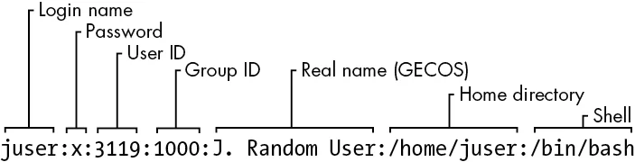

*图 7-1：密码文件中的一个条目*

*/etc/passwd* 文件的语法相当严格，不允许出现注释或空行。

> */etc/passwd* 中的一个用户及其对应的主目录，合起来称为一个*账户*。不过要记住，这只是用户空间中的约定。通常，只要 *passwd* 文件中存在相应条目，就足以将其视为一个账户；即使主目录不存在，大多数程序仍然能识别这个账户。此外，也可以不在 *passwd* 文件中明确列出用户，就将其加入系统。例如，过去常通过 NIS（网络信息服务，Network Information Service）或 LDAP（轻量级目录访问协议，Lightweight Directory Access Protocol）等机制，从网络服务器添加用户。

#### 7.3.2 特殊用户

你会在 */etc/passwd* 中看到一些特殊用户。*超级用户*（root）的 UID 和 GID 始终都是 0，如[清单 7-1](#listing7-1) 所示。有些用户（例如 daemon）没有登录权限。nobody 是一个权限很低的用户；某些进程以 nobody 的身份运行，因为它通常无法向系统中的任何位置写入数据。

无法登录的用户称为*伪用户*（pseudo-users）。尽管这些用户不能登录，系统仍然可以使用其用户 ID 启动进程。创建 nobody 等伪用户通常是出于安全考虑。

再次强调，这些都只是用户空间中的约定。对于内核而言，这些用户并没有特殊含义；唯一具有特殊意义的用户 ID 是超级用户的 ID，即 0。你完全可以像对待其他用户一样，赋予 nobody 访问系统中所有内容的权限。

#### 7.3.3 /etc/shadow 文件

Linux 系统中的影子密码文件（*/etc/shadow*）通常保存用户身份验证信息，包括与 */etc/passwd* 中用户对应的加密密码及密码过期信息。

引入 *shadow* 文件，是为了以更灵活（也可能更安全）的方式存储密码。它最初还配套提供了一组库和实用工具，其中许多后来很快被 PAM（可插拔认证模块，Pluggable Authentication Modules）的组件取代。我们将在 7.10 节介绍这个进阶主题。PAM 没有为 Linux 引入一套全新的文件，而是继续使用 */etc/shadow*，但并不使用某些相关配置文件，例如 */etc/login.defs*。

#### 7.3.4 管理用户和密码

普通用户通过 `passwd` 命令及其他一些工具与 */etc/passwd* 交互。使用 `passwd` 可以修改自己的密码；使用 `chfn` 和 `chsh` 可以分别修改真实姓名和 Shell（所选 Shell 必须列在 */etc/shells* 中）。这些程序都是设置了 suid-root 的可执行文件，因为只有超级用户才能修改 */etc/passwd* 文件。

##### 以超级用户身份修改 /etc/passwd

由于 */etc/passwd* 只是一个普通的纯文本文件，从技术上说，超级用户可以使用任意文本编辑器修改它。要添加用户，可以直接添加一行合适的记录，并为该用户创建主目录；删除用户时则可以反向操作。

然而，直接编辑 *passwd* 并不是好主意。不仅容易出错，如果另一个程序同时修改 *passwd*，还可能遇到并发问题。通过终端中的专用命令或图形界面管理用户，既简单又安全。例如，要设置某个用户的密码，可以超级用户身份运行 `passwd` `user`。添加和删除用户则分别使用 `adduser` 和 `userdel`。

如果确实必须直接编辑该文件（例如文件因某种原因损坏），请使用 `vipw` 程序。它会在编辑期间备份并锁定 */etc/passwd*，以增加一层保护。若要编辑 */etc/shadow* 而不是 */etc/passwd*，请使用 `vipw -s`。（希望你永远不需要进行这两种操作。）

#### 7.3.5 使用用户组

Unix 中的*组*提供了一种在特定用户之间共享文件的方法。基本思路是为某个组设置读取或写入权限位，同时将其他所有用户排除在外。过去，许多用户共用一台计算机或同一个网络，因此这一功能非常重要；近年来，由于工作站不再那么频繁地被多人共用，它的重要性有所下降。

*/etc/group* 文件定义组 ID（例如 */etc/passwd* 文件中出现的那些组 ID）。[清单 7-2](#listing7-2) 给出了一个示例。

```
root:*:0:juser
daemon:*:1:
bin:*:2:
sys:*:3:
adm:*:4:
disk:*:6:juser,beazley
nogroup:*:65534:
user:*:1000:
```

清单 7-2：*/etc/group* 文件示例

与 */etc/passwd* 文件一样，*/etc/group* 中的每一行也由冒号分隔的多个字段组成。每条记录的字段从左到右依次为：

1. **组名**：运行 `ls -l` 等命令时会显示这个名称。
2. **组密码**：Unix 组密码几乎从不使用，也不应该使用（大多数情况下，`sudo` 是更好的替代方案）。这里可以使用 `*` 或其他默认值。`x` 表示 */etc/gshadow* 中存在对应条目；其中的密码也几乎总是被禁用，通常以 `*` 或 `!` 表示。
3. **组 ID（数字）**：GID 在 `group` 文件中必须唯一。这个数字会出现在用户 */etc/passwd* 条目的组字段中。
4. **可选的组成员列表**：列出属于该组的用户。除此之外，凡是在 *passwd* 文件中以相应组 ID 作为主组的用户，也属于这个组。

[图 7-2](#figure7-2) 标出了 *group* 文件条目中的各个字段。

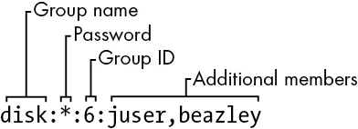

*图 7-2：组文件中的一个条目*

要查看自己所属的组，请运行 `groups`。

> Linux 发行版通常会在添加新用户时，同时为该用户创建一个同名的新组。


### 7.4 getty 与 login

`getty` 程序连接到终端并显示登录提示。在大多数 Linux 系统上，`getty` 的用途很简单，因为系统只用它处理虚拟终端上的登录。在进程列表中，它通常看起来像下面这样（例如运行在 */dev/tty1* 上时）：

```bash
$ ps ao args | grep getty
/sbin/agetty -o -p -- \u --noclear tty1 linux
```

在许多系统上，只有当你通过 Ctrl-Alt-F1 之类的组合键进入虚拟终端后，才会看到 `getty` 进程。这个示例展示的是 `agetty`，许多 Linux 发行版默认包含的 `getty` 实现。

输入登录用户名后，`getty` 会将自身替换为 `login` 程序，由后者提示你输入密码。如果密码正确，`login` 就会使用 `exec()` 将自身替换为你的 shell；否则，你会看到“Login incorrect”（登录信息不正确）的提示。`login` 程序实际执行的大部分身份验证工作由 PAM 负责（参见 7.10 节）。

>研究 `getty` 时，你可能会遇到“38400”之类的波特率设置。这个设置基本已经过时。虚拟终端会忽略波特率；它只在连接真实串行线路时才有意义。

现在你已经知道 `getty` 和 `login` 的作用，但很可能永远不需要配置或修改它们。事实上，你甚至很少会直接使用它们，因为如今大多数用户通过 `gdm` 等图形界面或通过 SSH 远程登录，而这两种方式都不使用 `getty` 或 `login`。

### 7.5 设置时间

Unix 计算机依赖准确的计时。内核维护着**系统时钟**（*system clock*），运行 `date` 等命令时读取的就是这个时钟。你也可以使用 `date` 命令设置系统时钟，但通常不建议这样做，因为你无法把时间设置得完全准确。系统时钟应当尽可能接近真实时间。

PC 硬件中有一个由电池供电的**实时时钟**（*real-time clock*，RTC）。RTC 并不是特别精确的时钟，但总比没有好。内核通常会在启动时根据 RTC 设置系统时间；你也可以使用 `hwclock` 将系统时钟重置为当前硬件时间。为了避免时区或夏令时调整带来的问题，应当让硬件时钟使用协调世界时（UTC）。可以使用以下命令将 RTC 设置为内核当前的 UTC 时间：

```bash
# hwclock --systohc --utc
```

遗憾的是，内核的计时能力甚至比 RTC 还差。由于 Unix 计算机经常一次启动后连续运行数月乃至数年，系统时间往往会逐渐产生偏差。**时间漂移**（*time drift*）是指内核时间与真实时间（由原子钟或其他高精度时钟确定）之间的当前差值。

不要尝试通过 `hwclock` 修正时间漂移，因为这可能导致依赖时间的系统事件丢失或出现混乱。你可以运行 `adjtimex` 之类的工具，根据 RTC 平滑地调整时钟；不过，通常最好的办法还是使用网络时间守护进程保持系统时间准确（参见 7.5.2 节）。

#### 7.5.1 内核的时间表示与时区

内核的系统时钟将当前时间表示为自 UTC 时间 1970 年 1 月 1 日午夜 12 点以来经过的秒数。要查看当前这个数值，请运行：

```bash
$ date +%s
```

为了把这个数字转换成人类能够阅读的时间，用户空间程序会将其转换为本地时间，并考虑夏令时以及其他特殊情况（例如居住在美国印第安纳州）。本地时区由文件 */etc/localtime* 控制。（不必尝试直接查看它的内容；它是一个二进制文件。）

系统的时区文件位于 */usr/share/zoneinfo*。你会发现，这个目录包含大量时区及其别名。要手动设置系统时区，可以将 */usr/share/zoneinfo* 中的某个文件复制到 */etc/localtime*（或者创建符号链接），也可以使用发行版提供的时区设置工具。命令行程序 `tzselect` 可以帮助你找到对应的时区文件。

如果只想在某一次 shell 会话中使用不同于系统默认值的时区，可以将 `TZ` 环境变量设置为 */usr/share/zoneinfo* 中某个文件的名称，并按下面的方法测试：

```bash
$ export TZ=US/Central
$ date
```

与其他环境变量一样，你也可以只为单条命令设置时区：

```bash
$ TZ=US/Central date
```

#### 7.5.2 网络时间

如果计算机始终连接互联网，可以运行网络时间协议（NTP）守护进程，通过远程服务器保持时间准确。过去，这项工作由 `ntpd` 守护进程负责；但与许多其他服务一样，systemd 已经提供了自己的替代组件，名为 `timesyncd`。大多数 Linux 发行版都包含 `timesyncd`，并且默认启用。通常不需要配置它；如果你想了解配置方法，可以参考 `timesyncd.conf(5)` 手册页。最常见的自定义设置是更换远程时间服务器。

如果想改用 `ntpd`，并且系统已安装 `timesyncd`，就需要先禁用后者。你可以访问 <https://www.ntppool.org/> 查看相关说明。如果仍想使用 `timesyncd`，但希望指定其他时间服务器，这个网站同样可能有所帮助。

如果计算机并非始终连接互联网，可以使用 `chronyd` 之类的守护进程，在断网期间继续维持时间。

你还可以根据网络时间设置硬件时钟，以便系统重新启动后仍能保持时间一致。许多发行版会自动执行这项操作；如果要手动完成，请先确认系统时间已通过网络校准，然后运行以下命令：

```bash
# hwclock --systohc –-utc
```


### 7.6 使用 cron 和定时器单元调度周期性任务

要让程序按照重复的时间计划运行，有两种方式：cron 和 systemd 定时器单元。这项能力对于自动执行系统维护任务至关重要。例如，前面介绍过的日志文件轮转工具，可以避免旧日志不断累积、占满硬盘。长期以来，cron 服务一直是完成这类工作的事实标准，因此我们会详细介绍它。不过，systemd 的定时器单元也是 cron 的一种替代方案，并且在某些情况下具有优势，所以我们也会学习如何使用它。

使用 cron，可以在任何适合你的时间运行任意程序。通过 cron 运行的程序称为 *cron 作业（cron job）*。要安装 cron 作业，通常需要运行 `crontab` 命令，在 *crontab 文件*中创建一行条目。例如，下面这条 crontab 记录安排 `/home/juser/bin/spmake` 命令每天上午 9:15（本地时区）运行：

```
15 09 * * * /home/juser/bin/spmake
```

这一行开头由空白字符分隔的五个字段指定执行时间（另见[图 7-3](#figure7-3)）。这些字段依次为：

- 分钟（0～59）。这个 cron 作业设置为第 15 分钟。
- 小时（0～23）。这个作业设置为第 9 小时。
- 一个月中的日期（1～31）。
- 月份（1～12）。
- 一周中的星期几（0～7）。数字 0 和 7 都代表星期日。

  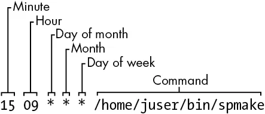

  *图 7-3：crontab 文件中的一条记录*

任何字段中的星号（`*`）都表示匹配所有取值。前面的示例每天运行 `spmake`，因为日期、月份和星期字段都填了星号；cron 将其理解为“每个月的每一天、每周的每一天都运行此作业”。

如果只想在每月 14 日运行 `spmake`，可以使用下面这行 crontab：

```
15 09 14 * * /home/juser/bin/spmake
```

每个字段也可以指定多个时间值。例如，要在每月 5 日和 14 日运行程序，可以在第三个字段输入 `5,14`：

```
15 09 5,14 * * /home/juser/bin/spmake
```

> 如果 cron 作业产生标准输出、错误输出，或者异常退出，cron 应当将这些信息通过电子邮件发送给作业所有者（前提是系统的邮件功能正常）。如果这些邮件令人困扰，可以把输出重定向到 `/dev/null` 或其他日志文件。

`crontab(5)` 手册页提供了 crontab 格式的完整说明。

#### 7.6.1 安装 Crontab 文件

每个用户都可以拥有自己的 crontab 文件，因此一台系统上可能存在多个 crontab，通常位于 */var/spool/cron/crontabs*。普通用户不能直接写入该目录；`crontab` 命令负责安装、列出、编辑和删除用户的 crontab。

安装 crontab 最简单的方法是先把条目写入一个文件，然后运行 `crontab` `file`，将 `file` 安装为当前用户的 crontab。`crontab` 命令会检查文件格式，以确认没有错误。要列出你的 cron 作业，运行 `crontab -l`；要删除 crontab，使用 `crontab -r`。

创建初始 crontab 之后，如果每次修改都通过临时文件进行，操作可能有些繁琐。你可以改用 `crontab -e`，一步完成编辑和安装。如果出现错误，`crontab` 应当指出错误所在，并询问你是否希望再次编辑。

#### 7.6.2 系统 Crontab 文件

许多由 cron 触发的常见系统任务都以超级用户身份运行。不过，Linux 发行版通常不会通过编辑和维护超级用户自己的 crontab 来安排这些任务，而是提供面向整个系统的 */etc/crontab* 文件。你不会使用 `crontab` 命令编辑这个文件；而且它的格式略有不同：在要执行的命令之前，多了一个字段，用于指定运行该作业的用户。（因此，即使系统任务由不同用户运行，也可以将它们集中管理。）例如，下面定义在 */etc/crontab* 中的作业会在上午 6:42 以超级用户身份运行（原文示例的用户名写作 `root1`）：

```
42 6 * * * root1 /usr/local/bin/cleansystem > /dev/null 2>&1
```

> 某些发行版会在 */etc/cron.d* 目录中存放其他系统 crontab 文件。这些文件可以采用任意名称，但格式与 */etc/crontab* 相同。系统中也可能存在 */etc/cron.daily* 等目录，不过其中的文件通常是由 */etc/crontab* 或 */etc/cron.d* 中的某个 cron 作业执行的脚本。有时，要查清作业究竟位于何处、何时运行，会令人困惑。

#### 7.6.3 定时器单元

对于周期性任务，除了创建 cron 作业，还可以构建 systemd 定时器单元。对于一个全新的任务，你需要创建两个单元：一个定时器单元和一个服务单元。之所以需要两个单元，是因为定时器单元本身不包含要执行的任务细节；它只是一种激活机制，用来启动服务单元（从概念上说，也可以启动其他类型的单元，但最常见的用途是启动服务单元）。

我们来看一组典型的定时器／服务单元，先从定时器单元开始。将它命名为 *loggertest.timer*；与其他自定义单元文件一样，把它放在 */etc/systemd/system* 中（参见[代码清单 7-3](#listing7-3)）。

```ini
[Unit]
Description=Example timer unit

[Timer]
OnCalendar=*-*-* *:00,20,40
Unit=loggertest.service

[Install]
WantedBy=timers.target
```

这个定时器每 20 分钟运行一次。`OnCalendar` 选项的写法与 cron 语法有些相似。在这个例子中，运行时间是每小时的整点、20 分和 40 分。

`OnCalendar` 的时间格式为 `年-月-日 时:分:秒`。秒字段可以省略。与 cron 一样，`*` 代表某种通配符，逗号可以分隔多个取值。还可以使用 `/` 表示周期性间隔；在前面的例子中，将 `*:00,20,40` 改为 `*:00/20`（每 20 分钟）可以得到同样的效果。

> `OnCalendar` 字段的时间语法有许多简写形式和变体。完整列表请参阅 `systemd.time(7)` 手册页中的“Calendar Events”部分。

与之关联的服务单元名为 *loggertest.service*（参见[代码清单 7-4](#listing7-4)）。我们通过定时器中的 `Unit` 选项显式指定了它，但严格来说并非必需，因为 systemd 会查找与定时器单元文件具有相同基本名称的 *.service* 文件。这个服务单元同样放在 */etc/systemd/system* 中，其结构与第 6 章介绍的服务单元非常相似。

```ini
[Unit]
Description=Example Test Service

[Service]
Type=oneshot
ExecStart=/usr/bin/logger -p local3.debug I\'m a logger
```

这里的核心是 `ExecStart` 行，它指定服务激活时执行的命令。这个示例会向系统日志发送一条消息。

注意：`Type=oneshot` 表示服务运行结束即退出；systemd 要等到 `ExecStart` 命令执行完成，才认为服务启动成功。将它和定时器配合使用，有几个好处：

- 可以在单元文件中指定多个 `ExecStart` 命令。第 6 章介绍的其他服务单元类型不允许这样做。
- 在通过 `Wants` 和 `Before` 依赖指令激活其他单元时，更容易严格控制依赖顺序。
- 可以在 journal 中更好地记录单元的启动与结束时间。

  > 在这个单元示例中，我们使用 `logger` 向 syslog 和 journal 写入一条记录。你在 7.1.2 节已经学过，可以按单元查看日志消息。不过，单元可能在 journald 来得及接收消息之前就已结束。这是一种竞态条件：如果单元结束得太快，journald 就无法根据进程 ID 查出这条 syslog 消息对应的单元。结果，写入 journal 的消息可能不包含单元字段，因而 `journalctl -f -u loggertest.service` 之类的过滤命令无法显示该消息。对于运行时间较长的服务，这通常不是问题。

#### 7.6.4 cron 与定时器单元的比较

cron 是 Linux 系统中最古老的组件之一；它已经存在了几十年（甚至早于 Linux 本身），其配置格式多年来也几乎没有变化。一个组件如此古老，自然就可能成为被替换的对象。

刚刚介绍的 systemd 定时器单元看起来似乎是顺理成章的替代方案。事实上，许多发行版现在已经把系统级的周期性维护任务迁移到定时器单元。不过，cron 仍然具有一些优势：

- 配置更简单。
- 与许多第三方服务兼容。
- 用户更容易安装自己的任务。

定时器单元则具有以下优势：

- 借助 cgroups，更好地跟踪与任务／单元相关的进程。
- 在 journal 中出色地记录诊断信息。
- 提供更多关于激活时间和频率的选项。
- 能够使用 systemd 的依赖关系与激活机制。

也许有一天，cron 作业会像挂载单元与 */etc/fstab* 之间的关系那样，拥有一层兼容机制。不过，仅从配置方式来看，cron 格式就不太可能很快消失。下一节将介绍 `systemd-run` 工具：它可以在不创建单元文件的情况下生成定时器单元及关联服务，但其管理方式和实现机制仍然有明显区别，因此许多用户可能依旧偏爱 cron。接下来讨论 `at` 时，你会看到其中的一些差异。


### 7.7 使用 at 安排一次性任务

如果想在未来某个时间只执行一次任务，而不使用 cron，可以使用 `at` 服务。例如，要在晚上 10:30 运行 `myjob`，请输入以下命令：

```bash
$ at 22:30
at> myjob
```

按 ctrl-D 结束输入。（`at` 工具从标准输入读取命令。）

要检查任务是否已安排好，可以使用 `atq`；要删除该任务，则使用 `atrm`。你还可以在命令中添加 `DD.MM.YY` 格式的日期，将任务安排在未来某一天执行，例如 `at 22:30 30.09.15`。

`at` 命令的用法基本就是这些。虽然它并不常用，但在确实需要的时候，它可能非常有价值。

#### 7.7.1 使用定时器单元实现同等功能

你可以使用 systemd 定时器单元代替 `at`。与前面介绍的周期性定时器单元相比，这种定时器要容易创建得多，而且可以直接通过命令行运行，如下所示：

```bash
# systemd-run --on-calendar='2022-08-14 18:00' /bin/echo this is a test
Running timer as unit: run-rbd000cc6ee6f45b69cb87ca0839c12de.timer
Will run service as unit: run-rbd000cc6ee6f45b69cb87ca0839c12de.service
```

`systemd-run` 命令会创建一个临时定时器单元，你可以像往常一样使用 `systemctl list-timers` 查看它。如果不在意具体的执行时刻，也可以通过 `--on-active` 指定相对时间，例如 `--on-active=30m` 表示从现在起 30 分钟后执行。

> 使用 `--on-calendar` 时，务必同时指定一个未来的日历日期和具体时间。否则，定时器单元和服务单元会一直保留，定时器每天都在指定时刻运行该服务，就像前面介绍的普通定时器单元一样。这个选项的语法与定时器单元中的 `OnCalendar` 选项相同。

### 7.8 以普通用户身份运行定时器单元

到目前为止，我们看到的所有 systemd 定时器单元都是以 root 身份运行的。不过，也可以以普通用户身份创建定时器单元。为此，只需在 `systemd-run` 命令中添加 `--user` 选项。

然而，如果你在单元运行之前退出登录，该单元就不会启动；如果你在单元完成之前退出登录，该单元就会终止。这是因为 systemd 为已登录的用户关联了一个用户管理器，而运行定时器单元需要这个管理器。可以通过以下命令，让 systemd 在你退出登录后仍保留用户管理器：

```bash
$ loginctl enable-linger
```

作为 root，你还可以为其他用户启用用户管理器：

```bash
# loginctl enable-linger user
```

### 7.9 用户访问相关主题

本章剩余部分将讨论几个与用户如何获得登录权限、切换到其他用户以及执行相关操作有关的主题。这些内容略为深入。如果你已经迫不及待地想进一步研究进程的内部机制，也可以直接跳到下一章。

#### 7.9.1 用户 ID 与用户切换

前面我们讨论过，`sudo` 和 `su` 等 setuid 程序如何让你临时切换用户，也介绍过 `login` 等负责控制用户访问的系统组件。你可能会好奇：这些组件究竟如何工作？内核在用户切换中又扮演什么角色？

临时切换到另一个用户，本质上就是改变你的用户 ID。实现这一点有两种方式，而且两种方式都由内核处理。第一种是使用 setuid 可执行文件，我们已经在 2.17 节介绍过。第二种是使用 `setuid()` 系列系统调用。由于一个进程会关联多种用户 ID，这类系统调用也有几个不同版本；你将在 7.9.2 节了解这些用户 ID。

内核对进程能做什么、不能做什么有一些基本规则。就 setuid 可执行文件和 `setuid()` 而言，最重要的是以下三条：

- 只要具有足够的文件访问权限，进程就可以运行 setuid 可执行文件。
- 以 root（用户 ID 为 0）身份运行的进程，可以使用 `setuid()` 切换为任何其他用户。
- 不以 root 身份运行的进程在使用 `setuid()` 时受到严格限制；大多数情况下，它根本无法使用这一调用来切换用户。

因此，如果想从一个普通用户 ID 切换到另一个用户 ID，通常需要结合使用上述两种方法。例如，`sudo` 可执行文件设置了 setuid root 权限；它启动之后，便可以调用 `setuid()` 切换成其他用户。

> 从根本上说，用户切换与密码或用户名没有关系。密码和用户名完全属于用户空间的概念，你在 7.3.1 节第一次看到 `/etc/passwd` 文件时就已经接触过这一点。7.9.4 节将进一步介绍其工作方式。


#### 7.9.2 进程所有权、有效 UID、真实 UID 与保存的 UID

到目前为止，我们对用户 ID 的讨论有所简化。实际上，每个进程都不止有一个用户 ID。你已经熟悉**有效用户 ID**（*effective user ID*，简称 *effective UID* 或 *euid*），它决定了进程的访问权限，其中最重要的是文件权限。第二种用户 ID 是**真实用户 ID**（*real user ID*，简称 *real UID* 或 *ruid*），用来表示是谁启动了该进程。通常，这两个 ID 相同；但是，当你运行一个 setuid 程序时，Linux 会在程序执行期间将 euid 设置为该程序所有者的用户 ID，同时在 ruid 中保留你原来的用户 ID。

有效 UID 和真实 UID 之间的区别很容易让人困惑，以至于许多关于进程所有权的文档都存在错误。

可以把 euid 看作**执行者**，把 ruid 看作**所有者**。ruid 决定哪个用户可以与正在运行的进程交互，尤其是哪个用户可以终止进程或向进程发送信号。例如，如果用户 A 启动了一个以用户 B 身份运行的进程（通过 setuid 权限实现），那么用户 A 仍然拥有该进程，也可以终止它。

我们已经看到，大多数进程的 euid 和 ruid 都相同。因此，`ps` 和其他系统诊断程序的默认输出通常只显示 euid。要在系统上同时查看这两个用户 ID，可以尝试以下命令。不过，如果你发现所有进程的这两列完全相同，也不必感到意外：

```bash
$ ps -eo pid,euser,ruser,comm
```

如果想人为制造一个例外，以便观察两列中的不同数值，可以尝试复制一份 `sleep` 命令，为副本设置 setuid 权限，让它运行几秒钟，然后在副本结束之前，在另一个窗口执行前面的 `ps` 命令。

更让人困惑的是，除了真实用户 ID 和有效用户 ID，还有一种**保存的用户 ID**（*saved user ID*，通常不使用缩写）。进程在运行期间可以把自己的 euid 切换为 ruid 或保存的用户 ID。（事情还可以更复杂：Linux 另有一种用户 ID，称为**文件系统用户 ID**，即 *filesystem user ID* 或 *fsuid*。它用于确定访问文件系统的用户身份，但很少使用。）

##### 典型的 setuid 程序行为

关于 ruid 的解释可能与你以往的经验相矛盾。为什么平时很少需要处理这些不同的用户 ID？例如，使用 `sudo` 启动进程后，如果想终止它，你仍然需要使用 `sudo`；无法直接以普通用户身份终止它。按照前面的解释，你的普通用户 ID 不应该是这个进程的 ruid，从而赋予你相应权限吗？

之所以会出现这种行为，是因为 `sudo` 和许多其他 setuid 程序会通过某个 `setuid()` 系统调用，显式地**同时修改 euid 和 ruid**。这些程序之所以这样做，是因为各个用户 ID 不一致时，往往会引发意料之外的副作用和访问问题。

> 如果你对用户 ID 切换的具体细节和规则感兴趣，请阅读 `setuid(2)` 手册页，并查看其中 SEE ALSO 一节列出的其他手册页。针对不同的使用场景，系统提供了多种不同的系统调用。

有些程序不希望自己的 ruid 是 root。为了阻止 `sudo` 修改 ruid，可以在 */etc/sudoers* 文件中添加以下一行（但要注意，这可能对其他需要以 root 身份运行的程序产生副作用！）：

```
Defaults      stay_setuid
```

##### 安全方面的影响

由于 Linux 内核通过 setuid 程序及其后续系统调用来处理所有用户身份切换（进而决定文件访问权限），系统开发人员和管理员必须格外关注以下两点：

- 具有 setuid 权限的程序的数量及其质量
- 这些程序实际执行的操作

如果你复制一份 `bash` shell，并将它设置为以 root 身份运行的 setuid 程序，那么任何本地用户都可以执行它，并获得对整个系统的完全控制。事情就是这么简单。更进一步说，即使某个 setuid root 程序只用于执行特定任务，只要其中存在漏洞，也可能构成安全威胁。利用以 root 身份运行的程序中的弱点，是入侵系统的主要方法之一；此类漏洞利用的数量多得难以计数。

由于入侵系统的途径非常多，防范入侵必须从多个方面着手。其中，阻止未经授权活动的一项最基本措施，就是通过用户名和可靠的密码实施用户身份认证。

#### 7.9.3 用户标识、身份认证与授权

多用户系统必须在三个方面提供基本的用户安全支持：**标识**（*identification*）、**身份认证**（*authentication*）和**授权**（*authorization*）。标识要回答的是用户**是谁**；身份认证要求用户**证明**自己确实是所声称的那个人；授权则用于定义和限制用户**可以做什么**。

就用户标识而言，Linux 内核只认识用于表示进程和文件所有权的数字用户 ID。内核也知道有关授权的规则，例如如何运行 setuid 可执行文件，以及用户 ID 如何通过 `setuid()` 系列系统调用切换身份。但是，内核并不了解身份认证的细节，例如用户名和密码。实际上，几乎所有与身份认证相关的工作都发生在用户空间。

我们在 7.3.1 节讨论过用户 ID 与密码之间的映射关系，现在来看看用户进程如何访问这种映射。先从一个经过简化的例子开始：某个用户进程想知道自己的用户名（也就是与 euid 对应的名称）。在传统 Unix 系统中，进程可以通过以下步骤获取用户名：

1. 进程通过 `geteuid()` 系统调用向内核查询自己的 euid。
2. 进程打开 */etc/passwd* 文件，并从文件开头开始读取。
3. 进程读取 */etc/passwd* 中的一行。如果已经没有内容可读，说明进程未能找到对应的用户名。
4. 进程将这一行解析为各个字段（以冒号为分隔符）。第三个字段就是这一行所对应的用户 ID。
5. 进程将第 4 步得到的 ID 与第 1 步得到的 ID 比较。如果两者相同，第 4 步解析出的第一个字段就是要找的用户名，进程可以停止搜索并使用这个名称。
6. 进程继续读取 */etc/passwd* 的下一行，然后返回第 3 步。

这套过程相当繁琐，而实际使用的实现通常还会更加复杂。

#### 7.9.4 使用程序库获取用户信息

如果每个需要知道当前用户名的开发人员都必须亲自编写前面那一整套代码，系统最终就会变成一个各部分互不协调、错误百出、臃肿不堪且难以维护的烂摊子。幸运的是，我们通常可以使用标准程序库来完成这种重复性的工作。在这个例子中，通常只需要先调用 `geteuid()`，再调用标准库中的 `getpwuid()` 之类的函数，就能得到用户名。（有关这些函数的工作方式，请参阅相应的手册页。）

系统上的多个可执行程序共享标准库，因此可以在不修改任何应用程序的情况下，对身份认证的实现方式进行重大调整。例如，只需修改系统配置，就可以不再依赖 */etc/passwd* 管理用户，而改用 LDAP 等网络服务。

这种方式在根据用户 ID 查找用户名方面运行得很好，但密码带来的问题要棘手得多。7.3.1 节介绍过，传统上，加密后的密码就保存在 */etc/passwd* 中。因此，如果想验证用户输入的密码，只需要对输入内容进行加密，然后与 */etc/passwd* 中保存的内容比较。

这种传统实现存在许多局限，包括：

- 它不允许你为整个系统统一规定加密协议的标准。
- 它假定你能够访问加密后的密码。
- 它假定每次用户访问需要身份认证的资源时，都应该提示用户输入密码（这会令人厌烦）。
- 它假定你希望使用密码。如果想使用一次性令牌、智能卡、生物识别或其他用户身份认证方式，就必须自行添加相应支持。

这些局限中的一部分促成了 7.3.3 节介绍的 *shadow* 密码软件包的开发。它迈出了允许在系统范围内统一配置密码的第一步。不过，真正解决上述大部分问题的，是 PAM 的设计与实现。


### 7.10 可插拔身份认证模块

为了让用户身份认证更加灵活，Sun Microsystems 于 1995 年提出了一项名为*可插拔身份认证模块（Pluggable Authentication Modules，PAM）*的新标准。这是一套用于身份认证的共享库体系（Open Software Foundation RFC 86.0，1995 年 10 月）。应用程序需要认证用户时，会将认证工作交给 PAM，由 PAM 判断用户能否成功证明自己的身份。这样一来，增加双因素认证、实体密钥等其他认证方式的支持就相对容易了。除了支持各种身份认证机制，PAM 还为服务提供有限的授权控制功能（例如，你可能希望禁止某些用户使用 `cron` 之类的服务）。

由于身份认证场景多种多样，PAM 使用一系列可动态加载的*认证模块*。每个模块执行一项特定任务，都是可以由进程动态加载、并在进程执行空间中运行的共享对象。例如，*pam\_unix.so* 就是一个能够检查用户密码的模块。

至少可以说，这并不是一件简单的事。PAM 的编程接口并不容易使用，而且它是否真正解决了所有现存问题，也并不明确。尽管如此，Linux 系统上几乎所有需要身份认证的程序都支持 PAM，大多数发行版也使用 PAM。由于 PAM 构建在现有的 Unix 身份认证 API 之上，客户端程序集成 PAM 支持时，通常只需要很少的额外工作，甚至不需要额外工作。

#### 7.10.1 PAM 配置

我们通过查看 PAM 的配置来了解它的基本工作原理。通常可以在 */etc/pam.d* 目录下找到 PAM 的应用程序配置文件（较旧的系统可能使用单个 */etc/pam.conf* 文件）。大多数安装环境都有很多这样的文件，因此你可能不知道该从哪里入手。其中有些文件名，例如 *cron* 和 *passwd*，对应着你已经熟悉的系统组件。

这些文件的具体配置在不同发行版之间差异很大，因此很难找到普遍适用的示例。下面来看一行可能出现在 `chsh`（更改 shell 的程序）配置中的内容：

```
auth       requisite   pam_shells.so
```

这行配置表示：要通过 `chsh` 程序的身份认证，用户的 shell 必须列在 */etc/shells* 中。我们来看看它是如何实现的。每一行配置依次包含三个字段：功能类型、控制参数和模块。在这个例子中，它们的含义如下：

1. **功能类型（Function type）**：用户应用程序请求 PAM 执行的功能。这里是 `auth`，即认证用户身份。
2. **控制参数（Control argument）**：控制 PAM 在当前行的操作成功或失败*之后*如何处理。本例中为 `requisite`。我们很快会详细介绍。
3. **模块（Module）**：这一行运行的认证模块，决定该行实际执行的操作。这里的 *pam\_shells.so* 模块检查用户当前的 shell 是否列在 */etc/shells* 中。

PAM 配置在 pam.conf(5) 手册页中有详细说明。下面来看几个基本要点。

##### 功能类型

用户应用程序可以请求 PAM 执行以下四种功能之一：

1. `auth`：认证用户身份（检查用户是否确实是其声称的身份）。
2. `account`：检查用户账户状态（例如，用户是否获准执行某项操作）。
3. `session`：执行仅针对用户当前会话的操作（例如显示每日提示消息）。
4. `password`：更改用户密码或其他凭据。

对于任意一行配置，模块与功能类型共同决定 PAM 要执行的操作。一个模块可以支持不止一种功能类型，因此在判断某行配置的用途时，始终要把功能和模块结合起来考虑。例如，*pam\_unix.so* 模块执行 `auth` 功能时会检查密码，而执行 `password` 功能时则会设置密码。

##### 控制参数与规则堆叠

PAM 的一个重要特性是配置行指定的规则可以*堆叠*，也就是说，执行某项功能时可以应用多条规则。这正是控制参数重要的原因：一行操作的成功或失败可能影响后续规则，也可能使整个功能直接成功或失败。

控制参数有两种写法：简单语法和更高级的语法。下面是规则中最常见的三个简单语法控制参数：

1. `sufficient`：如果当前规则成功，身份认证就成功，PAM 不必再检查其他规则。如果当前规则失败，PAM 继续执行后续规则。
2. `requisite`：如果当前规则成功，PAM 继续执行后续规则。如果当前规则失败，身份认证就失败，PAM 不必再检查其他规则。
3. `required`：如果当前规则成功，PAM 继续执行后续规则。如果当前规则失败，PAM 仍然继续执行后续规则，但无论后续规则的最终结果如何，身份认证都会失败。

继续前面的例子，下面是一组用于 `chsh` 身份认证功能的堆叠规则：

```
auth       sufficient     pam_rootok.so
auth       requisite      pam_shells.so
auth       sufficient     pam_unix.so
auth       required       pam_deny.so
```

使用这组配置时，当 `chsh` 命令请求 PAM 执行身份认证功能，PAM 会依次执行以下步骤（流程图见[图 7-4](#figure7-4)）：

1. *pam\_rootok.so* 模块检查尝试认证的用户是否为 root。如果是，就立即成功，不再尝试其他认证。这是因为控制参数设为 `sufficient`，意味着这一操作成功就足以让 PAM 立即向 `chsh` 报告成功。否则进入第 2 步。

   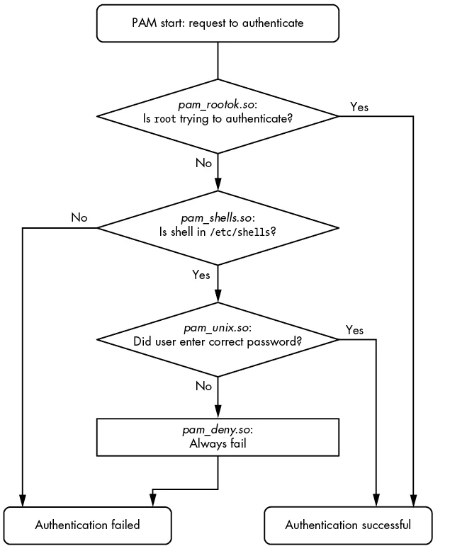

   *图 7-4：PAM 规则执行流程*
2. *pam\_shells.so* 模块检查用户的 shell 是否列在 */etc/shells* 中。如果不在，模块返回失败；`requisite` 控制参数指示 PAM 必须立即向 `chsh` 报告失败，不再尝试其他认证。如果在列表中，模块返回成功，满足 `requisite` 控制参数的要求，然后进入第 3 步。
3. *pam\_unix.so* 模块要求用户输入密码并进行检查。这里的控制参数是 `sufficient`，因此只要模块成功（密码正确），PAM 就可以向 `chsh` 报告成功。如果密码错误，PAM 继续执行第 4 步。
4. *pam\_deny.so* 模块总是返回失败。由于控制参数设为 `required`，PAM 会向 `chsh` 报告失败。当没有其他方法可尝试时，这就是默认处理方式。（注意，`required` 控制参数不会使 PAM 立即终止当前功能；PAM 仍会执行规则堆栈中剩余的行，但最终一定会向应用程序报告失败。）

   > 使用 PAM 时，不要混淆*功能（function）*与*操作（action）*。功能是较高层次的目标，即用户应用程序希望 PAM 完成的事情（例如认证用户）。操作则是 PAM 为实现该目标而采取的某个具体步骤。只需记住：用户应用程序首先调用某项功能，而 PAM 通过具体操作来完成它。

高级控制参数语法使用方括号（`[]`）表示，允许你根据模块返回的具体值（而不仅是成功或失败）手动控制响应方式。详情参见 pam.conf(5) 手册页。理解了简单语法之后，掌握高级语法也不会困难。

##### 模块参数

PAM 模块可以在模块名称后接受参数。你经常会看到下面这个使用 *pam\_unix.so* 模块的例子：

```
auth       sufficient   pam_unix.so   nullok
```

这里的 `nullok` 参数表示允许用户没有密码（默认情况下，没有密码会导致认证失败）。

#### 7.10.2 PAM 配置语法提示

由于具备控制流程和模块参数语法，PAM 配置语法具有许多编程语言的特征，也具备一定的表达能力。前面只是初步介绍，下面再给出一些有关 PAM 的提示：

- 要查看系统中有哪些 PAM 模块，可以尝试 `man -k pam_`（注意末尾的下划线）。模块所在的位置可能不容易查找，可以尝试 `locate pam_unix.so`，看看结果指向哪里。
- 每个模块的功能及参数都记录在相应的手册页中。
- 许多发行版会自动生成某些 PAM 配置文件，因此直接修改 */etc/pam.d* 中的这些文件可能并不明智。编辑之前先阅读文件中的注释；如果文件是自动生成的，注释会说明其来源。
- */etc/pam.d/other* 配置文件为没有专用配置文件的应用程序定义默认配置。默认行为通常是拒绝所有请求。
- 在 PAM 配置文件中引入其他配置文件有不同的方法。`@include` 语法会加载整个配置文件，但你也可以通过控制参数，只加载针对某一功能的配置。具体用法因发行版而异。
- PAM 的配置并不止于模块参数。有些模块还可以读取 */etc/security* 下的其他文件，通常用于配置针对各个用户的限制。

#### 7.10.3 PAM 与密码

随着 Linux 密码验证机制多年来不断演变，系统中留下了多种与密码有关的配置文件，有时容易令人困惑。首先需要了解的是 */etc/login.defs* 文件。它是最初的 shadow 密码工具套件的配置文件，其中包含用于 */etc/shadow* 密码文件的加密算法信息。不过，在安装了 PAM 的系统上，这些信息通常由 PAM 配置提供，因此很少使用 */etc/login.defs* 中的相关设置。尽管如此，如果偶尔遇到不支持 PAM 的应用程序，*/etc/login.defs* 中指定的加密算法仍应与 PAM 配置保持一致。

PAM 从哪里获取密码加密方案的信息呢？回想一下，PAM 有两种与密码交互的方式：`auth` 功能用于验证密码，`password` 功能用于设置密码。最容易追踪的是设置密码时使用的参数。最好的办法大概就是直接用 `grep` 搜索：

```bash
$ grep password.*unix /etc/pam.d/*
```

匹配的行应当包含 *pam\_unix.so*，看起来类似这样：

```
password        sufficient      pam_unix.so obscure sha512
```

参数 `obscure` 和 `sha512` 告诉 PAM 设置密码时应该做什么。首先，PAM 检查密码是否足够“复杂”（例如，密码不能与旧密码过于相似，此外还有其他检查），然后使用 SHA512 算法加密新密码。

但是，这些操作*只在用户设置密码时*发生，而不是在 PAM *验证密码时*发生。那么 PAM 在认证时如何知道应该使用哪种算法呢？遗憾的是，配置文件并不能告诉你答案：对于 `auth` 功能，*pam\_unix.so* 没有相应的加密参数。手册页对此也没有说明。

实际情况是（截至本书写作时），*pam\_unix.so* 只是尝试推断所用的算法，通常把繁重的工作交给 libcrypt 库，让它尝试多种方法，直到找到可用的算法，或者没有其他方法可尝试。因此，通常不必担心验证密码时使用的加密算法。

### 7.11 展望

到这里，我们已经完成了本书学习进程的大约一半，并介绍了 Linux 系统中许多重要的基础构件。通过讨论 Linux 系统上的日志和用户，你已经看到，服务和任务可以划分成较小且相互独立的部分，同时仍然能够在一定程度上相互协作。

本章几乎完全围绕用户空间展开。接下来，我们需要进一步完善对用户空间进程及其所消耗资源的认识。为此，第 8 章将重新回到内核内部。


## 第 8 章：深入了解进程与资源利用

本章将带你进一步了解进程、内核和系统资源之间的关系。硬件资源主要分为三类：CPU、内存和 I/O。各个进程会争用这些资源，而内核的职责就是公平地分配资源。内核本身也是一种资源——一种软件资源，进程借助它完成创建新进程、与其他进程通信等任务。

本章介绍的许多工具都属于性能监控工具。当系统运行得异常缓慢，而你正试图找出原因时，它们尤其有用。不过，不要过分关注性能。对已经正常运行的系统进行优化，只会浪费时间。大多数系统的默认设置都经过合理选择，因此，只有在需求非常特殊时才应修改它们。相反，你应该把注意力放在理解这些工具**究竟测量了什么**上。这样，你就能深入了解内核的工作原理，以及它与进程之间的交互方式。

### 8.1 跟踪进程

在 2.16 节中，你已经学会使用 `ps` 列出系统在某个时刻正在运行的进程。`ps` 命令会列出当前进程及其资源使用统计信息，却很难告诉你这些进程随时间发生了怎样的变化。因此，它无法直接帮助你确定哪个进程占用了过多的 CPU 时间或内存。

`top` 程序为 `ps` 所显示的信息提供了一个交互式界面。它不仅显示当前系统状态，还显示 `ps` 列表中的各项字段，并且每秒更新一次。也许最重要的是，`top` 会将最活跃的进程列在显示区域的顶部；默认情况下，这些进程就是当前占用 CPU 时间最多的进程。

你可以通过按键向 `top` 发送命令。最常用的命令用于改变排序顺序或筛选进程列表：

1. **空格键**：立即刷新显示内容。
2. **M**：按当前常驻内存使用量排序。
3. **T**：按 CPU 总使用量（累计值）排序。
4. **P**：按当前 CPU 使用量排序（默认方式）。
5. **u**：只显示某个用户的进程。
6. **f**：选择要显示的统计信息。
7. **?**：显示所有 `top` 命令的使用说明摘要。

>
> `top` 的按键命令区分大小写。

另外两个类似的工具 `atop` 和 `htop` 提供了更丰富的视图和功能。它们增加的大部分功能，也可以在其他工具中找到。例如，`htop` 就具备下一节将介绍的 `lsof` 命令的许多功能。

### 8.2 使用 lsof 查找已打开的文件

`lsof` 命令会列出已经打开的文件以及正在使用这些文件的进程。由于 Unix 非常重视文件这一抽象概念，`lsof` 因而成为排查问题时最有用的工具之一。不过，`lsof` 的作用并不限于普通文件——它还能列出网络资源、动态库、管道等。

#### 8.2.1 阅读 lsof 的输出

直接在命令行运行 `lsof`，通常会产生大量输出。下面是你可能看到的一段输出。为便于阅读，示例经过了少量调整，其中包含 systemd（init）进程和一个正在运行的 `vi` 进程所打开的文件：

```bash
# lsof

COMMAND  PID   USER   FD    TYPE    DEVICE  SIZE/OFF    NODE NAME
systemd    1   root  cwd     DIR    8,1      4096          2 /
systemd    1   root  rtd     DIR    8,1      4096          2 /
systemd    1   root  txt     REG    8,1   1595792    9961784 /lib/systemd/systemd
systemd    1   root  mem     REG    8,1   1700792    9961570 /lib/x86_64-linux-gnu/libm-2.27.so
systemd    1   root  mem     REG    8,1    121016    9961695 /lib/x86_64-linux-gnu/libudev.so.1

--snip--
vi      1994   juser  cwd    DIR    8,1      4096    4587522 /home/juser
vi      1994   juser   3u    REG    8,1     12288     786440 /tmp/.ff.swp

--snip--
```

输出的第一行列出了以下字段：

1. **`COMMAND`**：持有文件描述符的进程所对应的命令名称。
2. **`PID`**：进程 ID。
3. **`USER`**：运行该进程的用户。
4. **`FD`**：该字段可能包含两类内容。在前面的多数输出行中，`FD` 列表示文件的用途。`FD` 字段也可以列出已打开文件的**文件描述符（file descriptor）**。文件描述符是一个数字，进程借助它以及系统库和内核来识别、操作文件；示例的最后一行显示的文件描述符为 `3`。
5. **`TYPE`**：文件类型，例如普通文件、目录、套接字等。
6. **`DEVICE`**：存放该文件的设备的主设备号和次设备号。
7. **`SIZE/OFF`**：文件大小。
8. **`NODE`**：文件的 inode 编号。
9. **`NAME`**：文件名。

`lsof(1)` 手册页完整列出了各字段可能出现的内容，不过输出通常不难理解。例如，看看 `FD` 字段为 `cwd` 的条目：这些行表示相应进程的当前工作目录。再看最后一行，它显示的是用户运行的 `vi` 进程（PID 为 1994）正在使用的一个临时文件。

>
> 你可以以 root 用户或普通用户身份运行 `lsof`，但使用 root 身份能够获得更多信息。

#### 8.2.2 使用 lsof

运行 `lsof` 主要有两种基本方法：

- 列出全部内容，将输出通过管道传给 `less` 之类的命令，然后搜索所需的信息。由于输出量很大，这可能需要一些时间。
- 使用命令行选项，缩小 `lsof` 返回结果的范围。

你可以使用命令行选项，把文件名作为参数传给 `lsof`，让它只列出与该参数匹配的条目。例如，下面的命令会显示 */usr* 及其所有子目录中已打开文件的相关条目：

```bash
$ lsof +D /usr
```

如果要列出某个特定进程 ID 所打开的文件，可以运行：

```bash
$ lsof -p pid
```

要查看 `lsof` 众多选项的简要说明，可以运行 `lsof -h`。其中大多数选项与输出格式有关。（有关 `lsof` 网络功能的讨论，请参见第 10 章。）

>
> `lsof` 高度依赖内核提供的信息。如果你在发行版升级时同时更新了内核和 `lsof`，那么在重启系统、启用新内核之前，更新后的 `lsof` 可能无法正常工作。


### 8.3 跟踪程序执行与系统调用

到目前为止，我们介绍的工具都是用来检查正在运行的进程的。然而，如果你完全不知道一个程序为什么刚启动就几乎立刻退出，`lsof` 就帮不上忙了。事实上，你甚至很难在出错的命令运行期间同时执行 `lsof`。

`strace`（系统调用跟踪）和 `ltrace`（库调用跟踪）命令可以帮助你弄清程序试图执行哪些操作。这些工具会产生大量输出，但只要知道应该关注什么，就能从中获得更多排查问题所需的信息。

#### 8.3.1 strace

回顾一下，*系统调用*是用户空间进程请求内核执行的特权操作，例如打开文件并读取其中的数据。`strace` 工具会打印进程发出的所有系统调用。可以运行以下命令看看它的效果：

```bash
$ strace cat /dev/null
```

默认情况下，`strace` 将输出写入标准错误。如果想将输出保存到文件，可以使用 `-o` `save_file` 选项。你也可以在命令行末尾添加 `2>` `save_file` 来重定向，但这样也会一并捕获被检查命令自身写入标准错误的内容。

在第 1 章中，你已经学过：当一个进程想启动另一个进程时，会调用 `fork()` 系统调用创建自身的副本，然后由这个副本调用 `exec()` 系列系统调用中的某个函数来运行新程序。`strace` 会在 `fork()` 调用完成之后，开始跟踪新进程（即原进程的副本）。因此，这条命令的输出开头应该先显示 `execve()` 调用，随后是用于初始化内存的 `brk()` 调用，如下所示：

```
execve("/bin/cat", ["cat", "/dev/null"], 0x7ffef0be0248 /* 59 vars */) = 0
brk(NULL)                               = 0x561e83127000
```

接下来的一部分输出主要与加载共享库有关。除非你确实想深入研究共享库系统，否则可以跳过这些内容：

```
access("/etc/ld.so.nohwcap", F_OK)      = -1 ENOENT (No such file or directory)
openat(AT_FDCWD, "/etc/ld.so.cache", O_RDONLY|O_CLOEXEC) = 3
fstat(3, {st_mode=S_IFREG|0644, st_size=119531, ...}) = 0
mmap(NULL, 119531, PROT_READ, MAP_PRIVATE, 3, 0) = 0x7fa9db241000
close(3)                                = 0

--snip--
openat(AT_FDCWD, "/lib/x86_64-linux-gnu/libc.so.6", O_RDONLY|O_CLOEXEC) = 3
read(3, "\177ELF\2\1\1\3\0\0\0\0\0\0\0\0\3\0>\0\1\0\0\0\260\34\2\0\0\0\0\0"..., 832) = 832
```

另外，也可以略过 `mmap` 的输出，直到接近输出末尾、出现类似下面的内容：

```
fstat(1, {st_mode=S_IFCHR|0620, st_rdev=makedev(0x88, 1), ...}) = 0
openat(AT_FDCWD, "/dev/null", O_RDONLY) = 3
fstat(3, {st_mode=S_IFCHR|0666, st_rdev=makedev(0x1, 3), ...}) = 0
fadvise64(3, 0, 0, POSIX_FADV_SEQUENTIAL) = 0
mmap(NULL, 139264, PROT_READ|PROT_WRITE, MAP_PRIVATE|MAP_ANONYMOUS, -1, 0) = 0x7fa9db21b000
read(3, "", 131072)                     = 0
munmap(0x7fa9db21b000, 139264)          = 0
close(3)                                = 0
close(1)                                = 0
close(2)                                = 0
exit_group(0)                           = ?
+++ exited with 0 +++
```

这部分输出展示了命令实际执行的操作。首先看 `openat()` 调用（它是 `open()` 的一个略有不同的变体），其作用是打开文件。返回值 `3` 表示调用成功（`3` 是内核打开文件后返回的文件描述符）。再往下可以看到 `cat` 从 */dev/null* 读取数据的位置，即 `read()` 调用；这里使用的文件描述符同样是 `3`。由于已经没有更多数据可读，程序随后关闭文件描述符，并通过 `exit_group()` 退出。

如果命令遇到错误，会发生什么？试着运行 `strace cat not_a_file`，然后检查输出中的 `open()` 调用：

```
openat(AT_FDCWD, "not_a_file", O_RDONLY) = -1 ENOENT (No such file or directory)
```

由于 `open()` 无法打开该文件，它返回 `-1` 表示出错。可以看到，`strace` 报告了具体的错误，并给出了简短的错误说明。

文件缺失是 Unix 程序最常见的问题之一。因此，当系统日志和其他日志信息没有提供多少帮助，而你在查找缺失文件时又没有其他线索，`strace` 就可能非常有用。你甚至可以用它跟踪会派生子进程或将自身分离到后台运行的守护进程。例如，要跟踪一个假想的、名为 `crummyd` 的守护进程所执行的系统调用，可以输入：

```bash
$ strace -o crummyd_strace -ff crummyd
```

在这个例子中，`strace` 的 `-o` 选项会将 `crummyd` 创建的各个子进程的活动记录到名为 `crummyd_strace.`*`pid`* 的文件中，其中 `pid` 是对应子进程的进程 ID。

#### 8.3.2 ltrace

`ltrace` 命令用于跟踪共享库函数调用。它的输出与 `strace` 相似，因此我们在这里一并介绍；不过，`ltrace` 不会跟踪内核层面的操作。需要注意的是，共享库调用的数量比系统调用*多得多*。你肯定需要过滤输出，而 `ltrace` 本身提供了许多内置选项来帮助你完成这项工作。

> 有关共享库的更多内容，请参阅 15.1.3 节。`ltrace` 命令不适用于静态链接的可执行文件。


### 8.4 线程

在 Linux 中，有些进程会被划分为称作*线程*（thread）的部分。线程与进程非常相似：它有自己的标识符（*线程 ID*，即 *TID*），内核也像调度和运行进程一样调度和运行线程。不过，独立的进程通常不会与其他进程共享内存、I/O 连接等系统资源，而同一进程内的所有线程则共享系统资源以及部分内存。

#### 8.4.1 单线程进程与多线程进程

许多进程只有一个线程。只有一个线程的进程称为*单线程进程*（single-threaded process），拥有多个线程的进程称为*多线程进程*（multithreaded process）。所有进程在启动时都是单线程的。这个最初的线程通常称为*主线程*（main thread）。主线程可以创建新线程，使进程变成多线程进程，这与进程调用 `fork()` 创建新进程有些相似。

> 
>
> 对于单线程进程，人们很少专门谈论它的线程。本书也只有在多线程进程会影响你所看到或体验到的行为时，才会提到线程。

多线程进程的主要优势在于，当进程需要完成大量工作时，多个线程可以同时在多个处理器上运行，从而有可能加快计算速度。虽然使用多个进程也能实现并行计算，但创建线程通常比创建进程更快；而且，线程通过共享内存相互通信，往往比进程通过网络连接、管道等通道通信更容易，或者效率更高。

有些程序使用线程来解决管理多个 I/O 资源时遇到的问题。传统上，进程有时会调用 `fork()` 创建一个新的子进程，以处理新的输入流或输出流。线程提供了类似的机制，却不需要承担创建新进程的开销。

#### 8.4.2 查看线程

默认情况下，`ps` 和 `top` 命令的输出只显示进程。要让 `ps` 显示线程信息，可以添加 `m` 选项。[清单 8-1](#listing8-1) 给出了一段示例输出。

```bash
$ ps m
  PID TTY      STAT   TIME COMMAND
 3587 pts/3    -      0:00 bash1
    - -        Ss     0:00 -
 3592 pts/4    -      0:00 bash2
    - -        Ss     0:00 -
12534 tty7     -    668:30 /usr/lib/xorg/Xorg -core :03
    - -        Ssl+ 659:55 -
    - -        Ssl+   0:00 -
    - -        Ssl+   0:00 -
    - -        Ssl+   8:35 -
```

清单 8-1：使用 `ps m` 查看线程

这个清单同时显示了进程及其线程。与普通 `ps` 输出一样，PID 列中带有数字的每一行（标记为 1、2 和 3 的位置）表示一个进程。PID 列中显示短横线的行，则表示与相应进程关联的线程。在这个输出中，标记为 1 和 2 的进程各只有一个线程，而标记为 3 的进程 12534 是多线程进程，包含四个线程。

如果想使用 `ps` 查看 TID，可以自定义输出格式。[清单 8-2](#listing8-2) 只显示 PID、TID 和命令：

```bash
$ ps m -o pid,tid,command
  PID   TID    COMMAND
 3587     -    bash
    -  3587    -
 3592     -    bash
    -  3592    -
 12534    -    /usr/lib/xorg/Xorg -core :0
    - 12534    -
    - 13227    -
    - 14443    -
    - 14448    -
```

清单 8-2：使用 `ps m` 显示 PID 和 TID

本清单中的示例输出与[清单 8-1](#listing8-1) 展示的线程相对应。请注意，单线程进程的 TID 与 PID 相同；这个线程就是主线程。对于多线程进程 12534，TID 为 12534 的线程同样是主线程。

> 
>
> 通常，你不会像操作进程那样直接操作单个线程。要对线程逐个采取操作，你必须非常了解该多线程程序的实现方式；即使了解，这样做也未必合适。

在线程参与资源消耗时，资源监控会变得更加复杂，因为多线程进程中的各个线程可以同时使用资源。例如，`top` 默认不显示线程；你需要按 **H** 键来开启线程显示。对于接下来将介绍的大多数资源监控工具，要显示线程也需要额外进行一些设置。


### 8.5 资源监控简介

现在我们来讨论资源监控中的几个主题，包括处理器（CPU）时间、内存和磁盘 I/O。我们既会从整个系统的角度考察资源使用情况，也会关注单个进程的资源使用情况。

很多人为了提高性能而深入研究 Linux 内核的内部工作机制。不过，大多数 Linux 系统使用发行版的默认设置就能运行得很好。你可能花上好几天调整机器的性能，却得不到有意义的结果，尤其是在不知道应该观察哪些指标的情况下。因此，在尝试本章介绍的工具时，与其一心想着性能调优，不如把它们看作观察内核如何在各个进程之间分配资源的窗口。

#### 8.5.1 测量 CPU 时间

要持续监控一个或多个指定进程，可以使用 `top` 的 `-p` 选项，语法如下：

```bash
$ top -p pid1 [-p pid2 ...]
```

要了解一条命令从启动到结束使用了多少 CPU 时间，可以使用 `time`。不过，这里有一点容易引起混淆：大多数 shell 都有一个内建的 `time` 命令，但它提供的统计信息并不全面；系统中还有一个位于 `/usr/bin/time` 的工具。你很可能先遇到 `bash` 内建的版本，因此可以试着对 `ls` 执行 `time`：

```bash
$ time ls
```

`ls` 结束后，`time` 应该输出类似以下内容：

```
real    0m0.442s
user    0m0.052s
sys     0m0.091s
```

*用户时间*（`user`）是 CPU 执行程序*自身代码*所花费的秒数。有些命令执行得非常快，因而 CPU 时间接近于 0。*系统时间*（`sys` 或 `system`）是内核为该进程完成工作所花费的时间，例如读取文件和目录。最后，实际时间（`real`，也称为*经过时间*，*elapsed time*）是进程从开始到结束所经历的总时间，其中也包含 CPU 执行其他任务的时间。这个数值通常不太适合直接用来衡量性能，但从经过时间中减去用户时间和系统时间，可以大致了解进程有多长时间在等待系统资源和外部资源。例如，等待网络服务器响应请求的时间会计入经过时间，却不会计入用户时间或系统时间。

#### 8.5.2 调整进程优先级

你可以改变内核调度进程的方式，让某个进程获得比其他进程更多或更少的 CPU 时间。内核根据每个进程的调度*优先级*运行进程。优先级是一个介于 –20 和 20 之间的数字，其中 –20 表示最高优先级。（没错，这确实有点令人困惑。）

`ps -l` 命令可以列出进程当前的优先级，不过使用 `top` 更容易直观地观察优先级，如下所示：

```bash
$ top
Tasks: 244 total,   2 running, 242 sleeping,   0 stopped,   0 zombie
Cpu(s): 31.7%us,  2.8%sy,  0.0%ni, 65.4%id,  0.2%wa,  0.0%hi,  0.0%si,  0.0%st
Mem:   6137216k total,  5583560k used,   553656k free,    72008k buffers
Swap:  4135932k total,   694192k used,  3441740k free,   767640k cached

  PID USER      PR  NI  VIRT  RES  SHR S %CPU %MEM    TIME+  COMMAND
28883 bri       20   0 1280m 763m  32m S   58 12.7 213:00.65 chromium-browse
 1175 root      20   0  210m  43m  28m R   44  0.7  14292:35 Xorg
 4022 bri       20   0  413m 201m  28m S   29  3.4   3640:13 chromium-browse
 4029 bri       20   0  378m 206m  19m S    2  3.5  32:50.86 chromium-browse
 3971 bri       20   0  881m 359m  32m S    2  6.0 563:06.88 chromium-browse
 5378 bri       20   0  152m  10m 7064 S    1  0.2  24:30.21 xfce4-session
 3821 bri       20   0  312m  37m  14m S    0  0.6  29:25.57 soffice.bin
 4117 bri       20   0  321m 105m  18m S    0  1.8  34:55.01 chromium-browse
 4138 bri       20   0  331m  99m  21m S    0  1.7 121:44.19 chromium-browse
 4274 bri       20   0  232m  60m  13m S    0  1.0  37:33.78 chromium-browse
 4267 bri       20   0 1102m 844m  11m S    0 14.1  29:59.27 chromium-browse
 2327 bri       20   0  301m  43m  16m S    0  0.7 109:55.65 xfce4-panel
```

在这份 `top` 输出中，`PR`（priority，优先级）列列出了内核当前为进程设置的调度优先级。数字越大，当其他进程也需要 CPU 时间时，内核就越不可能调度该进程。不过，调度优先级本身并不能完全决定内核是否将 CPU 时间分配给某个进程。内核还可能根据进程消耗的 CPU 时间，在程序运行过程中调整优先级。

优先级列旁边是 `NI`（*nice value*，nice 值）列，它向内核调度器提供一个提示。想要影响内核的调度决策时，你真正需要关注的就是这个值。内核将 nice 值加到当前优先级上，以决定进程的下一个时间片。将 nice 值调高，就相当于对其他进程更加“友好”，因为内核会优先考虑它们。

默认的 nice 值为 0。假设你正在后台运行一个大型计算任务，但不希望它拖慢交互式会话。为了让该进程退居次要位置，只在其他任务无事可做时运行，可以使用 `renice` 将其 nice 值改为 20（其中 `pid` 是要修改的进程 ID）：

```bash
$ renice 20 pid
```

如果你是超级用户，还可以将 nice 值设置为负数，但这样做几乎总不是好主意，因为系统进程可能因此得不到足够的 CPU 时间。实际上，你大概不需要经常修改 nice 值，因为许多 Linux 系统只有一位用户，而且这位用户通常不会执行大量真正耗费计算资源的任务。（在一台机器上同时有许多用户的年代，nice 值要重要得多。）

#### 8.5.3 使用平均负载衡量 CPU 性能

总体 CPU 性能是比较容易测量的指标之一。*平均负载*（*load average*）是当前准备运行的进程数量的平均值。换句话说，它估计的是任意时刻*能够*使用 CPU 的进程数量，其中既包括正在运行的进程，也包括正在等待使用 CPU 的进程。理解平均负载时要记住，系统上的大多数进程通常都在等待输入（例如键盘、鼠标或网络输入），因此它们尚未准备好运行，也不应该对平均负载产生影响。只有实际在执行某些工作的进程才会影响平均负载。

##### 使用 uptime

`uptime` 命令除了告诉你内核已经运行了多长时间，还会显示三个平均负载值：

```bash
$ uptime
... up 91 days, ... load average: 0.08, 0.03, 0.01
```

这三个数字分别表示过去 1 分钟、5 分钟和 15 分钟的平均负载。可以看出，这台系统并不繁忙：在过去 15 分钟内，所有处理器上平均只有 0.01 个进程处于运行状态。换句话说，如果只有一个处理器，那么它在过去 15 分钟里仅有约 1% 的时间用于运行用户空间应用程序。

传统上，在桌面系统中，除了编译程序或玩游戏的时候，平均负载通常都接近 0。平均负载为 0 往往是好现象，因为这意味着处理器没有承受压力，同时也节省了电力。

不过，如今桌面系统的用户界面组件往往比过去占用更多 CPU 资源。尤其是某些网站（特别是其中的广告），会让 Web 浏览器变成资源消耗大户。

如果平均负载上升到 1 左右，很可能有一个进程几乎一直在使用 CPU。要找出这个进程，可以使用 `top` 命令；它通常会出现在显示列表的顶部。

大多数现代系统都不止有一个处理器核心或 CPU，因此多个进程可以轻松地同时运行。如果有两个核心，平均负载为 1 意味着任意时刻很可能只有一个核心处于活动状态；平均负载为 2 则意味着两个核心始终都有恰好足够的工作要做。

##### 管理高负载

平均负载高并不一定表示系统出了问题。只要有足够的内存和 I/O 资源，系统就能轻松应对许多正在运行的进程。如果平均负载很高，但系统仍然响应良好，就不必惊慌；这只说明有许多进程正在共享 CPU。进程之间必须争夺处理器时间，因此与各自能够始终独占 CPU 的情况相比，它们完成计算所需的时间会更长。还有一种高平均负载可能属于正常现象的情况：Web 服务器或计算服务器上的进程启动和结束得太快，以至于平均负载的测量机制无法有效工作。

不过，如果平均负载非常高，而且你感觉系统明显变慢，那么问题可能出在内存性能上。当系统内存不足时，内核可能开始发生*颠簸*（*thrashing*），也就是在内存和磁盘之间快速、反复地交换数据。发生这种情况时，许多进程会变成准备运行的状态，但它们所需的内存可能还不可用，因此它们会比平时更长时间地停留在就绪状态（从而增加平均负载）。接下来，我们将更详细地研究内存，看看为什么会出现这种情况。


#### 8.5.4 监控内存状态

检查整个系统内存状态最简单的方法之一，是运行 `free` 命令，或者查看 */proc/meminfo*，了解有多少物理内存被用于缓存和缓冲区。正如前面提到的，内存不足可能造成性能问题。如果缓存和缓冲区占用的内存不多，而其余物理内存也已被占满，那么你可能需要增加内存。不过，把计算机上的每一种性能问题都归咎于内存不足，也实在太容易了。

##### 内存的工作原理

第 1 章介绍过，CPU 配有内存管理单元（MMU），以便更灵活地访问内存。内核通过把进程使用的内存划分为称作*页（page）*的小块，来协助 MMU 工作。内核维护一种叫作*页表（page table）*的数据结构，将进程的虚拟页地址映射到内存中的实际页地址。进程访问内存时，MMU 根据内核的页表，把进程使用的虚拟地址转换为实际地址。

用户进程运行时，并不需要它的所有内存页立即可用。通常，内核会在进程需要时才加载和分配页面，这种机制称为*按需分页（on-demand paging）*，也简称*需求分页（demand paging）*。看看一个程序作为新进程启动和运行时会发生什么：

1. 内核把程序开头的指令代码加载到内存页中。
2. 内核可能为新进程分配一些工作内存页。
3. 进程运行时，可能遇到下一条指令不在内核最初加载的任何页面中的情况。此时，内核接管控制权，将所需页面加载到内存，然后让程序恢复执行。
4. 同样，如果程序需要的工作内存超过了最初分配的数量，内核就会寻找空闲页面（或者腾出空间），并将它们分配给进程。

可以查看内核配置来获取系统的页大小：

```bash
$ getconf PAGE_SIZE
4096
```

这里的单位是字节；对于大多数 Linux 系统，4KB 是常见的页大小。

内核不会随意把物理内存页映射到虚拟地址。也就是说，它并不会把所有可用页面都放进一个大池子，再从中统一分配。物理内存有许多分区方式，取决于硬件限制、内核对连续页面的优化及其他因素。不过，刚开始学习时，你不必为这些细节操心。

##### 缺页异常

如果进程想使用某个内存页，而该页尚未准备好，就会触发*缺页异常（page fault）*。发生缺页异常时，内核会从进程手中接管 CPU，以便准备好该页面。缺页异常分为两种：次要缺页异常和主要缺页异常。

**次要缺页异常（Minor page faults）**

1. *次要缺页异常*发生在所需页面实际上已经位于主内存中，但 MMU 不知道它的位置时。进程请求更多内存，或者 MMU 没有足够空间存储某个进程全部页面的位置时，都可能发生这种情况（MMU 内部的映射表通常相当小）。此时，内核把页面的位置告知 MMU，并允许进程继续运行。次要缺页异常不值得担心；进程运行过程中会出现很多次。

**主要缺页异常（Major page faults）**

1. *主要缺页异常*发生在所需内存页根本不在主内存中时。这意味着内核必须从磁盘或其他较慢的存储介质加载该页面。大量主要缺页异常会拖慢系统，因为内核必须做大量工作来提供页面，从而挤占普通进程的运行机会。
2. 有些主要缺页异常不可避免，例如第一次运行某个程序时，需要从磁盘加载程序代码。最严重的问题出现在内存开始耗尽时：内核不得不把工作内存中的页面换出到磁盘，为新页面腾出空间，这可能导致*颠簸（thrashing）*。

可以使用 `ps`、`top` 和 `time` 命令查看单个进程的缺页异常。这里需要使用系统提供的 `time` 程序（`/usr/bin/time`），而不是 shell 内建版本。下面是 `time` 显示缺页异常的简单示例（`cal` 命令的输出与此无关，所以将其重定向到 */dev/null* 丢弃）：

```bash
$ /usr/bin/time cal > /dev/null
0.00user 0.00system 0:00.06elapsed 0%CPU (0avgtext+0avgdata 3328maxresident)k
648inputs+0outputs (2major+254minor)pagefaults 0swaps
```

可以看到，程序运行时发生了 2 次主要缺页异常和 254 次次要缺页异常。主要缺页异常是因为内核首次需要从磁盘加载该程序。如果再次运行这条命令，很可能不会再发生主要缺页异常，因为内核已经缓存了从磁盘读取的页面。

如果希望在进程运行过程中查看缺页异常，可以使用 `top` 或 `ps`。运行 `top` 时，按 `f` 修改显示字段，并选择 `nMaj` 列来显示主要缺页异常的数量。如果正在排查行为异常的进程，选择 `vMj`（上次更新以来发生的主要缺页异常数）也很有帮助。

使用 `ps` 时，可以自定义输出格式，查看特定进程的缺页异常。下面以 PID 为 20365 的进程为例：

```bash
$ ps -o pid,min_flt,maj_flt 20365
  PID  MINFL  MAJFL
20365 834182     23
```

`MINFL` 和 `MAJFL` 列分别表示次要和主要缺页异常的数量。当然，你也可以将它们与其他进程筛选选项组合使用，详见 ps(1) 手册页。

按进程查看缺页异常有助于定位存在问题的组件。不过，如果你关心的是整个系统的性能，就需要一种能够汇总所有进程的 CPU 和内存活动的工具。

#### 8.5.5 使用 vmstat 监控 CPU 和内存性能

在众多系统性能监控工具中，`vmstat` 是历史最悠久的工具之一，而且开销很低。它可以帮助你从整体上了解内核换入和换出页面的频率、CPU 的繁忙程度，以及 I/O 资源的使用情况。

发挥 `vmstat` 作用的关键在于理解它的输出。例如，`vmstat 2` 每隔两秒报告一次统计信息：

```bash
$ vmstat 2
procs -----------memory---------- ---swap-- -----io---- -system-- ----cpu----
 r  b   swpd   free   buff  cache   si   so    bi    bo   in   cs us sy id wa
 2  0 320416 3027696 198636 1072568    0    0     1     1    2    0 15  2 83  0
 2  0 320416 3027288 198636 1072564    0    0     0  1182  407  636  1  0 99  0
 1  0 320416 3026792 198640 1072572    0    0     0    58  281  537  1  0 99  0
 0  0 320416 3024932 198648 1074924    0    0     0   308  318  541  0  0 99  1
 0  0 320416 3024932 198648 1074968    0    0     0     0  208  416  0  0 99  0
 0  0 320416 3026800 198648 1072616    0    0     0     0  207  389  0  0 100  0
```

输出分为几个类别：`procs` 表示进程，`memory` 表示内存使用情况，`swap` 表示从交换空间换入和换出的页面，`io` 表示磁盘使用情况，`system` 表示内核切换到内核代码的次数，`cpu` 则表示系统不同部分使用的 CPU 时间。

上面的输出是一个没有多少工作的系统的典型情况。通常应从第二行数据开始看，因为第一行是系统自启动以来的平均值。例如，系统有 320,416KB 的内存被换出到磁盘（`swpd`），还有大约 3,027,000KB（3GB）的空闲物理内存（`free`）。尽管有交换空间正在使用，`si`（换入）和 `so`（换出）两列都为零，说明内核目前没有从磁盘换入或向磁盘换出任何内容。`buff` 列表示内核用于磁盘缓冲区的内存量（参见 4.2.5 节）。

在最右侧的 CPU 类别下，`us`、`sy`、`id` 和 `wa` 列分别表示 CPU 用于用户任务、系统（内核）任务、空闲状态以及等待 I/O 的时间百分比。上例中，运行的用户进程并不多（最多只使用了 1% 的 CPU）；内核几乎没有工作，CPU 有 99% 的时间处于空闲状态。

[清单 8-3](#listing8-3) 展示了一个大型程序启动时发生的情况。

```
procs -----------memory---------- ---swap-- -----io---- -system-- ----cpu----
 r  b   swpd   free   buff  cache   si   so    bi    bo   in   cs us sy id wa
 1  0 320412 2861252 198920 1106804    0    0     0     0 2477 4481 25  2 72  0 1
 1  0 320412 2861748 198924 1105624    0    0     0    40 2206 3966 26  2 72  0
 1  0 320412 2860508 199320 1106504    0    0   210    18 2201 3904 26  2 71  1
 1  1 320412 2817860 199332 1146052    0    0 19912     0 2446 4223 26  3 63  8
 2  2 34 2791608 200612 1157752  202    0  4960   854 3371 5714 27  3 51 18 2
 1  1 320252 2772076 201076 1166656   10    0  2142  1190 4188 7537 30  3 53 14
 0  3 320244 2727632 202104 1175420   20    0  1890   216 4631 8706 36  4 46 14
```

清单 8-3：内存活动

如[清单 8-3](#listing8-3) 中标记 1 的位置所示，CPU 开始持续承担一定的工作负载，尤其是来自用户进程的负载。由于仍有足够的空闲内存，随着内核更多地使用磁盘，缓存和缓冲区占用的空间也开始增加。

稍后会出现一个有趣的现象：注意标记 2 的位置，内核把一些此前换出过的页面重新换入内存（见 `si` 列）。这意味着刚运行的程序可能访问了与其他进程共享的页面。这很常见，因为许多进程只在启动时才会使用某些共享库中的代码。

还要注意 `b` 列：有几个进程在等待内存页时处于*阻塞（blocked）*状态，也就是暂时无法运行。总体而言，空闲内存正在减少，但距离耗尽还很远。同时，磁盘活动也相当明显，`bi`（读入块）和 `bo`（写出块）列不断增大的数值说明了这一点。

内存耗尽时，输出会很不一样。随着空闲空间减少，缓冲区和缓存的大小都会下降，因为内核越来越需要把这些空间留给用户进程。当再也没有可用空间时，你会看到 `so`（换出）列开始出现活动：内核开始把页面移到磁盘上。此时，几乎所有其他输出列也都会变化，反映内核正在承担的工作量。系统时间会增加，磁盘读写的数据会增多，而且会有更多进程因所需内存尚不可用（已经被换出）而阻塞。

我们尚未讨论 `vmstat` 输出的所有列。你可以查阅 vmstat(8) 手册页进一步了解。不过，要真正理解这些指标，可能还需要通过课程或书籍深入学习内核内存管理，例如 Silberschatz、Gagne 和 Galvin 合著的 *Operating System Concepts*（《操作系统概念》，第 10 版，Wiley，2018 年）。


#### 8.5.6 I/O 监控

默认情况下，`vmstat` 会提供一些总体的 I/O 统计信息。虽然可以通过 `vmstat -d` 获取每个分区非常详细的资源使用情况，但这个选项产生的大量输出可能让你难以招架。与其如此，不如试试专门用于 I/O 监控的工具 `iostat`。

> 这里讨论的许多 I/O 工具并不是大多数发行版默认安装的，但都很容易安装。

##### 使用 iostat

和 `vmstat` 一样，不带任何选项运行 `iostat` 时，它会显示从系统启动到当前时刻的统计信息：

```bash
$ iostat
[kernel information]
avg-cpu:  %user   %nice %system %iowait  %steal   %idle
           4.46    0.01    0.67    0.31    0.00   94.55

Device:            tps    kB_read/s    kB_wrtn/s    kB_read    kB_wrtn
sda               4.67         7.28        49.86    9493727   65011716
sde               0.00         0.00         0.00       1230          0
```

顶部的 `avg-cpu` 部分报告的 CPU 使用率信息，与本章前面介绍的其他工具相同，因此我们直接看下方的设备统计信息。每个设备都会显示以下指标：

1. `tps`：每秒平均数据传输次数。
2. `kB_read/s`：每秒平均读取的千字节数。
3. `kB_wrtn/s`：每秒平均写入的千字节数。
4. `kB_read`：累计读取的千字节数。
5. `kB_wrtn`：累计写入的千字节数。

`iostat` 与 `vmstat` 的另一个相似之处是，你可以指定采样间隔，例如 `iostat 2`，让它每两秒更新一次。指定间隔时，你可能只想查看设备报告；这时可以加上 `-d` 选项，例如 `iostat -d 2`。

默认情况下，`iostat` 的输出不包含分区信息。若要显示所有分区的信息，可以使用 `-p ALL` 选项。由于一般系统有很多分区，这会产生大量输出。下面是你可能看到的部分内容：

```bash
$ iostat -p ALL
--snip--
Device:            tps    kB_read/s    kB_wrtn/s    kB_read    kB_wrtn
--snip--
sda               4.67         7.27        49.83    9496139   65051472
sda1              4.38         7.16        49.51    9352969   64635440
sda2              0.00         0.00         0.00          6          0
sda5              0.01         0.11         0.32     141884     416032
scd0              0.00         0.00         0.00          0          0
--snip--
sde               0.00         0.00         0.00       1230          0
```

在这个例子中，`sda1`、`sda2` 和 `sda5` 都是磁盘 `sda` 上的分区，因此读取和写入数据列会存在一定重叠。不过，各分区统计值相加不一定等于整块磁盘的统计值。虽然从 `sda1` 读取数据也会计入 `sda` 的读取量，但请记住，你还可以直接读取 `sda`，例如读取分区表时就是如此。

##### 按进程查看和监控 I/O 使用情况：iotop

如果需要进一步深入，查看各个进程使用了多少 I/O 资源，`iotop` 就能派上用场。`iotop` 的用法类似 `top`：它会持续刷新显示内容，列出 I/O 使用量最高的进程，并在顶部给出总体摘要：

```bash
# iotop
Total DISK READ:       4.76 K/s | Total DISK WRITE:     333.31 K/s
  TID  PRIO  USER     DISK READ  DISK WRITE  SWAPIN     IO>    COMMAND
  260 be/3 root        0.00 B/s   38.09 K/s  0.00 %  6.98 % [jbd2/sda1-8]
 2611 be/4 juser       4.76 K/s   10.32 K/s  0.00 %  0.21 % zeitgeist-daemon
 2636 be/4 juser       0.00 B/s   84.12 K/s  0.00 %  0.20 % zeitgeist-fts
 1329 be/4 juser       0.00 B/s   65.87 K/s  0.00 %  0.03 % soffice.b~ash-pipe=6
 6845 be/4 juser       0.00 B/s  812.63 B/s  0.00 %  0.00 % chromium-browser
19069 be/4 juser       0.00 B/s  812.63 B/s  0.00 %  0.00 % rhythmbox
```

除了用户、命令和读写数据量等列之外，请注意这里显示的是 `TID` 列，而不是 `PID` 列。`iotop` 是少数以线程而非进程为显示对象的工具之一。

`PRIO`（优先级）列表示 I/O 优先级。它与前面介绍的 CPU 优先级类似，但影响的是内核为进程安排 I/O 读取和写入操作的速度。以 `be/4` 为例，`be` 部分是*调度类别*（scheduling class），数字则表示优先级等级。与 CPU 优先级类似，数字越小，优先级越高。例如，内核会允许优先级为 `be/3` 的进程获得比 `be/4` 进程更多的 I/O 时间。

内核通过调度类别对 I/O 调度实施进一步控制。在 `iotop` 中，你会看到三种调度类别：

1. `be`（best effort，尽力而为）：内核尽可能公平地为这一类别调度 I/O。大多数进程都使用这种 I/O 调度类别。
2. `rt`（real time，实时）：无论其他 I/O 属于什么类别，内核都会优先调度实时 I/O。
3. `idle`（空闲）：只有在没有其他 I/O 工作需要执行时，内核才会处理这一类别的 I/O。空闲调度类别没有优先级等级。

你可以使用 `ionice` 工具查看和修改进程的 I/O 优先级；详细信息请参阅 ionice(1) 手册页。不过，你很可能永远不需要操心 I/O 优先级。

#### 8.5.7 使用 pidstat 监控单个进程

前面已经介绍过如何使用 `top` 和 `iotop` 等工具监控特定进程。不过，这些工具的显示内容会随时间刷新，每次更新都会覆盖先前的输出。`pidstat` 工具则允许你以类似 `vmstat` 的方式，持续观察某个进程随时间变化的资源消耗情况。下面是一个简单示例：每秒更新一次，监控进程 1329。

```bash
$ pidstat -p 1329 1
Linux 5.4.0-48-generic (duplex)         11/09/2020      _x86_64_        (4 CPU)

09:26:55 PM   UID  PID    %usr %system  %guest    %CPU   CPU  Command
09:27:03 PM  1000  1329    8.00   0.00    0.00    8.00     1  myprocess
09:27:04 PM  1000  1329    0.00   0.00    0.00    0.00     3  myprocess
09:27:05 PM  1000  1329    3.00   0.00    0.00    3.00     1  myprocess
09:27:06 PM  1000  1329    8.00   0.00    0.00    8.00     3  myprocess
09:27:07 PM  1000  1329    2.00   0.00    0.00    2.00     3  myprocess
09:27:08 PM  1000  1329    6.00   0.00    0.00    6.00     2  myprocess
```

默认输出会显示用户态时间、系统态时间分别占用的百分比，以及 CPU 时间的总体占比，甚至还能告诉你进程当时运行在哪个 CPU 上。（这里的 `%guest` 列有些特殊：它表示进程在虚拟机内部运行某些内容所花费的时间百分比。除非你正在运行虚拟机，否则不必在意这一项。）

虽然 `pidstat` 默认显示 CPU 使用情况，但它能做的远不止这些。例如，可以用 `-r` 选项监控内存，或用 `-d` 选项启用磁盘监控。不妨亲自试一试，然后查阅 pidstat(1) 手册页，了解更多选项，包括线程、上下文切换，以及本章讨论过的几乎所有其他内容。


### 8.6 控制组

到目前为止，你已经了解了如何查看和监控资源使用情况。不过，如果你希望限制进程能够消耗的资源，而不只是使用前面介绍的 `nice` 命令，该怎么办呢？传统上有多种机制可以实现这一点，例如 POSIX 的 rlimit 接口。但如今，在 Linux 系统上，对大多数类型的资源限制而言，最灵活的选择是内核提供的 *cgroup*（控制组）功能。

其基本思想是将多个进程放进一个 cgroup，从而以组为单位管理它们消耗的资源。例如，如果你想限制一组进程总共能够使用的内存量，就可以使用 cgroup。

创建 cgroup 后，你可以将进程加入其中，再通过*控制器*（controller）改变这些进程的行为。例如，`cpu` 控制器可以限制处理器时间，此外还有 `memory` 控制器等。

> 虽然 systemd 大量使用 cgroup 功能，而且系统上的大部分（甚至全部）cgroup 可能都由 systemd 管理，但 cgroup 本身位于内核空间，并不依赖 systemd。

#### 8.6.1 区分 cgroup 的不同版本

cgroup 有两个版本：v1 和 v2。遗憾的是，目前两者都还在使用，而且可以在同一系统上同时配置，这可能令人困惑。除了支持的功能略有差异外，它们在结构上的区别可以概括如下：

- 在 cgroups v1 中，每种控制器（`cpu`、`memory` 等）都有自己的一组 cgroup。一个进程在每种控制器下可以属于一个 cgroup，因此同一个进程可以同时属于多个 cgroup。例如，在 v1 中，一个进程既可以属于某个 `cpu` cgroup，也可以属于某个 `memory` cgroup。
- 在 cgroups v2 中，一个进程只能属于一个 cgroup，而你可以为每个 cgroup 配置不同类型的控制器。

为了直观地理解两者的区别，假设有 A、B、C 三组进程，我们希望对每组都使用 `cpu` 和 `memory` 控制器。[图 8-1](#figure8-1) 展示了 cgroups v1 的结构示意图。由于每个 cgroup 只能对应一种控制器，因此总共需要六个 cgroup。

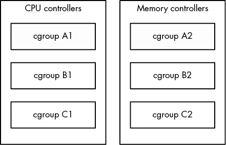

*图 8-1：cgroups v1。一个进程可以在每种控制器下属于一个 cgroup。*

[图 8-2](#figure8-2) 展示了使用 cgroups v2 实现相同目标的方法。由于每个 cgroup 可以配置多个控制器，所以只需要三个 cgroup。

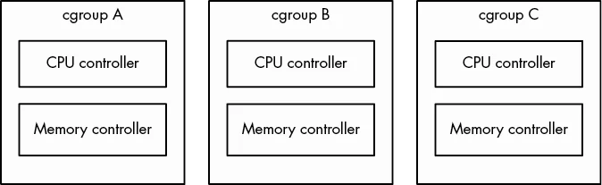

*图 8-2：cgroups v2。一个进程只能属于一个 cgroup。*

要列出任意进程所属的 v1 和 v2 cgroup，可以查看 */proc/<pid>* 目录中的 *cgroup* 文件。首先，可以通过以下命令查看当前 shell 所属的 cgroup：

```bash
$ cat /proc/self/cgroup
12:rdma:/
11:net_cls,net_prio:/
10:perf_event:/
9:cpuset:/
8:cpu,cpuacct:/user.slice
7:blkio:/user.slice
6:memory:/user.slice
5:pids:/user.slice/user-1000.slice/session-2.scope
4:devices:/user.slice
3:freezer:/
2:hugetlb:/testcgroup 1
1:name=systemd:/user.slice/user-1000.slice/session-2.scope
0::/user.slice/user-1000.slice/session-2.scope
```

如果你系统上的输出短得多，也不必惊讶；这很可能只是因为系统仅使用 cgroups v2。这里的每一行都以一个数字开头，代表一个不同的 cgroup。阅读输出时，可以注意以下几点：

- 编号 2–12 对应 cgroups v1。相应的控制器列在编号之后。
- 编号 1 也属于 v1，但没有控制器。这个 cgroup 仅用于管理（本例中由 systemd 配置）。
- 最后一行的编号 0 对应 cgroups v2。这里看不到控制器。如果系统不使用 cgroups v1，那么输出就只有这一行。
- 名称具有层次结构，看起来像文件路径的一部分。在这个例子中，一些 cgroup 名为 */user.slice*，另一些则名为 */user.slice/user-1000.slice/session-2.scope*。
- 名称 */testcgroup* 1 是特意创建的，用来说明在 cgroups v1 中，一个进程所属的不同 cgroup 可以彼此完全独立。
- *user.slice* 下名称包含 *session* 的 cgroup 表示登录会话，由 systemd 分配。查看 shell 所属的 cgroup 时，你会看到它们；系统服务对应的 cgroup 则位于 *system.slice* 下。

你可能已经推测出：在某个方面，cgroups v1 比 v2 更灵活，因为可以给进程分配不同的 cgroup 组合。然而，实际上几乎没有人这样使用它，而且与每个进程只归属一个 cgroup 的方式相比，这种设计的配置和实现都更复杂。

由于 cgroups v1 正在逐步退出使用，接下来的讨论将集中于 cgroups v2。需要注意的是，如果某个控制器已被 cgroups v1 使用，那么为了避免潜在冲突，它就不能同时用于 v2。这意味着，如果你的系统仍在使用 v1，接下来涉及特定控制器的操作可能无法正常工作。不过，只要找到 v1 中相应的位置，你仍然应该能够跟随后面的讲解进行操作。


#### 8.6.2 查看 cgroups

与通过传统 Unix 系统调用接口同内核交互的方式不同，cgroups 完全通过文件系统访问。这个文件系统通常以 cgroup2 类型挂载在 */sys/fs/cgroup* 下。（如果同时运行 cgroups v1，它可能位于 */sys/fs/cgroup/unified* 下。）

我们来探索一个 shell 的 cgroup 配置。打开 shell，从 */proc/self/cgroup* 中找到它所属的 cgroup（前面已经演示过）。然后查看 */sys/fs/cgroup*（或 */sys/fs/cgroup/unified*）。你会找到一个与该 cgroup 同名的目录；切换到这个目录，看看里面有什么：

```bash
$ cat /proc/self/cgroup
0::/user.slice/user-1000.slice/session-2.scope
$ cd /sys/fs/cgroup/user.slice/user-1000.slice/session-2.scope/
$ ls
```

> 某些桌面环境喜欢为每个新启动的应用程序创建一个新的 cgroup，因此 cgroup 的名称可能相当长。

这里可能有许多文件，其中主要的 cgroup 接口文件以 *cgroup* 开头。先查看 *cgroup.procs*（使用 `cat` 即可），它列出了该 cgroup 中的进程。类似的文件 *cgroup.threads* 还包含线程。

要查看当前可供该 cgroup 使用的控制器，可以检查 *cgroup.controllers*：

```bash
$ cat cgroup.controllers
memory pids
```

大多数用于 shell 的 cgroup 都有这两个控制器，分别可以控制内存使用量和 cgroup 中的进程总数。要与某个控制器交互，就查找以该控制器名称为前缀的文件。例如，如果想知道这个 cgroup 中正在运行多少个线程，可以查看 *pids.current*：

```bash
$ cat pids.current
4
```

要查看这个 cgroup 最多能够使用多少内存，可以检查 *memory.max*：

```bash
$ cat memory.max
max
```

值为 `max` 表示这个 cgroup 本身没有特定的限制。不过，由于 cgroups 具有层次结构，沿目录层次向上追溯时，某个祖先 cgroup 仍可能对它施加限制。

#### 8.6.3 操作和创建 cgroups

虽然你可能永远不需要修改 cgroups，但操作起来并不困难。要将一个进程放入某个 cgroup，以 root 身份把它的 PID 写入该 cgroup 的 *cgroup.procs* 文件即可：

```bash
# echo pid > cgroup.procs
```

许多 cgroup 配置更改都采用这种方式。例如，要将一个 cgroup 中允许的 PID 最大数量限制为 3,000，可以这样做：

```bash
# echo 3000 > pids.max
```

创建 cgroups 则要复杂一些。从技术上说，只需在 cgroup 目录树的某个位置创建子目录；这样做时，内核会自动创建接口文件。如果一个 cgroup 中没有进程，即使接口文件仍然存在，也可以用 `rmdir` 删除这个 cgroup。真正容易让人困惑的是管理 cgroups 的规则，其中包括：

- 只能将进程放入最外层（即“叶子”）cgroup。例如，如果存在名为 */my-cgroup* 和 */my-cgroup/my-subgroup* 的两个 cgroup，就不能将进程放入 */my-cgroup*，但可以放入 */my-cgroup/my-subgroup*。（如果 cgroup 没有控制器，则存在例外；这里不再深入讨论。）
- 一个 cgroup 不能拥有其父 cgroup 中不存在的控制器。
- 必须明确指定子 cgroup 可以使用的控制器。可以通过 *cgroup.subtree\_control* 文件来完成。例如，如果希望子 cgroup 拥有 `cpu` 和 `pids` 控制器，就向该文件写入 `+cpu +pids`。

这些规则有一个例外：位于层次结构底部的根 cgroup。你可以将进程放入这个 cgroup。这样做的一个原因，是让某个进程脱离 systemd 的控制。

#### 8.6.4 查看资源使用情况

除了可以通过 cgroup 限制资源，还可以查看各个 cgroup 中所有进程当前的资源使用情况。即使没有启用任何控制器，也可以通过 *cpu.stat* 文件查看一个 cgroup 的 CPU 使用情况：

```bash
$ cat cpu.stat
usage_usec 4617481
user_usec 2170266
system_usec 2447215
```

这些数字是 cgroup 从创建以来累计的 CPU 使用量。因此，即使一个服务启动了许多子进程，而这些子进程最终都已退出，你仍然可以了解该服务消耗了多少处理器时间。

启用相应的控制器后，还能查看其他类型的资源使用情况。例如，`memory` 控制器提供 *memory.current* 文件，用于查看当前内存使用量；还提供 *memory.stat* 文件，其中包含该 cgroup 整个生命周期内的详细内存数据。这些文件在根 cgroup 中不可用。

cgroups 还有许多其他用途。关于每个控制器的具体用法，以及创建 cgroups 的全部规则，都可以在内核文档中找到；只需在线搜索“cgroups2 documentation”即可。

不过，到这里，你应该已经对 cgroups 的工作方式有了相当清楚的认识。理解其基本运作方式，有助于解释 systemd 如何组织进程。稍后读到容器时，你还会看到 cgroups 如何被用于截然不同的目的。

### 8.7 延伸话题

之所以有如此多的工具用于测量和管理资源使用情况，一个原因是不同类型的资源会以许多不同的方式被消耗。本章介绍了 CPU、内存和 I/O 等系统资源，以及进程、进程中的线程和内核如何使用这些资源。

这些工具存在的另一个原因是资源本身是**有限的**。为了让系统保持良好的性能，各个组成部分必须尽可能减少资源消耗。过去，一台机器通常由许多用户共享，因此需要确保每位用户都能公平地获得资源。如今，现代桌面计算机虽然不一定有多个用户，却仍有许多进程在争夺资源。同样，高性能网络服务器需要密切监控系统资源，因为它们要运行大量进程，同时处理多个请求。

关于资源监控和性能分析，你还可以进一步了解以下主题：

1. **`sar`（System Activity Reporter，系统活动报告工具）**：`sar` 软件包具有许多与 `vmstat` 类似的持续监控功能，但它还会随时间记录资源使用情况。借助 `sar`，你可以回头查看某个特定时刻系统正在做什么。这对分析过去发生的系统事件很有帮助。
2. **`acct`（process accounting，进程记账）**：`acct` 软件包可以记录进程及其资源使用情况。
3. **配额（Quotas）**：可以使用 `quota` 系统限制用户能够使用的磁盘空间。

如果你对系统调优和性能尤其感兴趣，可以阅读 Brendan Gregg 所著的 *Systems Performance: Enterprise and the Cloud*（《系统性能：企业与云》，第 2 版，Addison-Wesley，2020 年），其中有更详细的介绍。

我们也还没有涉及用于监控网络资源使用情况的众多工具。不过，要使用这些工具，首先需要理解网络的工作原理。这正是下一章的主题。

---


## 第 9 章：理解网络及其配置

网络就是将计算机连接起来，并在它们之间传送数据。听起来很简单，但要理解网络如何工作，需要先回答两个基本问题：

- 发送数据的计算机如何知道应该将数据发送到**哪里**？
- 目标计算机收到数据后，如何知道自己收到的究竟是**什么**？

计算机通过一系列组件回答这些问题。每个组件分别负责数据发送、接收和识别的某个方面。这些组件被组织成不同的组，形成相互叠加的**网络层（network layers）**，共同构成一个完整的系统。Linux 内核处理网络的方式，与第 3 章介绍的 SCSI 子系统有相似之处。

由于各层往往相互独立，因此可以采用许多不同的组件组合来构建网络。这也正是网络配置可能变得非常复杂的原因。因此，本章将从非常简单的网络入手，了解各个网络层。你将学习如何查看自己的网络设置；理解各层的基本工作方式后，就能够着手自行配置这些层。最后，我们还会讨论一些更高级的主题，例如搭建自己的网络和配置防火墙。（如果这些内容让你看得头昏眼花，可以先跳过去，以后再回来阅读。）

### 9.1 网络基础

在深入讨论网络层理论之前，先看看[图 9-1](#figure9-1) 所示的简单网络。

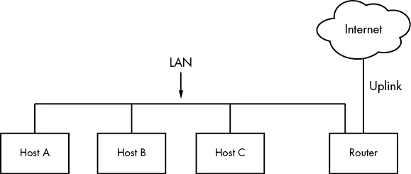

*图 9-1：通过路由器访问互联网的典型局域网*

这种网络随处可见；大多数家庭和小型办公室网络都采用类似的配置。连接到网络的每台计算机称为**主机（host）**。其中一台是**路由器（router）**，它是一种能够将数据从一个网络转发到另一个网络的主机。在这个例子中，四台主机（主机 A、B、C 和路由器）组成一个**局域网（local area network，LAN）**。局域网中的连接既可以是有线的，也可以是无线的。局域网并没有严格的定义；同一局域网中的计算机通常在物理位置上比较接近，并且共享许多配置和访问权限。稍后你会看到一个具体示例。

路由器还连接到互联网，即图中的云状部分。这条连接称为**上行链路（uplink）**或**广域网（wide area network，WAN）连接**，因为它将规模较小的局域网连接到更大的网络。由于路由器同时连接局域网和互联网，局域网中的所有计算机都可以通过路由器访问互联网。本章的目标之一，就是理解路由器如何提供这种访问能力。

我们首先站在局域网中一台运行 Linux 的计算机（例如[图 9-1](#figure9-1) 中的主机 A）的角度观察网络。

### 9.2 数据包

计算机通过网络传送数据时，会将数据分成称为**数据包（packet）**的小块。数据包由两部分组成：**首部（header）**和**载荷（payload）**。首部包含识别信息，例如源主机、目标主机和基本协议；载荷则是计算机实际想要发送的应用程序数据，例如 HTML 或图像数据。

主机可以按任意顺序发送、接收和处理数据包，而不受数据包来源或目的地的限制。这使多台主机能够“同时”通信。例如，一台主机需要同时向另外两台主机传送数据时，可以在发出的数据包之间交替切换目标。将消息拆分成较小的单位，也更容易检测和弥补传输过程中的错误。

在大多数情况下，你不需要关心数据包与应用程序所使用的数据之间如何转换，因为操作系统会替你完成这项工作。不过，理解数据包在接下来介绍的网络层中所扮演的角色仍然很有帮助。

### 9.3 网络层

一个功能完整的网络包含一组网络层，称为**网络协议栈（network stack）**。任何能够正常工作的网络都有自己的协议栈。典型的互联网协议栈从上到下如下所示：

1. **应用层（application layer）**：包含应用程序与服务器通信所使用的“语言”，通常是某种高级协议。常见的应用层协议包括超文本传输协议（HTTP，用于 Web）、TLS 等加密协议，以及文件传输协议（FTP）。应用层协议通常可以组合使用。例如，TLS 经常与 HTTP 结合形成 HTTPS。
2. 应用层的处理发生在**用户空间**。
3. **传输层（transport layer）**：定义应用层数据的传输特征，包括数据完整性检查、源端口和目标端口，以及如何在发送端将应用数据拆分成数据包（如果应用层尚未完成拆分）、如何在接收端重新组装。传输控制协议（TCP）和用户数据报协议（UDP）是最常见的传输层协议。传输层有时也称为**协议层（protocol layer）**。
4. 在 Linux 中，传输层及其以下各层主要由内核处理，但也存在例外：某些数据包会被送入用户空间进行处理。
5. **网络层或互联网层（network or internet layer）**：定义如何将数据包从源主机送往目标主机。互联网使用的具体数据包传送规则称为**互联网协议（internet protocol，IP）**。由于本书只讨论互联网网络，后面主要使用“互联网层”这一名称。不过，网络层在设计上应当独立于硬件，因此你可以在同一台主机上同时配置多个彼此独立的网络层协议，例如 IP（IPv4）、IPv6、IPX 和 AppleTalk。
6. **物理层（physical layer）**：定义如何通过以太网或调制解调器等物理媒介发送原始数据。它有时也称为**链路层（link layer）**或**主机到网络层（host-to-network layer）**。

理解网络协议栈的结构很重要，因为数据到达目标程序之前，至少要经过这些层两次。例如，按照[图 9-1](#figure9-1)，如果你要从主机 A 向主机 B 发送数据，数据字节会从主机 A 的应用层出发，经过主机 A 的传输层和网络层，再向下进入物理媒介；穿过媒介之后，数据又会沿着主机 B 的各个较低层向上移动，最终到达应用层。如果通过路由器向互联网上的主机发送数据，数据还会经过路由器及沿途其他设备的部分网络层（通常不是全部层）。

有时，不同网络层之间的界限会以一些奇怪的方式变得模糊，因为严格按顺序处理所有层可能效率不高。例如，过去只处理物理层的设备，如今有时也会同时查看传输层和互联网层的数据，以便快速过滤和转发数据。此外，术语本身也可能令人困惑。例如，TLS 的全称是 *Transport Layer Security*（传输层安全），但实际上它位于更高一层，即应用层。（刚开始学习基础知识时，不必为这些烦人的细节担心。）

接下来，我们先研究 Linux 计算机如何连接到网络，以回答本章开头提出的“**发送到哪里**”的问题。这涉及协议栈的下半部分，即物理层和网络层。之后，我们再研究回答“**收到什么**”这一问题的上面两层。

> 你可能听说过另一套网络分层体系，称为**开放系统互连参考模型（Open Systems Interconnection Reference Model，OSI）**。这是一个七层网络模型，常用于网络教学和设计。不过，本书不会介绍 OSI 模型，因为你将直接使用这里描述的四层结构。如果想深入了解网络层（以及网络的其他方面），可以阅读 Andrew S. Tanenbaum 和 David J. Wetherall 合著的 *Computer Networks*，第 5 版（Prentice Hall，2010）。


### 9.4 互联网层

我们不从网络协议栈最底部的物理层开始，而是先讨论网络层，因为它更容易理解。我们今天所熟悉的互联网建立在互联网协议第 4 版（IPv4）和第 6 版（IPv6）之上。互联网层最重要的特点之一，是它被设计成一个软件网络，不对硬件或操作系统提出特定要求。也就是说，无论使用哪种硬件和操作系统，都应该能够发送和接收互联网数据包。

我们先讨论 IPv4，因为它的地址更容易阅读，也更容易理解其局限性；随后会说明 IPv6 的主要区别。

互联网采用去中心化的拓扑结构，由称为*子网*（subnet）的较小网络组成。其基本思想是，所有子网都以某种方式相互连接。例如，在[图 9-1](#figure9-1) 中，局域网通常就是一个子网。

一台主机可以同时连接多个子网。正如 9.1 节所述，如果这样的主机能够在子网之间转发数据，就称为*路由器*（router）；路由器也称为*网关*（gateway）。[图 9-2](#figure9-2) 在[图 9-1](#figure9-1) 的基础上，标明局域网是一个子网，并为每台主机和路由器标注互联网地址。图中的路由器有两个地址：本地子网中的 10.23.2.1，以及连接互联网的上行链路地址（目前这个地址并不重要，因此仅标为 Uplink Address）。我们先介绍地址，再介绍子网表示法。

每台互联网主机至少有一个数字形式的 *IP 地址*。IPv4 地址采用 *a.b.c.d* 的形式，例如 10.23.2.37。这种写法称为*点分四组表示法*（dotted-quad）。如果主机连接多个子网，那么它在每个子网上至少有一个 IP 地址。原则上，每台主机的 IP 地址应当在整个互联网中唯一；不过，稍后介绍的私有网络和网络地址转换（NAT）会让这个问题稍显复杂。

暂时不必关心[图 9-2](#figure9-2) 中的子网表示法，我们很快就会讨论。

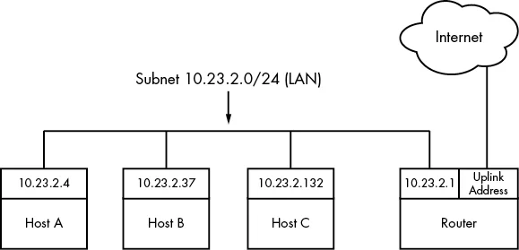

*图 9-2：带有 IP 地址的网络*

> 从技术上说，一个 IPv4 地址由 4 个字节（即 32 位）组成，记作 *abcd*。字节 *a* 和 *d* 的数值为 1 到 254，*b* 和 *c* 的数值为 0 到 255。计算机将 IP 地址作为原始字节处理，但对人而言，10.23.2.37 这样的点分四组地址，显然比十六进制的 0x0A170225 更容易读写。

IP 地址在某些方面类似邮政地址。要与另一台主机通信，你的计算机必须知道对方的 IP 地址。

下面来查看你自己计算机上的地址。

#### 9.4.1 查看 IP 地址

一台计算机可以拥有多个 IP 地址，以支持多个物理接口、内部虚拟网络等。要查看 Linux 计算机上当前启用的地址，请运行：

```bash
$ ip address show
```

输出可能很长（按物理接口分组，我们将在 9.10 节介绍），但其中应该包含类似以下的内容：

```
2: enp0s31f6: <BROADCAST,MULTICAST,UP,LOWER_UP> mtu 1500 qdisc fq_codel state UP group default qlen 1000
    link/ether 40:8d:5c:fc:24:1f brd ff:ff:ff:ff:ff:ff
    inet 10.23.2.4/24 brd 10.23.2.255 scope global noprefixroute enp0s31f6
       valid_lft forever preferred_lft forever
```

`ip` 命令的输出包含互联网层和物理层的许多细节。（有时甚至完全没有互联网地址！）我们稍后会更详细地解释这些输出。现在先关注第四行：它表明这台主机配置了 IPv4 地址 10.23.2.4（以 `inet` 标识）。地址后面的 `/24` 用来帮助确定该地址所属的子网。下面看看它是如何工作的。

> `ip` 是目前标准的网络配置工具。在其他文档中，你可能会看到 `ifconfig` 命令。这个较旧的命令已经在其他 Unix 系统中使用了几十年，但功能较为有限。为了遵循现代推荐做法，也考虑到某些发行版默认甚至不安装 `ifconfig`，本书统一使用 `ip`。`ip` 还取代了 `route` 和 `arp` 等工具的部分用途。

#### 9.4.2 子网

如前所述，子网是由某个特定 IP 地址范围内、彼此连接的主机组成的集合。例如，地址从 10.23.2.1 到 10.23.2.254 的主机可以构成一个子网；地址从 10.23.1.1 到 10.23.255.254 的主机也可以构成一个子网。通常，子网内的主机处于同一个物理网络中，如[图 9-2](#figure9-2) 所示。

定义子网需要两部分：*网络前缀*（network prefix，也称路由前缀）和*子网掩码*（subnet mask，有时也称网络掩码或路由掩码）。假设你想创建一个包含 10.23.2.1 到 10.23.2.254 的子网。网络前缀是该子网内所有地址*共同拥有*的部分；在这个例子中，网络前缀是 10.23.2.0，子网掩码是 255.255.255.0。下面看看这些数字从何而来。

为了理解前缀和掩码如何共同确定子网中所有可能的 IP 地址，我们来看二进制形式。掩码标记 IP 地址中属于子网公共部分的位。例如，10.23.2.0 和 255.255.255.0 的二进制表示如下：

```
10.23.2.0:        00001010 00010111 00000010 00000000
255.255.255.0:    11111111 11111111 11111111 00000000
```

现在，我们把 10.23.2.0 中对应掩码值为 1 的位标为粗体（以下代码块保留原书展示的位序列）：

```
10.23.2.0:        00001010 00010111 00000010 00000000
```

任何地址只要在这些被标记的位置上具有相同的位组合，就属于这个子网。至于未被标记的位（最后八个 0），可以将其中任意数量的位设为 1，从而得到子网内的有效 IP 地址，但全为 0 或全为 1 的情况除外。

综合起来便可以看出：IP 地址为 10.23.2.1、子网掩码为 255.255.255.0 的主机，与其他任何 IP 地址以 10.23.2 开头的计算机都位于同一个子网。整个子网可以表示为 10.23.2.0/255.255.255.0。

下面看看如何将它缩写为 `/24` 这样的形式，也就是你在 `ip` 等工具中看到的表示法。

#### 9.4.3 常见子网掩码与 CIDR 表示法

在大多数互联网工具中，你会遇到另一种子网表示方式，称为*无类别域间路由*（Classless Inter-Domain Routing，CIDR）表示法。例如，子网 10.23.2.0/255.255.255.0 可以写成 10.23.2.0/24。这种简写利用了子网掩码遵循的简单规律。

回顾上一节的二进制掩码，你会发现所有子网掩码（按照 RFC 1812 的规定，至少应当如此）都是先由一串连续的 1 组成，再接一串连续的 0。例如，255.255.255.0 的二进制形式包含 24 个连续的 1，后面跟着 8 个 0。CIDR 表示法使用子网掩码*开头连续的 1 的数量*来标识掩码。因此，10.23.2.0/24 同时包含了网络前缀和子网掩码的信息。

[表 9-1](#table9-1) 列出了一些子网掩码及其 CIDR 形式。`/24` 是终端用户局域网中最常见的子网掩码，经常与 9.22 节介绍的私有网络配合使用。

**表 9-1：子网掩码**

| 完整形式 | CIDR 形式 |
| --- | --- |
| 255.0.0.0 | /8 |
| 255.255.0.0 | /16 |
| 255.240.0.0 | /12 |
| 255.255.255.0 | /24 |
| 255.255.255.192 | /26 |

> 如果你不熟悉十进制、二进制和十六进制之间的转换，可以使用 `bc` 或 `dc` 等计算工具进行进制转换。例如，在 `bc` 中执行 `obase=2; 240`，就会以二进制（基数为 2）输出数字 240。

再进一步，你可能已经注意到：只要知道 IP 地址和子网掩码，就不必再单独定义网络。你可以将两者组合起来，正如 9.4.1 节中看到的那样：`ip address show` 的输出包含 10.23.2.4/24。

识别子网及其主机，是理解互联网工作方式的第一块基石。不过，你仍然需要把各个子网连接起来。


### 9.5 路由与内核路由表

连接互联网中的各个子网，主要依靠将数据经由同时连接多个子网的主机转发。回到[图 9-2](#figure9-2)，考虑 IP 地址为 10.23.2.4 的主机 A。这台主机连接到本地网络 10.23.2.0/24，可以直接访问该网络中的其他主机。若要访问互联网其余部分的主机，它就必须通过地址为 10.23.2.1 的路由器（主机）进行通信。

Linux 内核使用*路由表*（routing table）区分这两类目的地，并据此决定如何路由。要显示路由表，可使用 `ip route show` 命令。对于 10.23.2.4 这样的简单主机，你可能看到以下内容：

```bash
$ ip route show
default via 10.23.2.1 dev enp0s31f6 proto static metric 100
10.23.2.0/24 dev enp0s31f6 proto kernel scope link src 10.23.2.4 metric 100
```

> 
>
> 传统的路由查看工具是 `route` 命令，通常以 `route -n` 方式运行。`-n` 选项告诉 `route` 显示 IP 地址，而不是尝试用名称显示主机和网络。这个选项值得记住，因为它也适用于其他与网络有关的命令，例如 `netstat`。

这些输出一开始可能不太容易理解。每一行都是一条路由规则。我们先看示例中的第二行，将其拆分为各个字段。

首先看到的字段是 `10.23.2.0/24`，它表示目标网络。与前面的例子一样，这就是该主机所在的本地子网。这条规则说明，主机可以直接通过网络接口访问本地子网；目标地址后面的 `dev enp0s31f6` 指明了所使用的接口。（后面还有一些路由的详细信息，包括这条路由是如何建立的；目前不必关心。）

接着回到输出的第一行，其目标网络是 `default`。这条规则能够匹配任何主机，也称为*默认路由*（default route），下一节会详细介绍。其转发方式由 `via 10.23.2.1` 指定，表示使用默认路由的流量应发送到 10.23.2.1（在示例网络中，这是一台路由器）；`dev enp0s31f6` 则表示实际的数据传输会通过该网络接口进行。

### 9.6 默认网关

路由表中的 `default` 条目具有特殊意义，因为它可以匹配互联网上的任何地址。在 IPv4 的 CIDR 表示法中，它写作 `0.0.0.0/0`。这就是默认路由，而默认路由中配置的中转地址称为*默认网关*（default gateway）。当其他规则都无法匹配时，默认路由总能匹配；没有其他可选路径时，消息就会发送到默认网关。你可以在不配置默认网关的情况下使用主机，但它将无法访问路由表所列目标范围以外的主机。

在大多数子网掩码为 /24（255.255.255.0）的网络中，路由器通常使用子网中主机地址为 1 的地址（例如 10.23.2.0/24 网络中的 10.23.2.1）。这只是一种约定，也存在例外。

> **补充说明：内核如何选择路由**
>
> 路由有一个稍微复杂的细节。假设主机要向 10.23.2.132 发送数据，而这个地址同时匹配路由表中的默认路由和 10.23.2.0/24 这两条规则。内核如何知道应该使用第二条？路由规则在表中的排列顺序并不重要；内核会选择匹配的目标前缀中最长的那个。这也是 CIDR 表示法特别有用的地方：10.23.2.0/24 能够匹配，且前缀长度为 24 位；0.0.0.0/0 也能够匹配，但前缀长度为 0 位（即没有前缀），因此 10.23.2.0/24 的规则优先。

### 9.7 IPv6 地址与网络

回顾 9.4 节，你会发现 IPv4 地址由 32 位，也就是 4 字节组成。这意味着地址总数大约为 43 亿，已经不足以满足当今互联网的规模。IPv4 地址不足造成了若干问题，因此互联网工程任务组（Internet Engineering Task Force，IETF）开发了下一版本 IPv6。介绍更多网络工具之前，我们先讨论 IPv6 的地址空间。

IPv6 地址有 128 位——原文此处写作 32 字节——分为八组，每组 4 字节。一个地址的完整写法如下：

```
2001:0db8:0a0b:12f0:0000:0000:0000:8b6e
```

地址采用十六进制表示，每个数字的取值范围为 0 到 f。有几种常用的缩写方法。首先，可以省略每一组开头的零（例如，将 0db8 写成 db8）；其次，可以将一段连续的全零组替换为 `::`（两个冒号），但一个地址中只能这样替换一次。因此，上面的地址可以写成：

```
2001:db8:a0b:12f0::8b6e
```

子网仍然使用 CIDR 表示法。对于终端用户，子网通常占据地址空间中可用位数的一半（/64），不过也存在使用更少位数的情况。地址中每台主机特有的部分称为*接口标识符*（interface ID）。[图 9-3](#figure9-3) 展示了一个采用 64 位子网前缀的示例地址的结构。

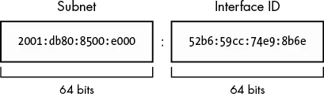

*图 9-3：典型 IPv6 地址中的子网与接口标识符*

> 
>
> 本书主要从普通用户的角度讨论网络。对于服务提供商来说，情况稍有不同：子网还会进一步划分为路由前缀和另一个网络 ID（有时也称为子网）。目前不必关心这些细节。

关于 IPv6，目前最后需要知道的一点是：主机通常至少有两个地址。第一个地址可在整个互联网上使用，称为*全球单播地址*（global unicast address）。第二个地址用于本地网络，称为*链路本地地址*（link-local address）。链路本地地址始终具有 `fe80::/10` 前缀，后面接着一个全零的 54 位网络 ID，最后是一个 64 位的接口标识符。因此，当你在系统上看到链路本地地址时，它将属于 `fe80::/64` 子网。

> 
>
> 全球单播地址使用 `2000::/3` 前缀。由于此前缀的第一个字节以二进制 `001` 开头，这个字节可以继续形成 `0010` 或 `0011`。因此，全球单播地址总是以 2 或 3 开头。


#### 9.7.1 查看系统上的 IPv6 配置

如果系统已经配置了 IPv6，那么你先前运行 `ip` 命令时，应该已经看到了一些 IPv6 信息。要只显示 IPv6 信息，可以使用 `-6` 选项：

```bash
$ ip -6 address show
1: lo: <LOOPBACK,UP,LOWER_UP> mtu 65536 state UNKNOWN qlen 1000
    inet6 ::1/128 scope host
       valid_lft forever preferred_lft forever
2: enp0s31f6: <BROADCAST,MULTICAST,UP,LOWER_UP> mtu 1500 state UP qlen 1000
    inet6 2001:db8:8500:e:52b6:59cc:74e9:8b6e/64 scope global dynamic noprefixroute
       valid_lft 86136sec preferred_lft 86136sec
    inet6 fe80::d05c:97f9:7be8:bca/64 scope link noprefixroute
       valid_lft forever preferred_lft forever
```

除了回环接口（稍后会讨论）之外，还可以看到另外两个地址。全局单播地址标有 `scope global`，而链路本地地址标有 `scope link`。

查看路由的方法类似：

```bash
$ ip -6 route show
::1 dev lo proto kernel metric 256 pref medium
1 2001:db8:8500:e::/64 dev enp0s31f6 proto ra metric 100 pref medium
2 fe80::/64 dev enp0s31f6 proto kernel metric 100 pref medium
3 default via fe80::800d:7bff:feb8:14a0 dev enp0s31f6 proto ra metric 100 pref medium
```

这比 IPv4 配置稍微复杂一些，因为同时配置了链路本地子网和全局子网。第二行（标记 1）对应本地直连的全局单播地址子网中的目的地址；主机知道可以直接到达这些地址。下一行链路本地路由（标记 2）的作用类似。对于默认路由（标记 3，在 IPv6 中也可以写成 `::/0`；记住，它匹配所有非直连目的地），此配置让流量经过链路本地地址为 `fe80::800d:7bff:feb8:14a0` 的路由器，而不是使用该路由器在全局子网上的地址。后面你会看到，路由器通常并不关心流量是怎样到达自己的，而只关心流量应该发往哪里。把链路本地地址用作默认网关有一个好处：即使全局 IP 地址空间发生变化，也不必修改网关地址。

#### 9.7.2 配置双栈网络

你可能已经猜到了，主机和网络可以同时运行 IPv4 和 IPv6。这有时称为*双栈网络*（dual-stack network），不过这里使用“栈”这个词并不十分严谨，因为通常的网络协议栈实际上只有一层被重复了（真正的双栈更像是 IP 与 IPX 并存）。抛开术语上的争论，IPv4 和 IPv6 是相互独立的协议，可以同时运行。在这样的主机上，由应用程序（例如 Web 浏览器）决定使用 IPv4 还是 IPv6 连接另一台主机。

最初只为 IPv4 编写的应用程序并不会自动获得 IPv6 支持。幸运的是，由于网络层之上的协议栈各层并没有改变，因此添加 IPv6 通信能力所需的代码很少，也比较容易实现。如今大多数重要应用程序和服务器都支持 IPv6。

### 9.8 基本的 ICMP 和 DNS 工具

现在来看看一些与其他主机交互时常用的实用工具。这些工具涉及两种值得特别关注的协议：互联网控制消息协议（Internet Control Message Protocol，ICMP），它可以帮助你排查连接和路由问题；以及域名系统（Domain Name Service，DNS），它把名称映射到 IP 地址，让你不必记住一大串数字。

ICMP 是一种用于配置和诊断互联网网络的传输层协议。它与其他传输层协议不同，不承载真正的用户数据，因此其上方没有应用层。相比之下，DNS 是一种应用层协议，用于将人类可读的名称映射到互联网地址。

#### 9.8.1 ping

`ping`（参见 <https://ftp.arl.army.mil/~mike/ping.html>）是最基本的网络调试工具之一。它向目标主机发送 ICMP 回显请求数据包，要求接收主机把响应发回发送方。如果目标主机收到了数据包，而且配置为允许回复，就会返回一个 ICMP 回显应答数据包。

例如，运行 `ping 10.23.2.1` 后，可能看到以下输出：

```bash
$ ping 10.23.2.1
PING 10.23.2.1 (10.23.2.1) 56(84) bytes of data.
64 bytes from 10.23.2.1: icmp_req=1 ttl=64 time=1.76 ms
64 bytes from 10.23.2.1: icmp_req=2 ttl=64 time=2.35 ms
64 bytes from 10.23.2.1: icmp_req=4 ttl=64 time=1.69 ms
64 bytes from 10.23.2.1: icmp_req=5 ttl=64 time=1.61 ms
```

第一行说明你正在向 `10.23.2.1` 发送 56 字节的数据包（算上首部则为 84 字节），默认每秒发送一个。其余各行表示来自 `10.23.2.1` 的响应。输出中最重要的部分是序列号（`icmp_req`）和往返时间（`time`）。返回的字节数是发送的数据包大小加上 8。（数据包的具体内容对这里的分析并不重要。）

序列号出现缺口，例如上例中从 2 跳到 4，通常意味着存在某种连接问题。由于 `ping` 每秒只发送一个数据包，因此正常情况下不应出现数据包乱序到达。如果某个响应需要超过一秒（1,000 毫秒）才能到达，说明连接极其缓慢。

往返时间是从请求数据包发出到收到响应数据包之间经过的总时间。如果无法到达目的地，最后一个收到该数据包的路由器会向 `ping` 返回一条 ICMP“主机不可达”消息。

在有线局域网中，你应该期望完全没有丢包，而且往返时间非常短。（前面的示例输出来自无线网络。）在你的网络与互联网服务提供商（ISP）之间，也应当基本没有丢包，且往返时间相对稳定。

> 出于安全考虑，互联网上有些主机会禁用对 ICMP 回显请求的响应。因此，你可能可以访问某台主机上的网站，却无法从该主机获得 `ping` 响应。

可以分别使用 `-4` 和 `-6` 选项，强制 `ping` 使用 IPv4 或 IPv6。

#### 9.8.2 DNS 与 host

IP 地址难以记忆，而且可能发生变化，因此我们通常使用 *www.example.com* 这样的名称。系统上的域名系统（DNS）库一般会自动完成名称到地址的转换，但有时你需要手动在名称与 IP 地址之间进行查询。要查找域名对应的 IP 地址，可以使用 `host` 命令：

```bash
$ host www.example.com
example.com has address 172.17.216.34
example.com has IPv6 address 2001:db8:220:1:248:1893:25c8:1946
```

注意，这个例子同时列出了 IPv4 地址 `172.17.216.34` 和长得多的 IPv6 地址。一个主机名可能对应多个地址，输出中还可能包含邮件交换服务器等其他信息。

你也可以反过来使用 `host`：输入 IP 地址而不是主机名，尝试查找与该地址对应的主机名。不过，不要指望反向查询总是可靠。一个 IP 地址可能关联多个主机名，而 DNS 并不知道应该把其中哪个主机名认定为该 IP 地址的对应名称。此外，主机管理员必须手动设置反向查询，而管理员经常不会这样做。

DNS 涉及的内容远不止 `host` 命令。我们将在 9.15 节介绍客户端的基本配置。

`host` 也有 `-4` 和 `-6` 选项，但它们的作用可能与你想象的不同。这两个选项强制 `host` 分别通过 IPv4 或 IPv6 获取信息；由于查询得到的信息原则上不应因网络协议不同而改变，因此输出仍然可能同时包含 IPv4 和 IPv6 地址。


### 9.9 物理层与以太网

理解互联网时，一个关键点是：互联网是一种*软件*网络。到目前为止，我们讨论的内容都不依赖于特定硬件。事实上，互联网之所以成功，原因之一就是它几乎能够运行在任何类型的计算机、操作系统和物理网络之上。不过，如果你确实想与另一台计算机通信，仍然必须将网络层建立在某种硬件之上。连接网络层与硬件的这一层，就是物理层。

本书将考察最常见的一种物理层：以太网。IEEE 802 系列标准文档定义了多种以太网，从有线网络到无线网络都有，但它们具有一些共同特征：

- 以太网上的所有设备都有一个*媒体访问控制地址（Media Access Control address，MAC 地址）*，有时也称为*硬件地址*。这个地址与主机的 IP 地址相互独立，并且在主机所在的以太网中是唯一的（但在互联网这样的更大范围的软件网络中，不一定唯一）。MAC 地址的一个例子是 `10:78:d2:eb:76:97`。
- 以太网上的设备以*帧（frame）*为单位发送消息。帧相当于包裹待传输数据的封装结构，其中包含源 MAC 地址和目标 MAC 地址。

以太网本身并不真正尝试超越单个网络中的硬件范围。例如，假设有两个不同的以太网，而一台主机通过两个不同的网络接口设备同时连接到这两个网络。除非设置以太网网桥，否则你无法直接把一个以太网中的帧传送到另一个以太网。这正是更高层的网络层（例如互联网层）发挥作用的地方。按照惯例，每个以太网通常也是一个互联网子网。虽然帧不能离开其所在的物理网络，但路由器可以从帧中取出数据，重新封装，再发送到另一个物理网络中的主机。互联网中的数据传输正是这样进行的。

### 9.10 理解内核网络接口

物理层和互联网层必须连接起来，同时还要让互联网层保持不依赖具体硬件的灵活性。Linux 内核在这两层之间维持着明确的划分，并提供一种连接两者的通信标准，称为*（内核）网络接口（network interface）*。配置网络接口时，你会把互联网层一侧的 IP 地址设置与物理设备一侧的硬件标识关联起来。网络接口的名称通常反映底层硬件的类型，例如 *enp0s31f6*（位于 PCI 插槽中的接口）。这样的名称称为*可预测网络接口设备名称*，因为重新启动后名称仍会保持不变。启动时，接口可能具有 *eth0*（计算机中的第一块以太网卡）或 *wlan0*（无线接口）这样的传统名称，但在大多数运行 systemd 的计算机上，它们很快就会被重命名。

在 9.4.1 节中，你已经学过使用 `ip address show` 查看网络接口设置。输出按接口组织。下面是此前见过的一个示例：

```
2: enp0s31f6: <BROADCAST,MULTICAST,UP,LOWER_UP> mtu 1500 qdisc fq_codel state 1 UP group default qlen 1000
    2 link/ether 40:8d:5c:fc:24:1f brd ff:ff:ff:ff:ff:ff
    inet 10.23.2.4/24 brd 10.23.2.255 scope global noprefixroute enp0s31f6
       valid_lft forever preferred_lft forever
    inet6 2001:db8:8500:e:52b6:59cc:74e9:8b6e/64 scope global dynamic noprefixroute
       valid_lft 86054sec preferred_lft 86054sec
    inet6 fe80::d05c:97f9:7be8:bca/64 scope link noprefixroute
       valid_lft forever preferred_lft forever
```

每个网络接口都有一个编号；这里的接口编号是 2。编号为 1 的接口几乎总是 9.16 节将介绍的回环接口。标志 `UP` 表示接口正在工作（原文标注 1）。除了前面介绍过的互联网层信息，你还可以看到物理层的 MAC 地址，它位于 `link/ether` 字段（原文标注 2）。

尽管 `ip` 命令会显示一些硬件信息，但它主要用于查看和配置连接到接口的软件层。如果想进一步了解网络接口背后的硬件和物理层，可以使用 `ethtool` 等命令来显示或修改以太网卡的设置。（我们将在 9.27 节简要介绍无线网络。）

### 9.11 网络接口配置简介

至此，你已经了解网络协议栈较低层的所有基本组成部分：物理层、网络层（互联网层），以及 Linux 内核的网络接口。要将这些部分组合起来，使 Linux 计算机连接到互联网，你或某个软件必须完成以下工作：

1. 连接网络硬件，并确保内核具有相应的驱动程序。如果驱动程序已经存在，即使设备尚未配置，`ip address show` 的输出中也会出现该设备的条目。
2. 完成物理层所需的其他设置，例如选择网络名称或输入密码。
3. 为内核网络接口分配 IP 地址和子网，使内核设备驱动程序（物理层）与互联网子系统（互联网层）能够相互通信。
4. 添加其他必要的路由，包括默认网关。

过去，所有计算机都是通过网线连接在一起的大型固定设备，完成这些工作相对简单：内核负责第 1 步，不需要第 2 步，你可以使用旧式的 `ifconfig` 命令完成第 3 步，再使用旧式的 `route` 命令完成第 4 步。下面我们将简要了解如何使用 `ip` 命令完成这些操作。

#### 9.11.1 手动配置接口

现在来看看如何手动设置接口。不过，我们不会深入太多细节，因为实际工作中很少需要这样做，而且很容易出错。通常，只有在试验系统功能时才会手动配置。即使需要配置，你也可能更愿意使用 Netplan 之类的工具，在文本文件中建立配置，而不是像下面这样依次运行命令。

可以使用 `ip` 命令将接口与互联网层关联起来。要为内核网络接口添加 IP 地址和子网，可执行：

```bash
# ip address add address/subnet dev interface
```

这里的 `interface` 是接口名称，例如 *enp0s31f6* 或 *eth0*。这个命令也适用于 IPv6，但需要添加一些参数（例如用于表明链路本地状态的参数）。如果想了解全部选项，请参阅 ip-address(8) 手册页。

#### 9.11.2 手动添加和删除路由

接口启用后，就可以添加路由。通常只需要设置默认网关，如下所示：

```bash
# ip route add default via gw-address dev interface
```

参数 `gw-address` 是默认网关的 IP 地址；它*必须*属于某个网络接口已分配的、直接连接的本地子网。

要删除默认网关，运行：

```bash
# ip route del default
```

你可以很容易地通过其他路由覆盖默认网关。例如，假设你的计算机位于子网 `10.23.2.0/24`，你希望访问 `192.168.45.0/24` 子网，并且知道 `10.23.2.44` 这台主机可以充当通往该子网的路由器。运行下面的命令，就能将发往 `192.168.45.0` 网络的流量交给这台路由器：

```bash
# ip route add 192.168.45.0/24 via 10.23.2.44
```

删除路由时，不需要指定路由器：

```bash
# ip route del 192.168.45.0/24
```

在你开始大量添加路由之前，需要知道：配置路由往往比表面看起来复杂。对于这个具体例子，还必须确保 `192.163.45.0/24` 上所有主机的路由都能返回 `10.23.2.0/24`，否则你添加的第一条路由基本上没有用处。

通常应尽可能保持配置简单，让本地网络中的主机只需要一条默认路由。如果需要多个子网，并允许它们相互路由，通常最好让充当默认网关的路由器负责不同本地子网之间的全部路由工作。（9.21 节将给出一个例子。）


### 9.12 启动时激活的网络配置

我们已经讨论了手动配置网络的方法。传统上，为了确保计算机的网络配置正确，会让 init 在启动时运行一个脚本，执行手动配置步骤。归根结底，就是在启动过程的某个环节运行 `ip` 之类的工具。

Linux 曾多次尝试为启动时的网络配置文件制定统一标准，`ifup` 和 `ifdown` 就是其中的工具。例如，启动脚本（理论上）可以运行 `ifup eth0`，由它执行正确的 `ip` 命令来配置接口。遗憾的是，不同发行版对 `ifup` 和 `ifdown` 的实现完全不同，因此配置文件也各不相同。

还有一个更深层次的差异：网络配置涉及多个网络层，因此负责实现网络功能的软件分散在内核和用户空间的多个组件中，由不同的开发者编写和维护。在 Linux 中，人们通常认为，不应让相互独立的工具集或程序库共用配置文件，因为为一个工具所做的修改可能破坏另一个工具的正常运行。

必须在多个位置处理网络配置，使系统管理变得困难。因此出现了多种网络管理工具，它们各自采用不同的方法解决配置问题。不过，这些工具往往针对 Linux 计算机所承担的特定角色进行了专门设计：适用于桌面系统的工具，不一定适合服务器。

Netplan 提供了另一种解决配置问题的方法。它并不直接管理网络，而只是提供一套统一的网络配置标准，并将配置转换为现有网络管理器使用的文件。目前，Netplan 支持 NetworkManager 和 systemd-networkd，我们将在本章后面讨论它们。Netplan 配置文件采用 YAML 格式，位于 */etc/netplan*。

在讨论网络配置管理器之前，我们先进一步了解它们需要解决的问题。

### 9.13 手动配置与启动时网络配置的问题

过去，大多数系统都通过启动机制配置网络，许多服务器至今仍然如此。然而，现代网络具有动态变化的特点，这意味着大多数计算机并没有静态（固定不变）的 IP 地址。在 IPv4 网络中，计算机通常不会在本地保存 IP 地址及其他网络信息，而是在首次接入本地物理网络时从网络中的某个位置获取这些信息。对于大多数普通网络客户端应用来说，只要网络能够正常工作，计算机使用哪个 IP 地址并不重要。在典型的 IPv4 客户端上，动态主机配置协议（DHCP，第 9.19 节介绍）工具负责完成基本的网络层配置。在 IPv6 网络中，客户端能够在一定程度上自行完成配置；我们将在第 9.20 节简要讨论。

但问题不止于此。例如，无线网络还为接口配置增加了网络名称、身份认证和加密方式等方面的要求。从整体上看，系统需要回答以下问题：

- 如果计算机有多个物理网络接口（例如，同时具有有线和无线以太网接口的笔记本电脑），应该选择使用哪个或哪些接口？
- 计算机应该怎样配置物理接口？对于无线网络，这包括扫描网络名称、选择网络，以及协商身份认证方式。
- 物理网络接口连接成功后，计算机应该如何配置互联网层等软件网络层？
- 怎样让用户选择连接选项？例如，如何让用户选择无线网络？
- 如果某个网络接口失去连接，计算机应该怎么办？

这些问题通常超出了简单启动脚本的处理能力，全部手动完成也非常麻烦。解决办法是使用一个系统服务：它能够监控物理网络，根据一套符合用户需求的规则选择内核网络接口，并自动配置这些接口。这个服务还应当能够响应用户的请求，让用户无须成为 root 就能切换所连接的无线网络。

### 9.14 网络配置管理器

在基于 Linux 的系统中，有多种自动配置网络的方法。桌面电脑和笔记本电脑上使用最广泛的是 NetworkManager。systemd 有一个名为 systemd-networkd 的附加组件，可以执行基本网络配置，适用于不需要太多灵活性的计算机（例如服务器），但它不具备 NetworkManager 那样的动态处理能力。其他网络配置管理系统主要面向较小的嵌入式系统，例如 OpenWRT 的 `netifd`、Android 的 ConnectivityManager 服务，以及 ConnMan 和 Wicd。

我们将简要讨论 NetworkManager，因为它是你最有可能遇到的工具。不过这里不会介绍太多细节：理解基本概念之后，NetworkManager 和其他配置系统就会容易理解得多。如果你对 systemd-networkd 感兴趣，可以查阅 systemd.network(5) 手册页了解其配置选项；它的配置目录是 */etc/systemd/network*。

#### 9.14.1 NetworkManager 的工作方式

NetworkManager 是一个由系统在启动时运行的守护进程。和大多数守护进程一样，它不依赖桌面组件处于运行状态。它负责监听来自系统和用户的事件，并根据一套规则修改网络配置。

运行时，NetworkManager 维护两个基本层次的配置信息。第一层是可用硬件设备的信息集合，通常由它从内核获取，并通过桌面总线（D-Bus）监控 udev 来持续更新。第二层则是更具体的*连接（connections）*列表：每个连接包含硬件设备以及额外的物理层、网络层配置参数。例如，一个无线网络可以表示为一个连接。

为了激活连接，NetworkManager 经常将任务交给其他专用网络工具和守护进程，例如使用 `dhclient` 从本地连接的物理网络获取互联网层配置。由于不同发行版采用的网络配置工具和方案不同，NetworkManager 使用插件与它们交互，而不是强制使用自己的一套标准。例如，它为 Debian/Ubuntu 风格和 Red Hat 风格的接口配置分别提供了插件。

启动后，NetworkManager 收集所有可用网络设备的信息，搜索连接列表，然后决定尝试激活哪个连接。对于以太网接口，它的决策过程如下：

1. 如果有可用的有线连接，就尝试通过它连接；否则尝试无线连接。
2. 扫描可用的无线网络列表。如果发现以前连接过的网络，NetworkManager 会尝试再次连接。
3. 如果有多个以前连接过的无线网络可用，就选择最近一次连接过的网络。

建立连接后，NetworkManager 会维持该连接，直到连接断开、出现更好的网络（例如在使用无线网络时插入网线），或者用户强制切换连接。

#### 9.14.2 与 NetworkManager 交互

大多数用户通过桌面上的小程序与 NetworkManager 交互。它通常是屏幕右上角或右下角的一个图标，用于显示连接状态（有线、无线或未连接）。点击图标后，可以看到多种连接选项，例如选择无线网络或断开当前网络。不同桌面环境有各自版本的小程序，因此外观会略有差异。

除了桌面小程序，你还可以使用一些工具从 shell 中查询和控制 NetworkManager。要快速查看当前连接状态的摘要，可以不带参数运行 `nmcli` 命令。它会列出接口及其配置参数。从某些方面看，这与 `ip` 类似，但它提供了更多细节，尤其是在查看无线连接时。

`nmcli` 还允许你从命令行控制 NetworkManager。这个命令的功能相当丰富；除了常规的 nmcli(1) 手册页，它甚至还有专门的 nmcli-examples(5) 手册页。

最后，`nm-online` 工具可以告诉你网络是否已连接。如果网络已连接，命令的退出码为 `0`；否则为非零值。（关于如何在 shell 脚本中使用退出码，参见第 11 章。）


#### 9.14.3 NetworkManager 配置

NetworkManager 的通用配置目录通常是 */etc/NetworkManager*，其中包含几种不同类型的配置。通用配置文件是 *NetworkManager.conf*。它的格式类似于 XDG 风格的 *.desktop* 文件和 Microsoft 的 *.ini* 文件：键值参数按不同的节组织。几乎每个配置文件都有一个 `[main]` 节，用于定义要使用的插件。下面是一个简单示例，它启用了 Ubuntu 和 Debian 使用的 ifupdown 插件：

```
[main]
plugins=ifupdown,keyfile
```

其他针对特定发行版的插件包括 ifcfg-rh（用于 Red Hat 风格的发行版）和 ifcfg-suse（用于 SuSE）。这里还能看到 keyfile 插件，它支持 NetworkManager 的原生配置文件。使用该插件时，可以在 */etc/NetworkManager/system-connections* 中看到系统已知的所有连接。

大多数情况下，你不需要修改 *NetworkManager.conf*，因为更具体的配置选项位于其他文件中。

##### 不受管理的接口

尽管你可能希望 NetworkManager 管理大部分网络接口，但有时也需要让它忽略某些接口。例如，大多数用户都不需要对本地主机接口（*lo*；见 9.16 节）进行动态配置，因为它的配置从不改变。你还希望在启动过程的早期就配置好这个接口，因为基本的系统服务通常依赖它。大多数发行版都会让 NetworkManager 避开本地主机接口。

你可以通过插件告诉 NetworkManager 忽略某个接口。如果使用 ifupdown 插件（例如在 Ubuntu 和 Debian 上），先把该接口的配置加入 */etc/network/interfaces* 文件，然后在 *NetworkManager.conf* 的 `[ifupdown]` 节中把 `managed` 设置为 `false`：

```
[ifupdown]
managed=false
```

对于 Fedora 和 Red Hat 使用的 ifcfg-rh 插件，可以在 */etc/sysconfig/network-scripts* 目录中的 *ifcfg-\** 配置文件里查找下面这一行：

```
NM_CONTROLLED=yes
```

如果没有这一行，或者它的值为 `no`，NetworkManager 就会忽略该接口。对于本地主机接口，你会发现它在 *ifcfg-lo* 文件中被设为不受管理。你还可以指定一个要忽略的硬件地址，例如：

```
HWADDR=10:78:d2:eb:76:97
```

如果没有使用上述任一种网络配置方案，也可以通过 keyfile 插件，在 *NetworkManager.conf* 中直接使用 MAC 地址指定不受管理的设备。下面的示例指定了两个这样的设备：

```
[keyfile]
unmanaged-devices=mac:10:78:d2:eb:76:97;mac:1c:65:9d:cc:ff:b9
```

##### 分派脚本

NetworkManager 配置的最后一个细节，是在网络接口启用或停用时指定额外的系统操作。例如，某些网络守护进程需要知道何时开始或停止监听某个接口，才能正常工作（下一章将讨论的安全 Shell 守护进程就是一个例子）。

当系统网络接口的状态发生变化时，NetworkManager 会运行 */etc/NetworkManager/dispatcher.d* 中的所有程序，并向它们传入 `up` 或 `down` 等参数。这种机制相当直接，不过许多发行版有自己的网络控制脚本，因此不会把各个分派脚本直接放在这个目录中。例如，Ubuntu 在这里仅有一个名为 `01ifupdown` 的脚本，它会运行 */etc/network* 下相应子目录（例如 */etc/network/if-up.d*）中的所有脚本。

与 NetworkManager 的其他配置一样，这些脚本的具体细节并不是特别重要。你只需要知道：当需要添加或修改操作时，应该如何找到相应的位置（或者使用 Netplan，让它替你确定位置）。和往常一样，不要害怕查看系统上的脚本。

### 9.15 解析主机名

任何网络配置中最后几项基本工作之一，就是通过 DNS 解析主机名。前面已经介绍过 `host` 查询工具，它能把 *www.example.com* 这样的名称转换成 10.23.2.132 这样的 IP 地址。

DNS 与我们目前讨论过的网络组件不同：它属于应用层，完全运行在用户空间。因此，严格来说，把它与互联网层、物理层的内容放在同一章略显不合适。不过，如果 DNS 配置不正确，互联网连接实际上就几乎毫无用处。没有人会愿意在网站和电子邮件地址中宣传一串 IP 地址（更不用说 IPv6 地址），因为主机的 IP 地址可能改变，而且一长串数字也很难记住。

Linux 系统上几乎所有网络应用程序都会进行 DNS 查询。解析过程通常如下：

1. 应用程序调用一个函数，查找主机名对应的 IP 地址。这个函数位于系统共享库中，因此应用程序不需要了解其内部实现细节，也不需要关心实现是否会变化。
2. 共享库中的函数运行时，会按照一组规则（位于 */etc/nsswitch.conf*；见 9.15.4 节）决定如何执行查询。例如，这些规则通常要求在查询 DNS 之前，先检查 */etc/hosts* 文件中是否有手动指定的映射。
3. 当函数决定使用 DNS 查询名称时，它会读取另一个配置文件，寻找 DNS 名称服务器。名称服务器以 IP 地址指定。
4. 函数通过网络向名称服务器发送 DNS 查询请求。
5. 名称服务器返回该主机名对应的 IP 地址，函数再将这个地址返回给应用程序。

以上只是简化后的过程。在典型的现代系统中，还会有更多组件参与，以加快查询速度或提高灵活性。我们暂且忽略这些组件，先看看几个基础部分。与其他类型的网络配置一样，你很可能不需要修改主机名解析设置，但了解它的工作方式仍然很有帮助。

#### 9.15.1 /etc/hosts

在大多数系统上，你可以通过 */etc/hosts* 文件覆盖主机名查询结果。这个文件通常类似于：

```
127.0.0.1       localhost
10.23.2.3       atlantic.aem7.net       atlantic
10.23.2.4       pacific.aem7.net         pacific
::1             localhost ip6-localhost
```

你几乎总会在这里看到本地主机（localhost）的条目（见 9.16 节）。其他条目展示了在本地子网中添加主机的一种简单方法。

> 在过去那些不太方便的年代，曾经有一个中央主机文件，所有人都需要把它复制到自己的机器上，以保持信息更新（参见 RFC 606、608、623 和 625）。但随着 ARPANET／互联网的发展，这种做法很快就变得难以管理。

#### 9.15.2 resolv.conf

传统上，用于配置 DNS 服务器的文件是 */etc/resolv.conf*。在配置还比较简单的年代，一个典型示例可能如下，其中 ISP 的名称服务器地址分别是 10.32.45.23 和 10.3.2.3：

```
search mydomain.example.com example.com
nameserver 10.32.45.23
nameserver 10.3.2.3
```

`search` 行定义了如何处理不完整的主机名（即只有主机名的第一部分，例如 `myserver`，而不是 `myserver.example.com`）。在这个例子中，解析器库会尝试查询 `host.mydomain.example.com` 和 `host.example.com`。

如今，名称查询通常不再如此简单。DNS 配置已经增加了许多增强功能，也经历了不少修改。


#### 9.15.3 DNS 缓存与零配置 DNS

传统 DNS 配置主要存在两个问题。首先，本地计算机不会缓存名称服务器的应答，因此，如果需要频繁重复查询名称服务器，就可能因为不断进行网络访问而产生不必要的延迟。为解决这一问题，许多计算机（以及充当名称服务器的路由器）会运行一个中间守护进程，拦截名称服务器查询并缓存应答，之后尽可能使用缓存的结果。这类守护进程中最常见的是 systemd-resolved；你也可能在系统中看到 dnsmasq 或 nscd。还可以将 BIND（标准的 Unix 名称服务器守护进程）配置为缓存服务器。如果在 */etc/resolv.conf* 中看到 `127.0.0.53` 或 `127.0.0.1`，或者运行 `nslookup -debug`、`host` 时发现它们被列为服务器地址，通常就意味着系统正在运行名称服务器缓存守护进程。不过还要进一步检查：如果使用的是 systemd-resolved，你可能会发现 *resolv.conf* 甚至不是 */etc* 中的普通文件，而是一个指向 */run* 中自动生成文件的符号链接。

systemd-resolved 的功能远不止表面上看到的这些。它能够组合多种名称查询服务，并针对不同网络接口以不同方式提供这些服务。这也解决了传统名称服务器配置的第二个问题：如果希望在本地网络中通过名称查找设备，传统方式往往不够灵活，需要进行大量配置。例如，当你在网络中接入一台网络设备时，通常希望立刻就能通过名称访问它。这正是多播 DNS（Multicast DNS，mDNS）和链路本地多播名称解析（Link-Local Multicast Name Resolution，LLMNR）等零配置名称服务系统背后的理念。如果某个进程想按名称查找本地网络中的主机，它只需向网络广播一个请求；如果目标主机存在，就会回复自己的地址。这些协议的功能还不局限于主机名解析，也能够提供可用服务的信息。

可以使用 `resolvectl status` 命令查看当前 DNS 设置（在较旧的系统上，这个命令可能叫作 `systemd-resolve`）。输出首先列出全局设置（通常用处不大），然后列出每个网络接口的设置。示例如下：

```
Link 2 (enp0s31f6)
      Current Scopes: DNS
       LLMNR setting: yes
MulticastDNS setting: no
      DNSSEC setting: no
    DNSSEC supported: no
         DNS Servers: 8.8.8.8
          DNS Domain: ~.
```

这里可以看到系统支持的多种名称解析协议，以及 systemd-resolved 在遇到未知名称时所查询的名称服务器。

DNS 和 systemd-resolved 涉及的内容非常广泛，本书不再深入讨论。如果想修改设置，可以查阅 `resolved.conf(5)` 手册页，然后修改 */etc/systemd/resolved.conf*。不过，你很可能还需要阅读大量 systemd-resolved 文档，并通过其他资料熟悉 DNS 的一般原理，例如 Cricket Liu 和 Paul Albitz 合著的 *DNS and BIND* 第五版（O’Reilly，2006）。

#### 9.15.4 /etc/nsswitch.conf

结束名称查询这一话题之前，还有一项设置需要了解。*/etc/nsswitch.conf* 是一个传统配置接口，用于控制系统中多种名称相关信息的查询优先顺序，例如用户和密码信息；它也包含主机名查询设置。系统上的这个文件应该有类似下面的一行：

```
hosts:          files dns
```

这里把 `files` 放在 `dns` 前面，意味着系统查找主机时，会先检查 */etc/hosts*，然后才查询任何 DNS 服务器，包括 systemd-resolved。这通常是个好主意（尤其是查询下一节介绍的 localhost 时），但 */etc/hosts* 文件应当尽可能**简短**。不要为了提高性能而往里面添加条目，否则迟早会遇到麻烦。你可以把小型私有局域网中的主机写入 */etc/hosts*，但通常的经验法则是：如果某台主机已经有 DNS 记录，就不应该再把它写入 */etc/hosts*。（*/etc/hosts* 还有一个用途：在启动早期网络尚不可用时解析主机名。）

以上机制都通过系统库中的标准调用实现。名称查询可能发生在很多地方，想记住所有细节并不容易；不过，如果有一天需要自底向上追踪名称查询的过程，可以从 */etc/nsswitch.conf* 开始。

### 9.16 本地主机

运行 `ip address show` 时，你会注意到 *lo* 接口：

```
1: lo: <LOOPBACK,UP,LOWER_UP> mtu 65536 qdisc noqueue state UNKNOWN group default qlen 1000
    link/loopback 00:00:00:00:00:00 brd 00:00:00:00:00:00
    inet 127.0.0.1/8 scope host lo
       valid_lft forever preferred_lft forever
    inet6 ::1/128 scope host
       valid_lft forever preferred_lft forever
```

*lo* 是一个称为**回环接口**（loopback）的虚拟网络接口，因为它会把通信“绕回”自身。因此，连接 `127.0.0.1`（IPv6 中为 `::1`）就相当于连接当前正在使用的计算机。当发往 localhost 的数据到达内核中的 *lo* 网络接口时，内核会把这些数据重新封装为传入数据，再通过 *lo* 交给正在监听的服务器程序（默认情况下，大多数服务器程序都能够使用这一接口）。

*lo* 回环接口往往是启动脚本中唯一可能看到静态网络配置的地方。例如，Ubuntu 的 `ifup` 命令会读取 */etc/network/interfaces*。但这种配置通常是多余的，因为 systemd 会在启动时配置回环接口。

回环接口还有一个你可能已经注意到的特殊之处：它的网络掩码是 `/8`，也就是说，所有以 `127` 开头的地址都分配给回环用途。因此，你可以让不同服务器分别使用回环地址范围内的不同 IPv4 地址，而无须配置额外接口。systemd-resolved 就利用了这一特性，使用 `127.0.0.53`，从而避免与运行在 `127.0.0.1` 上的其他名称服务器冲突。到目前为止，IPv6 只定义了一个回环地址，不过也有人提出修改这一规定的建议。


### 9.17 传输层：TCP、UDP 与服务

到目前为止，我们只了解了数据包如何在互联网上从一台主机传送到另一台主机——也就是本章开头提出的“传到哪里”这个问题。现在，我们开始回答“传输的是什么”。了解计算机如何将从其他主机收到的数据包中的数据交给正在运行的进程，这一点很重要。如果用户空间程序必须像内核一样直接处理大量原始数据包，事情会变得困难而不方便。灵活性尤其重要：多个应用程序应该能够同时使用网络（例如，你可能同时运行电子邮件客户端和几个 Web 客户端）。

*传输层*协议弥合了互联网层原始数据包与应用程序具体需求之间的差距。最常见的两种传输层协议是传输控制协议（Transmission Control Protocol，TCP）和用户数据报协议（User Datagram Protocol，UDP）。我们将重点讨论 TCP，因为它是使用最广泛的协议；不过，也会简要介绍 UDP。

#### 9.17.1 TCP 端口与连接

TCP 通过网络*端口*，使一台计算机能够运行多个网络应用程序。端口只是与 IP 地址配合使用的数字。如果把主机的 IP 地址比作一栋公寓楼的邮寄地址，那么端口号就像其中的信箱编号，是进一步的细分。

使用 TCP 时，应用程序会在本机的某个端口和远程主机的某个端口之间建立一个*连接*（不要与 NetworkManager 中的连接混淆）。例如，Web 浏览器可以在本机的 36406 端口与远程主机的 80 端口之间建立连接。从应用程序的角度看，36406 是本地端口，80 是远程端口。

可以通过一对 IP 地址和端口号来识别连接。要查看计算机当前打开的连接，可以使用 `netstat`。下面的例子显示 TCP 连接：`-n` 选项禁用主机名解析（DNS），`-t` 则将输出限制为 TCP：

```bash
$ netstat -nt
Active Internet connections (w/o servers)
Proto Recv-Q Send-Q Local Address          Foreign Address         State
tcp        0      0 10.23.2.4:47626        10.194.79.125:5222      ESTABLISHED
tcp        0      0 10.23.2.4:41475        172.19.52.144:6667      ESTABLISHED
tcp        0      0 10.23.2.4:57132        192.168.231.135:22      ESTABLISHED
```

`Local Address`（本地地址）和 `Foreign Address`（远程地址）字段都是从本机的角度描述连接。因此，这台计算机有一个配置为 `10.23.2.4` 的网络接口，本地的 47626、41475 和 57132 端口都处于连接状态。第一条连接表明，本地端口 47626 连接到了 `10.194.79.125` 的 5222 端口。

要只显示 IPv6 连接，可在 `netstat` 选项中加上 `-6`。

##### 建立 TCP 连接

为了建立传输层连接，一台主机上的进程会从自己的某个本地端口发起连接，通过一系列特殊的数据包连接到另一台主机的某个端口。第二台主机要识别并响应传入的连接，就必须有一个进程正在正确的端口上*监听*。通常，发起连接的进程称为*客户端*（client），监听连接的进程称为*服务器*（server）；第 10 章将进一步讨论。

关于端口，需要记住的重要一点是：客户端会选择一个当前未被使用的本地端口，而它连接的几乎总是服务器上某个众所周知的端口。回顾前面 `netstat` 命令的输出：

```
Proto Recv-Q Send-Q Local Address          Foreign Address         State
tcp        0      0 10.23.2.4:47626        10.194.79.125:5222      ESTABLISHED
```

只要稍微了解端口号的惯例，就能看出这条连接很可能是本地客户端向远程服务器发起的：本地端口 47626 看起来是动态分配的端口号，而远程端口 5222 是列在 */etc/services* 中的知名服务端口，具体来说是 Jabber 或 XMPP 消息服务。在大多数桌面计算机上，你还会看到许多连接到 443 端口的连接；443 是 HTTPS 的默认端口。

> 动态分配的端口称为*临时端口*（ephemeral port）。

不过，如果输出中的本地端口是一个知名端口，那么连接很可能由远程主机发起。下面的例子中，远程主机 `172.24.54.234` 连接到了本地主机的 443 端口：

```
Proto Recv-Q Send-Q Local Address          Foreign Address         State
tcp        0      0 10.23.2.4:443          172.24.54.234:43035     ESTABLISHED
```

远程主机连接到本机的知名端口，意味着本机有服务器程序正在监听该端口。要确认这一点，可以使用 `netstat` 列出本机所有正在监听的 TCP 端口。这次加上 `-l` 选项，它会显示进程正在监听的端口：

```bash
$ netstat -ntl
Active Internet connections (only servers)
Proto Recv-Q Send-Q Local Address          Foreign Address         State
1 tcp        0      0 0.0.0.0:80             0.0.0.0:*               LISTEN
2 tcp        0      0 0.0.0.0:443            0.0.0.0:*               LISTEN
3 tcp        0      0 127.0.0.53:53          0.0.0.0:*               LISTEN
--snip--
```

第 1 行中的本地地址 `0.0.0.0:80` 表示本机正在 80 端口监听来自任意远程计算机的连接；第 2 行的 443 端口也是如此。服务器也可以将访问限制在特定网络接口上。第 3 行就展示了这种情况：某个程序只在本地主机接口上监听连接。这里监听的是 `systemd-resolved`；我们已经在 9.16 节讨论过它为何使用 `127.0.0.53` 而不是 `127.0.0.1`。要进一步了解，可以使用 `lsof` 找出具体的监听进程（参见 10.5.1 节）。

##### 端口号与 /etc/services

怎样知道某个端口是不是知名端口？没有一种绝对可靠的判断方法，但一个不错的起点是查看 */etc/services*，这个文件把知名端口号映射为名称。它是纯文本文件，你应该能看到类似下面的条目：

```
ssh             22/tcp              # SSH Remote Login Protocol
smtp            25/tcp
domain          53/udp
```

第一列是名称，第二列表示端口号和具体的传输层协议（不一定是 TCP）。

> 除了 */etc/services*，<http://www.iana.org/> 还提供在线端口注册表，该注册表由网络标准文档 RFC 6335 规范。

在 Linux 上，只有以超级用户身份运行的进程才能使用 1 到 1023 号端口。这些端口也称为系统端口、知名端口或特权端口。所有用户进程都可以监听 1024 及以上的端口，也可以从这些端口建立连接。

##### TCP 的特点

TCP 作为传输层协议之所以广受欢迎，是因为它对应用程序的要求相对较少。应用程序进程只需要知道如何打开连接（或监听连接）、从连接读取数据、向连接写入数据，以及关闭连接。在应用程序看来，连接就像输入和输出数据流；整个过程几乎和操作文件一样简单。

不过，幕后发生了大量工作。首先，TCP 实现必须知道如何把进程输出的数据流拆分为数据包。更困难的是，如何将一系列收到的数据包重新组成可供进程读取的输入数据流，尤其是这些数据包不一定按正确顺序到达。此外，使用 TCP 的主机还必须检查错误：数据包在互联网上传输时可能丢失或损坏，TCP 实现必须检测并纠正这些情况。[图 9-4](#figure9-4) 简化展示了主机可能如何使用 TCP 发送一条消息。

幸运的是，你几乎不需要了解这些复杂的内部细节，只要知道 Linux 的 TCP 实现主要位于内核中，而操作传输层的工具往往是在操作内核的数据结构即可。9.25 节讨论的 `iptables` 数据包过滤系统就是一个例子。

#### 9.17.2 UDP

UDP 是一种比 TCP 简单得多的传输层协议。它只为单条消息定义传输方式，不提供数据流。同时，与 TCP 不同，UDP 不会纠正数据包丢失或乱序的问题。事实上，尽管 UDP 也有端口，但它甚至没有连接！一台主机只是从自己的某个端口向服务器的某个端口发送消息，服务器愿意的话就返回响应。不过，UDP *确实*能够检测数据包内部的数据错误：主机可以发现数据包是否损坏，却不必对此采取任何措施。

如果把 TCP 比作打电话，那么 UDP 就像寄信、发电报或发送即时消息（只是即时消息通常更可靠）。使用 UDP 的应用程序通常很看重速度，希望尽可能快地发出消息。它们不想承担 TCP 的额外开销，因为它们假定两台主机之间的网络总体上是可靠的。它们也不需要 TCP 的错误纠正机制，因为它们要么有自己的错误检测系统，要么根本不在意错误。

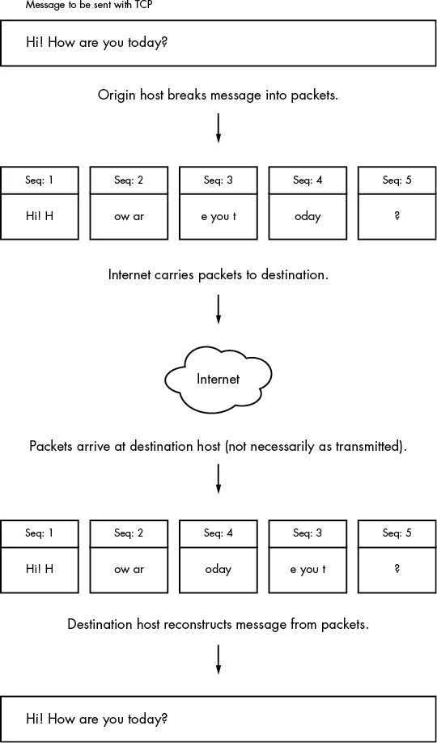

*图 9-4：使用 TCP 发送消息*

使用 UDP 的一个应用实例是*网络时间协议（Network Time Protocol，NTP）*。客户端向服务器发送一个简短的请求来获取当前时间，服务器的响应同样简短。由于客户端希望尽快收到响应，UDP 很适合这种应用；如果服务器的响应在网络中丢失，客户端只需重新发送请求，或者放弃即可。另一个例子是视频聊天。在这种情况下，图像通过 UDP 发送；如果途中丢失了某些数据，接收端客户端会尽可能进行补偿。

> 本章剩余部分将讨论更高级的网络主题，例如网络过滤和路由器。这些主题与我们已经了解的较低层网络——物理层、网络层和传输层——有关。如果你愿意，也可以直接跳到下一章，看看应用层如何在用户空间把所有内容结合起来。你将看到真正使用网络的进程，而不只是各种地址和数据包。


### 9.18 重新审视一个简单的局域网

现在，我们来看看第 9.4 节介绍的简单网络中的其他组成部分。这个网络由一个作为子网的局域网（LAN），以及一台将该子网连接到互联网其他部分的路由器组成。你将了解以下内容：

- 子网中的主机如何自动获取网络配置
- 如何设置路由
- 路由器究竟是什么
- 如何确定子网应该使用哪些 IP 地址
- 如何设置防火墙，过滤来自互联网的不需要的流量

在大多数情况下，我们将重点讨论 IPv4（即便只是因为它的地址更容易阅读）；不过，当 IPv6 有所不同时，我们也会说明。

首先来看看子网中的主机如何自动获取网络配置。

### 9.19 理解 DHCP

在 IPv4 网络中，如果你将一台网络主机设置为自动从网络获取配置，实际上就是让它使用动态主机配置协议（Dynamic Host Configuration Protocol，DHCP），获取 IP 地址、子网掩码、默认网关和 DNS 服务器。除了不必手动输入这些参数之外，DHCP 还给网络管理员带来了其他好处，例如防止 IP 地址冲突，以及减小网络变更造成的影响。如今，很少能见到不使用 DHCP 的网络。

要通过 DHCP 获取配置，主机必须能够向其所连接网络上的 DHCP 服务器发送消息。因此，每个物理网络都应该有自己的 DHCP 服务器。在简单网络中（例如第 9.1 节介绍的网络），路由器通常也充当 DHCP 服务器。

> 主机第一次发出 DHCP 请求时，甚至还不知道 DHCP 服务器的地址，因此它会向所有主机广播请求（通常是向所在物理网络上的所有主机广播）。

当一台计算机请求 DHCP 服务器分配 IP 地址时，它实际上是在请求某个地址在一段时间内的*租约（lease）*。租约到期时，客户端可以请求续租。

#### 9.19.1 Linux DHCP 客户端

尽管网络管理系统有许多不同类型，实际负责获取租约的 DHCP 客户端却只有两种。传统的标准客户端是互联网系统联盟（Internet Software Consortium，ISC）的 `dhclient` 程序。不过，systemd-networkd 现在也内置了 DHCP 客户端。

`dhclient` 启动后，会将进程 ID 保存在 */var/run/dhclient.pid*，并将租约信息保存在 */var/lib/dhcp/dhclient.leases*。

你可以在命令行中手动测试 `dhclient`，但在此之前，**必须**先删除所有默认网关路由（参见第 9.11.2 节）。测试时只需指定网络接口名称（这里是 enp0s31f6）：

```bash
# dhclient enp0s31f6
```

与 `dhclient` 不同，systemd-networkd 的 DHCP 客户端不能直接在命令行中手动运行。它的配置位于 */etc/systemd/network*，具体说明见 systemd.network(5) 手册页。不过，与其他网络配置一样，这些配置也可以由 Netplan 自动生成。

#### 9.19.2 Linux DHCP 服务器

你可以让 Linux 计算机运行 DHCP 服务器，从而更精细地控制它分配的地址。不过，除非你管理的是一个包含许多子网的大型网络，否则使用内置 DHCP 服务器的专用路由器硬件通常更合适。

关于 DHCP 服务器，最重要的一点可能是：**同一个子网中最好只运行一台 DHCP 服务器**，以免出现 IP 地址冲突或配置错误等问题。

### 9.20 自动配置 IPv6 网络

DHCP 在实际应用中运行得相当不错，但它依赖一些前提：网络中存在可用的 DHCP 服务器；服务器的实现正确且运行稳定；服务器能够跟踪和维护租约。虽然 IPv6 也有一个名为 DHCPv6 的 DHCP 版本，但还有一种使用范围广得多的替代方案。

互联网工程任务组（IETF）利用 IPv6 庞大的地址空间，设计了一种不需要中央服务器的网络配置方法。这称为*无状态配置（stateless configuration）*，因为客户端不需要保存租约分配之类的数据。

IPv6 的无状态网络配置从链路本地网络开始。回想一下，该网络包含前缀为 fe80::/64 的地址。由于链路本地网络中可用地址非常多，主机可以自行生成一个地址，而且这个地址与网络中其他地址重复的可能性很小。此外，网络前缀已经固定，因此主机可以向网络广播，询问是否有其他主机正在使用这个地址。

主机获得链路本地地址后，就可以确定全局地址。它会监听路由器不时在链路本地网络上发送的*路由器通告（router advertisement，RA）*消息。RA 消息包含全局网络前缀、路由器 IP 地址，还可能包含 DNS 信息。主机利用这些信息，就可以尝试填充全局地址中的接口标识符部分，其过程与生成链路本地地址时类似。

无状态配置要求全局网络前缀的长度不超过 64 位（换句话说，网络掩码为 /64 或更短）。

> 路由器也会响应主机发送的*路由器请求（router solicitation）*消息，并发出 RA 消息。这些消息以及另外几种相关消息，都属于 IPv6 的 ICMP 协议（ICMPv6）。


### 9.21 将 Linux 配置为路由器

路由器其实就是拥有多个物理网络接口的计算机。你可以很容易地将一台 Linux 机器配置成路由器。

来看一个例子。假设有两个局域网子网：10.23.2.0/24 和 192.168.45.0/24。为了连接它们，你准备了一台具有三个网络接口的 Linux 路由器：其中两个连接局域网子网，另一个用于连接互联网，如[图 9-5](#figure9-5)所示。

可以看到，这与本章此前使用的简单网络示例并没有太大区别。路由器在两个局域网子网上的 IP 地址分别是 10.23.2.1 和 192.168.45.1。配置好这些地址之后，路由表大致如下（实际接口名称可能不同；暂时忽略互联网连接）：

```bash
# ip route show
10.23.2.0/24 dev enp0s31f6 proto kernel scope link src 10.23.2.1 metric 100
192.168.45.0/24 dev enp0s1 proto kernel scope link src 192.168.45.1 metric 100
```

现在假设每个子网中的主机都把这台路由器设置为默认网关：10.23.2.0/24 子网使用 10.23.2.1，192.168.45.0/24 子网使用 192.168.45.1。如果 10.23.2.4 想向 10.23.2.0/24 以外的地址发送数据包，就会将数据包交给 10.23.2.1。例如，要从 10.23.2.4（主机 A）向 192.168.45.61（主机 E）发送数据包，数据包首先通过路由器的 enp0s31f6 接口到达 10.23.2.1，再从路由器的 enp0s1 接口发出。

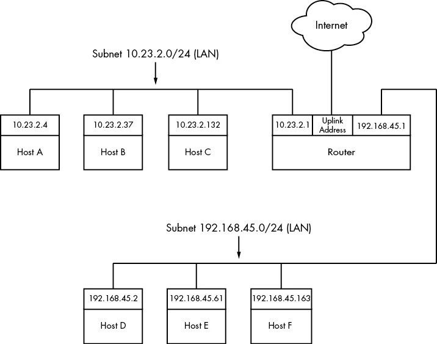

*图 9-5：通过路由器连接的两个子网*

不过，在某些基本配置中，Linux 内核不会自动把数据包从一个子网转发到另一个子网。要启用这项基本路由功能，需要通过以下命令在路由器内核中开启 *IP 转发（IP forwarding）*：

```bash
# sysctl -w net.ipv4.ip_forward=1
```

执行此命令后，只要两个子网中的主机知道应当把数据包发送给你刚刚配置的路由器，这台机器就应该立即开始在子网之间转发数据包。

> 可以使用 `sysctl net.ipv4.ip_forward` 命令检查 IP 转发是否已启用。

为了使这一设置在重启后仍然生效，可以将它写入 */etc/sysctl.conf*。根据发行版的不同，你也可以把设置放在 */etc/sysctl.d* 目录中的文件里，以免发行版更新时覆盖你的修改。

如果路由器还通过第三个网络接口连接互联网，由于两个子网中的所有主机都已将其设为默认网关，同样的配置就能让它们通过路由器访问互联网。不过，事情从这里开始变得复杂。问题在于，10.23.2.4 等某些 IPv4 地址并不能被整个互联网识别；它们属于所谓的*私有网络*。要提供互联网连接，必须在路由器上配置一项称为*网络地址转换（Network Address Translation，NAT）*的功能。几乎所有专用路由器的软件都会执行这项操作，因此并不是什么特殊做法。不过，我们先进一步了解私有网络带来的问题。

### 9.22 私有网络

假设你决定建立自己的网络。计算机、路由器和网络硬件都已准备妥当。根据目前对简单网络的了解，你接下来会问：“应该使用哪个 IP 子网？”

如果你想要一段互联网上所有主机都能访问的地址，可以向互联网服务提供商（ISP）购买。不过，由于 IPv4 地址范围十分有限，这样做的成本很高；除非你要运行一台供互联网其他主机访问的服务器，否则通常没有多大意义。大多数人并不需要这种服务，因为他们主要以客户端身份访问互联网。

通常更经济的替代方案，是从 RFC 1918/6761 互联网标准文档规定的私有地址中选择一个子网，如[表 9-2](#table9-2)所示。

**表 9-2：RFC 1918 和 6761 定义的私有网络**

| 网络 | 子网掩码 | CIDR 表示法 |
| --- | --- | --- |
| 10.0.0.0 | 255.0.0.0 | 10.0.0.0/8 |
| 192.168.0.0 | 255.255.0.0 | 192.168.0.0/16 |
| 172.16.0.0 | 255.240.0.0 | 172.16.0.0/12 |

你可以根据需要划分私有子网。除非计划在单个网络中容纳超过 254 台主机，否则可以选择一个较小的子网，例如本章一直使用的 10.23.2.0/24。（具有这种子网掩码的网络有时称为 *C 类子网*。虽然这一术语在技术上已经过时，但仍有一定的实用价值。）

那么，代价是什么？真正互联网上的主机并不知道私有子网的存在，也不会向这些子网发送数据包。因此，如果没有额外的帮助，私有子网中的主机就无法与外界通信。连接互联网的路由器拥有真实的、非私有的 IP 地址，必须通过某种方式在这条互联网连接和私有网络中的主机之间搭起桥梁。

### 9.23 网络地址转换（IP 伪装）

NAT 是让私有网络共享单个 IP 地址最常用的方法，在家庭和小型办公室网络中几乎无处不在。在 Linux 中，大多数人使用的 NAT 形式称为 *IP 伪装（IP masquerading）*。

NAT 的基本思想是：路由器并不只是将数据包从一个子网移到另一个子网，还会在转发过程中修改数据包。互联网上的主机知道如何连接到路由器，却对路由器背后的私有网络一无所知。私有网络中的主机不需要特殊配置，只需将路由器设为默认网关。

它大致按以下步骤工作：

1. 内部私有网络中的一台主机想要连接外部网络，因此通过路由器发送连接请求数据包。
2. 路由器拦截连接请求数据包，而不是直接把它转发到互联网（否则数据包会丢失，因为公共互联网并不了解私有网络）。
3. 路由器确定连接请求数据包的目标地址，并自行向目标建立连接。
4. 路由器建立连接后，向最初的内部主机发送一条伪装的“连接已建立”消息。
5. 此时路由器成为内部主机和目标之间的中间人。目标不知道内部主机的存在；在远端主机看来，连接来自路由器。

但实际情况并不像听起来那么简单。普通 IP 路由只知道互联网层中的源 IP 地址和目标 IP 地址。然而，如果路由器只处理互联网层，那么同一台内部主机一次只能与同一个目标建立一条连接（此外还有其他限制），因为数据包的互联网层部分没有足够的信息来区分同一主机发往同一目标的多个请求。因此，NAT 必须超越互联网层，解析数据包并提取更多标识信息，尤其是传输层中的 UDP 和 TCP 端口号。UDP 相对简单，因为它有端口却没有连接；TCP 传输层则要复杂得多。

要让 Linux 机器充当 NAT 路由器，必须在内核配置中启用以下全部功能：网络数据包过滤（“防火墙支持”）、连接跟踪、iptables 支持、完整 NAT，以及 MASQUERADE 目标支持。大多数发行版的内核都已经包含这些功能。

接下来，需要执行一些看起来比较复杂的 `iptables` 命令，让路由器为私有子网执行 NAT。以下示例中，内部以太网接口 enp0s2 通过外部接口 enp0s31f6 共享互联网连接（第 9.25 节会进一步介绍 `iptables` 语法）：

```bash
# sysctl -w net.ipv4.ip_forward=1
# iptables -P FORWARD DROP
# iptables -t nat -A POSTROUTING -o enp0s31f6 -j MASQUERADE
# iptables -A FORWARD -i enp0s31f6 -o enp0s2 -m state --state ESTABLISHED,RELATED -j ACCEPT
# iptables -A FORWARD -i enp0s2 -o enp0s31f6 -j ACCEPT
```

除非你正在开发自己的软件，否则大概永远不需要手动输入这些命令，尤其是在专用路由器硬件如此普遍的今天。不过，各种虚拟化软件也可以设置 NAT，为虚拟机和容器提供网络连接。

虽然 NAT 在实践中效果不错，但请记住，它本质上是一种延长 IPv4 地址空间使用寿命的变通办法。由于第 9.7 节介绍的 IPv6 拥有更大、更完善的地址空间，因此 IPv6 不需要 NAT。

### 9.24 路由器与 Linux

在宽带发展的早期，需求不高的用户只需将计算机直接连接互联网。但没过多久，许多用户就希望让自己的网络共享一条宽带连接。尤其是 Linux 用户，经常会额外配置一台计算机，让它作为运行 NAT 的路由器。

制造商发现了这一新市场，于是推出了专用路由器硬件：它们由高效处理器、一些闪存和多个网络端口组成，性能足以管理典型的简单网络、运行 DHCP 服务器等重要软件，并执行 NAT。至于软件，许多制造商选择使用 Linux 驱动路由器。他们添加所需的内核功能，精简用户空间软件，并制作基于图形界面的管理工具。

第一批此类路由器刚刚出现不久，就有许多人开始深入研究它们的硬件。某家制造商 Linksys 由于其软件中某个组件的许可证条款，必须公开软件源代码。随后，OpenWRT 等专用于路由器的 Linux 发行版很快出现。（这些名称中的“WRT”来自 Linksys 的型号编号。）

除了业余爱好者的探索兴趣之外，在路由器上安装这些发行版也有实际好处。它们通常比制造商提供的固件更稳定，尤其是在较旧的路由器硬件上，而且一般会提供更多功能。例如，要通过无线连接桥接网络，许多制造商要求购买相互匹配的硬件；但安装 OpenWRT 后，只要硬件受到支持，其制造商和生产年代通常就无关紧要。这是因为你在路由器上运行的是一个真正开放的操作系统，它并不在意你使用哪个品牌的硬件。

你可以运用本书介绍的许多知识，检查定制 Linux 固件的内部工作方式，不过也会遇到一些差异，尤其是在登录方面。与许多嵌入式系统一样，开放固件通常使用 BusyBox 提供大量 shell 功能。BusyBox 是一个单独的可执行程序，能够提供 shell、`ls`、`grep`、`cat` 和 `more` 等许多 Unix 命令的精简功能。（这样可以节省大量内存。）此外，嵌入式系统在启动时使用的 init 往往非常简单。不过，这些限制通常不会成为问题，因为定制 Linux 固件一般也会提供类似制造商固件的 Web 管理界面。


### 9.25 防火墙

路由器始终应该配备某种防火墙，以阻止不受欢迎的流量进入网络。*防火墙（firewall）* 是一种软件和／或硬件配置，通常位于互联网与较小网络之间的路由器上，试图确保来自互联网的“恶意”内容不会危害内部网络。你也可以在任何主机上设置防火墙功能，在数据包层面检查所有传入和传出的数据（而不是在应用层检查；服务器程序通常会在应用层自行实施某些访问控制）。在单台计算机上使用防火墙，有时称为 *IP 过滤（IP filtering）*。

系统可以在接收数据包、发送数据包，或者将数据包转发（路由）到其他主机或网关时进行过滤。

如果没有防火墙，系统只是处理数据包并将其继续传送。防火墙则在上述数据传输位置设置检查点，根据某些条件丢弃、拒绝或接受数据包。这些条件通常包括：

- 源 IP 地址、目标 IP 地址或其所在子网
- 源端口或目标端口（位于传输层信息中）
- 防火墙使用的网络接口

防火墙也为我们提供了接触 Linux 内核中负责处理 IP 数据包的子系统的机会。下面就来看看它。

#### 9.25.1 Linux 防火墙基础

在 Linux 中，防火墙规则按顺序组成一条*链（chain）*。多条链构成一张*表（table）*。数据包经过 Linux 网络子系统的不同部分时，内核会将特定链中的规则应用于数据包。例如，从物理层到达的新数据包会被内核归类为“输入”，因此会触发与输入相对应的链中的规则。

所有这些数据结构都由内核维护。整个系统称为 *iptables*，并提供一个名为 `iptables` 的用户空间命令，用于创建和操作规则。

> 还有一种较新的系统叫作 nftables，旨在取代 iptables。不过，在本书写作时，iptables 仍是使用最广泛的系统。管理 nftables 的命令是 `nft`；此外，还有一个名为 `iptables-translate` 的工具，可以将本书展示的 iptables 命令转换为 nftables 命令。更复杂的是，最近还出现了采用另一种方法的 bpfilter 系统。不要过分纠结于具体命令的细节——真正重要的是它们产生的效果。

由于系统可能有许多表，每张表又包含若干链，而每条链都可能包含许多规则，因此数据包的流向可能相当复杂。不过，你通常主要接触的是一张名为 *filter* 的表，它负责控制基本的数据包流向。filter 表有三条基本链：处理传入数据包的 INPUT、处理传出数据包的 OUTPUT，以及处理被路由转发的数据包的 FORWARD。

图 9-6 和图 9-7 简化展示了 filter 表中的规则在何处应用于数据包。之所以有两张图，是因为数据包可能从网络接口进入系统（[图 9-6](#figure9-6)），也可能由本地进程生成（[图 9-7](#figure9-7)）。

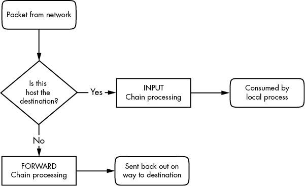

*图 9-6：来自网络的数据包所经过的链处理顺序*


*图 9-7：本地进程产生的数据包所经过的链处理顺序*

可以看到，从网络传入的数据包可能直接由用户进程接收，而不会经过 FORWARD 或 OUTPUT 链。由用户进程生成的数据包则不会经过 INPUT 或 FORWARD 链。

实际情况还要复杂一些，因为沿途除了这三条链之外，还有许多处理步骤。例如，数据包还会经过 PREROUTING 和 POSTROUTING 链，而且在较低的三个网络层级中也可能进行链处理。如果想看展示全部处理过程的大型示意图，可以在互联网上搜索“Linux netfilter packet flow”。不过要记住，这类图试图涵盖数据包输入与流动的所有可能情况。像图 9-6 和图 9-7 那样，按数据包的来源分别理解，通常更容易。

#### 9.25.2 设置防火墙规则

下面看看 iptables 系统在实践中如何工作。首先运行以下命令查看当前配置：

```bash
# iptables -L
```

输出通常是以下这些空链：

```
Chain INPUT (policy ACCEPT)
target     prot opt source               destination

Chain FORWARD (policy ACCEPT)
target     prot opt source               destination

Chain OUTPUT (policy ACCEPT)
target     prot opt source               destination
```

每条防火墙链都有一个默认*策略（policy）*，用于规定没有任何规则匹配数据包时应该采取的操作。这个示例中，三条链的策略都是 ACCEPT，意味着内核允许数据包通过过滤系统。DROP 策略则要求内核丢弃数据包。要设置某条链的策略，可以像下面这样使用 `iptables -P`：

```bash
# iptables -P FORWARD DROP
```

> **警告：**
>
> 在读完本节剩余内容之前，不要贸然修改自己计算机上的策略。

假设地址为 192.168.34.63 的某个人一直在骚扰你。要阻止这台主机与你的计算机通信，可以运行：

```bash
# iptables -A INPUT -s 192.168.34.63 -j DROP
```

参数 `-A INPUT` 表示向 INPUT 链的末尾追加一条规则。`-s 192.168.34.63` 指定规则中的源 IP 地址，`-j DROP` 则告诉内核丢弃所有匹配该规则的数据包。因此，你的计算机会丢弃所有来自 192.168.34.63 的数据包。

再次运行 `iptables -L`，可以看到这条规则：

```
Chain INPUT (policy ACCEPT)
target     prot opt source               destination
DROP       all  --  192.168.34.63        anywhere
```

不幸的是，192.168.34.63 上的那个人又让同一子网的所有人连接你的 SMTP 端口（TCP 端口 25）。要同时阻止这类流量，可以运行：

```bash
# iptables -A INPUT -s 192.168.34.0/24 -p tcp --destination-port 25 -j DROP
```

这个示例给源地址添加了网络掩码限定条件，并使用 `-p tcp` 指定仅匹配 TCP 数据包。另一个限制条件 `--destination-port 25` 表示规则只适用于发往端口 25 的流量。此时 INPUT 链的规则列表如下：

```
Chain INPUT (policy ACCEPT)
target     prot opt source               destination
DROP       all  --  192.168.34.63        anywhere
DROP       tcp  --  192.168.34.0/24      anywhere           tcp dpt:smtp
```

一切似乎都很顺利，直到你认识的一位朋友（地址为 192.168.34.37）告诉你，她无法向你发送电子邮件，因为你屏蔽了她的计算机。你觉得这很好解决，于是运行：

```bash
# iptables -A INPUT -s 192.168.34.37 -j ACCEPT
```

但这并没有奏效。看看更新后的链就知道原因了：

```
Chain INPUT (policy ACCEPT)
target     prot opt source               destination
DROP       all  --  192.168.34.63        anywhere
DROP       tcp  --  192.168.34.0/24      anywhere           tcp dpt:smtp
ACCEPT     all  --  192.168.34.37        anywhere
```

内核从上到下读取链中的规则，并采用第一条匹配的规则。

第一条规则不匹配 192.168.34.37，但第二条规则会匹配，因为它适用于从 192.168.34.1 到 192.168.34.254 的所有主机，而第二条规则要求丢弃数据包。一旦某条规则匹配，内核就执行相应操作，不再继续检查链中后面的规则。（你可能已经注意到，192.168.34.37 仍能向你计算机上的其他端口发送数据包，*只有*端口 25 不行，因为第二条规则*仅*适用于端口 25。）

解决办法是将第三条规则移到最前面。首先运行以下命令删除第三条规则：

```bash
# iptables -D INPUT 3
```

然后使用 `iptables -I` 将这条规则*插入*链的开头：

```bash
# iptables -I INPUT -s 192.168.34.37 -j ACCEPT
```

如果要把规则插入链中的其他位置，可以在链名称后指定规则编号（例如 `iptables -I INPUT 4 ...`）。

#### 9.25.3 防火墙策略

前面的教程展示了如何插入规则，以及内核如何处理 IP 规则链，但还没有介绍真正可行的防火墙策略。现在来讨论这个问题。

防火墙主要有两种使用场景：一种是保护单台计算机（在各台计算机的 INPUT 链中设置规则），另一种是保护由多台计算机组成的网络（在路由器的 FORWARD 链中设置规则）。无论哪种情况，如果采用默认 ACCEPT 策略，然后不断添加规则，去丢弃那些开始发送恶意内容的来源的数据包，就无法实现可靠的安全防护。你必须只允许自己信任的数据包通过，并拒绝其他所有数据包。

例如，假设你的计算机在 TCP 端口 22 上运行 SSH 服务器。没有理由让任意主机主动连接到你计算机上的其他端口，你也不应该给它们这种机会。要实现这一点，首先将 INPUT 链的默认策略设置为 DROP：

```bash
# iptables -P INPUT DROP
```

要允许 ICMP 流量（供 `ping` 等工具使用），可以添加：

```bash
# iptables -A INPUT -p icmp -j ACCEPT
```

还要确保能够接收发送到本机网络 IP 地址以及 127.0.0.1（localhost）的数据包。假设本机 IP 地址为 `my_addr`，执行：

```bash
# iptables -A INPUT -s 127.0.0.1 -j ACCEPT
# iptables -A INPUT -s my_addr -j ACCEPT
```

> **警告：**
>
> 如果你只能远程访问某台计算机，千万不要在上面逐条执行这些命令。第一条 `DROP` 命令会立即阻断你的访问，而在进行额外干预（例如重新启动计算机）之前，你将无法重新连接。

如果你控制整个子网（并且信任其中的所有设备），可以将 `my_addr` 替换为子网地址和子网掩码，例如 `10.23.2.0/24`。

虽然你仍然希望拒绝传入的 TCP 连接，但也必须确保本机可以主动建立到外部的 TCP 连接。由于所有 TCP 连接都以 SYN（连接请求）数据包开始，因此如果允许所有非 SYN 的 TCP 数据包通过，仍然可以满足这个需求：

```bash
# iptables -A INPUT -p tcp '!' --syn -j ACCEPT
```

符号 `!` 表示取反，因此 `! --syn` 匹配所有非 SYN 数据包。

接下来，如果你使用基于 UDP 的远程 DNS 服务，就必须允许来自名称服务器的流量，以便本机能够通过 DNS 查询名称。应该对 */etc/resolv.conf* 中的*所有* DNS 服务器执行此操作。使用以下命令（其中 `ns_addr` 是名称服务器的地址）：

```bash
# iptables -A INPUT -p udp --source-port 53 -s ns_addr -j ACCEPT
```

最后，允许来自任意位置的 SSH 连接：

```bash
# iptables -A INPUT -p tcp --destination-port 22 -j ACCEPT
```

上述 iptables 设置适用于许多情况，包括任何直接连接互联网的环境（尤其是宽带连接），因为在这类环境中，入侵者更有可能扫描你的计算机端口。你也可以将这些设置改用于具有防火墙功能的路由器：把 INPUT 链替换为 FORWARD 链，并根据需要使用源子网和目标子网。对于更高级的配置，Shorewall 等配置工具可能有所帮助。

以上讨论只涉及安全策略的一部分。请记住，核心原则是只允许你认为可以接受的流量通过，而不是试图找出并排除所有恶意流量。此外，IP 防火墙也只是整个安全体系中的一个环节。（下一章还会介绍更多相关内容。）


### 9.26 以太网、IP、ARP 与 NDP

关于如何在以太网上实现 IP，还有一个基本细节尚未介绍。回想一下，主机要通过物理层向另一台主机发送 IP 数据包，就必须把 IP 数据包封装在以太网帧中。还要记住，以太网帧本身并不包含 IP 地址信息，而是使用 MAC（硬件）地址。因此，问题来了：主机为 IP 数据包构造以太网帧时，如何知道目标 IP 地址对应哪个 MAC 地址？

我们通常不太会考虑这个问题，因为网络软件提供了一套自动查找 MAC 地址的机制。在 IPv4 中，这套机制称为*地址解析协议（Address Resolution Protocol，ARP）*。以以太网作为物理层、以 IP 作为网络层的主机，会维护一张称为 *ARP 缓存*的小表，用于保存 IP 地址到 MAC 地址的映射。在 Linux 中，ARP 缓存位于内核中。可以使用 `ip neigh` 命令查看本机的 ARP 缓存。（等介绍 IPv6 中的对应机制时，你就会明白命令中“neigh”的含义。以前用于操作 ARP 缓存的命令是 `arp`。）

```bash
$ ip -4 neigh
10.1.2.57 dev enp0s31f6 lladdr 1c:f2:9a:1e:88:fb REACHABLE
10.1.2.141 dev enp0s31f6 lladdr 00:11:32:0d:ca:82 STALE
10.1.2.1 dev enp0s31f6 lladdr 24:05:88:00:ca:a5 REACHABLE
```

这里使用 `-4` 选项将输出限制为 IPv4。你可以看到内核已知主机的 IP 地址和硬件地址。最后一个字段表示缓存条目的状态。`REACHABLE` 表示最近与该主机进行过通信；`STALE` 则表示已有一段时间没有通信，需要刷新该条目。

机器刚启动时，ARP 缓存是空的。那么，这些 MAC 地址是怎样进入缓存的呢？一切始于机器准备向另一台主机发送数据包。如果目标 IP 地址不在 ARP 缓存中，就会发生以下过程：

1. 源主机创建一个特殊的以太网帧，其中包含 ARP 请求数据包，用来查询目标 IP 地址对应的 MAC 地址。
2. 源主机把这个帧广播到目标所在子网的整个物理网络。
3. 如果子网中的某台主机知道正确的 MAC 地址，它就创建包含该地址的应答数据包和以太网帧，并发送回源主机。通常，作出应答的就是目标主机，它只需返回自己的 MAC 地址。
4. 源主机将这组 IP 地址与 MAC 地址的对应关系加入 ARP 缓存，然后就可以继续发送数据包了。

> 请记住，ARP 只适用于本地子网中的机器。要访问子网之外的目标，主机会把数据包发送给路由器，之后的转发就由其他设备负责。当然，主机仍然需要知道路由器的 MAC 地址，而它可以通过 ARP 查到这个地址。

ARP 可能带来的一个实际问题是缓存过期。例如，在测试机器时，如果把某个 IP 地址从一块网卡转移到另一块网卡，由于两块网卡的 MAC 地址不同，系统中的 ARP 缓存就可能不再准确。Unix 系统会在缓存条目一段时间没有活动后使其失效，因此一般不会造成什么麻烦，最多是在旧条目失效时产生一点延迟。不过，你也可以使用以下命令立即删除某个 ARP 缓存条目：

```bash
# ip neigh del host dev interface
```

`ip-neighbour(8)` 手册页介绍了如何手动设置 ARP 缓存条目，但通常不需要这么做。注意这个手册页名称的拼写。

> 不要将 ARP 与反向地址解析协议（Reverse Address Resolution Protocol，RARP）混淆。RARP 可以根据 MAC 地址反向查找主机名或 IP 地址。在 DHCP 普及之前，一些无盘工作站和其他设备曾使用 RARP 获取配置，但如今 RARP 已经很少见了。

> **补充说明：IPv6：NDP**
>
> 你可能会疑惑，为什么操作 ARP 缓存的命令里没有“arp”（或者，如果你以前稍微接触过这方面的知识，可能会想知道为什么我们不用 `arp` 命令）。在 IPv6 中，链路本地网络使用一种新机制，称为*邻居发现协议（Neighbor Discovery Protocol，NDP）*。`ip` 命令将 IPv4 的 ARP 和 IPv6 的 NDP 统一到同一套操作接口中。NDP 包含以下两类消息：
>
> 1. **邻居请求（Neighbor Solicitation）**：用于获取链路本地主机的信息，包括该主机的硬件地址。
> 2. **邻居通告（Neighbor Advertisement）**：用于响应邻居请求消息。
>
> NDP 还包含其他几个组成部分，其中包括你在第 9.20 节见过的路由器通告（RA）消息。


### 9.27 无线以太网

从原理上讲，无线以太网（“Wi-Fi”）与有线网络并没有太大区别。与有线网络硬件一样，无线设备也有 MAC 地址，并使用以太网帧发送和接收数据。因此，Linux 内核与无线网络接口通信的方式，和与有线网络接口通信的方式大体相同。网络层及其以上各层的工作方式也完全相同；主要区别在于物理层增加了一些组成部分，例如频率、网络标识和安全功能。

有线网络硬件通常能够自动适应物理连接环境中的各种细微差异，几乎不需要人工干预。相比之下，无线网络的配置有更多可变因素。要让无线接口正常工作，Linux 还需要额外的配置工具。

我们先简要了解无线网络特有的几个组成部分。

1. **传输细节**：指无线电频率等物理特性。
2. **网络标识**：由于多个无线网络可以共用相同的基本传输介质，因此必须能够区分它们。服务集标识符（Service Set Identifier，SSID，也称“网络名称”）就是无线网络的标识。
3. **管理**：虽然可以将无线网络配置为让主机直接相互通信，但大多数无线网络都由一个或多个*接入点*（access point）管理，所有流量都经过接入点。接入点通常将无线网络与有线网络桥接起来，使两者看起来像同一个网络。
4. **身份认证**：你可能希望限制对无线网络的访问。为此，可以将接入点配置为要求客户端提供密码或其他身份认证密钥，验证通过后才与客户端通信。
5. **加密**：除了限制无线网络的初始接入权限之外，通常还需要对通过无线电波传输的全部流量进行加密。

Linux 中负责这些功能的配置机制和实用工具分布在多个地方。有些位于内核中；Linux 提供了一组无线扩展，为用户空间访问硬件提供标准化接口。在用户空间，无线网络配置可能相当复杂，因此大多数人更愿意使用图形界面前端，例如 NetworkManager 的桌面小程序，来完成配置。不过，了解一下这些工具背后的工作过程仍然很有价值。

#### 9.27.1 iw

你可以使用名为 `iw` 的工具查看和修改内核空间中的无线设备及网络配置。使用 `iw` 时，通常需要知道设备的网络接口名称，例如 *wlp1s0*（可预测的设备名称）或 *wlan0*（传统名称）。下面的示例会扫描并输出可用无线网络的信息。（如果你身处城市地区，可能会看到大量输出。）

```bash
# iw dev wlp1s0 scan
```

> 要执行这条命令，网络接口必须处于启用状态（如果尚未启用，可以运行 `ifconfig wlp1s0 up`）。不过，由于此时操作的仍是物理层，因此不必配置 IP 地址等网络层参数。

如果网络接口已经加入某个无线网络，可以用以下命令查看该网络的详细信息：

```bash
# iw dev wlp1s0 link
```

这条命令输出中的 MAC 地址属于当前正在与之通信的接入点。

> `iw` 命令会区分物理设备名称（例如 phy0）与网络接口名称（例如 wlp1s0），并允许你分别修改它们的多种设置。你甚至可以为同一个物理设备创建多个网络接口。不过，在几乎所有基本使用场景中，只需要使用网络接口名称即可。

可以使用 `iw` 按以下方式将网络接口连接到没有安全保护的无线网络：

```bash
# iw wlp1s0 connect network_name
```

连接受保护的网络则是另一回事。对于安全性很差的有线等效保密（Wired Equivalent Privacy，WEP）机制，可以在 `iw connect` 命令中使用 `keys` 参数。不过，不应该使用 WEP，因为它并不安全，而且现在支持它的网络也已经不多了。

#### 9.27.2 无线网络安全

对于大多数无线安全配置，Linux 依靠 `wpa_supplicant` 守护进程来管理无线网络接口的身份认证和加密。这个守护进程支持 WPA2 和 WPA3（Wi-Fi Protected Access，Wi-Fi 保护访问；不要使用旧版且不安全的 WPA）认证机制，以及无线网络中使用的几乎所有加密技术。守护进程启动时，会读取配置文件（默认为 */etc/wpa_supplicant.conf*），然后根据给定的网络名称尝试向接入点进行身份认证并建立通信。该系统的文档十分完善，尤其是 `wpa_supplicant(8)` 手册页，内容非常详尽。

每次建立连接时都手动运行这个守护进程会很麻烦。实际上，由于可选配置项很多，光是创建配置文件就已经相当繁琐。更麻烦的是，运行 `iw` 和 `wpa_supplicant` 所做的全部工作，只能让系统加入无线物理网络，甚至还没有完成网络层配置。这正是 NetworkManager 等自动网络配置管理器能够大幅简化流程的地方。虽然这些管理器并不亲自完成底层的每一项工作，但它们知道使无线网络正常运行所需的正确步骤顺序，以及每一步需要的配置。

### 9.28 总结

正如你所看到的，要理解 Linux 网络的运行方式以及如何配置网络，弄清各个网络层的位置和作用至关重要。虽然本章只介绍了基础知识，但物理层、网络层和传输层中更高级的主题，与这里看到的内容有许多相似之处。网络层本身也常常可以进一步细分，就像你刚刚在无线网络物理层中看到的各种组成部分一样。

本章介绍的许多操作都发生在内核中，而用户空间中的一些基础控制工具则负责操作内核的内部数据结构（例如路由表）。这是传统的网络工作方式。不过，与本书讨论的许多其他主题一样，有些任务由于复杂程度较高、需要更大的灵活性，并不适合由内核承担，因此需要交给用户空间工具处理。特别是，NetworkManager 会监视和查询内核，然后调整内核配置。另一个例子是对边界网关协议（Border Gateway Protocol，BGP）等动态路由协议的支持，这类协议用于大型互联网路由器。

不过，读到这里，你可能已经对网络配置感到有些厌倦了。接下来，让我们转向如何*使用*网络，也就是应用层。


## 第 10 章：网络应用与服务

本章探讨基本的网络应用——运行在用户空间、位于应用层的客户端和服务器。由于应用层处于协议栈的最顶端，最接近最终用户，你可能会觉得这些内容比第 9 章更容易理解。毕竟，你每天都会使用 Web 浏览器之类的网络客户端应用。

为了完成工作，网络客户端需要连接相应的网络服务器。Unix 网络服务器有多种形式。服务器程序可以自行监听某个端口，也可以通过辅助服务器监听。我们将介绍一些常见的服务器，以及有助于理解和调试服务器运行情况的工具。

网络客户端使用操作系统提供的传输层协议和接口，因此了解 TCP 和 UDP 传输层的基础知识非常重要。下面先通过一个使用 TCP 的网络客户端实验，开始了解网络应用。

### 10.1 服务基础

TCP 服务相对容易理解，因为它们建立在简单、连续的双向数据流之上。要了解其工作方式，一个很好的方法是直接与 TCP 80 端口上未加密的 Web 服务器通信，观察数据如何在连接中传输。例如，运行以下命令，连接到 IANA 用作文档示例的 Web 服务器：

```bash
$ telnet example.org 80
```

你应该看到类似下面的响应，表示已经成功连接到服务器：

```
Trying some address...
Connected to example.org.
Escape character is '^]'.
```

现在输入以下两行：

```
GET / HTTP/1.1
Host: example.org
```

> 与其前身 HTTP/1.0 一样，HTTP/1.1 已经显露出年代感；如今还有 HTTP/2、QUIC 以及正在兴起的 HTTP/3 等更新的协议。

输入最后一行后，再按两次 Enter。服务器应该会返回大量 HTML 文本。要终止连接，请按 Ctrl-D。

这个实验说明：

- 远程主机上有一个 Web 服务器进程，正在监听 TCP 80 端口。
- `telnet` 是发起连接的客户端。

之所以需要用 Ctrl-D 终止连接，是因为加载大多数网页需要发送多个请求，所以保持连接打开是合理的。如果你在协议层面探索 Web 服务器，会发现不同服务器的行为可能有所差异。例如，许多服务器在连接建立后，如果迟迟收不到请求，就会很快断开连接。

> `telnet` 最初用于登录远程主机。你的发行版可能默认没有安装它的客户端程序，但通常可以很容易地通过额外的软件包安装。虽然 `telnet` 远程登录服务器完全不安全（后面会介绍），但 `telnet` 客户端仍然有助于调试远程服务。`telnet` 不支持 UDP，也不支持 TCP 之外的其他传输层协议。如果需要通用网络客户端，可以考虑第 10.5.3 节介绍的 `netcat`。

### 10.2 进一步观察

在前面的示例中，你使用 `telnet`，通过 HTTP 应用层协议手动与网络上的 Web 服务器交互。通常你会使用 Web 浏览器建立这样的连接，但这里我们只比 `telnet` 前进一步：使用一个懂得如何通过 HTTP 应用层协议通信的命令行程序。我们将使用 `curl` 工具，并指定一个特殊选项来记录通信细节：

```bash
$ curl --trace-ascii trace_file http://www.example.org/
```

> 你的发行版可能没有预装 `curl` 软件包；如果需要，安装它通常并不困难。

命令会输出大量 HTML。可以忽略这些内容（或者将它们重定向到 */dev/null*），转而查看新创建的文件 *trace\_file*。如果连接成功，在 `curl` 尝试与服务器建立 TCP 连接时，文件开头应该类似这样：

```
== Info:   Trying 93.184.216.34...
== Info: TCP_NODELAY set
== Info: Connected to www.example.org (93.184.216.34) port 80 (#0)
```

到目前为止，你看到的一切都发生在传输层或更低的层次。不过，如果连接成功，`curl` 接下来会尝试发送请求（即“首部”）；应用层的工作从这里开始：

```
1 => Send header, 79 bytes (0x4f)
2 0000: GET / HTTP/1.1
0010: Host: www.example.org
0027: User-Agent: curl/7.58.0
0040: Accept: */*
004d:
```

第 1 行是 `curl` 的调试输出，说明它接下来将执行什么操作。其余各行展示了 `curl` 发送给服务器的内容。原文中以粗体标出的文本是实际发送给服务器的数据；行首的十六进制数字只是 `curl` 添加的调试偏移量，帮助你跟踪发送或接收了多少数据。

在标记 2 处，可以看到 `curl` 首先向服务器发出 `GET` 命令（就像使用 `telnet` 时那样），随后附带一些额外信息，并以一个空行结束。接着服务器返回响应，首先是它自己的首部（原文中以粗体标出）：

```
<= Recv header, 17 bytes (0x11)
0000: HTTP/1.1 200 OK
<= Recv header, 22 bytes (0x16)
0000: Accept-Ranges: bytes
<= Recv header, 12 bytes (0xc)
0000: Age: 17629
--snip--
```

与前面的输出类似，以 `<=` 开头的行是调试信息；`0000:` 则表示后面内容的偏移量。在 `curl` 中，首部不计入偏移量，因此这些行都从 0 开始。

服务器响应的首部可能很长，但在某个时刻，服务器会结束首部传输，开始发送实际请求的文档，如下所示：

```
<= Recv header, 22 bytes (0x16)
0000: Content-Length: 1256
<= Recv header, 2 bytes (0x2)
1 0000:
<= Recv data, 1256 bytes (0x4e8)
0000: <!doctype html>.<html>.<head>.    <title>Example Domain</title>.
0040: .    <meta charset="utf-8" />.    <meta http-equiv="Content-type
--snip--
```

这段输出还展示了应用层的一个重要特性。虽然调试信息分别写着 `Recv header` 和 `Recv data`，似乎暗示它们是服务器发来的两种不同消息，但无论是 `curl` 向操作系统获取这些消息的方式、操作系统处理消息的方式，还是底层网络处理数据包的方式，都没有区别。差别完全存在于用户空间的 `curl` 应用程序内部。`curl` 知道此前收到的都是首部；当它收到标记 1 处的空行时，就知道 HTTP 首部已经结束，应当将之后收到的内容解释为所请求的文档。

服务器发送这些数据时也是如此。服务器的操作系统并不区分首部数据和文档数据；这种区分发生在用户空间的服务器程序内部。


### 10.3 网络服务器

大多数网络服务器与系统中的其他服务器守护进程（例如 cron）相似，区别在于它们需要与网络端口交互。实际上，第 7 章介绍的 syslogd 在使用 `-r` 选项启动时，会接收发送到 UDP 514 端口的数据包。

下面列出一些可能正在你的系统上运行的常见网络服务器：

1. httpd、apache、apache2、nginx：Web 服务器
2. sshd：安全 Shell 守护进程
3. postfix、qmail、sendmail：邮件服务器
4. cupsd：打印服务器
5. nfsd、mountd：网络文件系统（文件共享）守护进程
6. smbd、nmbd：Windows 文件共享守护进程（参见第 12 章）
7. rpcbind：远程过程调用（RPC）端口映射服务守护进程

大多数网络服务器有一个共同特点：它们通常以多个进程的形式运行。至少有一个进程监听网络端口；当收到新的传入连接时，监听进程调用 `fork()` 创建子进程，由子进程负责处理新连接。这个子进程通常称为*工作进程*（worker process），连接关闭后便会退出。与此同时，原来的监听进程继续监听网络端口。通过这种方式，服务器可以相对轻松地处理大量连接。

不过，这种模型也有例外。调用 `fork()` 会带来相当大的系统开销。为了避免这种开销，Apache Web 服务器等高性能 TCP 服务器可能会在启动时预先创建多个工作进程，以便随时处理连接。接收 UDP 数据包的服务器则完全不需要为每个请求调用 `fork()`，因为 UDP 没有需要监听的连接；服务器只需接收数据并作出响应。

#### 10.3.1 安全 Shell

每种网络服务器程序的工作方式都有所不同。为了实际了解服务器的配置和运行方式，我们来仔细研究独立运行的安全 Shell（SSH）服务器。SSH 是最常见的网络服务应用之一，也是远程访问 Unix 计算机的事实标准。SSH 的设计目标包括安全地登录 Shell、远程执行程序、进行简单的文件共享等。它使用公钥密码学进行身份认证，并使用相对简单的密码算法加密会话数据，取代了旧式且不安全的 `telnet` 和 `rlogin` 远程访问系统。

大多数互联网服务提供商和云服务商都要求使用 SSH 来访问其服务的 Shell；许多基于 Linux 的网络设备（例如网络附加存储设备 NAS）也提供 SSH 访问。OpenSSH（<http://www.openssh.com/>）是 Unix 上流行的免费 SSH 实现，几乎所有 Linux 发行版都预装了它。OpenSSH 的客户端程序是 `ssh`，服务器程序是 sshd。SSH 协议主要有版本 1 和版本 2；由于版本 1 存在安全漏洞且已很少使用，OpenSSH 已停止支持它，只支持版本 2。

SSH 具有许多实用的功能和特性，其中包括：

- 加密密码和所有其他会话数据，防止他人窃听。
- 为其他网络连接建立隧道，包括 X Window System 客户端的连接。（第 14 章将进一步介绍 X。）
- 几乎所有操作系统都有相应的 SSH 客户端。
- 使用密钥验证主机身份。

> **补充说明：**
>
> *隧道传输*（tunneling）是指将一个网络连接封装在另一个网络连接中进行传输。通过 SSH 隧道传输 X Window System 连接有两个好处：SSH 会为你设置显示环境，并对隧道中的 X 数据进行加密。

SSH 也有一些缺点。例如，要建立 SSH 连接，你需要远程主机的公钥，而获取这个公钥的过程不一定安全（不过，你可以手动核对，以确保自己没有受到冒充攻击）。如果想概览多种密码学方法的工作原理，可以阅读 Jean-Philippe Aumasson 的 *Serious Cryptography: A Practical Introduction to Modern Encryption*（No Starch Press，2017）。另外两本深入介绍 SSH 的书是 Michael W. Lucas 的 *SSH Mastery: OpenSSH, PuTTY, Tunnels, and Keys*（第 2 版，Tilted Windmill Press，2018），以及 Daniel J. Barrett、Richard E. Silverman 和 Robert G. Byrnes 合著的 *SSH, The Secure Shell: The Definitive Guide*（第 2 版，O’Reilly，2005）。

> **专栏：公钥密码学**
>
> 前面已经多次提到*公钥*，但还没有解释其背景。如果你不熟悉这个概念，这里简要介绍一下。直到 20 世纪 70 年代，加密算法基本上都是*对称的*，即消息发送者和接收者必须持有同一把密钥。破解加密通信的一种方式就是窃取密钥；知道密钥的人越多，密钥泄露的机会就越大。
>
> 公钥密码学则使用两把密钥：公钥和私钥。*公钥*可以加密消息，却不能用来解密，因此谁能获得公钥并不重要。只有*私钥*才能解密使用公钥加密的消息。在大多数情况下，私钥更容易保护，因为只需保留一份，而且无须传输。
>
> 除了加密，公钥密码学还可以用于身份认证：有些方法能够在不传输任何密钥的情况下，验证某人是否持有与指定公钥对应的私钥。

#### 10.3.2 sshd 服务器

要运行 sshd 服务器并允许其他计算机远程连接到你的系统，需要准备配置文件和主机密钥。大多数发行版把配置文件放在 */etc/ssh* 目录中，并在安装 sshd 软件包时尽量自动完成正确配置。（注意不要把服务器配置文件 *sshd\_config* 与客户端配置文件 *ssh\_config* 混淆。）

通常不需要修改 *sshd\_config*，但检查一下总没有坏处。该文件由键值对组成，下面是一个片段：

```bash
Port 22
#AddressFamily any

#ListenAddress 0.0.0.0
#ListenAddress ::
#HostKey /etc/ssh/ssh_host_rsa_key
#HostKey /etc/ssh/ssh_host_ecdsa_key
#HostKey /etc/ssh/ssh_host_ed25519_key
```

以 `#` 开头的行是注释。从这个片段可以看到，*sshd\_config* 中许多注释还说明了参数的默认值。`sshd_config(5)` 手册页介绍了各个参数及其可能的取值，下面列出其中一些最重要的参数：

1. `HostKey` `file`：将 `file` 指定为主机密钥文件。（下文将介绍主机密钥。）
2. `PermitRootLogin` `value`：如果 `value` 为 `yes`，允许超级用户通过 SSH 登录；将其设为 `no` 可禁止这种登录。
3. `LogLevel` `level`：以 syslog 的 `level` 级别记录消息（默认是 `INFO`）。
4. `SyslogFacility` `name`：使用名为 `name` 的 syslog 设施记录消息（默认是 `AUTH`）。
5. `X11Forwarding` `value`：如果 `value` 为 `yes`，启用 X Window System 客户端隧道传输。
6. `XAuthLocation` `path`：指定系统中 `xauth` 工具的位置。没有这个路径，X 隧道传输就无法工作。如果 `xauth` 不在 */usr/bin* 中，请把 `path` 设为它的完整路径。

##### 创建主机密钥

OpenSSH 使用多组主机密钥。每组密钥都包含一个公钥（文件扩展名为 *.pub*）和一个私钥（没有扩展名）。

> **警告：**
>
> 不要让任何人看到私钥，即使是在你自己的系统上也一样。如果有人获得私钥，你的系统就可能面临入侵风险。

SSH 协议版本 2 使用 RSA 和 DSA 密钥。RSA 和 DSA 都是公钥密码学算法。密钥文件名见[表 10-1](#table10-1)。

**表 10-1：OpenSSH 密钥文件**

| 文件名 | 密钥类型 |
| --- | --- |
| *ssh\_host\_rsa\_key* | RSA 私钥 |
| *ssh\_host\_rsa\_key.pub* | RSA 公钥 |
| *ssh\_host\_dsa\_key* | DSA 私钥 |
| *ssh\_host\_dsa\_key.pub* | DSA 公钥 |

创建密钥需要进行数值计算，以同时生成公钥和私钥。通常不需要自行创建密钥，因为 OpenSSH 安装程序或发行版的安装脚本会代劳。不过，如果你打算使用 `ssh-agent` 等能够提供免密码身份认证服务的程序，就需要了解如何生成密钥。要创建 SSH 协议版本 2 的密钥，可以使用 OpenSSH 附带的 `ssh-keygen` 程序：

```bash
# ssh-keygen -t rsa -N '' -f /etc/ssh/ssh_host_rsa_key
# ssh-keygen -t dsa -N '' -f /etc/ssh/ssh_host_dsa_key
```

SSH 服务器和客户端还使用名为 *ssh\_known\_hosts* 的*密钥文件*来保存其他主机的公钥。如果打算根据远程客户端的身份进行认证，服务器的 *ssh\_known\_hosts* 文件就必须包含所有受信任客户端的主机公钥。

了解这些密钥文件，在更换计算机时尤其有用。从头安装一台新机器时，可以从旧机器导入密钥文件，避免用户连接新机器时遇到密钥不匹配的问题。

##### 启动 SSH 服务器

虽然大多数发行版都提供 SSH，但通常不会默认启动 sshd 服务器。在 Ubuntu 和 Debian 上，新安装的系统并不包含 SSH 服务器；安装其软件包后，系统会创建密钥、启动服务器，并把服务器的启动配置加入系统引导配置。

在 Fedora 上，sshd 默认已经安装，但处于关闭状态。要让 sshd 在系统启动时自动运行，可以使用 `systemctl`：

```bash
# systemctl enable sshd
```

如果希望立即启动服务器，而不必重启系统，可以执行：

```bash
# systemctl start sshd
```

Fedora 通常会在第一次启动 sshd 时创建所有缺失的主机密钥文件。

如果使用其他发行版，很可能不需要手动配置 sshd 的启动方式。不过，你应当知道 sshd 有两种启动模式：独立运行和按需启动。独立运行模式远为常见，只需以 root 身份运行 sshd 即可。sshd 服务器进程会把自己的 PID 写入 */var/run/sshd.pid*（当然，如果由 systemd 管理，也可以像第 6 章所介绍的那样，通过它所属的 cgroup 跟踪进程）。

另一种方式是让 systemd 通过套接字单元按需启动 sshd。但这通常不是一个好主意，因为服务器有时需要生成密钥文件，而这一过程可能耗费很长时间。

#### 10.3.3 fail2ban

如果你在自己的机器上设置 SSH 服务器，并将其开放到互联网，很快就会发现源源不断的入侵尝试。只要系统配置得当，而且没有使用愚蠢的弱密码，这些暴力破解攻击就不会成功。不过，它们仍然令人烦恼，会消耗 CPU 时间，还会让日志充满不必要的记录。

为防止这种情况，你需要建立一种机制，阻止重复的登录尝试。在本书写作时，最流行的解决方案是 fail2ban 软件包。它本质上是一个监视日志消息的脚本。当它发现某台主机在规定时间内产生了一定数量的失败请求时，就会使用 `iptables` 创建规则，拒绝来自该主机的流量。经过指定的时间后——此时对方很可能已经放弃连接尝试——fail2ban 会删除这条规则。

大多数 Linux 发行版都提供 fail2ban 软件包，并为 SSH 预设了默认配置。


#### 10.3.4 SSH 客户端

要登录远程主机，请运行：

```bash
$ ssh remote_username@remote_host
```

如果本地用户名与 `remote_host` 上的用户名相同，可以省略 `remote_username@`。也可以像下面这样，将管道与 `ssh` 命令结合使用。这个例子会把目录 *dir* 复制到另一台主机：

```bash
$ tar zcvf - dir | ssh remote_host tar zxvf -
```

SSH 客户端的全局配置文件 *ssh_config* 应当位于 */etc/ssh* 目录下，与 *sshd_config* 文件处在同一位置。与服务器配置文件一样，客户端配置文件也使用键值对，不过通常不需要修改它们。

使用 SSH 客户端时，最常见的问题是本地 *ssh_known_hosts* 或 *.ssh/known_hosts* 文件中记录的 SSH 公钥与远程主机的密钥不匹配。密钥不匹配会产生如下错误或警告：

```
@@@@@@@@@@@@@@@@@@@@@@@@@@@@@@@@@@@@@@@@@@@@@@@@@@@@@@@@@@@
@    WARNING: REMOTE HOST IDENTIFICATION HAS CHANGED!     @
@@@@@@@@@@@@@@@@@@@@@@@@@@@@@@@@@@@@@@@@@@@@@@@@@@@@@@@@@@@
IT IS POSSIBLE THAT SOMEONE IS DOING SOMETHING NASTY!
Someone could be eavesdropping on you right now (man-in-the-middle attack)!
It is also possible that the RSA host key has just been changed.
The fingerprint for the RSA key sent by the remote host is
38:c2:f6:0d:0d:49:d4:05:55:68:54:2a:2f:83:06:11.
Please contact your system administrator.
Add correct host key in /home/user/.ssh/known_hosts to get rid of this message.
1 Offending key in /home/user/.ssh/known_hosts:12
RSA host key for host has changed and you have requested
strict checking.
Host key verification failed.
```

通常，这只是因为远程主机的管理员更换了密钥（硬件或云服务器升级时经常会发生这种情况）。不过，如果无法确定原因，向管理员核实总没有坏处。无论如何，上面的消息指出，有问题的密钥位于用户的 *known_hosts* 文件第 12 行（标记 1）。

如果你不怀疑存在恶意行为，只需删除有问题的那一行，或者将其替换为正确的公钥。

##### SSH 文件传输客户端

OpenSSH 包含 `scp` 和 `sftp` 两个文件传输程序，用来替代较早且不安全的 `rcp` 和 `ftp`。可以使用 `scp` 在远程计算机与本地计算机之间传输文件，也可以在两台远程主机之间传输文件。它的用法与 `cp` 命令类似。下面是几个例子。

将远程主机上的文件复制到当前目录：

```bash
$ scp user@host:file .
```

将本地计算机上的文件复制到远程主机：

```bash
$ scp file user@host:dir
```

将文件从一台远程主机复制到另一台远程主机：

```bash
$ scp user1@host1:file user2@host2:dir
```

`sftp` 程序的使用方式与已经过时的命令行 `ftp` 客户端相似，可以使用 `get` 和 `put` 命令。远程主机必须安装 `sftp-server` 程序；如果远程主机也使用 OpenSSH，通常就会有这个程序。

> 如果你需要比 `scp` 和 `sftp` 更多的功能与灵活性（例如经常传输大量文件），可以了解第 12 章介绍的 `rsync`。

##### 非 Unix 平台上的 SSH 客户端

所有主流操作系统都有 SSH 客户端。应该选择哪一种呢？PuTTY 是一个简单实用的 Windows 客户端，还包含安全文件复制程序。macOS 基于 Unix，并且自带 OpenSSH。

### 10.4 systemd 之前的网络连接服务器：inetd/xinetd

在 systemd 及第 6.3.7 节介绍的套接字单元广泛使用之前，曾有一些服务器程序为构建网络服务提供标准化的方法。许多小型网络服务对连接处理的要求十分相似，因此为每一种服务分别实现独立服务器可能效率不高。每个服务器都必须单独配置端口监听、访问控制和端口设置。对于大多数服务，这些操作的实现方式相同；只有服务器接受连接之后，通信的具体处理方式才有所不同。

简化服务器使用方式的一种传统方法是采用 `inetd` 守护进程。它是一种*超级服务器*（superserver），旨在标准化网络端口的访问方式，以及服务器程序与网络端口之间的接口。启动 `inetd` 后，它会读取配置文件，并监听其中定义的网络端口。当新的网络连接到来时，`inetd` 会启动一个新进程，并将该进程连接到这个网络连接上。

`inetd` 的较新版本称为 `xinetd`，提供了更简单的配置方式和更完善的访问控制。不过，`xinetd` 已几乎完全被 systemd 取代。你仍可能在旧系统或不使用 systemd 的系统上见到它。

> **补充说明：TCP Wrappers：tcpd、/etc/hosts.allow 和 /etc/hosts.deny**
>
> 在 `iptables` 等较低层的防火墙普及之前，许多管理员使用 *TCP wrapper* 库和守护进程来控制网络服务的访问权限。在这种实现方式中，`inetd` 会运行 `tcpd` 程序。`tcpd` 首先检查传入连接，以及 */etc/hosts.allow* 和 */etc/hosts.deny* 文件中的访问控制列表。它会记录该连接；如果判定连接可以接受，就将连接交给最终的服务程序。你可能仍会遇到使用 TCP wrapper 的系统，但由于它已经基本退出使用，本书不再详细介绍。


### 10.5 诊断工具

接下来，我们来看几种有助于探查应用层的诊断工具。其中一些工具也会深入传输层和网络层，因为应用层中的一切最终都要映射到这些较低的层次上。

正如第 9 章所述，`netstat` 是一种基本的网络服务调试工具，能够显示多种传输层和网络层统计信息。[表 10-2](#table10-2) 回顾了几个用于查看连接的实用选项。

**表 10-2：netstat 中用于报告连接信息的实用选项**

| 选项 | 说明 |
| --- | --- |
| `-t` | 显示 TCP 端口信息 |
| `-u` | 显示 UDP 端口信息 |
| `-l` | 显示正在监听的端口 |
| `-a` | 显示所有活动端口 |
| `-n` | 禁止名称查询（可以提高速度；在 DNS 无法正常工作时也很有用） |
| `-4`、`-6` | 将输出限定为 IPv4 或 IPv6 |

#### 10.5.1 lsof

在第 8 章中，你已经了解到，`lsof` 不仅可以跟踪已打开的文件，还可以列出当前正在使用或监听网络端口的程序。要查看此类程序的完整列表，请运行：

```bash
# lsof -i
```

以普通用户身份运行时，该命令只显示这个用户的进程。以 root 身份运行时，输出大致如下，其中包含不同用户运行的各种进程：

```
COMMAND     PID     USER   FD   TYPE   DEVICE SIZE/OFF NODE NAME
rpcbind     700     root    6u  IPv4    10492      0t0  UDP *:sunrpc 1
rpcbind     700     root    8u  IPv4    10508      0t0  TCP *:sunrpc (LISTEN)
avahi-dae   872    avahi   13u  IPv4 21736375      0t0  UDP *:mdns 2
cupsd      1010     root    9u  IPv6 42321174      0t0  TCP ip6-localhost:ipp (LISTEN) 3
ssh       14366    juser    3u  IPv4 38995911      0t0  TCP thishost.local:55457-> 4
    somehost.example.com:ssh (ESTABLISHED)
chromium- 26534    juser    8r  IPv4 42525253      0t0  TCP thishost.local:41551-> 5
    anotherhost.example.com:https (ESTABLISHED)
```

这个示例输出列出了服务器程序和客户端程序的用户及进程 ID：从顶部的传统 RPC 服务 1，到 `avahi` 提供的多播 DNS 服务 2，再到支持 IPv6 的打印服务 `cupsd` 3。最后两项是客户端连接：一个 SSH 连接 4，以及 Chromium 浏览器建立的安全 Web 连接 5。由于输出可能很长，通常最好使用过滤条件（下一节会介绍）。

与 `netstat` 类似，`lsof` 会尝试将找到的每个 IP 地址反向解析为主机名，这会拖慢输出速度。使用 `-n` 选项可以禁用名称解析：

```bash
# lsof -n -i
```

还可以指定 `-P`，禁用通过 */etc/services* 查询端口名称的操作。

##### 按协议和端口过滤

如果你要查找某个特定端口（例如，已经知道某个进程正在使用这个端口，想弄清楚究竟是哪个进程），可以使用：

```bash
# lsof -i:port
```

完整语法如下：

```bash
# lsof -iprotocol@host:port
```

其中，`protocol`、`@host` 和 `:port` 参数都是可选的，可用于相应地过滤 `lsof` 的输出。与大多数网络工具一样，`host` 和 `port` 既可以用名称表示，也可以用数字表示。例如，如果只想查看 TCP 443 端口（HTTPS 端口）上的连接，可以使用：

```bash
# lsof -iTCP:443
```

要按 IP 版本过滤，可以使用 `-i4`（IPv4）或 `-i6`（IPv6）。既可以将其作为单独的选项，也可以把版本号直接放进更复杂的过滤表达式中（例如 `-i6TCP:443`）。

除了端口号，也可以指定 */etc/services* 中定义的服务名称，例如 `-iTCP:ssh`。

##### 按连接状态过滤

`lsof` 有一种特别实用的过滤方式：按连接状态过滤。例如，要只显示正在监听 TCP 端口的进程，可以输入：

```bash
# lsof -iTCP -sTCP:LISTEN
```

这个命令能让你大致了解系统中当前运行着哪些网络服务器进程。不过，UDP 服务器并不执行监听操作，也没有连接状态，因此必须使用 `-iUDP`，同时查看正在运行的 UDP 客户端和服务器。通常这并不是什么问题，因为系统中一般不会有很多 UDP 服务器。


#### 10.5.2 tcpdump

通常，系统不会理会那些目的 MAC 地址不是本机某个 MAC 地址的网络流量。如果需要准确了解网络中正在传输什么，`tcpdump` 可以让网卡进入*混杂模式*（promiscuous mode），并报告经过的每个数据包。不带参数运行 `tcpdump`，会得到类似下面的输出，其中包含一条 ARP 请求和一次 Web 连接：

```bash
# tcpdump
tcpdump: listening on eth0
20:36:25.771304 arp who-has mikado.example.com tell duplex.example.com
20:36:25.774729 arp reply mikado.example.com is-at 0:2:2d:b:ee:4e
20:36:25.774796 duplex.example.com.48455 > mikado.example.com.www: S 3200063165:3200063165(0) win 5840 <mss 1460,sackOK,timestamp 38815804[|tcp]> (DF)
20:36:25.779283 mikado.example.com.www > duplex.example.com.48455: S 3494716463:3494716463(0) ack 3200063166 win 5792 <mss 1460,sackOK,timestamp 4620[|tcp]> (DF)
20:36:25.779409 duplex.example.com.48455 > mikado.example.com.www: . ack 1 win 5840 <nop,nop,timestamp 38815805 4620> (DF)
20:36:25.779787 duplex.example.com.48455 > mikado.example.com.www: P 1:427(426) ack 1 win 5840 <nop,nop,timestamp 38815805 4620> (DF)
20:36:25.784012 mikado.example.com.www > duplex.example.com.48455: . ack 427 win 6432 <nop,nop,timestamp 4620 38815805> (DF)
20:36:25.845645 mikado.example.com.www > duplex.example.com.48455: P 1:773(772) ack 427 win 6432 <nop,nop,timestamp 4626 38815805> (DF)
20:36:25.845732 duplex.example.com.48455 > mikado.example.com.www: . ack 773 win 6948 <nop,nop,timestamp 38815812 4626> (DF)

9 packets received by filter
0 packets dropped by kernel
```

可以通过添加过滤条件，让 `tcpdump` 的输出更加具体。过滤条件可以根据源主机和目标主机、网络、以太网地址、网络模型中不同层次的协议等信息来筛选数据包。`tcpdump` 能识别许多协议的数据包，包括 ARP、RARP、ICMP、TCP、UDP、IP、IPv6、AppleTalk 和 IPX。例如，如果只想让 `tcpdump` 输出 TCP 数据包，可以运行：

```bash
# tcpdump tcp
```

如果要查看 Web 数据包和 UDP 数据包，可以输入：

```bash
# tcpdump udp or port 80 or port 443
```

关键字 `or` 表示其左侧或右侧的条件只要有一个成立，数据包就能通过过滤。类似地，关键字 `and` 则要求两个条件都成立。

> 如果需要大量进行数据包嗅探，可以考虑使用 Wireshark 等具有图形用户界面的 `tcpdump` 替代工具。

##### 基本过滤项

在前面的示例中，`tcp`、`udp` 和 `port 80` 都是过滤表达式的基本组成元素，称为*基本过滤项*（primitives）。最重要的基本过滤项列在[表 10-3](#table10-3)中。

**表 10-3：tcpdump 的基本过滤项**

| 基本过滤项 | 数据包匹配条件 |
| --- | --- |
| `tcp` | TCP 数据包 |
| `udp` | UDP 数据包 |
| `ip` | IPv4 数据包 |
| `ip6` | IPv6 数据包 |
| `port` `port` | 发往或来自端口 `port` 的 TCP 和/或 UDP 数据包 |
| `host` `host` | 发往或来自主机 `host` 的数据包 |
| `net` `network` | 发往或来自网络 `network` 的数据包 |

##### 运算符

前面使用的 `or` 是一种*运算符*。`tcpdump` 可以使用多个运算符（例如 `and` 和 `!`），还可以通过括号将表达式分组。如果打算认真使用 `tcpdump`，一定要阅读 `pcap-filter(7)` 手册页，尤其是介绍基本过滤项的部分。

> 使用 `tcpdump` 时要格外小心。本节前面展示的输出只包含数据包的 TCP（传输层）和 IP（互联网层）首部信息，但也可以让 `tcpdump` 打印数据包的全部内容。尽管如今大多数重要的网络流量都通过 TLS 加密，但除非网络属于你，或者你已获得相应许可，否则不应该擅自嗅探网络流量。

#### 10.5.3 netcat

如果需要以比 `telnet host port` 更灵活的方式连接远程主机，可以使用 `netcat`（也称为 `nc`）。`netcat` 能连接远程 TCP/UDP 端口、指定本地端口、监听端口、扫描端口，以及在网络连接与标准输入输出之间重定向数据等。要使用 `netcat` 建立到某个端口的 TCP 连接，运行：

```bash
$ netcat host port
```

当连接的另一端结束连接时，`netcat` 也会退出。如果把标准输入重定向到 `netcat`，这一行为可能令人困惑：发送完数据后，你不一定会重新看到 shell 提示符（这与几乎所有其他命令管道不同）。随时可以按 Ctrl-C 终止连接。（如果希望程序及网络连接根据标准输入流的结束而终止，可以试试 `sock` 程序。）

要监听指定端口，运行：

```bash
$ netcat -l port_number
```

如果 `netcat` 成功开始监听该端口，它就会等待连接。建立连接后，它会打印从连接中收到的内容，并将标准输入发送到该连接。

关于 `netcat`，还有几点需要注意：

- 默认情况下，它几乎不输出调试信息。发生错误时，`netcat` 可能静默失败，但仍会设置适当的退出状态码。如果想获取更多信息，可以添加 `-v`（“verbose”，详细输出）选项。
- 默认情况下，`netcat` 客户端会尝试通过 IPv4 和 IPv6 建立连接。不过，在服务器模式下，`netcat` 默认使用 IPv4。可以通过 `-4` 强制使用 IPv4，或通过 `-6` 强制使用 IPv6。
- `-u` 选项指定使用 UDP，而不是 TCP。


#### 10.5.4 端口扫描

有时，你甚至不知道网络中的计算机提供了哪些服务，或者哪些 IP 地址正在使用。Network Mapper（Nmap）程序可以扫描一台计算机或整个网络中多台计算机的端口，寻找开放的端口，并将发现的端口列出来。大多数发行版都提供 Nmap 软件包，你也可以从 <http://www.insecure.org/> 获取它。（关于 Nmap 的全部功能，请参阅 Nmap 手册页和在线资料。）

在列出自己计算机上的端口时，通常最好至少从两个位置运行 Nmap 扫描：一次在本机上执行，另一次从其他计算机执行（也可以是局域网之外的计算机）。这样可以大致了解防火墙阻止了哪些连接。

> **警告：**
>
> 如果你要使用 Nmap 扫描的网络由其他人管理，请先征得许可。网络管理员会监视端口扫描行为，通常会禁止发起扫描的计算机访问网络。

运行 `nmap host`，即可对指定主机执行常规扫描。例如：

```bash
$ nmap 10.1.2.2
Starting Nmap 5.21 ( http://nmap.org ) at 2015-09-21 16:51 PST
Nmap scan report for 10.1.2.2
Host is up (0.00027s latency).
Not shown: 993 closed ports
PORT     STATE SERVICE
22/tcp   open  ssh
25/tcp   open  smtp
80/tcp   open  http
111/tcp  open  rpcbind
8800/tcp open  unknown
9000/tcp open  cslistener
9090/tcp open  zeus-admin

Nmap done: 1 IP address (1 host up) scanned in 0.12 seconds
```

如你所见，这台计算机开放了多个服务，其中许多服务在大多数发行版中默认并不会启用。事实上，这里通常唯一默认启用的服务是 111 端口上的 `rpcbind`。

添加 `-6` 选项后，Nmap 也可以扫描 IPv6 端口。这是识别哪些服务不支持 IPv6 的一种实用方法。

### 10.6 远程过程调用

上一节扫描结果中的 rpcbind 服务究竟是什么？RPC 是*远程过程调用（remote procedure call）*的缩写，是一种位于应用层较低位置的机制。它旨在让程序员更容易构建客户端/服务器网络应用程序：客户端程序可以调用在远程服务器上执行的函数。每种远程服务器程序都通过分配给它的程序编号来标识。

RPC 实现使用 TCP、UDP 等传输协议，并且需要一个专门的中间服务，将程序编号映射到 TCP 或 UDP 端口。这个服务称为 rpcbind；任何希望使用 RPC 服务的计算机都必须运行它。

要查看计算机提供了哪些 RPC 服务，请运行：

```bash
$ rpcinfo -p localhost
```

RPC 是一种似乎始终不会消失的协议。网络文件系统（NFS）和网络信息服务（NIS）都使用 RPC，但对于独立运行的计算机来说，它们完全没有必要。然而，每当你以为自己已经彻底摆脱了对 rpcbind 的依赖时，又可能出现其他需求，例如 GNOME 中的文件访问监视器（File Access Monitor，FAM）支持。

### 10.7 网络安全

Linux 是 PC 平台上非常流行的 Unix 类系统，尤其广泛用于 Web 服务器，因此也吸引了许多试图入侵计算机系统的不怀好意者。第 9.25 节讨论过防火墙，但网络安全远不止防火墙这么简单。

网络安全领域容易吸引两类极端的人：一类人*非常*喜欢入侵系统（无论是为了取乐还是牟利）；另一类人则设计复杂的防护方案，*非常*热衷于击退入侵者。（后一种活动也可能带来可观的收益。）幸运的是，要让自己的系统保持安全，并不需要掌握太多知识。下面是一些基本经验法则：

1. **尽可能少地运行服务。** 入侵者无法攻击系统中根本不存在的服务。如果你知道某项服务的用途，而且目前并不使用它，就不要仅仅因为“将来也许会用到”而启用它。
2. **尽可能使用防火墙阻止不必要的访问。** Unix 系统中有许多你可能不了解的内部服务（例如 RPC 端口映射服务器使用的 TCP 111 端口），世界上的其他计算机*不应该*知道这些服务的存在。由于各种程序会监听不同端口，要追踪和管理系统上的所有服务可能十分困难。为了防止入侵者发现内部服务，应设置有效的防火墙规则，并在路由器上部署防火墙。
3. **持续关注对互联网开放的服务。** 如果运行 SSH 服务器、Postfix 或类似服务，就要及时更新软件，并关注相应的安全警报。（第 10.7.2 节列出了一些在线资源。）
4. **服务器应使用发行版的“长期支持”版本。** 安全团队通常将工作重点放在稳定且仍受支持的发行版版本上。Debian Unstable 和 Fedora Rawhide 等开发版、测试版获得的安全关注要少得多。
5. **不要为不需要使用系统的人创建账户。** 从本地账户获得超级用户权限，通常比从远程直接入侵更容易。事实上，大多数系统都安装了大量软件，其中难免存在程序错误和设计缺陷，因此攻击者一旦获得 shell 提示符，就可能相对容易地进一步取得超级用户权限。不要假定你的朋友懂得如何保护密码（甚至不要假定他们会选择足够安全的密码）。
6. **避免安装来源可疑的二进制软件包。** 这些软件包可能包含特洛伊木马。

以上就是保护系统的实用建议。但为什么这些措施如此重要？针对 Linux 计算机的网络攻击主要有以下三种：

1. **完全攻陷（Full compromise）。** 攻击者获得一台计算机的超级用户权限，也就是完全控制权。入侵者可能通过攻击某项服务来达到目的，例如利用缓冲区溢出漏洞；也可能先接管一个保护不当的用户账户，再尝试利用编写不安全的 setuid 程序提升权限。
2. **拒绝服务（Denial-of-service，DoS）攻击。** 这种攻击会使计算机无法正常提供网络服务，或者在无需特殊访问权限的情况下，以其他方式迫使计算机发生故障。常见的 DoS 攻击是向目标发送大量网络请求，但也可能利用服务器程序中的缺陷使其崩溃。这类攻击更难预防，不过通常更容易采取应对措施。
3. **恶意软件（Malware）。** Linux 用户通常不太容易受到电子邮件蠕虫和病毒等恶意软件的影响，原因之一是他们使用的邮件客户端一般不会愚蠢到自动运行附件中的程序。不过，Linux 恶意软件确实存在。不要从从未听说过的来源下载并安装可执行软件。


#### 10.7.1 典型漏洞

需要警惕的漏洞基本上有两类：直接攻击和明文密码嗅探。*直接攻击*试图直接控制一台计算机，通常并不怎么隐蔽。其中最常见的方式之一，是寻找系统中缺乏保护或存在其他漏洞的服务。这样的漏洞可能非常简单，例如某项服务默认不要求身份认证，或者管理员账户没有设置密码。一旦入侵者能够访问系统中的某项服务，就可能利用它进一步尝试攻陷整个系统。过去，一种常见的直接攻击是利用缓冲区溢出：粗心的程序员没有检查缓冲区数组的边界。如今，内核中的地址空间布局随机化（ASLR）技术和其他保护措施已经在一定程度上缓解了这一问题。

*明文密码嗅探攻击*会截获通过网络以明文形式传输的密码；攻击者也可能利用众多数据泄露事件中获得的密码数据库。一旦攻击者拿到你的密码，情况就非常危险了。接下来，攻击者几乎必然会尝试在本机获取超级用户权限（如前所述，这通常比远程攻击容易得多），或将这台计算机用作攻击其他主机的跳板，或者两者兼而有之。

> 如果必须运行某项原生不支持加密的服务，可以尝试 Stunnel（<http://www.stunnel.org/>）。它是一种加密封装软件包，某种程度上类似于 TCP Wrappers。对于通常通过 systemd 套接字单元或 `inetd` 激活的服务，Stunnel 尤其适合为其添加加密封装。

有些服务由于实现或设计不佳，长期以来一直是攻击目标。应当始终停用以下服务（它们如今都已相当陈旧，而且在大多数系统上通常不会默认启用）：

1. **ftpd**：不知为何，各种 FTP 服务器似乎总是受到漏洞困扰。此外，大多数 FTP 服务器使用明文密码。如果需要在计算机之间传输文件，可以考虑基于 SSH 的方案或 rsync 服务器。
2. **telnetd、rlogind、rexecd**：这些服务都以明文传输远程会话数据，包括密码。除非使用支持 Kerberos 的版本，否则应避免使用它们。

#### 10.7.2 安全资源

以下是三个不错的安全资源：

- **SANS Institute**（<http://www.sans.org/>）：提供培训、服务、免费的每周新闻通讯（列出当前最主要的漏洞）、安全策略示例等。
- **卡内基梅隆大学软件工程研究所的 CERT 部门**（<http://www.cert.org/>）：适合查找最严重的安全问题。
- **Insecure.org**（<http://www.insecure.org/>）：由黑客、Nmap 创建者 Gordon “Fyodor” Lyon 发起的项目。这里不仅有 Nmap，还提供各种网络漏洞测试工具的相关信息。与许多其他网站相比，它对漏洞的介绍更加开放，也更加具体。

如果你对网络安全感兴趣，就应该深入了解传输层安全协议（TLS）及其前身安全套接字层（SSL）。这些用户空间的网络协议层通常被加入网络客户端和服务器，借助公钥加密与证书来保护网络事务。不错的参考书包括 Davies 的 *Implementing SSL/TLS Using Cryptography and PKI*（Wiley，2011），以及 Jean-Philippe Aumasson 的 *Serious Cryptography: A Practical Introduction to Modern Encryption*（No Starch Press，2017）。

### 10.8 展望

如果想亲自动手配置一些较复杂的网络服务器，常见的选择有 Apache 或 nginx Web 服务器，以及 Postfix 邮件服务器。尤其是 Web 服务器，安装起来很容易，大多数发行版都提供相应的软件包。如果计算机位于防火墙或启用了 NAT 的路由器之后，就可以较为放心地尝试各种配置，而不必过于担心安全问题。

在前面几章中，我们逐渐从内核空间转向用户空间。本章讨论的工具中，只有 `tcpdump` 等少数工具会与内核直接交互。本章余下的内容将介绍套接字如何连接内核的传输层与用户空间的应用层。这些内容更为深入，对程序员尤其有用；如果愿意，也可以直接跳到下一章。

### 10.9 网络套接字

现在换个角度，看看进程如何从网络读取数据，以及如何向网络写入数据。对于已经建立的网络连接，进程进行读写并不困难：只需使用一些系统调用即可，详情可参阅 recv(2) 和 send(2) 手册页。从进程的角度看，或许最重要的是了解使用这些系统调用时，如何访问网络。在 Unix 系统上，进程使用套接字来确定自己何时以及如何与网络通信。*套接字（socket）*是进程通过内核访问网络的接口，代表着用户空间与内核空间之间的边界。套接字也经常用于进程间通信（IPC）。

套接字有不同类型，因为进程需要以不同方式访问网络。例如，TCP 连接由流式套接字表示（从程序员的角度看，其类型为 `SOCK_STREAM`），UDP 连接则由数据报套接字（`SOCK_DGRAM`）表示。

建立网络套接字的过程可能有些复杂，因为必须在相应阶段考虑套接字类型、IP 地址、端口和传输协议。不过，完成这些初始设置后，服务器通常会采用一些标准方法处理来自网络的流量。[图 10-1](#figure10-1) 的流程图展示了许多服务器处理传入流式套接字连接的方式。

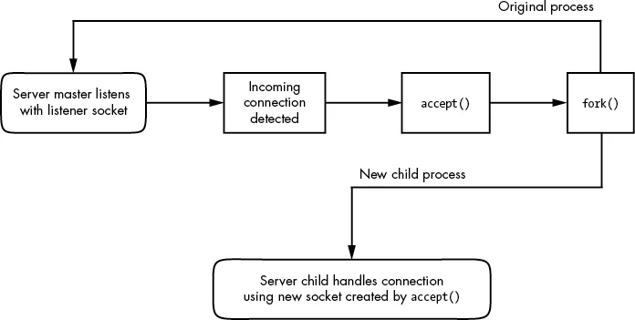

*图 10-1：接受并处理传入连接的一种方法*

请注意，这种服务器涉及两类套接字：一种用于监听，另一种用于读写。主进程通过监听套接字等待来自网络的连接。当新连接到来时，主进程使用 `accept()` 系统调用接受连接，从而创建一个专门服务于该连接的读写套接字。随后，主进程调用 `fork()` 创建新的子进程来处理该连接。原来的套接字则继续作为监听套接字，由主进程使用它等待后续连接。

进程建立某种类型的套接字后，就可以按照适合该类型的方式与其交互。这正是套接字具有灵活性的原因：如果需要更换底层传输层，通常不必重写所有发送和接收数据的代码，主要修改初始化代码即可。

如果你是程序员，想学习如何使用套接字接口，W. Richard Stevens、Bill Fenner 和 Andrew M. Rudoff 合著的 *Unix Network Programming, Volume 1* 第 3 版（Addison-Wesley Professional，2003）是一部经典指南。该书第 2 卷还介绍了进程间通信。

### 10.10 Unix 域套接字

使用网络功能的应用程序并不一定需要涉及两台不同的主机。许多应用程序采用客户端—服务器或对等通信机制：同一台计算机上运行的进程通过进程间通信来协商需要完成哪些工作，以及由谁来完成。例如，回想一下，systemd 和 NetworkManager 等守护进程会使用 D-Bus 监控系统事件并作出响应。

进程可以通过 localhost（127.0.0.1 或 ::1）上的普通 IP 网络相互通信，但通常也可以使用一种特殊的套接字作为替代方案，称为 *Unix 域套接字（Unix domain socket）*。当进程连接 Unix 域套接字时，其行为几乎与使用网络套接字完全相同：进程可以监听套接字并接受连接，甚至可以选择不同的套接字类型，使其行为类似于 TCP 或 UDP。

> 请记住，Unix 域套接字并不是网络套接字，其背后并不存在网络。使用它甚至不需要配置网络。此外，Unix 域套接字不一定必须绑定到套接字文件。进程可以创建一个未命名的 Unix 域套接字，并将其地址共享给另一个进程。

开发者喜欢使用 Unix 域套接字进行 IPC，主要有两个原因。首先，它允许使用文件系统中的特殊套接字文件来控制访问权限，因此没有权限访问该套接字文件的进程就无法使用它。由于不涉及网络交互，这种方式也更加简单，受到常规网络入侵的风险更低。例如，通常可以在 */var/run/dbus* 中找到 D-Bus 的套接字文件：

```bash
$ ls -l /var/run/dbus/system_bus_socket
srwxrwxrwx 1 root root 0 Nov  9 08:52 /var/run/dbus/system_bus_socket
```

其次，Linux 内核处理 Unix 域套接字时，无须经过网络子系统中的诸多层次，因此性能通常要好得多。

为 Unix 域套接字编写代码与支持普通网络套接字并没有太大区别。由于它的优势可能相当显著，一些网络服务器同时支持通过网络套接字和 Unix 域套接字通信。例如，MySQL 数据库服务器 mysqld 可以接受来自远程主机的客户端连接，但通常也会在 */var/run/mysqld/mysqld.sock* 提供一个 Unix 域套接字。

可以使用 `lsof -U` 查看系统当前正在使用的 Unix 域套接字列表：

```bash
# lsof -U
COMMAND     PID       USER   FD   TYPE     DEVICE SIZE/OFF     NODE NAME
mysqld    19701      mysql   12u  unix 0xe4defcc0      0t0 35201227 /var/run/mysqld/mysqld.sock
chromium- 26534      juser    5u  unix 0xeeac9b00      0t0 42445141 socket
tlsmgr    30480    postfix    5u  unix 0xc3384240      0t0 17009106 socket
tlsmgr    30480    postfix    6u  unix 0xe20161c0      0t0    10965 private/tlsmgr
--snip--
```

这个列表可能非常长，因为许多应用程序大量使用未命名的套接字。在输出的 `NAME` 列中，这类套接字会显示为 `socket`。

---


## 第 11 章：Shell 脚本入门

只要你能在 shell 中输入命令，就能编写 shell 脚本。*Shell 脚本*（也称为 *Bourne shell 脚本*）是写在文件中的一系列命令；shell 从文件中读取这些命令，就像你在终端中逐条输入一样。

### 11.1 Shell 脚本基础

Bourne shell 脚本通常以下面这一行开头，表示应由 `/bin/sh` 程序执行脚本文件中的命令。（务必确保脚本文件开头没有空白字符。）

```bash
#!/bin/sh
```

其中的 `#!` 称为 *shebang*（解释器指示符）；本书其他脚本中也会出现它。在 `#!/bin/sh` 后面，你可以列出任何希望 shell 执行的命令。例如：

```bash
#!/bin/sh
# Print something, then run ls

echo About to run the ls command.
ls
```

> 除脚本开头的 shebang 之外，行首的 `#` 表示注释；也就是说，shell 会忽略该行中 `#` 后面的所有内容。你可以用注释解释脚本中别人可能难以理解的部分，也可以提醒日后回头查看代码的自己。

与 Unix 系统上的其他程序一样，shell 脚本文件需要设置可执行权限；不过，为了让 shell 能读取文件，还必须设置读取权限。最简单的做法如下：

```bash
$ chmod +rx script
```

这条 `chmod` 命令也允许其他用户读取并执行 `script`。如果你不希望这样，可以改用绝对权限模式 `700`（有关权限的复习，请参见 2.17 节）。

创建 shell 脚本并设置读取、执行权限后，你可以将脚本放到命令搜索路径中的某个目录，再在命令行中输入脚本名称来运行它。如果脚本位于当前工作目录，也可以使用 `./script`，或者直接指定完整路径。

执行带有 shebang 的脚本，几乎（但并不完全）等同于通过 shell 执行命令。例如，运行名为 `myscript` 的脚本时，内核会启动 `/bin/sh myscript`。

了解这些基础知识后，我们来看看 shell 脚本有哪些局限。

> Shebang 并不一定是 `#!/bin/sh`；只要系统上的程序能够接受脚本输入，就可以用它作为解释器，例如用 `#!/usr/bin/python` 执行 Python 程序。此外，你可能会看到包含 `/usr/bin/env` 的另一种写法，例如脚本第一行是 `#!/usr/bin/env python`。这会让 `env` 工具运行 `python`。原因很简单：`env` 会在当前命令搜索路径中寻找要执行的程序，因此不需要把可执行文件固定在某个标准位置。缺点是，搜索路径中第一个匹配的可执行文件可能并不是你想用的那个。

#### 11.1.1 Shell 脚本的局限

Bourne shell 可以比较轻松地处理命令和文件。在 2.14 节中，你已经了解 shell 如何重定向输出；这是 shell 脚本编程的重要组成部分。不过，shell 脚本只是 Unix 编程工具中的一种。虽然脚本功能很强，但也有局限。

Shell 脚本的一项主要优势，是简化并自动完成那些原本需要在 shell 提示符下手动执行的任务，例如批量处理文件。但是，如果你需要拆解字符串、反复进行算术运算、访问复杂数据库，或者需要函数与复杂的控制结构，那么 Python、Perl、`awk` 等脚本语言，甚至 C 这样的编译型语言，通常更合适。（这一点很重要，因此本章还会多次提到。）

最后，要留意 shell 脚本的规模。尽量让脚本保持简短。Bourne shell 脚本并不适合写得很庞大，尽管你以后肯定会遇到一些庞然大物。

### 11.2 引号与字面量

在使用 shell 和编写脚本时，最令人困惑的事情之一，就是判断何时以及为何要使用引号和其他标点符号。假设你想输出字符串 `$100`，于是输入：

```bash
$ echo $100
00
```

为什么输出的是 `00`？因为 `$1` 带有 `$` 前缀，shell 会将其解释为 shell 变量（稍后会介绍这些变量）。你可能认为，用双引号括起来就能让 shell 不再处理 `$1`：

```bash
$ echo "$100"
00
```

结果还是不对。你向朋友请教，对方告诉你应该改用单引号：

```bash
$ echo '$100'
$100
```

为什么偏偏这种写法有效呢？

#### 11.2.1 字面量

使用引号时，你通常是想构造一个*字面量*：在将字符串传给命令之前，不允许 shell 分析（或试图改变）它。除了刚才例子中的 `$`，常见情况还包括：你想把 `*` 字符传给 `grep` 等命令，而不希望 shell 将其展开；或者需要在命令中使用分号（`;`）。

编写脚本或使用命令行时，请记住 shell 执行命令的过程：

1. 执行命令之前，shell 会查找变量、通配符模式及其他替换表达式，并在发现它们时进行替换。
2. shell 将替换结果传递给命令。

字面量相关的问题可能非常隐蔽。假设你要在 */etc/passwd* 中查找匹配正则表达式 `r.*t` 的条目（也就是某一行中先出现 `r`，后面又出现 `t`，因此可以搜索 `root`、`ruth`、`robot` 等用户名）。你可以运行：

```bash
$ grep r.*t /etc/passwd
```

这条命令大多数时候都能正常工作，但有时会莫名其妙地失败。为什么？答案很可能就在当前目录中。如果目录中存在 *r.input*、*r.output* 这样的文件，shell 就可能把 `r.*t` 展开为 `r.input r.output`，从而得到：

```bash
$ grep r.input r.output /etc/passwd
```

避免这类问题的关键，是先识别哪些字符可能带来麻烦，再使用正确的引号保护它们。

#### 11.2.2 单引号

创建字面量、让 shell 原样保留字符串，最简单的方法就是用单引号（`'`）括住整个字符串。例如，在前面的 `grep` 和 `*` 示例中：

```bash
$ grep 'r.*t' /etc/passwd
```

对 shell 来说，一对单引号之间的所有字符（包括空格）都属于同一个参数。因此，下面的命令**不能**达到预期效果，因为它要求 `grep` 从标准输入中查找字符串 `r.*t /etc/passwd`（原因是传给 `grep` 的只有一个参数）：

```bash
$ grep 'r.*t /etc/passwd'
```

需要字面量时，应优先考虑单引号，因为它能保证 shell 不进行*任何*替换。因此，这通常是最简洁清晰的写法。不过，有时你需要更灵活的处理方式，这时可以使用双引号。

#### 11.2.3 双引号

双引号（`"`）与单引号类似，但有一个区别：shell 会展开双引号中的变量。运行下面的命令，再把双引号改成单引号重新运行，就能看到差异：

```bash
$ echo "There is no * in my path: $PATH"
```

请注意，shell 会替换 `$PATH`，但不会展开 `*`。

> 如果你在处理大量文本时需要使用双引号，可以考虑使用 11.9 节介绍的 here document（此处文档）。

#### 11.2.4 字面量中的单引号

在 Bourne shell 中，如果要把单引号本身作为字面字符传给命令，处理起来可能有些麻烦。一种方法是在单引号前加反斜杠：

```bash
$ echo I don\'t like contractions inside shell scripts.
```

反斜杠和单引号**必须**位于任何一对单引号之外。像 `'don\'t` 这样的字符串会导致语法错误。稍显奇怪的是，你也可以把单引号放在双引号中，如下所示（输出与上一条命令相同）：

```bash
$ echo "I don't like contractions inside shell scripts."
```

如果遇到棘手情况，需要一套通用规则来引用整个字符串，同时完全禁止替换，可以按以下步骤操作：

1. 把字符串中的每个 `'`（单引号）替换成 `'\''`（依次是单引号、反斜杠、单引号、单引号）。
2. 再用单引号括住整个字符串。

因此，像 `this isn't a forward slash: \` 这样不太好处理的字符串，可以写成：

```bash
$ echo 'this isn'\''t a forward slash: \'
```

> 值得再次强调：用引号括住字符串时，shell 会把引号中的所有内容视为同一个参数。因此，`a b c` 是三个参数，而 `a` `"b c"` 只有两个参数。


### 11.3 特殊变量

大多数 Shell 脚本都能识别命令行参数，并与它们运行的命令交互。要让脚本不再只是简单的命令列表，而成为更加灵活的 Shell 脚本程序，就需要了解如何使用 Bourne Shell 的特殊变量。这些特殊变量与第 2.8 节介绍的其他 Shell 变量类似，只不过其中某些变量的值不能修改。

> 阅读接下来的几节后，你就会明白为什么 Shell 脚本在编写过程中会出现这么多特殊字符。如果你正在阅读一个 Shell 脚本，碰到一行完全看不懂的内容，可以试着将它拆开，逐个部分分析。

#### 11.3.1 单个参数：$1、$2 等

`$1`、`$2` 以及其他以非零正整数命名的变量，保存的是脚本的位置参数，也就是*实参*。例如，假设下面这个脚本名为 *pshow*：

```bash
#!/bin/sh
echo First argument: $1
echo Third argument: $3
```

尝试按以下方式运行脚本，看看它如何输出参数：

```bash
$ ./pshow one two three
First argument: one
Third argument: three
```

Shell 内建命令 `shift` 可以与参数变量配合使用：它会移除第一个参数（`$1`），并将其余参数依次前移，使 `$2` 变成 `$1`、`$3` 变成 `$2`，以此类推。例如，假设下面的脚本名为 *shiftex*：

```bash
#!/bin/sh
echo Argument: $1
shift
echo Argument: $1
shift
echo Argument: $1
```

按以下方式运行，观察执行结果：

```bash
$ ./shiftex one two three
Argument: one
Argument: two
Argument: three
```

可以看到，`shiftex` 通过输出第一个参数、将剩余参数前移，然后重复这一过程，依次输出了三个参数。

#### 11.3.2 参数数量：$#

`$#` 变量保存传递给脚本的参数数量。在循环中使用 `shift` 逐个处理参数时，它尤其重要。当 `$#` 为 `0` 时，表示已经没有剩余参数，因此 `$1` 为空。（循环的说明见第 11.6 节。）

#### 11.3.3 所有参数：$@

`$@` 变量表示脚本的所有参数，将这些参数传递给脚本内部的某条命令时非常有用。例如，Ghostscript 命令（`gs`）通常又长又复杂。假设你希望创建一个快捷脚本，以 150 dpi 的分辨率将 PostScript 文件栅格化，并使用标准输出流，同时允许向 `gs` 传递其他选项。你可以编写下面的脚本，让它接受额外的命令行选项：

```bash
#!/bin/sh
gs -q -dBATCH -dNOPAUSE -dSAFER -sOutputFile=- -sDEVICE=pnmraw $@
```

> 如果 Shell 脚本中的某一行过长，导致难以在文本编辑器中阅读和修改，可以使用反斜杠（`\`）将其拆成多行。例如，可以将上面的脚本改写为：

```bash
#!/bin/sh
gs -q -dBATCH -dNOPAUSE -dSAFER \
   -sOutputFile=- -sDEVICE=pnmraw $@
```

#### 11.3.4 脚本名称：$0

`$0` 变量保存脚本的名称，适合用来生成诊断信息。例如，假设脚本需要报告一个无效参数，而该参数保存在 `$BADPARM` 变量中。可以使用下面这行命令输出诊断信息，使错误消息中包含脚本名称：

```
echo $0: bad option $BADPARM
```

所有诊断错误信息都应发送到标准错误。正如第 2.14.1 节所述，`2>&1` 会将标准错误重定向到标准输出。如果要写入标准错误，可以反过来使用 `1>&2`。因此，上面的示例可以写成：

```
echo $0: bad option $BADPARM 1>&2
```

#### 11.3.5 进程 ID：$$

`$$` 变量保存 Shell 的进程 ID。

#### 11.3.6 退出码：$?

`$?` 变量保存 Shell 最近执行的一条命令的退出码。理解退出码是掌握 Shell 脚本的关键，下一节将对此进行介绍。


### 11.4 退出码

Unix 程序结束运行时，会为启动它的父进程留下一个*退出码*（exit code）。它是一个数值，也称为*错误码*（error code）或*退出值*（exit value）。退出码为零（`0`）通常表示程序运行正常；如果程序发生错误，通常会以非 `0` 的数值退出。不过也有例外，下面就会看到。

Shell 将上一条命令的退出码保存在特殊变量 `$?` 中，因此可以直接在 Shell 提示符下查看：

```bash
$ ls / > /dev/null
$ echo $?
0
$ ls /asdfasdf > /dev/null
ls: /asdfasdf: No such file or directory
$ echo $?
1
```

可以看到，成功执行的命令返回 `0`，执行失败的命令返回 `1`（当然，这里假设你的系统中不存在名为 */asdfasdf* 的目录）。

如果打算使用某条命令的退出码，就**必须**在该命令执行后立即读取或保存它，因为接下来运行的命令会覆盖前一个退出码。例如，连续运行两次 `echo $?`，第二次的输出总是 `0`，因为第一次 `echo` 命令已经成功结束。

编写 Shell 代码时，可能会遇到脚本需要因错误（例如文件名无效）而终止的情况。这时可以在脚本中使用 `exit 1`，结束脚本并向运行它的父进程返回退出码 `1`。（如果脚本有多种异常退出情况，也可以分别使用不同的非零数值。）

请注意，有些程序（例如 `diff` 和 `grep`）会用非零退出码表示正常情况。例如，`grep` 找到与模式匹配的内容时返回 `0`，找不到时返回 `1`。对这些程序来说，退出码 `1` 并不代表错误，因此 `grep` 和 `diff` 在遇到真正的问题时会使用退出码 `2`。如果怀疑某个程序会使用非零退出码表示非错误情况，请查阅它的手册页。退出码的含义通常在 **EXIT VALUE** 或 **DIAGNOSTICS** 一节中说明。

### 11.5 条件语句

Bourne Shell 提供了专门的条件控制结构，包括 `if`/`then`/`else` 和 `case` 语句。例如，下面这个简单脚本使用 `if` 条件判断脚本的第一个参数是否为 `hi`：

```bash
#!/bin/sh
if [ $1 = hi ]; then
   echo 'The first argument was "hi"'
else
   echo -n 'The first argument was not "hi" -- '
   echo It was '"'$1'"'
fi
```

上述脚本中的 `if`、`then`、`else` 和 `fi` 是 Shell 关键字，其余部分都是命令。理解这个区别非常重要，因为很容易误以为条件表达式 `[ $1 = "hi" ]` 是特殊的 Shell 语法。实际上，在 Unix 系统中，`[` 本身就是一个真正的程序。所有 Unix 系统都有名为 `[` 的命令，专门用于 Shell 脚本中的条件测试。这个程序也称为 `test`；`test` 和 `[` 对应的手册页是相同的。（你很快会了解到，Shell 并不总是实际运行 `[` 程序，但现在可以先把它当作独立命令理解。）

这正是第 11.4 节所讲的退出码知识派上用场的地方。来看一下前面的脚本实际上如何工作：

1. Shell 执行 `if` 关键字后面的命令，并取得该命令的退出码。
2. 如果退出码为 `0`，Shell 就执行 `then` 关键字后面的命令，直到遇到 `else` 或 `fi` 关键字。
3. 如果退出码不为 `0`，且存在 `else` 分支，Shell 就执行 `else` 后面的命令。
4. 条件结构在 `fi` 处结束。

既然已经知道 `if` 后面的测试实际上是一条命令，再来看分号（`;`）。它只是普通的 Shell 命令结束标记；这里之所以需要它，是因为我们将 `then` 关键字放在了同一行。如果没有分号，Shell 就会把 `then` 当作参数传给 `[` 命令，通常会造成难以排查的错误。也可以把 `then` 放到下一行，从而省略分号：

```
if [ $1 = hi ]
then
   echo 'The first argument was "hi"'
fi
```

#### 11.5.1 空参数列表的变通处理方法

前面的条件表达式存在一个潜在问题，原因是一种经常被忽略的情况：用户可能不带任何参数运行脚本，因此 `$1` 可能为空。如果 `$1` 为空，测试表达式就会变成 `[ = hi ]`，而 `[` 命令会因错误而终止。可以使用以下两种常见的加引号方式之一解决这个问题：

```
if [ "$1" = hi ]; then
if [ x"$1" = x"hi" ]; then
```


#### 11.5.2 使用其他命令进行测试

除了 `[`，还有许多其他命令可以用来进行条件测试。下面是一个使用 `grep` 的例子：

```bash
#!/bin/sh
if grep -q daemon /etc/passwd; then
    echo The daemon user is in the passwd file.
else
    echo There is a big problem. daemon is not in the passwd file.
fi
```

#### 11.5.3 elif

还可以使用 `elif` 关键字，将多个 `if` 条件判断连接起来，如下所示：

```bash
#!/bin/sh
if [ "$1" = "hi" ]; then
   echo 'The first argument was "hi"'
elif [ "$2" = "bye" ]; then
   echo 'The second argument was "bye"'
else
   echo -n 'The first argument was not "hi" and the second was not "bye"-- '
   echo They were '"'$1'"' and '"'$2'"'
fi
```

请记住，控制流程只会进入第一个条件成立的分支。因此，如果使用参数 `hi bye` 运行这个脚本，只会看到确认参数 `hi` 的输出。

> 不要过度使用 `elif`，因为在很多情况下，`case` 结构（见 11.5.6 节）更为合适。

#### 11.5.4 逻辑结构

你可能偶尔会看到两种简洁的单行条件结构，分别使用 `&&`（“与”）和 `||`（“或”）语法。`&&` 的用法如下：

```
command1 && command2
```

在这里，Shell 首先运行 `command1`；如果其退出码为 `0`，Shell 就继续运行 `command2`。

`||` 的行为与之类似，但触发第二条命令的条件相反：如果 `||` 前面的命令返回非零退出码，Shell 就运行第二条命令。

`&&` 和 `||` 经常用在 `if` 测试中。无论使用哪一种结构，最终执行的那条命令的退出码都会决定 Shell 如何处理条件判断。对于 `&&`，如果第一条命令失败，Shell 就使用它的退出码作为 `if` 的判断结果；如果第一条命令成功，则使用第二条命令的退出码。对于 `||`，如果第一条命令成功，Shell 就使用它的退出码；否则使用第二条命令的退出码。

例如：

```bash
#!/bin/sh
if [ "$1" = hi ] || [ "$1" = bye ]; then
    echo 'The first argument was "'$1'"'
fi
```

如果条件判断使用了测试命令（`[`），如上例所示，也可以用 `-a` 和 `-o` 代替 `&&` 和 `||`。例如：

```bash
#!/bin/sh
if [ "$1" = hi  -o "$1" = bye ]; then
   echo 'The first argument was "'$1'"'
fi
```

在测试条件前放置 `!` 运算符，可以将测试结果取反（逻辑非）。例如：

```bash
#!/bin/sh
if [ ! "$1" = hi  ]; then
   echo 'The first argument was not hi'
fi
```

在这个字符串比较的例子中，你也可能看到使用 `!=` 作为替代写法。不过，`!` 可以用于下一节介绍的任何条件测试。

#### 11.5.5 测试条件

你已经了解了 `[` 的工作方式：测试成立时，退出码为 `0`；测试失败时，退出码为非零值。你也知道可以通过 `[` `str1` `=` `str2` `]` 测试两个字符串是否相等。不过，请记住，Shell 脚本特别适合对整个文件进行操作，因为许多有用的 `[` 测试都涉及文件属性。例如，下面这一行检查 `file` 是否为普通文件（而不是目录或特殊文件）：

```
[ -f file ]
```

在脚本中，你可能会在下面这样的循环中看到 `-f` 测试。这个循环检查当前工作目录中的所有项目（关于循环的更多内容，见 11.6 节）：

```
for filename in *; do
    if [ -f $filename ]; then
        ls -l $filename
        file $filename
    else
        echo $filename is not a regular file.
    fi
done
```

> 由于 `test` 命令在脚本中使用得非常广泛，许多 Bourne Shell 的实现（包括 `bash`）都将其作为内建命令。这可以提高脚本执行速度，因为 Shell 不必为每次测试都运行一个单独的命令。

测试操作有几十种，大体可以分为三类：文件测试、字符串测试和算术测试。`info` 手册提供了完整的在线文档，而 `test(1)` 手册页适合快速查阅。以下几节概述主要的测试操作（省略了一些不太常用的操作）。

##### 文件测试

大多数文件测试（例如 `-f`）都称为*一元*操作，因为它们只需要一个参数，即待测试的文件。例如，下面是两个重要的文件测试：

1. `-e`：如果文件存在，则返回真。
2. `-s`：如果文件非空，则返回真。

有些操作用于检查文件类型，也就是判断一个对象是普通文件、目录，还是某种特殊设备，见[表 11-1](#table11-1)。另外，还有一些一元操作用于检查文件权限，见[表 11-2](#table11-2)。（有关权限的概述，请参阅 2.17 节。）

**表 11-1：文件类型运算符**

| 运算符 | 检查对象 |
| --- | --- |
| `-f` | 普通文件 |
| `-d` | 目录 |
| `-h` | 符号链接 |
| `-b` | 块设备 |
| `-c` | 字符设备 |
| `-p` | 命名管道 |
| `-S` | 套接字 |

> 当 `test` 命令用于符号链接时，除了 `-h` 测试以外，检查的都是链接指向的实际对象，而不是链接本身。也就是说，如果 `link` 是指向普通文件的符号链接，那么 `[ -f link ]` 的结果为真（退出码为 `0`）。

**表 11-2：文件权限运算符**

| 运算符 | 权限或属性 |
| --- | --- |
| `-r` | 可读 |
| `-w` | 可写 |
| `-x` | 可执行 |
| `-u` | 设置了 setuid 位 |
| `-g` | 设置了 setgid 位 |
| `-k` | 设置了“粘滞位”（sticky bit） |

最后，文件测试中还有三个*二元*运算符（需要两个文件作为参数），不过它们并不十分常用。考虑下面这条使用 `-nt`（“比……新”）的命令：

```
[ file1 -nt file2 ]
```

如果 `file1` 的修改时间晚于 `file2`，测试就返回真。`-ot`（“比……旧”）运算符的作用正好相反。如果需要检测两个硬链接是否指向同一个文件，可以使用 `-ef`：当两个文件具有相同的 inode 编号和设备标识时，它返回真。

##### 字符串测试

你已经见过二元字符串运算符 `=`：当两个操作数相等时，它返回真；而 `!=` 在两个操作数不相等时返回真。此外，还有两个一元字符串操作：

1. `-z`：如果参数是空字符串，则返回真（`[ -z "" ]` 返回 `0`）。
2. `-n`：如果参数不是空字符串，则返回真（`[ -n "" ]` 返回 `1`）。

##### 算术测试

请注意，等号（`=`）检查的是*字符串*相等，而不是*数值*相等。因此，`[ 1 = 1 ]` 返回 `0`（真），但 `[ 01 = 1 ]` 返回假。处理数字时，应使用 `-eq` 而不是等号：`[ 01 -eq 1 ]` 返回真。[表 11-3](#table11-3) 列出了所有数值比较运算符。

**表 11-3：算术比较运算符**

| 运算符 | 第一个参数与第二个参数满足以下关系时返回真 |
| --- | --- |
| `-eq` | 等于 |
| `-ne` | 不等于 |
| `-lt` | 小于 |
| `-gt` | 大于 |
| `-le` | 小于或等于 |
| `-ge` | 大于或等于 |


#### 11.5.6 case

`case` 关键字构成了另一种条件结构，特别适合用于字符串匹配。它不会执行测试命令，因此也不会检查退出码。不过，它可以进行模式匹配。下面这个例子基本展示了它的用法：

```bash
#!/bin/sh
case $1 in
    bye)
        echo Fine, bye.
        ;;
    hi|hello)
        echo Nice to see you.
        ;;
    what*)
        echo Whatever.
        ;;
    *)
        echo 'Huh?'
        ;;
esac
```

Shell 按以下步骤执行这段代码：

1. 脚本将 `$1` 与各个以 `)` 字符结尾的 `case` 匹配项逐一比较。
2. 如果某个匹配项与 `$1` 相符，Shell 就执行该项下方的命令，直到遇到 `;;`；随后跳转到 `esac` 关键字。
3. 条件结构在 `esac` 处结束。

每个 `case` 匹配项既可以是单个字符串（例如上例中的 `bye`），也可以用 `|` 指定多个字符串（当 `$1` 等于 `hi` 或 `hello` 时，`hi|hello` 就会匹配），还可以使用 `*` 或 `?` 通配模式（例如 `what*`）。如果需要一个默认分支，用来匹配前面指定的所有匹配项之外的任何值，只需使用单独的 `*`，就像上例中的最后一个分支那样。

> 
>
> 每个 `case` 分支都应以两个分号（`;;`）结束，以避免可能出现的语法错误。

### 11.6 循环

Bourne Shell 中有两种循环：`for` 循环和 `while` 循环。

#### 11.6.1 for 循环

`for` 循环（即“逐项遍历”循环）最为常见。下面是一个例子：

```bash
#!/bin/sh
for str in one two three four; do
    echo $str
done
```

在这段代码中，`for`、`in`、`do` 和 `done` 都是 Shell 关键字。Shell 会执行以下操作：

1. 将变量 `str` 设为 `in` 关键字后面四个以空格分隔的值中的第一个（`one`）。
2. 执行 `do` 与 `done` 之间的 `echo` 命令。
3. 返回 `for` 所在的行，将 `str` 设为下一个值（`two`），再次执行 `do` 与 `done` 之间的命令；如此重复，直到遍历完 `in` 后面的所有值。

该脚本的输出如下：

```
one
two
three
four
```

#### 11.6.2 while 循环

与 `if` 条件语句一样，Bourne Shell 的 `while` 循环也使用退出码进行判断。例如，下面的脚本会循环 10 次：

```bash
#!/bin/sh
FILE=/tmp/whiletest.$$;
echo firstline > $FILE

while tail -10 $FILE | grep -q firstline; do
    # add lines to $FILE until tail -10 $FILE no longer prints "firstline"
    echo -n Number of lines in $FILE:' '
    wc -l $FILE | awk '{print $1}'
    echo newline >> $FILE
done

rm -f $FILE
```

这里，判断条件是 `grep -q firstline` 的退出码。一旦该退出码不为零，循环就会退出。在这个例子中，这意味着字符串 `firstline` 已不再出现在 `$FILE` 的最后 10 行中。

可以使用 `break` 语句退出 `while` 循环。Bourne Shell 还提供了 `until` 循环，它与 `while` 的工作方式相同，区别在于：`until` 遇到退出码为零时结束循环，而 `while` 遇到非零退出码时结束循环。

不过，你应该不需要经常使用 `while` 和 `until` 循环。事实上，如果你发现自己需要使用 `while`，那么可能应该改用更适合这项任务的语言，例如 Python 或 `awk`。


### 11.7 命令替换

Bourne Shell 可以将某条命令的标准输出重新引入 Shell 自身的命令行。也就是说，你可以把一条命令的输出作为另一条命令的参数；也可以把命令放在 `$()` 中，将其输出保存到 Shell 变量里。

下面的示例将命令输出保存到 `FLAGS` 变量中。第二行的命令替换是这里的关键。

```bash
#!/bin/sh
FLAGS=$(grep ^flags /proc/cpuinfo | sed 's/.*://' | head -1)
echo Your processor supports:
for f in $FLAGS; do
    case $f in
        fpu)    MSG="floating point unit"
                ;;
        3dnow)  MSG="3DNOW graphics extensions"
                ;;
        mtrr)   MSG="memory type range register"
                ;;
        *)      MSG="unknown"
                ;;
    esac
    echo $f: $MSG
done
```

这个示例略显复杂，因为它还展示了如何在命令替换中同时使用单引号和管道。`grep` 命令的结果被传递给 `sed`（关于 `sed` 的更多内容见 11.10.3 节），后者删除与表达式 `.*:` 匹配的内容；随后，`sed` 的输出又被传递给 `head`。

命令替换很容易被过度使用。例如，不要在脚本中使用 `$(ls)`，因为让 Shell 直接展开 `*` 更快。另外，如果你想对 `find` 命令找到的多个文件名逐一执行命令，应考虑将结果通过管道传递给 `xargs`，而不是使用命令替换；也可以使用 `find` 的 `-exec` 选项（这两种方法都将在 11.10.4 节讨论）。

> 命令替换的传统语法是使用反引号（`` ` ``）将命令括起来，你会在许多 Shell 脚本中看到这种写法。`$()` 是较新的形式，但它已经是 POSIX 标准，而且通常更便于人们阅读和编写。

### 11.8 临时文件管理

有时，你需要创建一个临时文件，收集某条命令的输出，供后续命令使用。创建这样的文件时，务必确保文件名足够独特，以免其他程序意外写入同一个文件。有时候，只需在文件名中使用 Shell 的进程 ID（`$$`）就可以了；但如果必须确保不会发生命名冲突，`mktemp` 这样的工具通常是更好的选择。

下面演示如何使用 `mktemp` 创建临时文件名。这个脚本可以显示最近两秒内发生的设备中断变化：

```bash
#!/bin/sh
TMPFILE1=$(mktemp /tmp/im1.XXXXXX)
TMPFILE2=$(mktemp /tmp/im2.XXXXXX)

cat /proc/interrupts > $TMPFILE1
sleep 2
cat /proc/interrupts > $TMPFILE2
diff $TMPFILE1 $TMPFILE2
rm -f $TMPFILE1 $TMPFILE2
```

传给 `mktemp` 的参数是一个模板。`mktemp` 会将其中的 `XXXXXX` 替换为一组唯一的字符，并创建以该名称命名的空文件。请注意，这个脚本使用变量保存文件名，因此如果想修改文件名，只需要改动一处。

> 并非所有 Unix 系统都自带 `mktemp`。如果遇到可移植性问题，最好为你的操作系统安装 GNU coreutils 软件包。

使用临时文件的脚本有一个常见问题：如果脚本中途终止，临时文件可能会遗留在磁盘上。在上面的示例中，如果在第二条 `cat` 命令执行之前按下 Ctrl-C，就会有临时文件留在 */tmp* 中。应尽可能避免这种情况。可以使用 `trap` 命令创建信号处理程序，捕获 Ctrl-C 产生的信号并删除临时文件，例如：

```bash
#!/bin/sh
TMPFILE1=$(mktemp /tmp/im1.XXXXXX)
TMPFILE2=$(mktemp /tmp/im2.XXXXXX)
trap "rm -f $TMPFILE1 $TMPFILE2; exit 1" INT
 --snip--
```

必须在处理程序中使用 `exit` 来明确结束脚本的执行；否则，Shell 在运行信号处理程序之后仍会照常继续执行。

> `mktemp` 不一定需要参数。如果不提供参数，其模板将以 `/tmp/tmp.` 为前缀。

### 11.9 Here Document（此处文档）

假设你想输出一大段文本，或者向另一条命令提供大量文本。与其使用多条 `echo` 命令，不如使用 Shell 的 *here document*（此处文档）功能，如下面的脚本所示：

```bash
#!/bin/sh
DATE=$(date)
cat <<EOF
Date: $DATE

The output above is from the Unix date command.
It's not a very interesting command.
EOF
```

其中的关键部分用于控制此处文档。`<<EOF` 告诉 Shell：将后续各行重定向到 `<<EOF` 前面那条命令的标准输入，在这里就是 `cat`。当某一行单独出现 `EOF` 标记时，重定向便结束。实际上，标记可以是任意字符串，但要记得在此处文档的开头和结尾使用同一个标记。另外，按照惯例，标记通常全部使用大写字母。

请注意此处文档中的 Shell 变量 `$DATE`。Shell 会在此处文档中展开变量；当你需要输出包含许多变量的报告时，这一特性尤其有用。


### 11.10 重要的 Shell 脚本工具

有几个程序在 Shell 脚本中特别有用。有些工具（例如 `basename`）只有与其他程序配合使用才真正实用，因此很少出现在 Shell 脚本之外。不过，另一些工具（例如 `awk`）在命令行中也非常有用。

#### 11.10.1 basename

如果需要从文件名中去掉扩展名，或者从完整路径中去掉目录部分，可以使用 `basename` 命令。试着在命令行中运行下面的例子，看看它是如何工作的：

```bash
$ basename example.html .html
$ basename /usr/local/bin/example
```

两种情况下，`basename` 都会返回 `example`。第一条命令从 *example.html* 中去掉 *.html* 后缀；第二条命令则从完整路径中去掉目录部分。

下面的例子展示了如何在脚本中使用 `basename`，将 GIF 图像文件转换为 PNG 格式：

```bash
#!/bin/sh
for file in *.gif; do
    # exit if there are no files
    if [ ! -f $file ]; then
        exit
    fi
    b=$(basename $file .gif)
    echo Converting $b.gif to $b.png...
    giftopnm $b.gif | pnmtopng > $b.png
done
```

#### 11.10.2 awk

`awk` 并不是一个功能单一的简单命令；实际上，它是一门功能强大的编程语言。遗憾的是，如今使用 `awk` 的技艺在某种程度上已经逐渐失传，因为 Python 等更大型的语言取代了它的许多用途。

关于 `awk`，甚至有专门的著作，例如 Alfred V. Aho、Brian W. Kernighan 和 Peter J. Weinberger 合著的 *The AWK Programming Language*（Addison-Wesley，1988 年）。尽管如此，很多很多人使用 `awk` 只为了做一件事：从输入流中提取某一个字段，例如：

```bash
$ ls -l | awk '{print $5}'
```

这条命令会打印 `ls` 输出的第五个字段（文件大小），因此结果是一组文件大小的列表。

#### 11.10.3 sed

`sed`（“stream editor”，流编辑器）是一个自动文本编辑程序。它读取输入流（文件或标准输入），按照给定的表达式修改文本，然后将结果打印到标准输出。在很多方面，`sed` 与 Unix 最早的文本编辑器 `ed` 很相似。它提供了数十种操作、匹配工具和地址指定功能。与 `awk` 一样，也有整本书专门介绍 `sed`，例如 Arnold Robbins 所著、同时涵盖这两种工具的速查手册 *sed & awk Pocket Reference* 第 2 版（O’Reilly，2002 年）。

虽然 `sed` 是一个功能庞大的程序，深入分析它已超出本书范围，但理解其基本工作方式并不难。一般来说，`sed` 将一个地址和一项操作作为参数。地址指定一组文本行，操作则决定如何处理这些行。

`sed` 的一项非常常见的任务，是用某段文本替换匹配正则表达式的内容（参见 2.5.1 节），例如：

```bash
$ sed 's/exp/text/'
```

如果想将 */etc/passwd* 每一行中的第一个冒号替换为 `%`，并将结果发送到标准输出，可以这样做：

```bash
$ sed 's/:/%/' /etc/passwd
```

要替换 */etc/passwd* 中的**所有**冒号，则在操作末尾加上 `g`（global，全局）修饰符：

```bash
$ sed 's/:/%/g' /etc/passwd
```

下面这条命令按行操作：读取 */etc/passwd*，删除第 3 行到第 6 行，并将结果发送到标准输出：

```bash
$ sed 3,6d /etc/passwd
```

在这个例子中，`3,6` 是地址（一个行范围），`d` 是操作（删除）。如果省略地址，`sed` 就会对输入流中的所有行执行操作。`sed` 最常用的两种操作大概就是 `s`（查找并替换）和 `d`（删除）。

还可以使用正则表达式作为地址。下面的命令会删除所有匹配正则表达式 `exp` 的行：

```bash
$ sed '/exp/d'
```

在以上所有例子中，`sed` 都将结果写入标准输出，这也是它最常见的用法。如果没有指定文件参数，`sed` 就从标准输入读取数据；你会经常在 Shell 管道中看到这种用法。

#### 11.10.4 xargs

当你需要对数量极多的文件运行一条命令时，命令或 Shell 可能会报告：参数太多，无法全部放入参数缓冲区。可以使用 `xargs` 解决这个问题：它从标准输入流读取文件名，并以这些文件名为参数运行命令。

很多人将 `xargs` 与 `find` 搭配使用。例如，下面的命令可以帮助你确认当前目录树中所有以 *.gif* 结尾的文件是否真的是 GIF 图像：

```bash
$ find . -name '*.gif' -print | xargs file
```

这里由 `xargs` 运行 `file` 命令。不过，这种调用方式可能导致错误，甚至让系统面临安全问题，因为文件名可能包含空格和换行符。编写脚本时，应改用下面的形式，将 `find` 输出的分隔符和 `xargs` 识别参数的分隔符从换行符改为 NULL 字符：

```bash
$ find . -name '*.gif' -print0 | xargs -0 file
```

`xargs` 会启动*大量*进程，因此如果文件列表很长，不要指望它一定具有出色的性能。

如果目标文件名有可能以单个连字符（`-`）开头，你可能需要在 `xargs` 所执行的命令末尾加上两个连字符（`--`）。双连字符告诉程序：其后的参数都是文件名，而不是选项。不过要记住，并非所有程序都支持双连字符。

使用 `find` 时，除了 `xargs`，还有另一种选择：`-exec` 选项。不过，它的语法有点棘手，因为你需要提供花括号 `{}` 来代替文件名，并使用字面量 `;` 表示命令结束。下面演示如何仅使用 `find` 完成前面的任务：

```bash
$ find . -name '*.gif' -exec file {} \;
```

#### 11.10.5 expr

如果需要在 Shell 脚本中执行算术运算，可以使用 `expr` 命令（它甚至还能执行一些字符串操作）。例如，命令 `expr 1 + 2` 会打印 `3`。（运行 `expr --help` 可查看完整的操作列表。）

不过，使用 `expr` 做数学运算既笨拙又缓慢。如果你发现自己经常使用它，那么你可能应该改用 Python 之类的语言，而不是继续编写 Shell 脚本。

#### 11.10.6 exec

`exec` 是 Shell 的内建功能，它会使用 `exec` 后面指定的程序替换当前 Shell 进程。它执行的是第 1 章介绍过的 `exec()` 系统调用。这个功能旨在节省系统资源，但请记住，它不会返回：在 Shell 脚本中运行 `exec` 后，脚本以及运行该脚本的 Shell 都会消失，由新的命令取而代之。

要在 Shell 窗口中验证这一点，可以尝试运行 `exec cat`。按下 Ctrl-D 或 Ctrl-C 终止 `cat` 程序后，窗口应该会消失，因为它的子进程已经不存在了。


### 11.11 子 Shell

假设你需要稍微修改一下 Shell 的环境，却不希望这种修改永久生效。你可以利用 Shell 变量修改环境中的某个部分（例如搜索路径或当前工作目录），然后再将其恢复，但这样做比较笨拙。更简单的方法是使用*子 Shell*（subshell）：它是一个全新的 Shell 进程，可以专门用来执行一两条命令。新 Shell 会获得原始 Shell 环境的一份副本；当新 Shell 退出时，你对其 Shell 环境所做的任何修改都会消失，而原来的 Shell 则继续照常运行。

要使用子 Shell，把希望在子 Shell 中执行的命令放在圆括号内。例如，下面这行命令会在 *uglydir* 目录中执行 `uglyprogram`，而不会改变原始 Shell 的状态：

```bash
$ (cd uglydir; uglyprogram)
```

下面的例子演示如何临时向搜索路径中添加一个目录；如果永久添加这个目录，可能会引发问题：

```bash
$ (PATH=/usr/confusing:$PATH; uglyprogram)
```

使用子 Shell 对环境变量进行一次性修改是如此常见，以至于 Shell 还提供了一种内置语法，让你不必启动子 Shell：

```bash
$ PATH=/usr/confusing:$PATH uglyprogram
```

管道和后台进程也可以与子 Shell 配合使用。下面的例子使用 `tar` 将 *orig* 目录中的整个目录树打包，然后在新目录 *target* 中解包，实际上就复制了 *orig* 中的文件和文件夹。这种方法很有用，因为它能够保留所有权和权限，而且通常比 `cp -r` 等命令更快：

```bash
$ tar cf - orig | (cd target; tar xvf -)
```

> **警告：**
>
> 运行这类命令前一定要仔细检查，确认目标目录确实存在，并且与 *orig* 目录完全不同。在脚本中，可以使用 `[ -d orig -a ! orig -ef target ]` 来检查。

### 11.12 在脚本中包含其他文件

如果需要在 Shell 脚本中包含另一个文件的代码，可以使用点号（`.`）操作符。例如，下面的命令会执行 *config.sh* 文件中的命令：

```
. config.sh
```

这种包含文件的方法也叫作*载入文件*（sourcing），适用于读取变量（例如共享配置文件中的变量）以及其他类型的定义。这与执行另一个脚本并不相同：当你把脚本作为命令运行时，它会在新的 Shell 中启动；除了输出内容和退出码之外，你无法从那个 Shell 中取得其他结果。

### 11.13 读取用户输入

`read` 命令从标准输入读取一行文本，并将其保存到一个变量中。例如，下面的命令会把输入内容保存到 `$var` 中：

```bash
$ read var
```

这个 Shell 内置命令可以与本书未介绍的其他 Shell 功能结合使用。借助 `read`，你可以实现简单的交互，例如提示用户输入内容，而不是要求他们在命令行中一次列出所有参数；也可以在执行危险操作之前加入“你确定吗？”之类的确认提示。

### 11.14 何时应该（以及不应该）使用 Shell 脚本

Shell 的功能十分丰富，很难在一章之内概括它所有重要的特性。如果你有兴趣进一步了解 Shell 的其他功能，可以阅读有关 Shell 编程的书籍，例如 Stephen G. Kochan 和 Patrick Wood 合著的 *Unix Shell Programming*（第 3 版，SAMS Publishing，2003），或者 Brian W. Kernighan 和 Rob Pike 合著的 *The UNIX Programming Environment*（Prentice Hall，1984）中关于 Shell 脚本的讨论。

不过，到了某个阶段（特别是当你开始过度使用 `read` 内置命令时），就应该问问自己：是否仍在使用适合这项工作的工具？请记住 Shell 脚本最擅长的事情：操作简单的文件和命令。正如前面所说，如果你发现自己编写的脚本变得复杂难懂，尤其涉及复杂的字符串处理或算术运算，不妨考虑改用 Python、Perl 或 `awk` 等脚本语言。

---
